# BPAS theory (full course content)

Exported from the Study Hub lessons. Diagrams are omitted; every table, list and callout is kept as text.

---

## Module 1. Business & IT Alignment

**Goal:** Describe a business with Purpose, Participants, Process and Product, explain why IT must follow business goals, and see how BPM keeps processes improving.

**💡 Why it matters** Every later model answers one of four questions about a business. IT only pays off when it follows business goals, and BPM is the ongoing effort that keeps both lined up.

**🧠 Memory hook Purpose · Participants · Process · Product, then align IT and run the BPM cycle.**

#### 🗺️ Roadmap of this module

**1** Big-Picture Overview → **2** Understanding "Business Language": The Four Dimensions → **3** Business & IT Alignment → **4** Business Process Management

#### ⚡ At a glance — From purpose to improvement

Four dimensions describe any business → IT follows business goals → The BPM cycle keeps improving

#### 🔤 Exact names — know these word for word

| Name | What it does | How to tell it apart |
| --- | --- | --- |
| **Model** | Builds the As-Is models of what the business does today. | First stage; nothing is judged yet. |
| **Analyse** | Studies the As-Is models for issues and recommendations, then models the To-Be. | Judges the current state. |
| **Solve** | Turns the To-Be into IT solution requirements and solutioning models. | Specifies the system, not the business change. |
| **Innovate** | Feeds technology-driven ideas into new To-Be designs. | Last stage; looks beyond fixing existing processes. |
| **Purpose (Why?)** | Mission, vision and strategic goals — the business's North Star. | The reason the business exists. |
| **Participants (Who?)** | Every stakeholder, team, customer, system and AI agent, internal and external. | People and systems, not activities. |
| **Process (How?)** | The value-chain operations and workflows that connect participants. | The work itself. |
| **Product (What?)** | What is delivered: physical or digital goods and services, or hybrids. | The outcome the customer receives. |
| **Enterprise Alignment** | Aligns objectives, processes, information, applications and technology across the whole organisation. | Whole-organisation scope; delivered via Enterprise Architecture. |
| **Project Alignment** | Aligns the same list for one specific IT solution. | One solution; delivered via the Business Process Engineering Methodology. |
| **Discover** | Understands the current state; sets context and scope. | Deliberately shallow; not the detailed model-building. |
| **Model & Analyse** | Builds and studies the models to find issues and recommendations. | Covers the Model and Analyse chapters. |
| **Design Solution** | Designs the solution; corresponds to Solve. | Specifies requirements and blueprint. |
| **Implement Solution** | Builds and rolls out the solution. | Delivery, covered in a later course. |
| **Monitor & Optimise** | Measures and improves the running process; feeds back into the cycle. | Why the cycle never ends. |

Not a member: “Project” is not a fourth P of business language. In the As-Is/To-Be comparison table the fourth row is labelled Project (the IT solution), which is a different use of the word.

Mission, vision and business objectives sit above strategies in the strategy cascade; objectives are the measurable, time-bound level.

#### 1.1 Big-Picture Overview

The course follows one story arc:

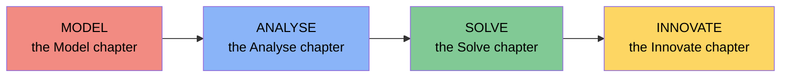

Read the arc as four chapters: Model, Analyse, Solve and Innovate. The "Big Picture" diagram below is the most repeated idea in the course:

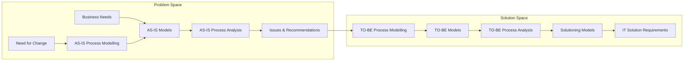

Read this diagram left to right:

- Model = build the As-Is Models (what we do today).
- **Analyse** = study those As-Is models to find **Issues & Recommendations**, then model the **To-Be** (future) state.
- Solve = turn To-Be models into concrete IT solution requirements (IT functional and non-functional requirements), expressed in the solutioning models: use case, function, architecture, risk and cost models.
- Innovate = technology-driven ideas feed new To-Be designs. The three innovation types behind it are product, process and business model innovation; enterprise-level process architecture completes the chapter.

#### 1.2 Understanding "Business Language": The Four Dimensions

Before you can model anything, you need a shared vocabulary for describing a business. The course frames every business along four dimensions:

                                   | Dimension | Question | Definition | Example |
| --- | --- | --- | --- |
| **Purpose** | Why? | Mission, vision, strategic goals — the business's "North Star" | "Lead claims processing for auto insurance" |
| **Participants** | Who? | Every stakeholder, team, customer, system, and now **AI agent**, internal and external | Sales agent, Store Keeper, AI chatbot |
| **Process** | How? | The value-chain operations and workflows that connect participants to deliver value | The order-fulfilment workflow |
| **Product** | What? | What is actually delivered to the customer: physical goods, digital goods, physical services, digital services, or hybrids | A sandwich, an insurance policy, a mobile app |

Why this matters: almost every model you'll build in this course is really just a detailed answer to one of these four questions, applied to one specific process. Keep this table in your head.

**Purpose = "Why / Value" and the North Star.** Purpose is the reason a business exists: to create value. You unite the whole organisation by finding a single *North Star Metric* that measures that value. The course name the idea but give no worked metric, so treat it as vocabulary: the dimension the later *performance goals* are traced back to.

#### 1.3 Business & IT Alignment

**The core question:** are business goals actually driving technology decisions, and do IT capabilities enable business innovation? The course frames misalignment as a symptom of five specific failures — memorize these as *diagnostic* questions, not vague platitudes:

                             | Alignment Question | What goes wrong without it |
| --- | --- |
| Are business goals driving technology decisions? | Wasted IT investment, missed opportunities |
| Do IT capabilities enable business innovation? | IT becomes a bottleneck, not an enabler |
| Is there shared accountability for outcomes? | Siloed thinking, finger-pointing on failed projects |
| Are communication channels effective between teams? | Requirements gaps, unrealistic expectations |
| Is technology strategy integrated with business strategy? | Conflicting priorities, duplicated effort |

**Root causes of misalignment:**

1. Lack of appreciation of business processes *by* IT.
2. Lack of appreciation of IT value *by* the business.
3. Lack of a common language between IT and business.
4. Growing business and a changing environment (alignment isn't a one-time fix).

**Steps toward alignment:**

1. Recognise IT as a *transformative* tool, not just a cost centre.
2. Use IT to target customers both internally and externally.
3. Get IT and business staff to "talk to each other" in mutually comprehensible language.
4. Define clear, coherent goals/objectives for the IT department.
5. Demand reliable, measurable ROI from IT systems.
6. Write it all down: one document enumerating both IT and business strategy.

**"IT doesn't matter" debate (Nicholas Carr):** Carr argued IT is becoming a commodity, not a source of competitive advantage. The course's counter-argument: differentiation doesn't come from *owning* IT, it comes from *how IT is combined* with strategy, processes, and organisational capability. Without Business-IT alignment, IT genuinely does become a commodity — alignment is what creates the differentiation. (And now, extend "IT" to include AI agents.)

#### Levels of Alignment

The course distinguishes two *scopes* of alignment, and one deliverable methodology for each:

                       | Level | Scope | Aligns | Delivered via |
| --- | --- | --- | --- |
| **Enterprise Alignment** | Whole organisation | Business objectives, processes, information, applications, technology — across the *entire* org | Enterprise Architecture |
| **Project Alignment** | One IT solution | The same list, but *in the context of delivering one specific solution* | Business Process Engineering Methodology |

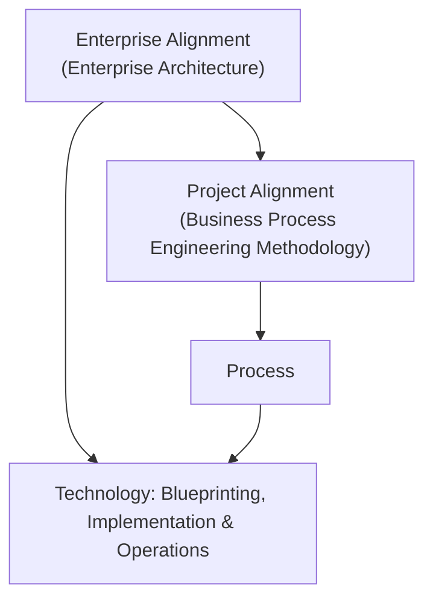

**Practical framing — "Voice of the Business" (As-Is vs To-Be):** this table is how the four dimensions from get reused later once you start comparing current vs. future state (this becomes central in Analyse):

                                   | Category | Question | As-Is | To-Be |
| --- | --- | --- | --- |
| Purpose | Why? | As-Is Mission/Vision/Business Goals | To-Be Mission/Vision/Business Goals |
| Participants | Who? | As-Is Business Participants (human or systems) | To-Be Business Participants |
| Process | How? | As-Is Business Process | To-Be Business Process |
| Project | What? | Current IT Solution | Proposed IT Solution |

#### 1.4 Business Process Management

**Definition (BABOK® Guide v3, IIBA):** BPM is a management discipline and set of enabling technologies that:

- focuses on **how** the organisation performs work to deliver value across multiple functional areas to customers/stakeholders,
- aims for a view of value delivery that **spans the entire organisation**, and
- views the organisation through a **process-centric lens**.

A BPM initiative delivers value by **improving how work is performed**. It governs how manual and automated processes are created, modified, cancelled, and governed. Process-centric organisations treat BPM as an **ongoing effort**, not a one-off project.

**The strategy cascade** (how a mission becomes a running process improvement cycle):

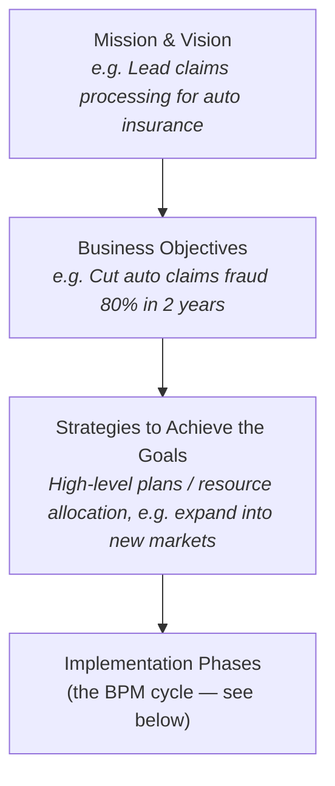

Examples given for each level of the cascade:

                     | Level | Examples (auto-insurance company) |
| --- | --- |
| Mission and Vision | "Accelerate growth in the auto insurance business"; "Lead claims processing for auto insurance business"; "Provide affordable and reliable auto insurance services" |
| Business Objectives | "Achieve 30% increase in revenue in the auto insurance business"; "Support on-line auto insurance claims processing by the end of the fiscal year"; "Cut auto claims fraud by 80% within the next two years" |
| Strategies to achieve the goals | High-level plans or approaches designed to achieve business goals and objectives; they guide resource allocation and decision-making. Example: "Expand into new geographic markets and launch a targeted marketing campaign to increase brand awareness." |

The pattern to notice: a mission/vision is *directional* and qualitative; an objective is *measurable and time-bound* (30%, 80%, "two years", "end of the fiscal year"). That measurability is what later lets a process performance goal be tested by simulation.

Mission vs vision. Both are foundational, concise, memorable statements that align employees, stakeholders and customers around the organisation's purpose, and they usually work together. They differ as follows:

                                   |  | Mission statement | Vision statement |
| --- | --- | --- |
| Time focus | Present and near future — what the company does now | Future — where the company aspires to be |
| Purpose | Current purpose, objectives and approach | Desired future state and long-term aspirations |
| Scope | Concrete and specific: what it does and whom it serves | Abstract and broad: the overall impact it hopes to have |
| Actionability | Guides day-to-day operations and decisions | Inspirational; a long-term goal to strive towards |
| Audience | Internal and external (employees, customers, stakeholders) | Mainly employees and relevant stakeholders |

**Strategy vs goal**: strategies are broad statements from high-level management; goals are **measurable, often with a time span**; you then figure out how to achieve the goals. The notes add that a business strategy weighs three elements — the company, its customers and the competition — and answers which markets and geographies to engage, which products and services to provide, the nature of competition, the major competitive differentiators, and how well the organisation can adapt to changing customer needs.

**Implementation Phases — the BPM cycle.** This is the operational engine that keeps turning as long as the organisation exists:

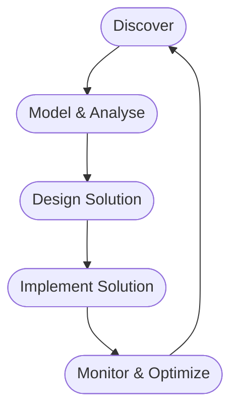

Each named phase of *this course* maps onto that cycle:

                             | BPM Cycle Phase | Course Chapter |
| --- | --- |
| Discover | (start of) Model |
| Model & Analyse | Model + Analyse |
| Design Solution | Solve |
| Implement Solution | ** Process Solution Implementation |
| Monitor & Optimise | Optimisation → BPAS; Monitoring and Change Management → covered in a later course |

**Inside "Model & Analyse"** — the two-stage structure of the Model and Analyse chapters:

the problem-space / solution-space steps that the whole Model + Analyse phase walks through.

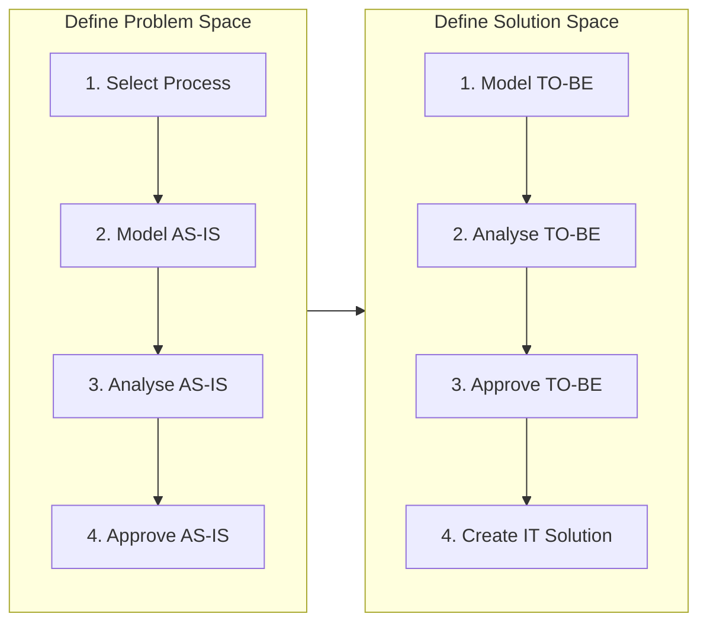

#### ✅ This module in 30 seconds

- The course runs Model → Analyse → Solve → Innovate.
- Model builds As-Is models; Analyse finds issues and designs the To-Be.
- Solve turns the To-Be into IT solution requirements.
- Innovate feeds technology and business-model ideas into the To-Be.
- Every business is described by Purpose, Participants, Process and Product.
- Alignment asks whether business goals drive technology decisions.
- Misalignment comes from poor mutual appreciation, no common language and a changing environment.
- Enterprise alignment is whole-organisation; project alignment is one solution.
- The BPM cycle repeats: Discover, Model & Analyse, Design Solution, Implement Solution, Monitor & Optimise.
- Objectives are measurable and time-bound; missions and visions are directional.

#### 🃏 Flip to recall

Say the answer out loud first, then tap the card.

Four dimensions of a business*tap to flip*

Purpose (Why), Participants (Who), Process (How), Product (What).

What does Analyse produce?*tap to flip*

Issues and recommendations from the As-Is, then the To-Be model.

North Star Metric*tap to flip*

A single metric that measures the value a business creates.

Participants include…*tap to flip*

People, teams, customers, systems and AI agents, inside and outside the business.

Enterprise vs project alignment*tap to flip*

Whole organisation via Enterprise Architecture vs one solution via the Business Process Engineering Methodology.

Mission vs vision*tap to flip*

Mission: what the company does now. Vision: where it aspires to be.

Why is Discovery shallow?*tap to flip*

It sets context and scope; deeper elicitation follows it.

Strategy vs goal*tap to flip*

Strategies are broad approaches; goals are measurable, often time-bound.

**➡ Where next?** Next: what exactly counts as a business process, and the first two models that capture it, organisation and location.

---

## Module 2. Process Modelling Part 1: Processes, Organisation & Location

**Goal:** Define a business process and its attributes, then capture the people and places around it with the organisation and location models.

**💡 Why it matters** You cannot improve what you cannot describe. A shared definition, then the people and places around the process, set up every later model.

**🧠 Memory hook Repeatable series of activities · Org = who reports to whom · Location = where.**

#### 🗺️ Roadmap of this module

**1** Discovery: Understanding the Current State → **2** What Is a Business Process? → **3** The Five (of Seven) Business Process Models → **4** Overview → **5** Organisation Model → **6** Location Model

#### ⚡ At a glance — From definition to models

A process is a repeatable series of activities → Org = who reports to whom → Location = where people are

#### 🔤 Exact names — know these word for word

| Name | What it does | How to tell it apart |
| --- | --- | --- |
| **Business process (course definition)** | A repeatable series of activities performed to deliver a service or a product to a stakeholder. | Repeatable and stakeholder-facing. |
| **Process** | Transforms inputs into outputs using resources; started by business events. | The whole: inputs to outputs, started by an event. |
| **Sub-process** | A process at a smaller scale; decomposable into further activities. | Marked with a + in BPMN. |
| **Activity** | A single logical step; the atomic unit for modelling. | Not decomposed further. |
| **Resources – Who?** | People and systems that perform the work. | Lens: who or what. |
| **Workflow – How?** | The ordered steps. | Lens: the sequence. |
| **Data – What?** | What goes in and comes out. | Lens: inputs and outputs. |
| **Organisation Model** | Roles and reporting structures; informally “People Politics”. | Who reports to whom. |
| **Location Model** | Geographic distribution of stakeholders. | Where people are. |
| **Collaboration Model** | The fourth of the seven views (not one of the five studied). | Named only; not modelled in depth. |
| **Process Package Model** | One of the seven views. | Named only. |
| **Process Workflow Model** | Sequence of activities in BPMN. | Covered in Module 3. |
| **Business Rules Model** | Rules applied when performing an activity. | Covered in Module 3. |
| **Functional Role** | An organisational title, e.g. Salesclerk. | Appears on the org chart. |
| **Process Role** | A role that exists because a process needs it, e.g. Requester. | May not appear on the org chart. |

Seven views in total: Organisation, Location, Resource, Collaboration, Process Package, Process Workflow and Business Rules. Five are studied. Collaboration and Process Package are the two not studied.

Business rules answer When?, not Why?. Why? is business strategy, objectives and KPIs.

#### 2.1 Discovery: Understanding the Current State

**What is Discovery?** Understanding the current state: *"What are we actually doing now?"* Objectives:

- Identify current processes and gather stakeholder requirements (process owners, end users, customers, SMEs).
- Assess current performance: baseline metrics/KPIs, bottlenecks, inefficiencies.
- Document process content; identify system dependencies/integrations; understand compliance requirements.

Discovery is deliberately shallow — it sets *context*. The detailed elicitation (the actual model-building covered in the rest of this module and in Module 3) is a separate, deeper step that follows it.

**Deliverables of Discovery:**

                                   | Expected Outputs | Challenges | Mitigation |
| --- | --- | --- |
| Complete list of in-scope processes | Limited stakeholder availability | Schedule in advance; offer flexible timing |
| Stakeholder roles and responsibilities | Incomplete/outdated documentation | Observe and interview instead of trusting docs |
| Current-state documentation | Complex technical integration | Engage IT early; document system interactions |
| Requirements specification | — | — |
| Baseline assessment | — | — |

**Elicitation technique — the Interview**, structured around three buckets of questions:

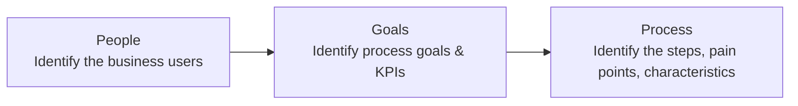

Also gather: **location information** and **organisational structure** (People bucket).

#### 2.2 What Is a Business Process?

Three definitions were given, each adding something the previous one lacked:

                         | Author/Year | Definition | What it added / what it's missing |
| --- | --- | --- |
| Pall (1987) | "The logical organisation of people, materials, energy, equipment, and procedures into work activities designed to produce a specified end result (work product)" | ✅ Introduces the *dimensions* (people, materials, etc.) ❌ No explicit mention of IT/services |
| Feiler & Humphrey (1993) | "A set of partially ordered steps intended to reach a goal" | Simple and general, but very abstract |
| **Course definition** | **"A repeatable series of activities performed to deliver a service or a product to a stakeholder"** | The working definition used throughout BPAS |

**Unpacking the course definition** — a business process:

- consists of activities, each a set of logical steps performed by **humans or systems**;
- **transforms inputs into outputs** according to guidance, using resources;
- is **initiated by one or more business events**;
- has **performance indicators (KPIs)** with measurable, evaluable objectives;
- can be described along: **How – Who – What – When – Where – Why**.

**Process vs. Sub-process vs. Activity:**

```
Process = Sub-Processes + Activities

```

- A **sub-process** is itself decomposable into further activities/sub-processes (it's a process at a smaller scale).
- An **activity** is the atomic unit — a single logical step, not further decomposed for modelling purposes.

#### Key components of a business process

Key components of a business process:

- a set of logical activities (tasks/steps) performed by human or machine;
- initiated by one or more business events;
- involves business documents (e.g., shipping notice, invoice);
- involves resources: humans and systems (applications);
- has a defined set of key performance indicators (KPIs);
- may be further divided into sub-processes and activities.

Each item is checkable against the airport diagram: the arrival at the counter is the event; Booking Confirmation, Passport, Boarding Pass and Luggage Tag are the business documents (work products); Traveler/Staff/System are the resources; the "+" on "Process booking details" marks a sub-process.

#### The six questions about a business

Asked of any business (for example, a fast-food chain), the six questions reveal:

                                        | Question | What it covers | Where it appears in the course |
| --- | --- | --- |
| **What?** | Raw materials, data, input/output, products | Work products and data |
| **How?** | Workflow, process flow, enterprise processes | Process Workflow Model |
| **Why?** | Business strategy, business objectives, KPIs | Purpose; KPIs feed performance goals |
| **When?** | Time, business rules, business events | Business events on the workflow; Business Rules Model |
| **Who?** | People and systems involved — organisation structure, organisational units, roles, people; IT infrastructure, systems, applications | Organisation Model + Resource Model |
| **Where?** | Location information; online, face-to-face; dine-in, takeaway, delivery | Location Model |

Business rules sit under When?, not Why?.

#### Three lenses of a process model

                         | Lens | Label | What it covers |
| --- | --- | --- |
| People & systems | **Resources – Who?** | Who/what performs the work |
| Instructions | **Workflow – How?** | The ordered steps |
| Input/output | **Data – What?** | What goes in and comes out |

**Business Process Models — why bother?**

- Provide a **focus** for discussing operational-improvement opportunities.
- Provide a **common framework/language** for stakeholders who don't naturally speak the same vocabulary (recall §1.3's "lack of common language" as a root cause of misalignment).
- Are a **systematic approach** to represent related information (as opposed to ad-hoc prose descriptions).

**Caution:** Modelling is **resource intensive**. Building all 5 models properly (below) is not free — it costs stakeholder time, analyst time, and tool licences. Part of your job as an analyst is choosing *which* models are actually needed for a given process, not modelling everything by default.

#### 2.3 The Five (of Seven) Business Process Models

A business process can be captured through **7 different "views"** (each view = one model): **Organisation, Location, Resource, Collaboration, Process Package, Process Workflow,** and **Business Rules**. Rule of thumb: *"you don't need to utilise all seven models — decide which model is most helpful in telling your story."*

#### 2.4 Overview

                                   | Model | Captures | Key Question It Answers |
| --- | --- | --- |
| **Organisation Model** | Roles and reporting structures | Who reports to whom? What's the org chart? |
| **Location Model** | Geographic distribution of stakeholders | Where is everyone physically located? |
| **Resource Model** | Humans and systems involved, categorised internal/external | Who/what is involved, and do we control it? |
| **Process Workflow Model** | Sequence of activities and the process flow (BPMN) | What happens, in what order, and who does it? |
| **Business Rules Model** | The rules applied when performing an activity | What logic/policy governs a decision or task? |

#### 2.5 Organisation Model

**Purpose:** represents the relationship between stakeholders **in the current organisational context** — informally known as "People Politics". It helps you:

- identify which stakeholder can supply what information;
- determine access control for an eventual IT solution;
- understand who the possible end-users are;
- anticipate the impact on org structure if a process changes.

**Building blocks:**

- **Organisation** — a legal entity that performs a business.
- **Department** — a unit of an organisation tied to related functions.
- **Role** — a logical grouping of a person's responsibilities. Two sub-types:
- **Functional Role — an organisational title**, e.g. "Salesclerk".
- **Process Role** — a role that exists *because* a process needs it, e.g. "Requester" in a Purchase Requisition process (this role may not appear anywhere on the org chart).

**Worked example — catalogue retailer:**

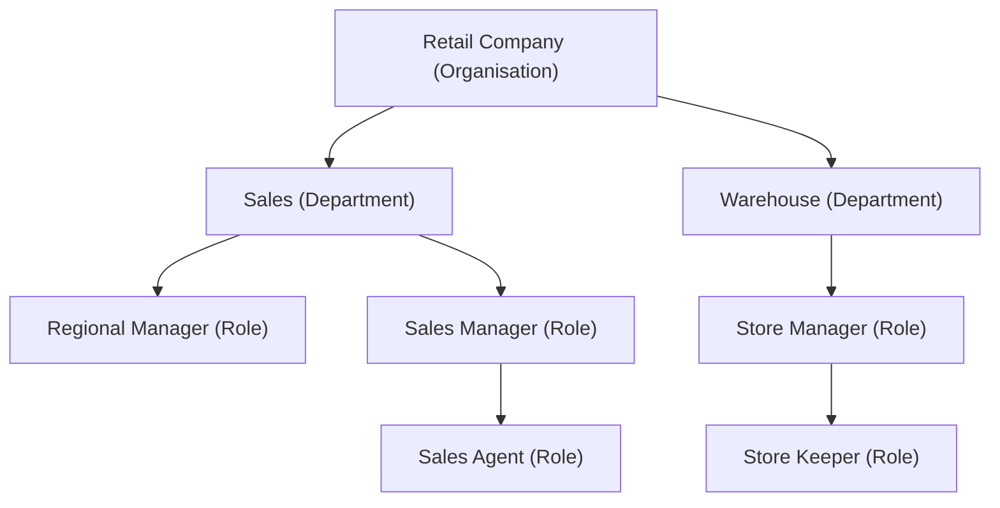

**Worked example — Expense Report scenario:**

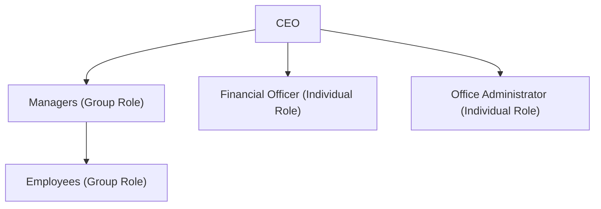

Note the distinction between Individual Role (one specific position, e.g. CEO, Financial Officer) and Group Role (a role held by many people, e.g. "Managers", "Employees").

#### 2.6 Location Model

**Purpose:** shows how stakeholders are distributed across physical locations. Helps with:

- identifying location-specific needs (e.g. language);
- input to IT solution **deployment** decisions;
- understanding organisational relationships/coordination across sites;
- awareness of **different government policies** per location;
- **cost implications** of a distributed deployment;
- **level of technology/infrastructure** available (internet access vs. leased line);
- a very concrete gotcha: **transactions spanning multiple time zones must use GMT**;
- **local culture** considerations.

**Worked example — catalogue retailer, geographic hierarchy (Region → Subregion → Office → Department):**

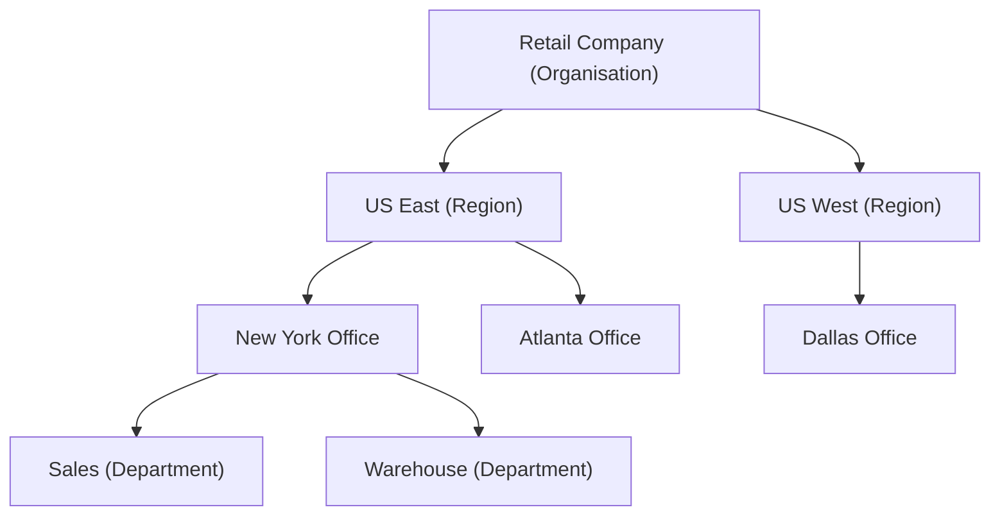

Cross-reference: Organisation Model shows the *reporting* structure; Location Model shows the *geographic* structure. The **same** departments/roles can appear in both — they're two different "views" (cuts) of the same underlying stakeholder set. This is exactly why the course calls them separate *models*: one dataset, multiple diagrams, each answering a different elicitation question.

#### ⚡ Quick examples

Activity or sub-process?

**Point** An activity is atomic; a sub-process can be broken down further.

**Example** A step marked with a + in BPMN hides its own sub-workflow.

**Explanation** The + marker means the step is a sub-process, so it is decomposable.

#### ✅ This module in 30 seconds

- A business process is a repeatable series of activities delivering a service or product to a stakeholder.
- It is started by business events and measured by KPIs.
- A sub-process can be broken down further; an activity cannot.
- The six questions: What, How, Why, When, Who, Where.
- Modelling is resource-intensive, so choose only the models you need.
- A process can be captured in seven views; choose the ones that tell your story.
- The Organisation Model shows roles and reporting lines.
- Functional roles appear on the org chart; process roles exist only because of a process.
- The Location Model shows where stakeholders are; transactions across time zones use GMT.

#### 🃏 Flip to recall

Say the answer out loud first, then tap the card.

Course definition of a business process*tap to flip*

A repeatable series of activities performed to deliver a service or a product to a stakeholder.

Activity vs sub-process*tap to flip*

An activity is atomic; a sub-process decomposes into further activities.

Where do business rules sit among the six questions?*tap to flip*

Under When?, together with time and business events.

Three lenses of a process model*tap to flip*

Resources (Who), Workflow (How), Data (What).

Functional vs process role*tap to flip*

Functional: an organisational title. Process: exists because the process needs it.

Which time standard is used for transactions across time zones?*tap to flip*

GMT.

Which two of the seven models are not studied?*tap to flip*

Collaboration and Process Package.

**➡ Where next?** Next: the resource model, the BPMN workflow, business rules and four worked processes.

---

## Module 3. Process Modelling Part 2: Resources, Workflow & Rules

**Goal:** Complete the model set with the resource model, the BPMN workflow and business rules, then practise on four worked processes.

**💡 Why it matters** The workflow is the heart of process modelling. Resources and rules complete the picture, and the four worked processes return in Analyse and Solve.

**🧠 Memory hook The lane follows who performs the activity, not which tool is touched.**

#### 🗺️ Roadmap of this module

**1** Resource Model → **2** Process Workflow Model → **3** Business Rules Model → **4** Airport Check-in Process → **5** SUBWAY Sandwich Sales Process → **6** StarMall Rental Application Process → **7** Generic Order Management Process

#### ⚡ At a glance — Resources, workflow, rules

Resource = who or what is used → Workflow = the order of activities → Rules = the logic behind them

#### 🔤 Exact names — know these word for word

| Name | What it does | How to tell it apart |
| --- | --- | --- |
| **Resource Model** | Humans and technologies, categorised internal vs external. | Who or what is used, and do you control it. |
| **Manual** | Performed by human effort, unaided by systems. | Human lane; no system involved. |
| **Interactive** | Done by a human using a system. | Still the human's lane, not the system's. |
| **Automated** | Done entirely by a system. | System lane; no human involvement. |
| **Business Event** | Start or end that triggers or concludes the process (circle). | Drawn as a circle; starts or ends the process. |
| **Decision Point (gateway)** | Process branches on a condition (diamond). | One flow in, several labelled flows out. |
| **Merge** | Several incoming paths converge into one. | Several flows in, one out; not a decision. |
| **Parallel Activities** | Branches run simultaneously (diamond with plus). | AND, not exclusive. |
| **Swimlane** | Groups the activities of one Business Participant. | A horizontal band named after the performer. |
| **Transition** | Sequence flow between elements. | A solid arrow between elements. |
| **Work product / Association** | Document or data object linked to an activity. | A dashed arrow to a document or data object. |
| **Timer** | A waiting period that can drive a loop. | A clock icon; a wait that can drive a loop. |
| **Airport check-in** | Lanes: Traveler, Check-in Staff, Check-in System. | Linear flow, no decisions; a + marks a sub-process. |
| **SUBWAY sandwich sales** | Lanes: Bread Artist, Veggie Artist, Cashier. | 8 activities, 3 lanes, 2 decisions, 4 diamonds. |
| **StarMall rental application (As-Is)** | Lanes: Customer Service Officer (CSO), Office Dispatcher (OD), Marketing Officer (MO). | Branch probabilities 75/25, then 90/10. |
| **Generic order management** | Lanes: Customer, Sales Agent, Sales System, Store Keeper. | Shows nearly every notation element. |

Rule-set template fields, in order: Name · Activity Using this Rule Set · Description · Rule Set · Related Rule Set. Annotations on a reviewed diagram: process trigger, association, usage of systems, execution time, probability.

In the airport example the work products are Booking Confirmation, Passport, Boarding Pass and Luggage Tag.

#### 3.1 Resource Model

**Purpose:** captures the **humans and technologies** involved in a process, categorised along two axes: **internal vs. external**, and (implicitly) **human vs. technology**. Visually the course draws this as a "bowl"/iceberg shape — everything above the waterline is external, below is internal; left of centre is human, right is technology.

**Worked example — SUBWAY Sandwich Sales Process:**

                    |  | Internal | External |
| --- | --- | --- |
| **Human** | Bread Artist, Veggie Artist, Cashier | Customer |
| **Technology** | Billing System | — |

**Worked example — StarMall Rental Application Process:**

                    |  | Internal | External |
| --- | --- | --- |
| **Human** | CSO (Customer Service Officer), OD (Office Dispatcher), MO (Marketing Officer), LM (Leasing Manager) | Customers |
| **Technology** | IMS (Industrial space Management System) | Government UEN website |

**Worked example — Expense Report Process:**

                    |  | Internal | External |
| --- | --- | --- |
| **Human** | Employee, Manager, Office Administrator, Financial Officer | — |
| **Technology** | — | Workday Cloud System, Bank System |

A resource only belongs in the model if it **participates in the process** — a system the company owns but which this specific process never touches doesn't belong here. Notice Workday Cloud System is classed *external* even though the company pays for it: internal/external in this model tracks who **controls/operates** the resource, not who uses it.

**"You manage":** the light-blue bowl in the resource-model diagram is labelled *You manage*, and the vertical axis is labelled *Resource Type*. That is the mnemonic for internal vs external: internal = the resources *you* manage; external = the ones you do not, however much you depend on them.

#### 3.2 Process Workflow Model

This is the model most people think of when they hear "business process diagram" — the flowchart-with-swimlanes.

**Business Participant** — who can appear in a workflow:

- **Roles** (supervisor, manager),
- **Departments** (finance, sales),
- **Systems** (service-centre system, order-entry system, AI Chatbot).

A participant is only given a **swimlane** if they *actually perform an activity* in this specific process — being a stakeholder isn't enough.

**Activity types — the automation spectrum** (this taxonomy is tested and reused constantly):

                             | Type | Definition | Example | Swimlane placement |
| --- | --- | --- | --- |
| **Manual** | Performed by human effort, unaided by systems | "Pack Goods" | The human/role's lane |
| **Interactive** | Done by a human *using* a system | "Enter Order" | The human/role's lane (not the system's!) |
| **Automated** | Done entirely by a system, no human involvement | "Retrieve Orders" | The system's lane |

**Common mistake:** putting an *interactive* activity in the system's swimlane because "a system is involved." The rule is about **who performs the activity**, not what tools they touch — a human entering data into a system is still the human's action, so it stays in the human's lane.

**Why the three types matter later:** in Solve the activity type decides whether an activity becomes a use case at all — manual → none, interactive → one use case for the human actor, automated between two systems → a client/server pair. The same split reappears in Innovate as BPMN user, script and service tasks for IoT.

#### BPMN Notation Legend

Use this legend to read any diagram in the course:

                                                         | Symbol | Meaning |
| --- | --- |
| ⭕ (circle) | **Business Event** — a start or end event that triggers/concludes the process |
| ◇ (diamond) | **Decision Point** (a.k.a. gateway) — the process branches based on a condition |
| ▭ (rounded rectangle) | **Activity** — a task performed by a participant |
| Horizontal band | **Swimlane** — groups all activities performed by one Business Participant |
| Solid arrow | **Transition** — sequence flow from one element to the next |
| Dashed/dotted arrow | **Work product / Association** — a document or data object linked to an activity (e.g. "Sales Order", "Passport") |
| ⬡ (small diamond, unlabelled) | **Merge** — multiple incoming paths converge back into one |
| ⭕ with arrow looping back | **Loop** — an activity or sequence repeats |
| ➕ (diamond with plus) | **Parallel Activities** (AND-split/join) — branches execute simultaneously, not exclusively |
| Small clock icon on a flow ("Wait for a day") | **Timer** — a waiting period that drives a loop (used in the Order Management example) |
| Vertical label at the left of a band | **Business Participant** — the owner of that swimlane |
| ✖ inside a diamond | Exclusive-gateway marker. In the course both a **decision point** (one flow in, several labelled flows out) and a **merge** (several flows in, one out) are drawn this way, so tell them apart by counting flows, not by the shape |

A **Flow Diagram** (as opposed to formal BPMN) is explicitly called out as **"a broad, non-standardised term referring to any diagram that visually represents flow through a system"** — i.e., simpler box-and-arrow charts without lanes are a looser, non-standard notation, still useful for quick communication but not equivalent to a proper BPMN swimlane diagram.

#### Reading an annotated real-world diagram (from the StarMall Signavio screenshot)

When you open an actual modelling tool (Signavio/Camunda/bpmn.io) on a finished diagram, these are the elements analysts specifically call out when reviewing it:

- **Process trigger** — the start event (what kicks the process off, e.g. "Customer walk-in").
- **Association** — the dotted line connecting an activity to a work product/document/system it uses.
- **Usage of systems** — the small computer icon attached to a lane/activity showing which IT system is used.
- **Execution time** — a number annotated on/near an activity indicating how long it takes (this feeds directly into Analyse**'s simulation/timing work).
- **Probability** — a percentage on a gateway's outgoing paths (e.g. "75% eligible / 25% not eligible") showing how often each branch is taken — also feeds forward into process simulation later in the course.

#### 3.3 Business Rules Model

**Purpose:** captures the business rules applicable to activities in the Process Workflow Model.

- Expressed in **plain English** (or another natural language) — not pseudocode, not a formal grammar.
- Heavy use of **business domain vocabulary**.
- **Both** manual and automated activities may require documented business rules.

**Structure:** `IF <condition(s)> THEN <consequence>`, chained with AND/OR, sometimes with an `ELSE`.

**Worked examples:**

```
IF a customer has a gold account
THEN discount is 20%

IF a customer has a gold account
THEN issue a gold credit card
ELSE issue a standard credit card

IF total miles earned is > 10,000
THEN change status from blue to silver

IF loan type is first mortgage
THEN occupancy status must be principal residence

IF borrower is student
THEN maximum number of books allowed is 10

IF travel is to overseas destination
THEN approval from Project Manager is required

```

The course's second column is an insurance-claim rule set:

```
If Claimant is an employee
AND injury occurred on premise
AND there is medical necessity
AND procedure is covered
THEN adjust amount billed

If Claimant is an employee
AND injury occurred off-premise
THEN reject claim

If Claimant is not an employee
THEN reject claim

```

**Common mistake:** Students often assume business rules attach to **decision gateways** (the diamonds). Business rules are used** in activities, not decision gateways.** The gateway just shows that a branch exists; the rule governing *how* that branch is decided lives with the activity that evaluates it (e.g. a "Determine Credit Worthiness" activity, not the diamond after it).

#### A rule *set* as a document — "Deciding Credit Worthiness"

Individual IF/THEN lines are grouped into a **rule set** attached to *one* activity. The course gives a template with five fields: **Name**, **Activity Using this Rule Set**, **Description**, **Rule Set**, **Related Rule Set**.

                         | Field | Content on the course |
| --- | --- |
| Name | Deciding Credit Worthiness |
| Activity Using this Rule Set | Determine Credit Worthiness |
| Description | "This rule set provides guidelines in deciding credit worthiness of a customer before allowing customer to buy product" |
| Related Rule Set | None |

                                   | # (ours) | Conditions | Conclusion |
| --- | --- | --- |
| 1 | existing customer AND no debts | credit worthiness is **good** |
| 2 | existing customer AND has debts AND debts < $1000 | **good** |
| 3 | new customer AND external rating is good | **good** |
| 4 | existing customer AND has debts AND debts > $1000 | **bad** |
| 5 | new customer AND external rating is bad | **bad** |

#### 3.4 Airport Check-in Process

Three swimlanes: **Traveler**, **Check-in Staff**, **Check-in System**.

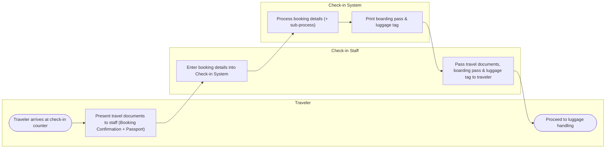

**Key components:** business participants (Traveler/Staff/System), activities, work products (Booking Confirmation, Passport, Boarding Pass, Luggage Tag), a business event (arrival), decision-free linear flow, and a sub-process marker.

**Activity types in the airport workflow**:

                                         | Activity | Lane | Type | Why |
| --- | --- | --- | --- |
| Present travel documents to the staff | Traveler | Manual | Human hands over the Booking Confirmation and Passport; no system involved |
| Enter booking details to Check-in system | Check-in Staff | Interactive | Human working *with* the Check-in System |
| Process booking details | Check-in System | Automated | System-only; the "+" marker means it hides a sub-process |
| Print boarding pass and luggage tag | Check-in System | Automated | Produces the Boarding Pass and Luggage tag work products |
| Pass travel documents, boarding pass and luggage tag to traveler | Check-in Staff | Manual | Physical hand-over |

The data the traveller must supply is visible as the two work products flowing into the first activity — Booking Confirmation and Passport.

#### 3.5 SUBWAY Sandwich Sales Process

**Process Workflow Model** (matches `SUBWAY Sandwich Sales Process.bpmn` — 3 lanes: Bread Artist, Veggie Artist, Cashier):

SUBWAY workflow with every activity in the lane of the role that performs it; branch probabilities and timings are added in.

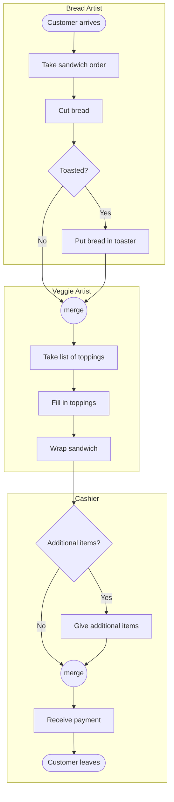

Reading it: work starts and the bread is prepared in the Bread Artist lane, hands over to the Veggie Artist through a merge (toasted or not), and finishes in the Cashier lane, where an optional extra step precedes payment. Each lane change is a **hand-off between roles** — the places where waiting appears in dynamic analysis.

**Activity-type table:**

                                                  | Step | Activity | Type |
| --- | --- | --- |
| 1 | Take sandwich order | Manual |
| 2 | Cut bread | Manual |
| 3 | Place bread in toaster | Manual |
| 4 | Take list of toppings | Manual |
| 5 | Fill in toppings | Manual |
| 6 | Wrap sandwich | Manual |
| 7 | Give additional items | Manual |
| 8 | Receive payment | **Interactive** (uses the Billing System) |

**Diagram statistics (a good sanity-check exercise for any diagram you build):** 8 activities · 3 swimlanes · 2 decision boxes · 1 start / 1 end point. *(The four diamonds are two decisions — "Toasted?", "Additional items?" — and two merges; only decisions count as "decision boxes".)*

#### 3.6 StarMall Rental Application Process

**Company context:** StarMall is Singapore's leading provider of industrial space (warehouses, flatted factories, ramp-up factories) for rental to light-industry players. The Business Process Engineering (BPE) team studies only the **Rental Application Process**.

**Process Workflow Model** — matches `Rental Application Process As-is.bpmn` exactly (3 lanes: **Customer Service Officer (CSO)**, **Office Dispatcher (OD)**, **Marketing Officer (MO)**):

📍 CASE FILE

#### Rental application: three lanes, two probability splits

**The setting**

A rental application process has three lanes: Customer Service Officer, Office Dispatcher and Marketing Officer. A timing table lists each step, its previous step and its time in minutes.

**What happened**

75% of applicants are eligible; of those, 90% accept the offered space and 10% reject. The timing table has the same shape that dynamic analysis later reuses.

**The lesson**

Learn the shape of the timing table now: step, previous step, task, time. Nested branches multiply their probabilities.

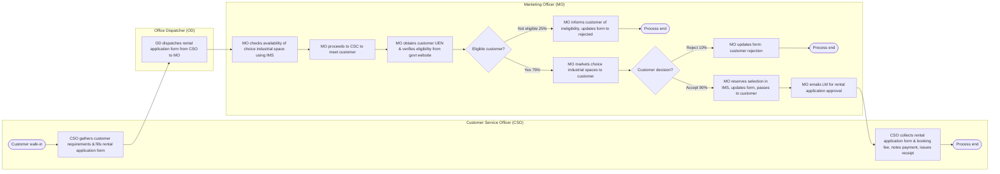

**Full step-by-step timing table (this exact table is reused later for process simulation, so learn its shape now):**

                                                                             | Step | Prev. Step(s) | Activity/Task Description | Time (min) |
| --- | --- | --- | --- |
| 1 | – | CSO gathers customer requirements & fills Rental Application Form | 30 |
| 2 | 1 | OD dispatches Rental Application Form from CSO to MO | 5 |
| 3 | 2 | MO checks availability of choice industrial space using IMS | 25 |
| 4 | 3 | MO proceeds to CSC to meet customer | 5 |
| 5 | 4 | MO obtains customer UEN & verifies eligibility from govt website | 5 |
| 6a | 5 | MO markets choice industrial spaces to customer *(if eligible, 75%)* | 45 |
| 6b | 5 | MO informs customer of ineligibility, updates form to rejected *(25%)*. **Process ends.** | 3 |
| 7a | 6a | Customer rejects choice; MO updates form of rejection *(10%)*. **Process ends.** | 3 |
| 7b | 6a | Customer accepts choice; MO reserves selection in IMS, updates form & passes to customer *(90%)* | 5 |
| 8 | 7b | MO sends email to LM for Rental Application approval | 3 |
| 9 | 8 | CSO collects rental application form and booking fee, notes payment, issues receipt. **Process ends.** | 12 |

Note the **branching probabilities** (75/25, then 90/10) — these annotate the exclusive gateways and are exactly the "Probability" annotation type described in §3.2's "reading an annotated diagram" callout.

#### 3.7 Generic Order Management Process

This is the textbook example of a fully-featured BPMN diagram — 4 lanes: **Customer**, **Sales Agent**, **Sales System**, **Store Keeper** — showing nearly every notation element from the legend in one diagram (decision gateway, merge, parallel split/join, work products, system associations, loop-back via a timer).

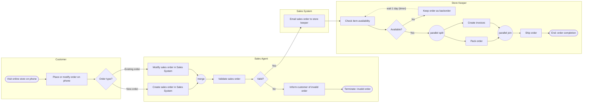

This is the single best diagram to study if you want to see **every** BPMN element from the legend used together at once: business events, decision points, activities, a swimlane per participant, transitions, work products (Sales Order, Purchase Invoice — omitted above for clarity, see the original image), a merge, a loop (the backorder wait), and parallel activities (pack + invoice happening simultaneously).

Lane placement in the diagram:

                         | Lane (Business Participant) | Elements in the lane |
| --- | --- |
| Customer | Start event "Visit online store on phone"; "Place or Modify Order on Phone"; the "Order Type?" decision |
| Sales Agent | "Create Sales Order in Sales System"; "Modify Sales Order in Sales System"; merge; "Validate Sales Order"; "If Valid?" decision; "Inform Customer of Invalid Order"; end "Terminate with Invalid Order" |
| Sales System | "Email Sales Order to Store Keeper" (the only activity in a system lane) |
| Store Keeper | "Check Item Availability"; "If Available?" decision; "Keep Order As Backorder"; timer "Wait for a day"; parallel split; "Pack Order" ∥ "Create Invoices"; parallel join; "Ship Order"; end "End with Order Completion" |

#### ⚡ Quick examples

Decision or merge?

**Point** Count the flows to tell a decision from a merge.

**Example** A diamond with two labelled exits is a decision; a diamond with two entries and one exit is a merge.

**Explanation** Both can use the same marker, so the shape alone does not decide.

#### ✅ This module in 30 seconds

- The Resource Model sorts resources into internal/external and human/technology; internal means you manage it.
- A participant gets a lane only if it performs an activity in this process.
- Manual, interactive and automated activities differ by who does the work.
- An interactive activity stays in the human's lane.
- Decisions have several labelled exits; merges have several entries and one exit.
- Business rules are written IF … THEN … and attach to activities, not gateways.
- Check-in has three lanes and no decisions; the + marks a hidden sub-process.
- Sandwich sales has 8 activities, 3 lanes, 2 decisions and 2 merges.
- Only decisions count as decision boxes; merges do not.
- Rental application: 75% eligible, then 90% accept, 10% reject.
- Order management uses nearly every BPMN element at once.

#### 🃏 Flip to recall

Say the answer out loud first, then tap the card.

Internal vs external resource*tap to flip*

Internal resources are the ones you manage; external ones you do not, however much you depend on them.

Where does an interactive activity go?*tap to flip*

In the human's lane, because the human performs it.

Decision vs merge*tap to flip*

Count flows: a decision has several labelled exits; a merge has several entries and one exit.

Rule structure*tap to flip*

IF <condition(s)> THEN <consequence>, chained with AND/OR, sometimes ELSE.

Why use a rule set?*tap to flip*

Logic lives in one activity, so the diagram avoids a maze of diamonds.

Four diamonds, how many decisions?*tap to flip*

Only those with several labelled exits; merges do not count.

Sandwich sales lanes*tap to flip*

Bread Artist, Veggie Artist, Cashier.

Rental application branch probabilities*tap to flip*

75% eligible / 25% not; then 90% accept / 10% reject.

Which order-management lane has only one activity?*tap to flip*

The Sales System lane.

**➡ Where next?** Next: practise choosing and drawing the models on written scenarios.

---

## Module 4. Modelling Exercises: Expense Report & Book Reservation

**Goal:** Choose the right model for a written scenario and draw the organisation, resource and workflow models, stating your assumptions.

**💡 Why it matters** Reading a scenario and choosing the right model is the exam skill. These exercises show how a scenario turns into lanes, systems and end events.

**🧠 Memory hook Roles → Organisation · Humans and systems → Resource · Steps and hand-offs → Workflow. Write your assumptions down.**

#### 🗺️ Roadmap of this module

**1** Lab 2 Part 2: the StarMall workflow in Camunda Modeler → **2** Expense Report Process → **3** SMU Book Reservation Process → **4** Explore GenAI: draw the workflow as BPMN XML → **5** Modelling checklist

#### ⚡ At a glance — Four steps for any scenario

Read the scenario → Pick the model → Draw it → State assumptions

#### 🔤 Exact names — know these word for word

| Name | What it does | How to tell it apart |
| --- | --- | --- |
| **Expense report process** | Employee, Office Administrator, Manager and Financial Officer; three end events. | Workday Cloud System and Bank System are external resources. |
| **SMU book reservation** | Faculty, Admin and Librarian; two end events. | The finance approval is a separate process. |
| **Work products** | The documents that flow through a process (forms, receipts, quotations). | Left out of the official solution diagrams. |

#### 4.1 Lab 2 Part 2: the StarMall workflow in Camunda Modeler

The lab asks you to **develop the workflow model for the StarMall Rental Application Process using Camunda Modeler**. The solution slides check five things, and each one is a separate notation element on the diagram:

| Element | What the solution shows |
| --- | --- |
| **Process trigger** | A start event for the customer walk-in that starts the process. |
| **Usage of systems** | The systems the activities use (for example IMS) are attached to those activities. |
| **Association** | A system is linked to its activity with an association, not given a lane of its own. |
| **Execution time** | Every task carries its time in minutes, taken from the timing table. |
| **Probability** | Each exclusive gateway branch carries its percentage (75% / 25%, then 90% / 10%). |

The finished diagram and its timing table are in Module 3 (the StarMall worked example). This lab is where you draw it with a tool.

#### 4.2 Expense Report Process

**Scenario.** An employee clears expenses through the Office Administrator. The steps in the scenario are:

- The employee collects all the receipts and creates scanned copies.
- The employee fills the Expense Report Form (a Word document) from the scanned receipts.
- The employee emails the form and the scanned receipts to the Office Administrator.
- The Office Administrator reviews both and checks that everything matches. If not, the administrator emails a mismatch rejection to the employee and the process ends.
- If all is good, the administrator uses the employee data to find the manager's email in the Workday Cloud System.
- The administrator emails the manager the reviewed form and receipts for approval.
- If the manager rejects, the administrator emails the employee about the rejection and the process ends.
- If the manager approves, the administrator prints the approval email, the form and the scanned receipts and submits them to the Financial Officer.
- The Financial Officer sends a pay order to the employee's bank account through the external Bank System and the process ends.

**Task.** Draw the organisation model, the resource model and the process workflow model, and **state all assumptions clearly**.

#### Possible organisation model

A CEO at the top. **Managers** and **Employees** are **group roles** (many people share them). The **Financial Officer** and the **Office Administrator** are **individual roles**.


#### Possible resource model

|  | Human | Technology |
| --- | --- | --- |
| **Internal** | Employee, Manager, Office Administrator, Financial Officer | — |
| **External** | — | Workday Cloud System, Bank System |

The Workday Cloud System is **external** even though the company pays for it: external means the company does not control or operate it.

#### Possible process workflow model

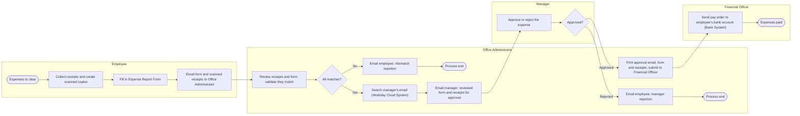

Four lanes and three end events: mismatch rejection, manager rejection and expenses paid. The Workday Cloud System is attached to the search step and the Bank System to the payment step.

The official solution leaves out the **work products** (the receipts, the Expense Report Form and the printed approval email) to keep the diagram readable. It also does not draw email as a system: email is the hand-off channel between lanes, not a resource. Say so in your assumptions.

#### 4.3 SMU Book Reservation Process

**Scenario.** A faculty member needs a book for a course:

- The faculty submits a book reservation request through corporate email. It includes the book details (name, authors, year of publication) and the number of books.
- The school admin fills up the reservation form on the faculty's behalf and emails it to the librarian.
- The librarian checks the book availability in the library management system (LMS). The LMS is slow and its search function is hard to use.
- If the book is available, the librarian reserves it and assigns the faculty and course information in the LMS, then emails the admin the reservation details. The admin updates the faculty, who can share it with the class.
- If the book is unavailable, the librarian prepares book quotations and sends quotation requests to the relevant publishers. The publishers have to be found manually and a quotation form is prepared for each.
- A separate finance approval process starts. The librarian then updates the reservation status with the arrival details to the admin, and the admin informs the faculty.

**Task.** Draw the process workflow model and state all assumptions clearly.

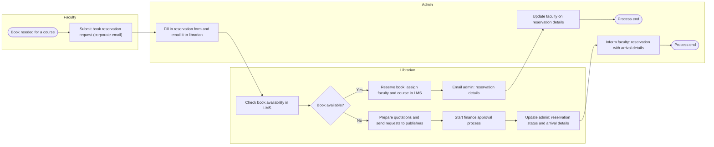

Three lanes (Faculty, Admin, Librarian) and two end events. The LMS is attached to the librarian's activities.

The scenario starts a separate finance approval process, but the official solution does not draw it. If you model it, show it as a trigger of another process and state that assumption. The reservation form and the quotations are work products and are left out of the solution too.

#### 4.4 Explore GenAI: draw the workflow as BPMN XML

Activity 3 asks you to **use a GenAI tool to generate the workflow models in XML format**, **import them into Signavio** to see whether and how they open, and then **improve the prompts** to get better models. Expect to try several times.

- A model is only worth keeping if it follows the lane rule: the lane is the participant who performs the activity.
- Check every gateway has labelled exits, every path reaches an end event, and systems are attached to activities instead of being drawn as lanes.
- Name the lanes, give the scenario and the notation rules in the prompt, and ask for the diagram in BPMN 2.0 XML.

#### Reading a small BPMN file: the library loan process

The module also supplies a short BPMN file for practice, **library_loan_process.bpmn**, with two lanes (Member and Librarian). Systems appear as text annotations on the activities, not as lanes, because a system never makes a decision.

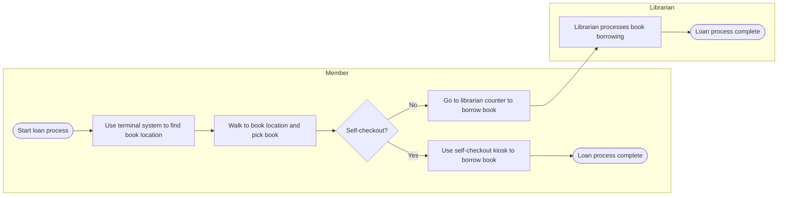

Annotations in the file name the systems: the terminal (book search) system, the self-checkout kiosk (library loan system) and the library loan system used by the librarian.

#### 4.5 Modelling checklist

- **Choose the model first.** Roles and reporting lines go in the organisation model, humans and systems in the resource model, steps and hand-offs in the workflow model.
- **State every assumption** (for example, email treated as a channel, work products left out, a separate process only triggered).
- **Lane = who performs the activity.** A hand-off is a change of lane.
- **Internal means you manage it.** External systems are drawn in the resource model but never get a lane.
- **Count what the question asks for.** Only decisions are decision boxes; merges are not.

#### ✅ This module in 30 seconds

- The module practises choosing the right model for a written scenario and drawing it.
- Expense report: four lanes, three end events, Workday and the Bank System are external resources.
- Book reservation: three lanes and two end events; the finance approval is a separate process.
- GenAI can draft BPMN XML, but check lanes, gateways and end events and improve the prompt.
- Always state your assumptions clearly.

#### 🃏 Flip to recall

Say the answer out loud first, then tap the card.

Expense report lanes*tap to flip*

Employee, Office Administrator, Manager, Financial Officer.

Why is the Workday Cloud System external?*tap to flip*

The company does not control or operate it, even though it uses it.

Book reservation lanes*tap to flip*

Faculty, Admin, Librarian.

Why leave out work products?*tap to flip*

They keep the solution diagram readable; the official solution omits them and says so.

**➡ Where next?** Next: Analyse. Static analysis finds the issues and root causes in the As-Is models you just drew.

---

## Module 5. Analysis Part 1: Static Analysis (RCI & RCR)

**Goal:** Find root causes of issues, calculate static reports and prioritise recommendations.

**💡 Why it matters** Static analysis is the cheap first pass: it shows what is slow, costly or over-used without running the process.

**🧠 Memory hook Issue → cause → root cause → recommendation.**

#### 🗺️ Roadmap of this module

**1** Static vs Dynamic Analysis → **2** The Static Analysis Methodology → **3** Static Reports → **4** The Root Cause-Impact (RCI) Model → **5** The Root Cause-Recommendation (RCR) Model → **6** Worked Example — StarMall RCI and RCR

#### ⚡ At a glance — Static analysis pipeline

Issue Elicitation → Issue Analysis → Recommendation Formulation

#### 🔤 Exact names — know these word for word

| Name | What it does | How to tell it apart |
| --- | --- | --- |
| **Issue Elicitation** | Reads interviews against the As-Is model and writes each problem as an effect. | Produces the Issue List. |
| **Issue Analysis** | Quantifies time, cost and workload and explains why issues exist. | Produces the static report and RCI Model. |
| **Recommendation Formulation** | Turns root causes into ranked recommendations. | Produces the RCR Model. |
| **Cycle Time Calculation** | Static report of process time. | Reports time per instance. |
| **Cost Calculation** | Static report of process cost. | Reports cost per instance. |
| **Resource Calculation** | Static report of workload and utilisation. | Reports workload and utilisation per role. |
| **RCI issue categories** | Process · System · People · Policy · Others. | Five categories. |
| **RCR columns** | Root Cause · Recommendation · Recommendation Impact Score · Complexity of Implementing. | Four columns. |

RCI columns: Issue # · Issue Description · Cause Description · Root Cause · Issue Category · Business Performance Metrics · Impact Level. Recommendations come from four sources: domain understanding, technology understanding, industry best practices and experience.

#### 5.1 Static vs Dynamic Analysis

The course borrows the distinction from software engineering:

                              |  | **Static analysis** | **Dynamic analysis** |
| --- | --- | --- |
| Software engineering | Analyse the issue of program code *without* code execution (e.g., lint) | Analyse the issue of program code *by executing* it (e.g., unit test) |
| Business process management | Analyse the issue of the business process *without* process execution — review the interview scripts, review the As-Is models | Analyse the issue of the business process *by executing* it — pilot test, or run a simulation based on the process model |
| Cost / risk | Cheap, immediate, uses documents you already have | Needs data, a simulation tool or a live trial; results depend on the assumptions you feed in |
| Blind spot | Cannot see waiting, queuing or randomness | Only as good as the input data |

Static analysis is the first pass: it produces a defensible list of *what is wrong and why* before any expensive simulation. Dynamic analysis then tests numbers and alternatives.

#### 5.2 The Static Analysis Methodology

The three-step pipeline is in the at-a-glance strip at the top of this module; this table fixes what enters and leaves each box.

                             | Step | Input | Output | What you actually do |
| --- | --- | --- | --- |
| **1. Issue Elicitation** | Interview script; As-Is model | **Issue List** | Read the interviews against the model and write each problem as an *effect* — StarMall's issues all follow "X happens, which leads to Y" (e.g., "…manually dispatched by the OD, which leads to increased waiting times") |
| **2. Issue Analysis** | Issue List | **Static Report** and **RCI Model** | Quantify time, cost and workload with a tool, and explain *why* each issue exists |
| **3. Recommendation Formulation** | RCI Model (+ tool reports) | **RCR Model** | Turn root causes into ranked recommendations |

#### 5.3 Static Reports

**Purpose**: analyse the Process Workflow Model using a tool to (a) identify the costs and time of the process and (b) identify issues with respect to activities and resources. The three example reports are **Cycle Time Calculation**, **Cost Calculation** and **Resource Calculation**.

**Why it exists:** a diagram alone doesn't say how long a sandwich takes, what it costs, or whether the Veggie Artists are overloaded. A static report turns the diagram plus two small data tables into numbers.

#### The two input tables

                    | Table | Columns | Meaning |
| --- | --- | --- |
| **Role Table** | Role · Cost per Hour · Annual Working Hour per Resource · No. of Resource Available | Used for cost and *resource calculation* |
| **Activity Table** | Cur Step · Pre Step · Task Description · Execution Time (min) · Role · Input Factor | One row per task; *Input Factor* = "Probability of task being executed" |

**Role data** (cost and availability of each resource):

                             | Role | Cost per hour | Annual working hours per resource | No. available |
| --- | --- | --- | --- |
| Bread Artist | $15.00 | 1920 | 1 |
| Veggie Artist | $15.00 | 720 | 3 |
| Cashier | $17.00 | 1920 (= 12 months × 20 days × 8 hrs) | 1 |

**Activity data** for SUBWAY (the process is the one in §3.5; probabilities from the annotated diagram):

                                                                             | Cur | Pre | Task | Exec. time (min) | Role | Input factor |
| --- | --- | --- | --- | --- | --- |
| 1 | – | Take sandwich order | 0.75 | Bread Artist | 1 |
| 2 | 1 | Cut bread | 0.25 | Bread Artist | 1 |
| 3 | 2 | Put bread in toaster | 1 | Bread Artist | 0.4 |
| 4 | 2/3 | Take list of toppings | 0.5 | Veggie Artist | 1 |
| 5 | 4 | Fill in toppings | 1 | Veggie Artist | 1 |
| 6 | 5 | Wrap sandwich | 0.5 | Veggie Artist | 1 |
| 7 | 6 | Give additional items | 0.5 | Cashier | 0.3 |
| 8 | 6/7 | Receive payment | 0.75 | Cashier | 1 |

"Pre Step 2/3" on step 4 means it can follow step 2 (no toast) *or* step 3 (toast) — the merge gateway. Likewise step 8 follows 6 or 7.

#### The formulas

Let tit_iti​ = execution time of task iii (minutes), fif_ifi​ = its input factor (probability it is executed), rkr_{k}rk​ = cost per hour of role kkk, NNN = instance frequency per year, HkH_kHk​ = annual working hours per resource of role kkk, nkn_knk​ = number of resources available in role kkk.

CT=∑iti fiC=∑iti fi60 rk(i)CT = \sum_i t_i\,f_i \qquad\qquad C = \sum_i \frac{t_i\,f_i}{60}\, r_{k(i)}CT=i∑​ti​fi​C=i∑​60ti​fi​​rk(i)​

Wk=∑i∈kti fi60 NRk=WkHkUk=RknkW_k = \sum_{i \in k} \frac{t_i\,f_i}{60}\,N \qquad R_k = \frac{W_k}{H_k} \qquad U_k = \frac{R_k}{n_k}Wk​=i∈k∑​60ti​fi​​NRk​=Hk​Wk​​Uk​=nk​Rk​​

In words: **cycle time per instance** CTCTCT is the probability-weighted sum of task times; **cost per instance** CCC converts each weighted time to hours and multiplies by the role's hourly cost; **annual workload** WkW_kWk​ of a role is its weighted task hours times the number of instances per year; **required resources** RkR_kRk​ is workload divided by the hours one person can work; **utilisation** UkU_kUk​ divides that by how many people you actually have.

#### Worked calculation — SUBWAY

**Where the annual figures come from.** The task and role tables above give numbers *per sandwich* (one process instance). To get yearly totals you also need the **instance frequency per year**: how many sandwiches the shop makes in a year. The slides give **43,800** as an assumed input for this example. It works out to **120 sandwiches a day × 365 days**, though the slides do not say how it was chosen. Any other volume would scale every annual number in the same way.

- **Annual hours per resource.** A Bread Artist or Cashier works **1,920 hours** a year = 12 months × 20 days × 8 hours. A Veggie Artist works 720 hours each, and 3 are available.
- **Annual workload of a task** = minutes per instance ÷ 60 × instances per year. Example: 0.75 ÷ 60 × 43,800 = 547.5 hours for Take sandwich order.

                                                                           | Task | tifit_i f_iti​fi​ (min) | Cost per instance | Role | Annual workload (hrs) |
| --- | --- | --- | --- | --- |
| Take sandwich order | 0.75 × 1 = 0.75 | 0.75/60 × 15 = $0.1875 | Bread Artist | 0.75/60 × 43,800 = 547.5 |
| Cut bread | 0.25 | $0.0625 | Bread Artist | 182.5 |
| Put bread in toaster | 1 × 0.4 = 0.4 | $0.1000 | Bread Artist | 292 |
| Take list of toppings | 0.5 | $0.1250 | Veggie Artist | 365 |
| Fill in toppings | 1 | $0.2500 | Veggie Artist | 730 |
| Wrap sandwich | 0.5 | $0.1250 | Veggie Artist | 365 |
| Give additional items | 0.5 × 0.3 = 0.15 | 0.15/60 × 17 = $0.0425 | Cashier | 109.5 |
| Receive payment | 0.75 | $0.2125 | Cashier | 547.5 |
| **Total** | **4.3 min** | **$1.105** | — | — |

- Total cycle time per year =4.3×43,800=188,340= 4.3 \times 43{,}800 = 188{,}340=4.3×43,800=188,340 min; total cost =1.105×43,800=$48,399= 1.105 \times 43{,}800 = \$48{,}399=1.105×43,800=$48,399.
- 3 minutes" and "1.1 SGD".

                             | Role | Total annual workload (hrs) | Required resources RkR_kRk​ | Utilisation UkU_kUk​ |
| --- | --- | --- | --- |
| Bread Artist | 547.5 + 182.5 + 292 = **1022** | 1022 / 1920 = **0.5323** | 0.5323 / 1 = **53%** |
| Veggie Artist | 365 + 730 + 365 = **1460** | 1460 / 720 = **2.0278** | 2.0278 / 3 = **68%** |
| Cashier | 109.5 + 547.5 = **657** | 657 / 1920 = **0.3422** | 0.3422 / 1 = **34%** |

**How to read it:** the Veggie Artist is the most heavily used role (68%) even though the Bread Artist has more *tasks*. This static result predicts where the dynamic simulation later finds the bottleneck — the Veggie Artist activities.

#### Applying the same method to StarMall (added context — computed from the timing table)

The Analyse method extends to branching processes, but the input factor of a task after *nested* branches is the **product of the probabilities on the way** (joint probability), not just the last gateway's percentage.

                                                                    | Step | Task | Time tit_iti​ | Input factor fif_ifi​ | tifit_i f_iti​fi​ |
| --- | --- | --- | --- | --- |
| 1–5 | Gather requirements (30), dispatch (5), check availability (25), go to CSC (5), verify eligibility (5) | 70 in total | 1 | 70 |
| 6a | MO markets spaces | 45 | 0.75 | 33.75 |
| 6b | MO informs of ineligibility | 3 | 0.25 | 0.75 |
| 7a | Customer rejects; MO updates form | 3 | 0.75 × 0.10 = 0.075 | 0.225 |
| 7b | Customer accepts; MO reserves in IMS | 5 | 0.75 × 0.90 = 0.675 | 3.375 |
| 8 | MO emails LM for approval | 3 | 0.675 | 2.025 |
| 9 | CSO collects form and fee | 12 | 0.675 | 8.1 |
| Total | — | — | **Expected cycle time** | **118.225 min** |

Cross-check by path: ineligible = 73 min (25%); eligible-but-rejected = 118 min (7.5%); accepted = 135 min (67.5%); $0.25(73) + 0.075(118) + 0.675(135) = 118.225$ ✓.

Two observations that connect to the RCI in §5.6: (1) 25% of applications spend **70 minutes** of staff effort before the ineligibility is discovered (0.25 × 73 = 18.25 min, about **15%** of the expected cycle time) — exactly Issue 2's "high cost of rejection". (2) This is *execution* time only; the LM's approval wait (Issue 3) does not appear at all, because a static report has no queues.

#### 5.4 The Root Cause-Impact (RCI) Model

**Purpose:** a table that explains, for each issue, *why* it exists, what business metric it hurts and how severe it is.

**Guideline**: (1) identify the relevant **issue** and give a short description; (2) identify the **cause** of the issue; (3) identify the **common cause** of the causes as the **root cause**. Suggested technique: the **5-Why** approach or the **Fishbone diagram**.

**Template columns**:

                                     | Column | What goes in it |
| --- | --- |
| Issue # | Number, for cross-reference in other models |
| Issue Description | A brief description of the problem and how it affects business performance |
| Cause Description | What causes the issue — consider the issue as the *outcome/effect* |
| Root Cause | The **top-level** cause; usually one or a few. High-level recommendations are based on it, and it helps identify a *common solution for multiple issues* |
| Issue Category | Process · System · People · Policy · Others (table below) |
| Business Performance Metrics | Which business metric(s) the issue affects (e.g., number of orders processed in a day) |
| Impact Level | Relative severity of the issue / of the metric affected, on the 5-point scale: **5 Very High … 1 Very Low** |

**Issue categories**:

                                   | Category | Covers | Examples |
| --- | --- | --- |
| **Process** | Non-automation, missing activities, missing participants, wrong activity sequence | Paper-based process, late exception check |
| **System** | Improper performance, interface, functionality of IT applications | Lack of system functionality or integration |
| **People** | Work attitude, lack of knowledge/skills | Inadequate staffing, inadequate training |
| **Policy** | Organisational or departmental; external (e.g., government) | Government policy; company/department policy |
| **Others** | External partners, or anything that fits none of the above | — |

**Common root causes** — a ready checklist for classification:

                                               | Root cause | Category | Root cause | Category |
| --- | --- | --- | --- |
| Paper-based process | Process | Lack of system functionalities | System |
| Lack of information | Process | Lack of system integration | System |
| Lack of automation | Process | Inadequate staffing | People |
| Inadequate activity flow | Process | Inadequate training | People |
| Task redundancy | Process | Government policy | Policy |
| Late exception check | Process | Company / department policy | Policy |

The common root causes group into four families:

                         | Family | Root causes |
| --- | --- |
| **Change of medium** | Paper-based process |
| **Information deficit** | Lack of information |
| **Automation potential** | Lack of automation; lack of system integration |
| **Organisation barrier** | Company policy; multiple roles with redundant tasks |

**The Fishbone view.** The course's fishbone diagram has six cause families feeding one problem, with *Environment* and *Management* bracketed together as **Policy**:

fishbone (cause-and-effect) categories as drawn on the course, and how they map to the RCI "Policy" category.

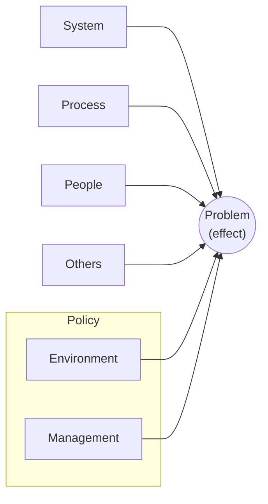

Each family is a set of *cause candidates*; the RCI model asks you to name the one or few that sit at the top of the chain. Category names line up with the RCI categories (System, Process, People, Others), and the course groups the fishbone's Environment + Management under Policy.

**The same issue, four different root causes** — the course's Real Estate Sales example uses one issue ("Errors in the forms where the bill of sales information is captured") and shows that changing the *cause* changes the category, root cause and metrics:

                                | Issue # | Issue Description | Cause Description | Root Cause | Issue Category | Business Performance Metrics | Impact Level |
| --- | --- | --- | --- | --- | --- | --- |
| 1 | Errors in the forms where the bill of sales information is captured | Buyer and seller fill in paper form, which is prone to error | Paper-based process | Process | No. of complete sales; no. of errors per paper form | High (4) |
| 1 (same issue) | (same) | (same) | Government policy (requires to sign bill of sales on paper) | Policy | No. of complete sales; no. of errors per paper form | High (4) |
| 1 (same issue) | (same) | The sales agent does not validate the form for correctness and completeness | Inadequate training | People | No. of complete sales; no. of complaints from buyer or seller | High (4) |
| 1 (same issue) | (same) | The system cannot properly validate the form for correctness and completeness | Lack of system functionalities | System | No. of complete sales; no. of exceptions raised by the system | High (4) |

#### 5.5 The Root Cause-Recommendation (RCR) Model

**Purpose:** convert the RCI model into a *prioritised* list of recommendations, each with a benefit score and an effort score.

**Guideline**:

1. Prioritise the issues from the RCI Model based on impact level.
2. Identify the list of root causes.
3. For each root cause, suggest one or more recommendations (tool-based reports may suggest additional ones).
4. For each recommendation, determine the impact it will have on mitigating the root cause and assign an **impact score** — based on the *number of resolved issues* and the *aggregated impact level*.
5. For each recommendation, identify the **complexity** of implementing it.

Recommendations are formulated from four sources: **domain understanding, technology understanding, industry best practices, experience**.

**Template**:

                         | Column | Scale / content |
| --- | --- |
| Root Cause | The top-level cause (from RCI) |
| Recommendation | The solution that mitigates the root cause; may have several alternatives |
| Recommendation Impact Score | 5 Very High … 1 Very Low, **with a reason** ("Resolves #issues") |
| Complexity of Implementing | **5 Very Easy … 1 Very Complex** |

**Scale directions — don't invert them.** For impact, 5 is the *best/biggest* effect. For complexity, 5 is *Very Easy* and 1 is *Very Complex*. So in both columns a higher number is more attractive. The StarMall solution writes complexity in words ("Low Complex", "Medium Complex", "High Complex") rather than numbers, which does not match the numeric template — read "Low Complex" as an *easy* change.

**Worked example — Real Estate**: root cause *Government Policy (requires to sign bill of sales on paper)* → recommendation *Cooperation with other real estate agency companies to propose change to the Government Regulation* → impact **4. High** ("It can solve 3 issues out of 4 for this root cause") → complexity **1. Very Complex** ("tedious process… industry is very fragmented. Low warranty the policy will be change"). This is the classic **high-benefit, hard-to-do** recommendation.

#### 5.6 Worked Example — StarMall RCI and RCR

**Setup**: you are a business analyst at StarMall analysing the Rental Application process. Five issues are marked on the diagram:

                                   | # | Issue | Where on the diagram |
| --- | --- | --- |
| 1 | The application form is manually dispatched by the OD, which leads to increased waiting times | OD dispatch step |
| 2 | The customer's eligibility is checked by the MO at a later stage, which results in a high cost of rejection | MO obtains UEN / verifies eligibility |
| 3 | The LM's role is critical, as he must approve all applications. This leads to longer waiting times for straightforward cases | MO emails LM for approval |
| 4 | The CSO manually fills in the application form together with the applicant, which affects his productivity | CSO gathers requirements |
| 5 | The MO first checks availability and then markets the rental spaces, which is time-consuming and inefficient | MO checks availability |

Worked RCI example — several valid analyses can be accepted for some issues:

                                                                                    | Issue # | Issue Description | Cause Description | Root Cause | Issue Category | Business Performance Metrics | Impact Level |
| --- | --- | --- | --- | --- | --- | --- |
| 1 | The application form is manually dispatched by the OD, which leads to increased waiting times | Paper-based collection of info by CSO from the customer | Paper-based process | Process | Total process time; cost of manual resources for paperwork; no. of missing forms | High (4) |
| 2 | The customer's eligibility is checked by the MO at a later stage, which results in a high cost of rejection | CSO is not given the rights to check the eligibility | Company policy | Policy | Total application processing time; cost of rejection paths | High (4) |
| 2 (another) | (same) | Arrangement of the activities didn't consider the independency of the UEN check | Late exception check | Process | (same) | High (4) |
| 2 (another) | (same) | The department's policy that CSO should not check UEN | Department policy | Policy | (same) | High (4) |
| 2 (another) | (same) | IMS does not talk to the UEN site to validate the customer's UEN | Lack of system integration *(source: "May not be a good RC – but still valid")* | System | (same) | High (4) |
| 3 | The LM's role is critical, as he must approve all applications. This leads to longer waiting times for straightforward cases | Bureaucracy within the department that LM must approve all applications | Company policy | Policy | Total cycle time in approval process | Medium (3) |
| 3 (another) | (same) | All applications are routed to LM despite MO having already checked availability and eligibility | Task redundancy | Process | (same) | Medium (3) |
| 4 | The CSO manually fills in the application form together with the applicant, which affects his productivity | Paper-based collection of info by CSO from the customer | Paper-based process | Process | Total application processing time; cost of manual resources | High (4) |
| 5 | The MO first checks availability and then markets the rental spaces, which is time-consuming and inefficient | The system doesn't have the feature to map the customer's options | Lack of system functionality | System | Total cycle time for application processing | High (4) |
| 5 (another) | (same) | Checking availability and marketing are done in sequence | Inadequate activity flow | Process | (same) | Medium (3) |

**Observations.** Issues 1 and 4 share a root cause (paper-based process) — that is the "common solution for multiple issues" the RCI is designed to expose. Issue 2 has four defensible analyses depending on *which link of the causal chain* you stop at (policy, sequencing, or integration). Notice the metrics are all *measurable process quantities*, not restatements of the issue.

📍 CASE FILE

#### Five issues collapse into three root causes

**The setting**

Five issues are marked on a rental application process: manual dispatch, a late eligibility check, one manager approving every case, manual form-filling and checking availability before marketing.

**What happened**

Paper-based process explains issues 1 and 4; the late eligibility check and task redundancy explain others. Issue 2 can be analysed in four defensible ways (policy, sequencing or integration).

**The lesson**

Look for shared root causes across issues. The metrics must be measurable process quantities, not a restatement of the issue.

Worked RCR example:

                             | Root cause | Recommendation(s) | Impact score with reason | Complexity |
| --- | --- | --- | --- |
| Paper-based process | 1. Introduce new IT system to process the customer rental application request. 2. Integrate existing application IMS | **5 – Very High.** Solves 2 high-impact issues out of 5 | Medium Complex |
| Late exception check | 1. Begin the rental application process with the UEN check of eligibility by the CSO before gathering requirements | **4 – High.** Solves 1 high-impact issue out of 5 | Low Complex |
| Task redundancy | 1. Improve IMS to include rules for approvals. 2. Marketing manager uses IMS for approvals on straightforward applications | **3 – Medium.** Solves 1 medium-impact issue out of 5 | High Complex |

how the five issues collapse into three root causes and three recommendations in the worked example.

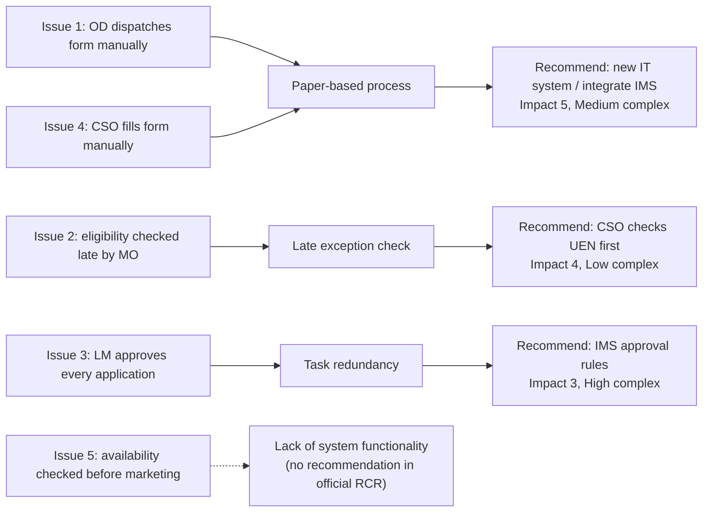

#### ⚡ Quick examples

Nested probabilities

**Point** The input factor after nested branches is the product of the probabilities on the path.

**Example** A task reached after a 75% branch and then a 90% branch has input factor 0.75 × 0.90 = 0.675.

**Explanation** Using only the last percentage would overstate cost and time.

#### ✅ This module in 30 seconds

- Static analysis examines the process without executing it; dynamic analysis executes or simulates it.
- Static analysis has a blind spot: it cannot see waiting, queues or randomness.
- The pipeline is Issue Elicitation → Issue Analysis → Recommendation Formulation.
- RCI explains why each issue exists, what it hurts and how severe it is.
- RCR ranks recommendations by impact (5 = Very High) and complexity (5 = Very Easy).

#### 🃏 Flip to recall

Say the answer out loud first, then tap the card.

Static vs dynamic analysis*tap to flip*

Static: no execution, uses existing documents. Dynamic: runs a pilot or simulation.

Root cause vs symptom*tap to flip*

The root cause is the top-level cause; never restate the issue as the root cause.

RCR scales*tap to flip*

Impact: 5 = Very High. Complexity: 5 = Very Easy, 1 = Very Complex.

Utilisation*tap to flip*

Required resources divided by resources available.

**➡ Where next?** Next: dynamic analysis, which can see waiting and compare alternatives by simulation.

---

## Module 6. Analysis Part 2: Dynamic Analysis & Simulation

**Goal:** Simulate As-Is and To-Be processes and choose the best alternative using four phases.

**💡 Why it matters** Static analysis cannot see waiting or randomness. Dynamic analysis shows queues, bottlenecks and what happens under change.

**🧠 Memory hook Goals → Model & simulate → Impact → Final selection.**

#### 🗺️ Roadmap of this module

**1** Why Not Just Static Analysis? → **2** Objectives of Dynamic Analysis → **3** The Dynamic Analysis Methodology — Four Phases → **4** Phase 1 — Establish Performance Goals → **5** Phase 2 — Model and Simulate → **6** Phase 3 — Impact Analysis → **7** Phase 4 — Final Selection

#### ⚡ At a glance — Four phases

Establish Performance Goals → Model and Simulate → Impact Analysis → Final Selection

#### 🔤 Exact names — know these word for word

| Name | What it does | How to tell it apart |
| --- | --- | --- |
| **Establish Performance Goals** | Fixes the yardstick: goals, priorities and metrics. | First phase; no simulation yet, only goals and metrics. |
| **Model and Simulate** | Collects data, simulates the As-Is and To-Be alternatives. | Second phase; the only one that produces simulation numbers. |
| **Impact Analysis** | Identifies who is affected by each To-Be alternative. | Third phase; looks at people affected, not at speed or cost. |
| **Final Selection** | Chooses the To-Be to implement. | Fourth phase; the only one that makes the decision. |
| **Process-wide data** | Triggers, arrival pattern, rate, start time, termination. | About the whole process (triggers, arrivals), not one task. |
| **Activity-related data** | Resources needed, time distribution, cost, queue handling. | About one task: its time, cost, resources and queue. |
| **Resource-related data** | Cost per resource, number per role, work hours. | About the people or machines: cost, headcount, work hours. |
| **Decision points data** | Probability of each decision path. | About gateways: the chance of each path. |

Eight analysis techniques: capacity, process cycle time/cost, resource utilisation, activities time/cost, bottleneck, path, unusual event and what-if. Impact grid: hard or soft × internal or external.

#### 6.1 Why Not Just Static Analysis?

 Static analysis has two limits: (1) especially the *qualitative* results (RCI, RCR) may not offer the **metrics** needed to evaluate a performance goal; (2) some analysis reports simply **cannot be produced** without running the process. Dynamic analysis can (a) determine the **best solution or outcome among various choices** and (b) use **quantitative data** to analyse and compare the potential value across process variations.

**SUBWAY: the same process seen both ways**. The course shows three heatmaps of the process:

                     | View | What it shows |
| --- | --- |
| **Static analysis** heatmap | Colours reflect the *fixed* task durations, on a legend running from short to long — no waiting, because nothing is queued |
| **Dynamic analysis**, one customer arriving every 2 minutes | A **bottleneck** in the Veggie Artist lane labelled **1.3 minutes** — the circled activity appears to be "Fill in toppings", whose static execution time is only 1 minute |
| **Dynamic analysis**, waiting-time heatmap | The three Veggie Artist activities are the red ones; **waiting times for Veggie Artist activities are ~17.6 s** |

#### 6.2 Objectives of Dynamic Analysis

                         | **As-Is process** | **To-Be process** |
| --- | --- |
| Identify key process issues (e.g., cost-overrun, inefficiencies) | Analyse and evaluate "what-if" conditions to derive the optimal solution |
| Identify the **bottleneck** activities | Estimate Return on Investment (ROI) and expected KPIs |
| Identify activities that are good to *retain* in the To-Be process | Help plan for future resources required by the new process (e.g., human resource, system, machineries) |
| Gather statistics to serve as a **basis for comparison** with the To-Be process | Assess the impact on the organisation and partners |

#### 6.3 The Dynamic Analysis Methodology — Four Phases

the four phases in order, and how the baseline As-Is process becomes a To-Be process.

```mermaid
flowchart LR
    B["Baseline As-Is process"] --> P1
    P1["1. Establish process performance goals"] --> P2["2. Modelling activities and simulations"]
    P2 --> P3["3. Impact analysis of To-Be alternatives"]
    P3 --> P4["4. Final selection of To-Be process"]
    P1 -.->|"Redesign based on process performance goals"| T["To-Be process"]
    P4 --> T

```

Phase 1 sets the yardstick; phase 2 produces numbers for the As-Is baseline and for each To-Be alternative; phase 3 asks who is affected by each alternative; phase 4 chooses. The dotted arrow is the course's label: the redesign from baseline to To-Be is driven by the performance goals.

#### 6.4 Phase 1 — Establish Performance Goals

**Purpose**: identify the important factors to address — cost, efficiency, quality, etc. Guiding questions: *Is lowering cost an important aspect? Is efficiency more important than cost? What are the ideal employee utilisation targets?*

**Three steps**: (1) identify the process performance goals and their priorities; (2) identify any binding organisational policies or management decisions related to the process; (3) document the process performance goals and the measurement metrics for each goal.

**Traceability chain** — goals are derived from the strategy cascade of:

                              | Level | Example 1 | Example 2 |
| --- | --- | --- |
| Mission and Vision | Deliver exceptional quality service in the real estate business | Deliver efficient service in the real estate business |
| Business Goals | Reduce at least 30% revenue lost from errors in the real estate business | Reduce at least 20% revenue lost from delay in the real estate business |
| Process Performance Goals | Reduce the errors in Real Estate Sales Process by at least 30% | Reduce the bottlenecks in Real Estate Sales Process by at least 20% |
| Metrics used for analysis | Number of errors found in real estate sales process | Number of bottlenecks; average delay caused by activities |

**Why it matters:** without a measurable goal, "better" is unfalsifiable — the goal is what phase 2's simulation results and phase 4's selection are tested against. Note that each goal has a **metric you can actually measure in a simulation**.

#### 6.5 Phase 2 — Model and Simulate

**Purpose**: identify current problems (e.g., bottlenecks); identify critical areas to focus on; explore alternatives for the To-Be process — *which alternative best matches the performance goals?* — and compare expected performance with the As-Is process.

the four sub-steps of phase 2 and where the RCR model plugs in.

```mermaid
flowchart LR
    subgraph PREP["Prepare simulations"]
        C["2.1 Collect data"] --> IP["2.2 Identify simulation parameters"]
    end
    subgraph PERF["Perform simulations"]
        AI["2.3 Simulate and analyse As-Is"] --> TB["2.4 Simulate and analyse To-Be"]
    end
    PREP --> PERF
    RCR["RCR model recommendations"] --> TB

```

#### 2.1 Collect Data — four types

                              | Data type | Questions to answer | Example values |
| --- | --- | --- |
| **Process-wide** | What triggers the start? Start time? Arrival pattern of triggers? Rate of triggers? Termination conditions? One-time process cost? Dependencies? | Frequency 6,500 per year; a customer arrives every 3 min on average (min 2, max 5); service time Mon–Fri 9:00–17:00 |
| **Activity-related** | Resource requirements (labour/machinery)? Which role or individual? Time to complete — constant, exponential or normal? Cost incurred? How is the queue handled? | Resource: Store Keeper + Sales System; time normally distributed, mean 5 min, s.d. 45 s; one-time cost $0.05 (printing invoice); queue handling: customer leaves if queue longer than 5 |
| **Resource-related** | Cost of each resource? How many per role? Work hours? Maximum utilisation? | $50/h per Sales Agent; 3 Sales Agents available |
| **Decision points** | Probability of each decision path from history or assumption? | 70% Yes / 30% No; or by segment, e.g., male 60/40 and female 80/20 (*only useful when there are multiple decision points*) |

Note how the four types line up with the static tables of: the Role Table ↔ resource-related, the Activity Table ↔ activity-related, Input Factor ↔ decision-point probabilities. The difference is that dynamic analysis also needs the **arrival pattern** and **distributions**, not just averages.

#### 2.2 Identify Simulation Parameters

The collected data must be translated into **tool-specific** parameters, and tools differ: one tool may let you specify a resource's work schedule while another cannot. Fitting collected data to a distribution is "a challenging task" — you choose among exponential, normal, uniform, etc. Run-level settings: number of simulation runs (**one case** or **multiple cases**, by number of days or number of instances), **random seed**, report format.

**Mapping the four data types to tool fields**: process-wide ↔ Signavio "Frequency (per year)" / BIMP "Total number of process instances"; activity-related ↔ Signavio "Execution Time" / BIMP "Duration" under "Tasks"; decision points ↔ Signavio "Probability" / BIMP "Gateways". The solution gives no field for resource-related data.

#### 2.3 Simulate and Analyse the As-Is Process

Four sub-steps: **As-Is scenario** (model the As-Is in the tool) → **simulation parameters** (turn collected data into parameters; enter them) → **simulation** (run on the As-Is; apply various analysis techniques) → **analysis** (analyse and document results).

**The eight analysis techniques** — four on "Analysis Techniques (1/2)", four on "(2/2)":

                                                  | Technique | What it does | Example |
| --- | --- | --- |
| **Capacity analysis** | Maximum capacity of the process under defined operating conditions | The order management process can handle up to 1000 transactions a day over 8 hours |
| **Process cycle time / cost analysis** | Duration and cost of the whole process cycle | Order fulfilment takes an average of 20 min with standard deviation 2.4 min |
| **Resource utilisation analysis** | How resources are used and how much cost they add | Order entry clerk is over-utilised at 127% |
| **Activities time / cost analysis** | Duration and cost of each individual activity | Order entry takes an average of 10 min, s.d. 2.1 min |
| **Bottleneck analysis** | *Combination* of process, resource and activity analysis to find what is causing the bottleneck | Order entry has an average queue length of 8 and the clerk is over-utilised at 127% → bottleneck at order entry |
| **Path analysis** | Analysis of the paths that make up the process; paths result from decision points (some tools call them "case" or "branch") | see below |
| **Unusual event analysis** | Events with huge impact that rarely occur | Effect on order fulfilment when the warehouse gets flooded |
| **What-if analysis** | Various possible scenarios for the process | Effect of cutting claim supervisors from four to two on overall claims processing time |

Part 1 covers capacity, process cycle time/cost, resource utilisation and activities time/cost; part 2 covers bottleneck, path, unusual event and what-if. Count them as **eight** in an exam.

**Bottleneck ≠ "longest task".** The course's definition is a *combination*: a queue builds at an activity *and* its resource is over-utilised. In the SUBWAY example the bottleneck (1.3 min) is not the task with the longest static time alone — it is where work waits for a scarce resource.

#### Path Analysis — worked example

**Q1 What is a path?** A flow in the process with **one start and one end**. **Q2 How many paths?** The course's sandwich flow (the SUBWAY *flow diagram* of §3.5, with the decisions *If toast?* and *If drinks?*) has **4 paths** — two independent yes/no decisions in sequence give $2 \times 2 = 4$ combinations (toast/no toast × drinks/no drinks). **Q3 Why analyse each path?** To compare figures between paths; see which paths are in good shape; prioritise paths for deeper analysis; understand the activities/bottlenecks in each path.

**Path Analysis 2 — a travel-request process**, with the expected contribution of each path added:

                                                                                      | Path | Description | Share | Avg elapsed | Avg cost | Expected cost (share × cost) | Expected elapsed (share × duration) |
| --- | --- | --- | --- | --- | --- | --- |
| 1 | Rejected: not approved by Finance (outstanding settlement) | 15.5% | 1 day 57 min | $60.41 | $9.36 | 232 min |
| 2 | Rejected: not approved by PL | 17.5% | 35 min | $18.75 | $3.28 | 6 min |
| 3 | Rejected: not approved by BM | 1.0% | 1 h 32 min | $38.75 | $0.39 | 1 min |
| 4 | Success: non-urgent, local travel | 45.5% | 1 day 1 h 16 min | $73.75 | **$33.56** | 690 min |
| 5 | Success: non-urgent, overseas | 13.5% | 1 day 6 h 44 min | $90.41 | $12.21 | 249 min |
| 6 | Success: urgent, local | 4.5% | 23 h 16 min | $80.75 | $3.63 | 63 min |
| 7 | Success: urgent, overseas | 2.5% | 1 day 52 min | $97.41 | $2.44 | 37 min |
| All | **Weighted averages** | 100% | **21 h 18 min 19.567 s** | **$64.86** | — | — |

Weighted averages: the shares sum to 100%, the slide gives the weighted averages as $64.86 and 21 h 18 min 19.567 s (computed from the unrounded values). Adding the rounded table figures gives $64.87 and about 1,278 min (21 h 18 min), so small differences are rounding.

**Conclusion**: analyse the path with the highest *expected* average total time or cost — path 4, at 45.5% × $73.75 = **$33.56**, the highest of all paths — and analyse the **rejection cases** (paths 1, 2, 3).

**Common mistake:** ranking paths by *per-instance* cost (path 7, $97.41) instead of *expected* contribution (share × cost). Path 7 is the most expensive per case but only 2.5% of cases, so it contributes $2.44 — fixing path 4 or the rejection paths pays back far more.

#### What-if Analysis — worked example

**Question:** how many servers do you need? **Performance goal:** waiting time at most **10 minutes** per order. **Cost:** $50 per server per hour.

                                         | Servers | 1 | 2 | 3 | 4 | 5 | 6 | 7 | 8 | 9 | 10 | 11 | 12 | 13 | 14 | 15 |
| --- | --- | --- | --- | --- | --- | --- | --- | --- | --- | --- | --- | --- | --- | --- | --- |
| Waiting (min) | 30.0 | 16.7 | 12.3 | **10.3** | **9.1** | 8.4 | 8.1 | 7.8 | **7.6** | 7.7 | 7.8 | 8.0 | 8.2 | 8.4 | 8.7 |

average waiting time falls steeply, flattens, and turns up slightly after 9 servers.

```
xychart-beta
    title "Average waiting time vs number of servers (goal: at most 10 min)"
    x-axis "Servers" [1,2,3,4,5,6,7,8,9,10,11,12,13,14,15]
    y-axis "Waiting time (min)" 0 --> 32
    line [30.0,16.7,12.3,10.3,9.1,8.4,8.1,7.8,7.6,7.7,7.8,8.0,8.2,8.4,8.7]

```

**Answer pattern for "how many do you need?":** state the goal, find the smallest option that meets it, then price it. "Lowest waiting time" (9 servers) is not the question — it ignores cost.

#### 2.4 Simulate and Analyse the To-Be Process

**Steps:** redesign recommendations based on the RCR model (with static and dynamic analysis of the As-Is using a tool) → **prepare To-Be scenarios** (several, from the recommendations; model them in the tool) → **simulation parameters** (some *have to be assumed* — see Q1 below) → **simulation** (run; apply techniques) → **analysis and comparison** ((1) within the To-Be alternatives, (2) with the As-Is).

**Preparing scenarios**: group different recommendations from the RCR by *complexity and cohesiveness* into a **scenario**.

                 | Root cause | Recommendation |
| --- | --- |
| Paper-based process | R1. Introduce a new online portal · R2. Collaboration with business partner in digitalisation · R3. Implement automated business-rule check |
| Late exception check | R4. Check for document validity before sending for approval · R5. Check for fraud activities before settling the case |

                    | Scenario | Recommendations | Brief details |
| --- | --- | --- |
| To-Be 1 | 1, 3 | New online portal with automated business-rule check |
| To-Be 2 | 1, 2, 3 | Digitalisation both internally and externally |

As-Is vs To-Be: same or different?

                     | Question | Answer |
| --- | --- |
| **1. What simulation parameters are used in To-Be analysis?** | Mostly similar to As-Is — same fundamental approach (simulation models; measure metrics; evaluate alternatives). **Critical difference:** parameters must be **assumed rather than measured** from existing data — future resource levels (staffing, equipment), process times for new/modified activities, arrival rates under changed business conditions, cost structures with new technology or procedures |
| **2. Which analysis techniques apply?** | **Scenario modelling** (compare versions of the future process); **sensitivity analysis** (change one parameter at a time to see which factors matter most); **Monte Carlo simulation** (thousands of runs with random variation to account for uncertainty); **optimisation** (mathematical methods to find the best resource allocation and configuration) |
| **3. What metrics for comparison?** | Two tables (below) |

Comparison table 1 — **within To-Be alternatives**: rows = paths; for each scenario show *% of cases, average elapsed duration, average total cost*; **put 0 or N/A in each column of a scenario if the path is removed**. Table 2 — **As-Is vs selected To-Be**: for each path, As-Is and To-Be (% / duration / cost) plus **% improvement over As-Is in duration** and **in cost**.

The course names the "% improvement" columns without a formula. the standard definition is:

%&#160;improvement=As-Is&#160;value−To-Be&#160;valueAs-Is&#160;value×100\%\text{ improvement} = \frac{\text{As-Is value} - \text{To-Be value}}{\text{As-Is value}} \times 100%&#160;improvement=As-Is&#160;valueAs-Is&#160;value−To-Be&#160;value​×100

where a positive result means the To-Be is *lower* (faster or cheaper). For example, a path that falls from 60 to 45 minutes improves by (60−45)/60=25%(60-45)/60 = 25\%(60−45)/60=25%. If a path is eliminated (value 0/N/A) the improvement for that path is not meaningful — compare *weighted averages* instead.

#### 6.6 Phase 3 — Impact Analysis

**Purpose:** identify **who will be affected** by the change; analyse the impact of each To-Be alternative along two axes:

                    |  | **Internal** | **External** |
| --- | --- | --- |
| **Hard, quantifiable benefit/loss** | e.g., staff time, cost | e.g., customer/partner cost |
| **Soft, qualitative benefit/loss** | e.g., morale, control, skills | e.g., convenience, relationship |

**Example — Order Fulfilment: As-Is vs proposed To-Be**:

                 | Process | Lanes and steps (from the diagram) |
| --- | --- |
| As-Is | *Sales Clerk*: Order Entry → Send Order Details to Warehouse. *In-house Logistics*: Prepare Shipment (Packaging) → Send SMS to Customer → Driver Delivers Product |
| To-Be | *Sales Clerk*: Order Entry → **Send Order Details to Warehouse (incl. courier: FedEx/DHL)**. *Warehouse*: Prepare Package → **Issue Shipment Instruction to Courier**. *External Courier*: Receive & Process Shipment Instruction → **Send Shipping Information to Customer** → Deliver Product to Customer |

Three circled activities each impact a different party: *Send Order Details… (incl. courier)* → **internal organisation**; *Issue Shipment Instruction to Courier* → **business partner (external)**; *Send Shipping Information to Customer* → **customer (external)**.

**Why it is the last analysis before choosing**: impact analysis *influences the final design choice*; the **best To-Be alternative may prove infeasible** because of major internal and external impacts. The chain the course draws:

why large impacts can rule out an otherwise good alternative.

```mermaid
flowchart LR
    A["The greater the impact"] --> B["The higher the risk"] --> C["Potentially higher implementation cost / time"] --> D["Resistance to change"]

```

**Worked example**: *To-Be 1* (new online portal, automated internal checks) → **external impact on customers** (if the mobile network is down or users aren't heavy portal users, the company must provide extra support — which indirectly creates internal impact). *To-Be 2* (systems integration with business partners + policy changes) → **external impact on business partners** *and* **internal impact on policy** (fraud detection currently done only internally must be amended — significant internal implications).

#### 6.7 Phase 4 — Final Selection

The final decision on the most suitable process to become the **chosen To-Be for implementation**, based on: performance goals, simulation results, impact analysis, management decisions, "…" (open-ended list). The overall outcome is an **organisation decision (To-Be)**.

**Final thoughts**: modelling and simulation may not fully reflect reality; different tools model business processes to different degrees — *you must be able to adapt your analysis*; balance the most accurate model against the amount of time and effort; **there is no one perfect model and no one accurate simulation result**.

#### 📍 Real-life case files

Cases that are not told in the lecture text above.

📍 CASE FILE

#### Where the bottleneck really sits

**The setting**

A sandwich-sales process is analysed statically and then dynamically with one customer arriving every two minutes.

**What happened**

The static view shows only task durations. The dynamic view shows a bottleneck in the Veggie Artist lane (about 1.3 minutes), with waiting around 17.6 seconds. The static report had already shown the Veggie Artist role as the most heavily used, at 68%.

**The lesson**

A bottleneck combines queue length, over-used resources and activity time, not simply the longest task.

#### ✅ This module in 30 seconds

- Dynamic analysis finds bottlenecks and compares alternatives using data.
- Phase 1 sets measurable goals traced from mission and objectives.
- Phase 2 collects four types of data and runs eight analysis techniques.
- A bottleneck combines queue length, resource over-use and activity time, not just the longest task.
- Impact analysis can rule out an otherwise good alternative; the final choice is an organisational decision.

#### 🃏 Flip to recall

Say the answer out loud first, then tap the card.

The four phases*tap to flip*

Establish Performance Goals; Model and Simulate; Impact Analysis; Final Selection.

Four data types*tap to flip*

Process-wide, activity-related, resource-related, decision points.

Path analysis ranking*tap to flip*

Rank paths by expected contribution (share × value), not per-instance value.

What-if answer pattern*tap to flip*

State the goal, find the smallest option that meets it, then price it.

**➡ Where next?** Next: practise static and dynamic analysis on one hospital process.

---

## Module 7. Analysis Exercises: Bed Management

**Goal:** Practise static and dynamic analysis on one hospital process: RCI model, bottlenecks, data categories and impact analysis.

**💡 Why it matters** One process, five activities. Working them in order shows how an RCI model, a bottleneck table, simulation data and an impact analysis fit together.

**🧠 Memory hook Issues → RCI. Waiting time → bottlenecks. Numbers to collect → five data categories. Change → internal or external impact.**

#### 🗺️ Roadmap of this module

**1** The Bed Management process → **2** Activity 1: complete the RCI model → **3** Activity 2: bottleneck analysis → **4** Activity 3: categorise the data → **5** Activity 4: categorise with GenAI → **6** Activity 5: impact analysis

#### ⚡ At a glance — Five activities on one process

Complete the RCI → Find the bottlenecks → Categorise the data → Judge the impact

#### 🔤 Exact names — know these word for word

| Name | What it does | How to tell it apart |
| --- | --- | --- |
| **Average delay duration** | The time an activity spends waiting for its resource. | The data used to rank bottlenecks. |
| **Bottleneck** | An activity whose wait is among the longest on a path. | Each gets a recommendation and a related root cause. |
| **Stakeholder (RCI column)** | Who feels the issue. | Replaces the impact-level column in this template. |

#### 7.1 The Bed Management process

**Scenario.** A hospital manages beds through emails:

- The admissions officer (AO) emails a bed request to the bed manager (BM). It carries the patient profile (name, address, age, gender, condition, admitting doctor, expected length of stay) and the ward or class preference.
- The BM checks the bed availability in the ward using the Bed Administrative System (BAS). The BAS is slow and its search function is hard to use.
- If a bed of choice is available the BM reserves it and updates the allocation in the BAS, emails the staff in the allocated ward (to prepare for the patient) and emails the bed location to the AO.
- If it is unavailable the BM emails alternative bed and ward options to the AO.
- With a reserved bed the AO informs the patient of the location and triggers the financial counselling and payment advice activities, and the process ends.
- With alternatives the AO advises the patient on the other options and the process ends.
- **If the original bed request is unsuccessful, a new request must always be made afterwards**, because availability may have changed in the meantime.

```mermaid
flowchart LR
    subgraph AO["Admissions Officer"]
        S(["New bed request"])
        A1["Email bed request"]
        A6["Inform bed location"]
        A7["Initiate financial advisory process"]
        E1(["Bed reserved"])
        A5["Advise bed options"]
        E2(["New bed request process trigger"])
    end
    subgraph BM["Bed Manager (uses the Bed Administrative System)"]
        B1["Search bed availability"]
        G{"Requested bed available?"}
        B2["Reserve bed and update bed allocation"]
        B3["Email staff in ward"]
        B4["Email bed location"]
        B5["Email bed options"]
    end
    S --> A1 --> B1 --> G
    G -->|Yes| B2 --> B3 --> B4 --> A6 --> A7 --> E1
    G -->|No| B5 --> A5 --> E2

```

Two lanes, one system and a re-trigger on the unavailable path.

The unavailable path ends with a **new bed request process trigger**. The retry is modelled as ending this instance and starting a new one, so every retry counts as a separate process instance in the statistics.

**Resource model.** Humans, internal: Admissions Officer and Bed Manager. Technology: the Bed Administrative System, attached to the search activity. The patient appears in the text only, not as a lane.

#### 7.2 Activity 1: complete the RCI model

The template uses a **Stakeholder** column in place of the impact level. Two issues are given: a long wait from the bed request to the patient being advised, and the time spent sending allocation emails.

| Issue # | Issue Description | Cause Description | Root Cause | Issue Category | Performance Metrics | Stakeholder |
| --- | --- | --- | --- | --- | --- | --- |
| 1 | Long waiting time from the bed request until the patient is advised on availability | The AO must email the BM to make the request, which is complex and slow | Lack of automation | Process | Total process time | Admissions Officer |
| 1 (second cause) | Same issue | The BAS is slow because its search function is hard to use | Lack of system functionality | System | # of bed requests processed | Admissions Officer |
| 1 (third cause) | Same issue | The AO cannot access the BAS directly because of department policy | Department policy | Policy | # of customer complaints | Admissions Officer |
| 2 | Sending emails on bed allocation notifications is time-consuming | The BAS lacks a feature to send notifications automatically | Lack of system functionality | System | Total process time | Bed Manager |

The last solution slide labels its row "2 (Ibid.)", but its text and stakeholder show it is a further cause of **Issue 1**, not a new issue.

One issue can have several defensible root causes in different categories (here Process, System and Policy). The stakeholder column says who feels the problem.

#### 7.3 Activity 2: bottleneck analysis

The data is the **average delay duration**: the time an activity spends waiting for its resource.

| Activity | Average delay (min) | Rank |
| --- | --- | --- |
| **Search bed availability** | 55 | 1 |
| **Email bed request** | 45 | 2 |
| **Email staff in ward** | 42 | 3 |
| **Reserve bed and update bed allocation** | 33 | 4 |
| **Advise bed options** | 21 | 5 |
| **Email bed location** | 15 | 6 |
| **Email bed options** | 14 | 7 |
| **Inform bed location** | 12 | 8 |
| **Initiate financial advisory process** | 10 | 9 |

**Official answer:** two bottlenecks, each with a recommendation and the root cause it addresses.

| # | Bottleneck | Recommendation | Related root cause |
| --- | --- | --- | --- |
| 1 | Search bed availability by the BM (55 min) | Improve the performance and usability of the BAS | Lack of system functionality |
| 2 | Email bed request by the AO (45 min) | Implement a system for bed-request management for the AO | Lack of automation |
| 2 (alternative) | Email bed request by the AO (45 min) | Improve the performance and usability of the BAS | Lack of system functionality |
| 2 (alternative) | Email bed request by the AO (45 min) | Give the AO access to the BAS | Department policy |

Why these two: if the delays simply add up along a path, the bed-available path waits 45 + 55 + 33 + 42 + 15 + 12 + 10 = 212 min and the unavailable path 45 + 55 + 14 + 21 = 135 min. The two bottlenecks account for 100 of 212 min (47%) and 100 of 135 min (74%).

The third-longest delay (42 min, email staff in ward) is not in the official answer, but it is Issue 2 of the RCI model. A bottleneck table and an RCI model should agree.

#### 7.4 Activity 3: categorise the data

Each item an analyst could collect belongs to one of the simulation data categories:

| Data item | Category | Tool field |
| --- | --- | --- |
| **Number of bed requests submitted (per AO over a period)** | Process-wide | Signavio "Frequency (per year)"; BIMP "Total number of process instances" |
| **Time spent checking bed availability in the BAS** | Activity-related | Signavio "Execution Time"; BIMP "Duration" under Tasks |
| **Bed request resubmission rate** | Decision points | Signavio "Probability"; BIMP "Gateways" |
| **Resource utilisation rate (ward and bed capacity)** | Resource-related | — |
| **Patient profile data (name, age, gender, condition, doctor, ward preference)** | Not applicable | Only useful if different patient types behave differently |

The resubmission rate is how often the availability decision goes the failing way, so it is a **probability at a decision point**. The time to check availability is the duration of one task. The number of requests is how often the process is triggered.

#### 7.5 Activity 4: categorise with GenAI

The task is to ask a GenAI tool for the data an analyst could collect, using the same five categories, and then answer whether there is any difference from Activity 3. The sample answer lists:

- **Process-wide:** process start time, end time, duration, outcome (fulfilled or alternatives) and process instance ID.
- **Activity-related:** email submission timestamp, BAS query time, bed reservation timestamp, email notification timestamps, patient notification time and activity completion status.

A fair comparison: Activity 3 listed derived metrics (rates, counts, utilisation), while GenAI listed raw event data (timestamps, IDs, statuses) from which those metrics are computed. Outcome and completion status are results to record, not simulation inputs like duration or probability.

#### 7.6 Activity 5: impact analysis

| Scenario | Description | Impact (official solution) |
| --- | --- | --- |
| **To-Be 1** | Allow the AO to access the BAS directly | **Internal**: affects department policy. The BM may feel a lack of control over the process and the AOs need training for the new duty. |
| **To-Be 2** | Replace the BAS with a cloud-based hospital management system whose data is shared with partnering hospitals | **Internal and external.** Internal: BAS users must learn the new system and its maintainers may manage it or face job displacement. External: the data sharing affects the partnering hospitals. |

To-Be 1 is the cheap answer to the department-policy root cause. To-Be 2 answers lack of system functionality with a larger benefit, but its impact chain is far longer.

#### ✅ This module in 30 seconds

- Issue 1 of the bed process has three root causes in three categories: process, system and policy.
- The two bottlenecks are searching bed availability (55 min) and emailing the bed request (45 min).
- Resubmission rate is a decision-point probability; time checking the BAS is activity-related.
- To-Be 1 has internal impact only; To-Be 2 has internal and external impact.
- A failed request ends the instance and starts a new one.

#### 🃏 Flip to recall

Say the answer out loud first, then tap the card.

Bed management bottlenecks*tap to flip*

Search bed availability (55 min) and email bed request (45 min).

Category of the resubmission rate*tap to flip*

Decision points: a probability on the availability decision.

Impact of replacing the BAS with a shared cloud system*tap to flip*

Internal (users, maintainers) and external (partnering hospitals).

What does "(Ibid.)" in the RCI solution mean?*tap to flip*

It is another root cause of Issue 1, not a new issue.

**➡ Where next?** Next: Solve. The To-Be process becomes functional requirements, starting with the use case model.

---

## Module 8. Solutioning Part 1: Functional Requirements

**Goal:** Turn a To-Be workflow into use cases, packages and a function model.

**💡 Why it matters** Solutioning starts by deciding what the system must do. These three models trace each To-Be activity to a system function.

**🧠 Memory hook Manual → none · Interactive → one · Automated between systems → a client/server pair.**

#### 🗺️ Roadmap of this module

**1** Where Solve Starts: the Process Solutioning Overview → **2** Functional vs Non-Functional Requirements → **3** The Functional Requirements Methodology → **4** The Use Case Model — Notation → **5** Deriving Use Cases from the To-Be Workflow → **6** Worked Example — StarMall To-Be Use Case Model → **7** Use Case Packages → **8** The Function Model

#### ⚡ At a glance — Functional requirements method

Use Case Model → Use Case Packages → Function Model

#### 🔤 Exact names — know these word for word

| Name | What it does | How to tell it apart |
| --- | --- | --- |
| **Actor** | Something that interacts with the IT system: a human, a device or an external system. | A generic role (a noun), drawn as a stick figure. |
| **Use case** | A task or goal an actor needs the system to perform. | A verb–noun phrase, drawn as an oval. |
| **Relationship (association)** | A communication between an actor and a use case. | A solid line. |
| **Use Case Package** | A named collection of related use cases of one system. | Groups use cases; never across systems. |
| **Function Model** | Technical, implementation-oriented view of the use cases. | Columns: System · Function · Use Case · Change Type · Technical Notes. |
| **Change type: New** | The use case is new, or currently manual. | Needs a build decision. |
| **Change type: To be modified** | Partly supported by an existing system. | Enhance the existing module. |
| **Change type: Unchanged / Existing** | Fully supported by an existing system. | Describes the system, not the business practice. |
| **CRUD** | Create, Read, Update, Delete. | Source of extra “view” use cases. |

Not members: a functional requirement says what the system does; a non-functional requirement says how the system should be (performance, security). Only the functional kind drives use cases.

#### 8.1 Where Solve Starts: the Process Solutioning Overview

The Big Picture adds one label under *IT Solution Requirements*: **"IT functional / non-functional Requirements"**. Solve then splits into two rows of work:

the two halves of Solve — the first half builds the top row and the second half the bottom row.

```mermaid
flowchart LR
    subgraph W7["IT Functional Requirements (the Solve chapter)"]
        direction LR
        U1["Modelling use cases"] -->|"Use Case Model"| U2["Packaging use cases"]
        U2 -->|"Use Case Packages"| U3["Modelling functional requirements"]
        U3 --> FM["Function Model"]
    end
    subgraph W9["Concept Solution Blueprint (the Solve chapter)"]
        direction LR
        A1["Architecture Modelling"] --> AM["Architecture Model"]
        R1["Risk Modelling"] --> RM["Risk Model"]
        C1["Cost Modelling"] --> CM["Cost Model"]
    end
    FM --> A1

```

Read it top to bottom: three Solve models turn the To-Be workflow into a list of system functions; the second half places those functions in an architecture and attaches risk and cost to them. The arrow from Function Model to Architecture Modelling is stated as the first step of the architecture method ("Examine the functions identified during the IT Requirements Phase",).

#### 8.2 Functional vs Non-Functional Requirements

                              |  | **Functional requirement** | **Non-functional requirement** |
| --- | --- | --- |
| Answers | "What should the system **do**?" | "How should the system **be**?" — its operational qualities and constraints |
| Kinds (with examples) | **Features and functions** — "The e-commerce website must allow users to add items to a shopping cart." · **Data handling** — "The banking app must display the account balance after each transaction." · **User interactions** — "The system must authenticate users using a username and password." | **Performance** — "The page must load within 2 seconds." · **Security** — "All user data must be encrypted." · **Usability** — "first-time users [can] complete their tasks within 5 minutes without external help." · **Reliability** — "The service should have 99.9% uptime." |
| SingPass example | Must allow users to log in and access government e-services, like applying for an HDB flat | Must have an uptime of 99.999% to ensure continuous availability for residents |
| Covered in | **This course** | **A later course** |

**Formal definition**: in software engineering, functional requirements are "specific, measurable, and verifiable descriptions of the essential behaviours, features, and capabilities that a software system must exhibit to fulfil its intended purpose and meet user needs." They:

- define **what** the system should do, not **how** it should do it;
- describe interactions between the system and its users or other external systems;
- specify inputs, processes and outputs;
- are typically expressed in natural language or formal notation;
- form the basis for system design, development and testing.

#### 8.3 The Functional Requirements Methodology

The course is repeated as a roadmap before each part of the course:

                              | Step | Sub-steps | Output |
| --- | --- | --- |
| **1.** Study the chosen To-Be workflow model | — | (understanding of the To-Be) |
| **2. Modelling use cases** | Identify actors → Identify use cases and relationships → Depict use cases in a graphical model | **Use Case Model** |
| **3. Packaging use cases** | Identify related use cases → Group related use cases → Provide a function name to each package | **Use Case Packages** |
| **4. Modelling functions** | Define the type of use cases → Define system ownership → Define any technical aspects | **Function Model** |

#### 8.4 The Use Case Model — Notation

**UML** is "a general-purpose visual modelling language that is intended to provide a standard way to visualise the design of a system" (the course quotes Wikipedia). A **Use Case Diagram** is "a representation of a user's interaction with the system that shows the relationship between the user and the different use cases in which the user is involved".

The **Use Case Model**:

- can be visualised via a Use Case Diagram;
- describes what a system does **from the standpoint of an external observer** — the emphasis is on *what* a system does;
- illustrates the activities performed by the users of the system;
- is closely connected to **scenarios**: a scenario is an example of what happens when someone interacts with the system.

The course treats Use Case Model as synonymous with Use Case Diagram (and uses "Use Case Model" from then on); a use case model is "a formal way of representing how a business system interacts with its environment", "a scenario-based technique in the UML", and a use case is "a sequence of actions a system performs that yields a valuable result for a particular actor". The example diagram was drawn in PlantUML from this source:

```
@startuml
left to right direction

actor "Customer" as C
actor "Finance Clerk" as FC
actor "Finance Manager" as FM

rectangle {
  usecase "Enter a New Order" as UC1
  usecase "Enter Billing Information" as UC2
}

UC1 <-- C
FC --> UC2
FM --> UC2
@enduml

```

`actor` declares a stick figure, `rectangle { … }` is the system boundary, `usecase` declares an oval, and each arrow is an association. Two actors (Finance Clerk and Finance Manager) can share one use case.

**Three components**:

                                 | Component | What it is | Label | Symbol | How to find it |
| --- | --- | --- | --- | --- |
| **Actor** | Something that interacts with the IT system: a **human**, a **peripheral device** (hardware), or an **external system or subsystem** | A **noun**, generic (a role, not a person's name) | Stick figure | Who is interested in the scenario/system? Who benefits from it? Who supplies, uses and/or removes its information? |
| **Use case** | "A summary of the scenario for a single task or goal" — a list of actions or interactions with the system; a task with a useful outcome | A descriptive **verb–noun** phrase ("Book Ticket", "Update Selection") | Oval | The task an actor needs the system to perform; whether the actor needs to **C** reate, **R** ead, **U** pdate or **D** elete data (**CRUD**); whether an actor informs the system of changes; whether an actor needs to be **notified** of a system occurrence |
| **Relationship** (association) | A communication between an actor and a use case | — | Solid line | One line per actor–use case pair |

**Common mistake — naming the actor after the person in the scenario.** The scenario says "Max submits the appointment request…"; the actor is **Patient**, not Max. Actors are roles, so the model still works for every other patient.

#### Worked example — Medical Booking

**As-Is scenario** (Jurong medical clinic): Max *calls* the clinic for a yearly health check-up; the receptionist finds the nearest empty slot in the **appointment book** and **staff book**; the doctor records availability in the **staff book**; the receptionist schedules the appointment with an available doctor.

**To-Be scenario**: Max *submits the request online*; the doctor records availability in his/her **Outlook calendar**; the receptionist finds the nearest empty slot in the **appointment module** and an available doctor from the **staff module**, then schedules the appointment.

The difference is the point: every paper artefact in the As-Is (appointment book, staff book, phone call) becomes a system feature in the To-Be — and every such feature is a candidate use case.

```mermaid
flowchart LR
    R(["Receptionist (actor)"]) --- U1(["Find schedule"])
    R --- U2(["Find available staff"])
    R --- U3(["Book Appointment"])
    P(["Patient (actor)"]) --- U4(["Request Appointment"])
    D(["Doctor (actor)"]) --- U5(["Submit availability"])

```

Answers may vary with assumptions. Each use case maps to one sentence of the scenario: Max submits online → Request Appointment; the doctor records availability → Submit availability; the receptionist finds a slot, finds a doctor and schedules → three receptionist use cases.

#### 8.5 Deriving Use Cases from the To-Be Workflow

**Actors from the workflow**:

- all humans and systems in the swimlanes are actors;
- the systems with which those humans or systems interact are **also** actors (even if they have no lane — e.g., a system drawn as an annotation).

**Rules to create use cases from the workflow**:

                              | Activity type | Becomes | Relationship |
| --- | --- | --- |
| **Manual** | **No use case** ("Manual activities will not be converted into use cases") | — |
| **Interactive** | A use case — "a potential candidate" | Linked to the **human actor** who performs it |
| **Automated, one system** | A use case of that system | Linked to whoever the system serves or notifies |
| **Automated, two systems** | **Two** use cases for the integration — the **sending** machine has the use case "as client", the **receiving** machine has it "as server" | Each system appears as an actor of the other's use case |

Two further rules:

- **"DO NOT combine automated use cases"**, even when combining sounds logical — e.g., "RAS emails and SMS MO" becomes *two* use cases, one per channel.
- **Extra use cases not in the workflow** may be needed — typical ones are **authentication** (login, logout), **search**, **security** and **personalisation** functions, and CRUD-style "view" features.

the decision an analyst makes for each activity in the To-Be workflow.

```mermaid
flowchart TD
    A["Activity in To-Be workflow"] --> T{"Activity type?"}
    T -->|Manual| N["No use case"]
    T -->|Interactive| I["One use case in the system used,<br/>linked to the human actor"]
    T -->|Automated| S{"How many systems involved?"}
    S -->|One| O["One use case per action,<br/>do not merge actions"]
    S -->|Two| TW["Two use cases: client side in sender,<br/>server side in receiver; each system is the other's actor"]
    N --> X["Then add extra use cases<br/>not in the workflow: login, search, CRUD views"]
    I --> X
    O --> X
    TW --> X

```

#### Medical Booking with a workflow

The To-Be workflow has a Patient lane ("Submit appointment request online"), a Receptionist lane (find nearest empty slot in appointment module → check available doctor from staff module → schedule appointment) using the Medical Booking System (MBS), and a separate Doctor process ("Record availability in Outlook calendar") using Outlook Calendar (OC). Applying the rules:

Medical Booking use case model with system boundaries — the integration between MBS and OC produces one use case on each side.

```mermaid
flowchart LR
    subgraph MBS["MBS System"]
        RA(["Request Appointment"])
        FS(["Find Schedule"])
        BA(["Book Appointment"])
        FT(["Find Staff"])
        US(["Update Schedule"])
    end
    subgraph OC["OC System"]
        SA(["Submit Availability"])
        SV(["Send Availability (to MBS)"])
    end
    Pt["Patient"] --- RA
    Rc["Receptionist"] --- FS
    Rc --- BA
    Rc --- FT
    OCa["OC (system actor)"] --- US
    Dr["Doctor"] --- SA
    MBa["MBS (system actor)"] --- SV

```

What to notice: compared with the first version, two use cases appear that nobody "does" — Send Availability to MBS (in OC, actor MBS) and Update Schedule (in MBS, actor OC). They come from the automated hand-off between the two systems, and they exist as a pair: OC is the client (sender), MBS the server (receiver).

📍 CASE FILE

#### Two use cases that nobody performs

**The setting**

In a medical booking To-Be, the booking system and a calendar tool exchange availability automatically.

**What happened**

Two use cases appear that no person performs: Send Availability to MBS in the calendar tool and Update Schedule in the booking system. They form a pair: the calendar is the client and the booking system the server.

**The lesson**

Every automated hand-off between two systems produces a client/server pair of use cases, one in each system's boundary.

#### 8.6 Worked Example — StarMall To-Be Use Case Model

The StarMall To-Be workflow is the first time the course shows the To-Be that the Analyse recommendations produce. It has three lanes — Customer Service Officer, RAS (the new Rental Application System ) and Marketing Officer — inside one pool, "StarMall".

StarMall To-Be workflow; colours mark which activities produce use cases.

```mermaid
flowchart LR
    subgraph L1["CSO"]
        S(["Customer walk-in"])
        C1["CSO obtains customer UEN and verifies eligibility from government website"]
        G1{"Eligible customer?"}
        C2["CSO informs customer of application rejection and updates RAS"]
        E1(["Process end"])
        C3["CSO gathers requirements and updates RAS"]
        C4["CSO collects booking fee from customer and informs of 2 working-day waiting time"]
        P2(("AND join"))
        E3(["Process end"])
    end
    subgraph L2["RAS (system)"]
        R1["RAS matches request with IMS"]
        R2["RAS emails and SMS MO of request"]
        R3["RAS sends email to LM for application approval and updates IMS with customer's selection"]
    end
    subgraph L3["MO"]
        M1["MO proceeds to CSC to meet customer"]
        M2["MO reviews and markets choice industrial spaces retrieved by RAS to customer"]
        G2{"Customer decision?"}
        M3["MO updates RAS of customer's rejection"]
        E2(["Process end"])
        M4["MO reserves customer's selection in RAS"]
        P1(("AND split"))
    end
    S --> C1 --> G1
    G1 -->|"Not eligible 25%"| C2 --> E1
    G1 -->|"Yes, eligible 75%"| C3 --> R1 --> R2 --> M1 --> M2 --> G2
    G2 -->|"Reject choice 10%"| M3 --> E2
    G2 -->|"Accept choice 90%"| M4 --> P1
    P1 --> C4
    P1 --> R3
    C4 --> P2
    R3 --> P2
    P2 --> E3

```

Lanes (not drawable in this Mermaid layout): C-prefixed boxes are in the CSO lane, R-prefixed in the RAS lane, M-prefixed in the MO lane. Annotations on the course: *Government Website UEN* on C1; *Rental Application System* on C2, C3, M2, M3, M4; *Industrial Management System* on R1 and R3; data objects *Booking fee* and *Rental receipt* on C4.

How the To-Be answers the Analyse RCR:

                     | the Analyse root cause → recommendation | What changed in the To-Be |
| --- | --- |
| Late exception check → CSO checks UEN first | The UEN/eligibility check is now the **first** activity, done by the CSO, so the 25% ineligible customers exit before 70 minutes of work |
| Paper-based process → new IT system / integrate IMS | The paper form and the Office Dispatcher are gone; the CSO enters requirements in **RAS**, which matches against IMS and notifies the MO by email and SMS |
| Task redundancy → IMS approval rules | Only partly: LM approval is still requested by email, but it now runs **in parallel** with fee collection, and the customer is told to expect a 2-working-day wait |

**classify the activities into use cases**:

                                     | Use case (interactive activities) | Actor |
| --- | --- |
| Enter customer requirements in RAS | Customer Service Officer |
| Verify customer's UEN in Gov website | Customer Service Officer |
| Update rental application rejection in RAS | Customer Service Officer |
| View rental requirements in RAS | Marketing Officer, CSO |
| View industrial spaces in RAS | Marketing Officer |
| Reserve customer selection in RAS | Marketing Officer |
| Update RAS of customer rejection | Marketing Officer |

                                             | Use case (automated activities) | System actor (send) | System(s) receiving, if any |
| --- | --- | --- |
| Send customer request email to MO | RAS | — |
| Send customer request SMS to MO | RAS | — |
| Send customer application approval request email to LM | RAS | — |
| Send match request to IMS | RAS | IMS |
| Send match results to RAS | IMS | RAS |
| Send customer selection to IMS | RAS | IMS |
| Update customer selection sent by RAS | IMS | RAS (Optional) |

The course's callouts: the blue interactive rows are **"Extra use case like CRUD"** (the callout points at *View rental requirements*); the blue automated pair is **"Two use cases for 'RAS match request with IMS'"**; the green pair is **"Two use cases for 'RAS updates IMS with customer reservation'"**.

**Activity-by-activity trace**:

                                                                      | To-Be activity | Type | Use case(s) |
| --- | --- | --- |
| CSO obtains UEN and verifies eligibility | Interactive (Gov website) | Verify customer's UEN in Gov website |
| CSO informs of rejection and updates RAS | Interactive | Update rental application rejection in RAS |
| CSO gathers requirements and updates RAS | Interactive | Enter customer requirements in RAS |
| RAS matches request with IMS | Automated, 2 systems | Send match request to IMS **+** Send match results to RAS |
| RAS emails and SMS MO | Automated, 1 system, 2 actions | Send customer request email to MO **+** Send customer request SMS to MO (not combined) |
| MO proceeds to CSC | **Manual** | — |
| MO reviews and markets spaces retrieved by RAS | Interactive | View industrial spaces in RAS |
| MO updates RAS of customer's rejection | Interactive | Update RAS of customer rejection |
| MO reserves selection in RAS | Interactive | Reserve customer selection in RAS |
| CSO collects booking fee | **Manual** | — |
| RAS emails LM and updates IMS | Automated, 3 actions | Send approval request email to LM **+** Send customer selection to IMS **+** Update customer selection sent by RAS |
| *(not in the workflow)* | Extra (CRUD read) | View rental requirements in RAS — the MO needs to read what the CSO entered |

**the diagram** has three system boundaries — **RAS** (11 use cases), **IMS** (2) and **UEN Gov Website** (1) — and five actors. It is **one** use case model. The full picture is too big to read in a single diagram (14 use cases, three system boundaries), so it is drawn as **two views of the same model**, matching the two tables above: part 1 holds the *interactive* use cases (a human uses a system), part 2 holds the *automated* ones (system to system). Nothing is duplicated except the actors and boundaries that appear in both views.

StarMall use case model, view 1 of 2 — interactive use cases: the human actors CSO and MO, inside the RAS and UEN Gov Website boundaries.

```mermaid
flowchart LR
    CSO["CSO"]
    MO["MO"]
    subgraph RAS["RAS boundary"]
        A1(["Enter customer requirements in RAS"])
        A2(["Update rental application rejection in RAS"])
        A3(["View rental requirements in RAS"])
        A4(["View industrial spaces in RAS"])
        A5(["Reserve customer selection in RAS"])
        A6(["Update RAS of customer rejection"])
    end
    subgraph UEN["UEN Gov Website boundary"]
        A7(["Verify customer's UEN in Gov website"])
    end
    CSO --- A1
    CSO --- A2
    CSO --- A3
    CSO --- A7
    MO --- A3
    MO --- A4
    MO --- A5
    MO --- A6

```

StarMall use case model, view 2 of 2 — automated use cases: RAS notifications and the RAS–IMS integrations, with the actors LM, IMS and RAS.

```mermaid
flowchart LR
    subgraph RAS["RAS boundary"]
        B1(["Send customer request SMS to MO"])
        B2(["Send customer request email to MO"])
        B3(["Send customer application approval request email to LM"])
        B4(["Send match request to IMS"])
        B5(["Send customer selection to IMS"])
    end
    subgraph IMS["IMS boundary"]
        B6(["Send match results to RAS"])
        B7(["Update customer selection sent by RAS"])
    end
    MOa["MO"] --- B1
    MOa --- B2
    LM["LM"] --- B3
    IMSa["IMS (actor)"] --- B4
    IMSa --- B5
    RASa["RAS (actor)"] --- B6
    RASa --- B7

```

**What to notice:**

1. The **Leasing Manager** is an actor although the To-Be has no LM lane — the LM receives a notification from RAS (the "requires notification of a system occurrence" rule).
2. Every integration appears **twice**, once in each system's boundary, with the *other* system as the actor.
3. "Verify customer's UEN" lives in the **UEN Gov Website** boundary, not RAS — the use case belongs to the system the actor uses.

#### 8.7 Use Case Packages

**Definition**: a use-case package is a collection of use cases, actors and relationships. It structures the use-case model by dividing it into smaller parts. Each package gets a unique **function name** that describes the overall functionality of its use cases. Steps: identify related use cases → group them → name the package.

**Rules for packaging**:

1. **Only use cases belonging to the same system can be grouped together** — use cases of different systems must not share a package.
2. **Typically**, related or similar use cases are grouped into one package — e.g., *Login*, *Logout*, *Change Password* and *Reset Password* → an "Authentication" package.
3. Integration use cases are **typically** treated as a related group and placed in an **Integration package** — e.g., System X's *Send User Profile to System A*, *Send Price to System B*, *Receive Currency Conversion Rate from System C* → "Integrations".

The course then asks whether MBS's *Update schedule* and OC's *Send availability to MBS* should be grouped. **No** — rule 1: they belong to different systems. The course's own answer shows them in two packages, *Integration Module @MBS* and *Integration Module @OC*.

**Medical Booking packages**:

                                   | System | Package (function name) | Use cases |
| --- | --- | --- |
| MBS | Staff Module | Find schedule, Find staff |
| MBS | Appointment Module | Book Appointment, Request Appointment |
| MBS | Integration Module @MBS | Update schedule |
| OC | Availability Module | Submit availability |
| OC | Integration Module @OC | Send availability to MBS |

**StarMall packages (3b)**. First name the main features of the To-Be: **rental requests, rental reservations, verifications, notifications/communication, integrations** — "these features help us to name the packages".

StarMall use case packages — six packages across three systems.

```mermaid
flowchart TB
    subgraph RASsys["RAS"]
        RR["Rental-Request Mgmt:<br/>Enter customer requirements<br/>View rental requirements<br/>Update rental application rejection"]
        RV["Reservation Module:<br/>View industrial space<br/>Reserve customer selection<br/>Update RAS of customer rejection"]
        CM["Communication Mgmt:<br/>Send request SMS to MO<br/>Send request email to MO<br/>Send approval request email to LM"]
        IR["Integration Module RAS:<br/>Send customer selection to IMS<br/>Send match request to IMS"]
    end
    subgraph IMSsys["IMS"]
        II["Integration Module IMS:<br/>Update customer selection sent by RAS<br/>Send match results to RAS"]
    end
    subgraph UENsys["UEN Gov Website"]
        V["Verification Module:<br/>Verify customer's UEN in Gov website"]
    end
    RR ~~~ RV
    RV ~~~ CM
    CM ~~~ IR
    IR ~~~ II
    II ~~~ V

```

Notice the two integration packages: rule 1 forbids one shared "Integration" package for RAS and IMS.

#### 8.8 The Function Model

**Definition**: the Function Model provides a **technical and implementation-oriented view** of the use cases in the Use Case Model. It organises use cases by **system ownership** and **functional area**, and records:

- **Change Type** — whether the use case is going to be **New**, **Modified** or **Unchanged**;
- **System ownership** — the system responsible for implementing the use case;
- **Technical Notes** — relevant technical or As-Is information, constraints, dependencies, migration considerations, or other implementation comments.

For large use-case models it adds structure for understanding system ownership, functional grouping and implementation impact. Steps: define the type of use cases → define system ownership → define other technical aspects.

**Template** — columns *System · Function · Use Case · Change Type · Technical Notes*. The template's example rows show the full range of change types:

                             | Change type | Example technical note from the template |
| --- | --- |
| **New** | "This is currently done manually" |
| **To be modified** | "Use case is partially supported by System A but will require modifications" |
| **Unchanged / Existing** | "Fully supported by System B" |
| **New (Migrate)** | "This is an existing use case in System C and moved now to System B" |
| **New** (integration) | "Integration with System C using HTTPS/RESTful API" |

**Medical Booking function model**:

                                                             | System | Function | Use case | Change type | Technical notes |
| --- | --- | --- | --- | --- |
| Medical Booking System | Staff Module | Find schedule | New | This is currently done manually |
| Medical Booking System | Staff Module | Find Available staff | New | This is currently done manually |
| Medical Booking System | Appointment Module | Book Appointment | New | This is currently done manually |
| Medical Booking System | Appointment Module | Request Appointment | New | This is currently done manually |
| Outlook Calendar | Availability Module | Submit Availability | **Unchanged** | This is currently done manually, but the feature/action is available & existing in outlook |
| Outlook Calendar | Integration Module @OC | Send Availability to MBS | New | System integration |
| Medical Booking System | Integration Module @MBS | Update Schedule | New | System integration |

*Submit Availability* is the instructive row: the clinic does it by hand today, yet the change type is **Unchanged** because Outlook already has the feature — change type describes the **system**, not the business practice.

StarMall function model:

                                                                                                              | System | Function | Use case | Change type | Comments |
| --- | --- | --- | --- | --- |
| RAS | Rental Request Management | Enter customer requirements in RAS | New | Currently done manually |
| RAS | Rental Request Management | Update rental application rejection in RAS | New | Currently done manually |
| RAS | Rental Request Management | View rental requirements in RAS | New | Currently done manually |
| RAS | Reservation Module | View industrial spaces in RAS | New | Was done using IMS |
| RAS | Reservation Module | Reserve customer selection in RAS | New | Was done using IMS |
| RAS | Reservation Module | Update RAS of customer rejection | New | Currently done manually |
| RAS | Communications Management | Send customer request SMS to MO | New | Currently done manually |
| RAS | Communications Management | Send customer request email to MO | New | Currently done manually |
| RAS | Communications Management | Send customer application approval request email to LM | New | Currently done manually |
| RAS | Integration Module RAS | Send match request to IMS | New | System Integration |
| RAS | Integration Module RAS | Send customer selection to IMS | New | System Integration |
| UEN | Verification Module | Verify customer's UEN in Gov website | **Unchanged** | Fully supported |
| IMS | Integration Module IMS | Update customer selection sent by RAS | **To be modified** | Currently interactive use case. System integration |
| IMS | Integration Module IMS | Send match results to RAS | New | System integration |

**Reading the change types against the As-Is:** everything in RAS is *New* because RAS does not exist today; "Was done using IMS" marks functions that **move** from the old IMS into RAS (the MO checked availability and reserved spaces in IMS). *Update customer selection* in IMS is **To be modified** — today the MO types the reservation into IMS (interactive); in the To-Be, RAS sends it (automated). The UEN website is a government system StarMall neither builds nor changes, so **Unchanged**.

**Why have a Function Model at all?**:

- group use cases into functions that reflect **order, configuration or delivery units** of the finished system;
- divide the project among development teams by **resources and competence**;
- preserve **secrecy** where certain information should be accessible to only a few people;
- ensure changes requested by one **user type** affect only the parts of the system for that user type.

How to use the change type: New raises a build decision — develop or buy? Existing/To be modified means enhance the existing module (and ask whether new features can be added to it). Look at the arrows, i.e. the integrations, because they decide the application integration design that follows. In short, the table tells you whether to build new or modify existing — and that is the input to the architecture model.

#### ✅ This module in 30 seconds

- Functional = what the system does; non-functional = how it should be.
- Actors are roles, not people's names.
- Manual → no use case; interactive → one for the human actor; automated between two systems → a client/server pair.
- Never combine automated use cases; add extras such as login, search and CRUD views.
- Packages group use cases of one system; the Function Model adds system ownership and change type.

#### 🃏 Flip to recall

Say the answer out loud first, then tap the card.

Actor naming*tap to flip*

Use the role (Patient), not the person in the scenario.

Two automated systems*tap to flip*

Two use cases: the sender as client, the receiver as server.

Packaging rule 1*tap to flip*

Only use cases of the same system may share a package.

Change type Unchanged*tap to flip*

The existing system already supports the feature, even if the business does it by hand today.

**➡ Where next?** Next: the Concept Solution Blueprint places these functions into an architecture and adds risk and cost.

---

## Module 9. Solutioning Part 2: Concept Solution Blueprint

**Goal:** Build architecture, risk and cost models for a concept-level solution.

**💡 Why it matters** Before building, stakeholders must agree the vision, the risks and the rough cost. The blueprint is that agreement.

**🧠 Memory hook Architecture + Risk + Cost**

#### 🗺️ Roadmap of this module

**1** What a Solution Blueprint Is → **2** The Concept Solution Blueprint Framework → **3** Architecture Modelling and the C4 Model → **4** Risk Modelling → **5** Cost Modelling

#### ⚡ At a glance — Concept Solution Blueprint

Architecture Modelling → Risk Modelling → Cost Modelling

#### 🔤 Exact names — know these word for word

| Name | What it does | How to tell it apart |
| --- | --- | --- |
| **C4: Context diagram** | Your system is a single box; shows users and connected systems. | Audience: everybody. |
| **C4: Container diagram** | Zooms into the applications and data stores of the system. | Technical audience. |
| **C4: Component diagram** | Zooms into the components of one container. | Only if it adds value. |
| **C4: Code diagram** | Zooms into code elements of one component. | Rarely used; can be generated. |
| **Goal risk** | Market or policy change affects goal setting. | Concerns goals being undermined from outside. |
| **Process flow risk** | Unexpected events or delays in the flow. | Concerns the flow itself: delays and unexpected events. |
| **Data risk** | Data is new or only partly available. | Concerns the information the process needs or produces. |
| **Technology risk** | New technology, lack of expertise or security incidents. | Concerns tools and skills, including security incidents. |
| **Organisational risk** | Lack of resources, changed roles or departments. | Concerns people, roles and departments changing. |
| **Reduction** | Lower the probability (defence) or impact (mitigation). | Acts on the event: lowers its probability or its impact. |
| **Transfer** | Shift the risk to others, for example insurance. | Moves the risk to someone else, such as an insurer. |
| **Acceptance** | Do nothing and accept the outcome. | Does nothing; the outcome is simply accepted. |
| **Elimination** | Avoid activities that introduce uncontrollable risk. | Stops the risky activity altogether. |

C4 abstractions: Person, Software system, Container, Component. A container is an application or data store (not Docker). Risk rating A is the highest; the concept cost model uses Low/Med/High, not dollars.

#### 9.1 What a Solution Blueprint Is

A **Solution Blueprint** is "a set of documents containing the specification of the various aspects of an IT Solution":

- each model emphasises aspects of the solution meaningful to a **certain class of stakeholder**;
- it gives an **initial, high-level view of the complete end-to-end solution**;
- it is **not concerned with constraints or technical implementation** at this stage — detailed design follows later.

**Goal**: communicate the system "vision" **without committing to very specific implementation details**. The course's example: if the blueprint says a new system will be used, it need not say which operating system, which version of UNIX or which vendor's server — "there will be time to choose the most cost-effective option later in the process."

**Inputs**:

three streams of requirements feed the Solution Blueprint.

```mermaid
flowchart TD
    A["Outputs of business modelling phase<br/>and IT Requirements phase"] -->|"Non-Functional Requirements"| SB["Solution Blueprint"]
    A -->|"Functional Requirements"| SB
    B["Business goals, IT trends, IT architecture principles,<br/>enterprise architecture, industry and corporate standards"] -->|"Additional Requirements"| SB

```

**Definition**: the Concept Solution Blueprint is "a combination of various elements that describe systems' interfaces and design, applications' interactions, information management, cost management and risk management."

#### 9.2 The Concept Solution Blueprint Framework

                         | Step | Sub-steps | Output |
| --- | --- | --- |
| **1. Architecture Modelling** | Identify functions, systems, actors and interfaces → Identify interactions among actors and systems → Depict the scope of IT solution design | **Architecture Model** |
| **2. Risk Modelling** | Identify risks and categories → Propose mitigation and impacts → Document the risks and mitigation strategies | **Risk Model** |
| **3. Cost Modelling** | Identify BPM project costs and analyse → Identify IT solutioning costs and analyse → Document costs and analysis | **Cost Model** |

#### 9.3 Architecture Modelling and the C4 Model

**Architecture overview**: describes the overall picture of the solution **in terms all stakeholders can easily understand**. **Purpose:** defining and understanding the **scope** of the solution. **Architecture:** depicts the **actors, systems, interfaces and major functions** of the proposed solution, and so defines the scope of the BPM project.

**Five steps to an Architecture Model**:

1. Examine the functions identified during the IT Requirements Phase (the Function Model).
2. Identify any other functions/systems that are required.
3. Group functions into their respective systems.
4. Determine the actors required for the solution, including those identified during IT Solution Requirements Definition (the use-case actors).
5. Draw a diagram linking actors with functions and functions with functions; add other details as required.

#### The C4 model

"The C4 model is a simple lightweight approach to describing and visualising your software architecture with layered levels of abstraction". It is two things:

1. **A simple set of abstractions** — **Person** (the end user who uses the systems); **Software system** (highest level of abstraction that delivers value to end users; often owned by a development team); **Container** (the applications and data stores that individually run within the system — the cheat sheet adds "not Docker"); **Component** (the building blocks that make up a container).
2. **Four core diagram types** — Context, Container (of a system), Component (of a container), Code (of a component).

the four C4 levels — each one zooms into a single box of the level above.

```mermaid
flowchart LR
    L1["Level 1: Context<br/>one system + its users<br/>and neighbouring systems"] -->|"zoom into the system"| L2["Level 2: Container<br/>applications and data stores<br/>inside the system"]
    L2 -->|"zoom into a container"| L3["Level 3: Component<br/>building blocks<br/>inside one container"]
    L3 -->|"zoom into a component"| L4["Level 4: Code<br/>classes, usually UML"]

```

                                                      |  | **Context diagram** | **Container diagram** | **Component diagram** | **Code diagram** |
| --- | --- | --- | --- | --- |
| Idea | "Your system is a single box" — zoom out to the big picture; focus on the users and other systems that interact with it | Zoom in to your system and see the containers it is made of — individual executables that process logic and/or store data; shows the "high-level shape" and major technology choices | Zoom in to one container and see its components | Classes inside a component |
| Scope | A single software system | A single software system | A single container | A single component |
| Primary elements | The software system in scope | Containers within the system | Components within the container | Code elements |
| Supporting elements | Users (actors, roles, personas) and systems directly connected — typically outside your boundary and not owned by you | People and software systems directly connected to the containers | Containers in the same system, people and systems directly connected to the components | — |
| Audience | **Everybody**, technical and non-technical, inside and outside the development team | Technical people: architects, developers, operations and support staff | Software architects and developers | Highly technical people |
| Recommended for most teams? | **Yes** | **Yes** | **No** — only if it adds value | Rarely used; "can be auto generated from existing code" |

From the Solve models to C4:

                             | Solve element | Becomes in C4 |
| --- | --- |
| Use-case **actor** (human) | **Person** |
| Function-model **System** you build (RAS, MBS) | The **software system in scope** |
| Function-model **System** you don't own (IMS, UEN website, Outlook) | **External system** |
| Function-model **Function** (package) | **Component** |
| Integration use cases (client/server pair) | A **relationship** arrow labelled with the protocol (e.g., HTTPS/RESTful API) |

#### Worked example — StarMall architecture

**Task**: given the workflow, use case and function models, derive the human actors, systems, functions and interfaces; make reasonable assumptions — e.g., **RAS is a monolithic (standalone) system**; given the Context Diagram, develop the **Container** and **Component** diagrams.

Level 1 — StarMall context diagram (given).

```mermaid
flowchart TB
    MO["Person: Marketing Officer (MO)<br/>receives customer requests and approvals"]
    CSO["Person: Customer Service Officer (CSO)<br/>handles customer rental applications"]
    RAS["Software system: Rental Application System (RAS)<br/>manages rental requests, reservations,<br/>communications and integration"]
    IMS["External system: Industrial Matching System (IMS)<br/>matches customer requirements with available spaces"]
    LM["Person: Leasing Manager (LM)<br/>receives approval request email"]
    MO -->|"Uses [HTTPS/RESTful API]"| RAS
    CSO -->|"Uses [HTTPS/RESTful API]"| RAS
    RAS -->|"Sends notifications [SMS/Email]"| MO
    RAS -->|"Send match requests and customer selections [HTTPS/RESTful API]"| IMS
    IMS -->|"Send match results [HTTPS/RESTful API]"| RAS
    RAS -->|"Sends customer application approval request [Email]"| LM

```

Level 2 — container diagram (solution): RAS is one monolith plus its database.

```mermaid
flowchart TB
    CSO2["CSO"] -->|"Uses [HTTPS/RESTful API]"| MONO
    MO2["MO"] -->|"Uses [HTTPS/RESTful API]"| MONO
    subgraph RASB["Rental Application System (RAS) — system boundary"]
        MONO["Container: RAS Monolith<br/>all rental application logic, reservations,<br/>communications and integration"]
        DB[("Container: RAS Database [PostgreSQL]<br/>rental applications, customer data,<br/>communication logs")]
        MONO -->|"Reads from and writes to"| DB
    end
    MONO -->|"Sends notifications [SMS/Email]"| MO2
    MONO -->|"Send match requests and customer selections [HTTPS/RESTful API]"| IMS2["External: IMS"]
    IMS2 -->|"Send match results [HTTPS/RESTful API]"| MONO
    MONO -->|"Sends approval request [Email]"| LM2["LM"]

```

Level 3 — component diagram (solution): the four RAS functions from the Function Model become the four components.

```mermaid
flowchart TB
    CSO3["CSO"] -->|"Enter requirements; update rejection; view requirements"| RRM
    MO3["MO"] -->|"View rental requirements"| RRM
    MO3 -->|"Update customer rejection; view spaces; reserve selection"| RES
    subgraph MONO3["RAS Monolith — container boundary"]
        RRM["Rental Request Management<br/>requests and customer requirements"]
        RES["Reservation Module<br/>space reservations and selections"]
        COM["Communications Management<br/>all communication channels"]
        INT["Integration Module<br/>external system integrations"]
        RRM -->|"Triggers notifications"| COM
        RES -->|"Triggers notifications"| COM
        RRM -->|"Send match requests"| INT
        RES -->|"Send customer selections"| INT
    end
    COM -->|"Approval request email to LM; request email to MO"| EM["External: Email System"]
    COM -->|"Request SMS to MO"| SMS["External: SMS System"]
    INT -->|"Send match request; send customer selection"| IMS3["External: IMS"]
    IMS3 -->|"Send match results to RAS"| INT

```

**Reading the three levels together:**

- **Context** answers *who and what touches RAS* — two people use it, one person and one external system receive from it.
- **Container** answers *what runs* — one deployable application and one PostgreSQL database (the "monolith" assumption is why there is only one application container).
- Component answers how the monolith is organised — and its four components are exactly the four RAS functions of the Solve Function Model (Rental Request Management, Reservation Module, Communications Management, Integration Module RAS). Each arrow from a person is labelled with a use case name. This is the traceability chain: workflow activity → use case → function → component.
- Only the component level reveals the **Email System** and **SMS System**: at the context level, "Sends notifications [SMS/Email]" hid them inside an arrow.

#### 9.4 Risk Modelling

**Purpose:** understand the potential risks in realising the solution and propose mitigation strategies. **Concept Risk Model:** a guideline for identifying and quantifying risks and deriving mitigation strategies.

**Risk types**:

                             | Risk type | Examples |
| --- | --- |
| **Goal risk** | Market changes affect goal alignment; government policy changes affect goal setting |
| **Process flow risk** | Unexpected events trigger the process flow; unexpected delays; a path is not activated in the control flow |
| **Data risk** | New data is produced by the process; only some of the required data is available |
| **Technology risk** | New technology and lack of expertise; information security incidents |
| **Organisational risk** | Lack of resources for the BPM project implementation; roles are removed or the department changes; the activity is executed by another role |

**Mitigation strategies**:

                              | Strategy | Description | Example of measures |
| --- | --- | --- |
| **Reduction** | Reduce the **probability** of the adverse event (*risk defence*) or its **impact** (*risk mitigation*) | Use project management tools to track the development schedule |
| **Transfer** | Shift risks to others | Purchase of insurance |
| **Acceptance** | Do nothing to protect; accept the outcome of the adverse event | Continue the current practice because the alternatives are not cost-justifiable |
| **Elimination** | Avoid business activities that introduce uncontrollable risks | Seek an alternate mechanism to meet the project requirement |

**Risk rating matrix** — rating from impact (rows) × likelihood of occurrence (columns); **A is the highest rating**:

                             | Impact ↓ / Likelihood → | Low | Medium | High |
| --- | --- | --- | --- |
| **High** | B | A | A |
| **Medium** | C | B | A |
| **Low** | C | C | B |

**Risk model template example** — columns *Risk Description · Risk Impact · Risk Likelihood · Risk Rating · Risk Type · Mitigation Strategy · Impact of Strategy*:

                                | Risk description | Impact | Likelihood | Rating | Type | Mitigation strategy | Impact of strategy |
| --- | --- | --- | --- | --- | --- | --- |
| Delays in a new process implementation caused by senior staff resisting the change and miscommunication between teams managing the transition | Low | High | **B** | Process Flow | Involve senior staff to ensure they feel ownership and responsibility for the change | Addressing concerns and ensuring understanding may temporarily slow the implementation pace |
| Early adoption of generative AI risks instability, unforeseen errors, and inadequate integration in production environments | High | High | **A** | Technology | Start with smaller, controlled pilot projects to test the AI's effectiveness and gather data before full deployment | Short-term schedule/cost increases; long-term savings with reduced risks, smoother integration, and fewer disruptions |

#### 9.5 Cost Modelling

- **Cost for traditional software projects:** "Cost models are computational approaches to estimate the effort of production of (software) products, financially."
- **Cost for BPM projects:** also considers the specific cost of **process modelling and analysis**.
- **Purpose:** understand the potential **qualitative cost level** for designing, implementing and maintaining the solution.
- **Concept Cost Model:** provides an **estimated qualitative cost level** (Low/Med/High), not a dollar figure.

-

**Cost model overview** — a classification from a cited paper; "others, such as fixed and maintenance costs, can also be part of the model". **x** = the cost type includes that kind of cost; **–** = it does not.

                                                                                               | Category | Cost type | Personnel costs | Material costs |
| --- | --- | --- | --- |
| **Investment costs** | Designing the modelling method | x | x |
| **Investment costs** | Hardware costs | – | x |
| **Investment costs** | Software licence costs | – | x |
| **Investment costs** | Training costs (methods, tools) | x | x |
| **Investment costs** | Other setup costs | x | x |
| **Running costs** | Cost of maintenance and care | – | x |
| **Running costs** | Modelling support costs | x | x |
| **Running costs** | Cost of the system is running | x | x |
| **Running costs** | Cost of using a regular technical infrastructure | – | x |
| **Direct costs of modelling** | Overall personnel costs | x | x |
| **Direct costs of modelling** | Personnel costs of specialists (modelling) | x | – |
| **Direct costs of modelling** | Personnel costs for quality assurance | x | x |
| **Other costs** | Cost of intra- and extra-company exchange of information | x | x |
| **Other costs** | Costs of negative productivity effects | – | – |

**Concept cost model template** — for each item, tick **Low/Med/High** for *Fixed Costs*, *Maintenance Costs* and *Total Cost Rating*, plus a *Justification* column (empty in the example):

                                                                                                                                                                             | No | Item | Fixed | Maintenance | Total rating |
| --- | --- | --- | --- | --- |
| 1 | **Hardware total** | — | — | **Med** |
| 1.1 | Servers | Med | Low | Med |
| 1.2 | Scanners | Low | Low | Low |
| 2 | **Software total** | — | — | **Med** |
| 2.1 | Database | Low | Low | Low |
| 2.2 | Portal | Med | Med | Med |
| 3 | **Process redesign total** | — | — | **High** |
| 3.1 | Process study | High | Med | High |
| 3.2 | Change management | Med | Low | Med |
| 4 | **Design and implementation** | — | — | — |
| 4.1 | *Application A* | — | — | **Med** |
| 4.1.1 | Requirements | Med | Low | Med |
| — | Design | Med | Low | Med |
| — | Construction | High | Med | High |
| — | Test | Med | Med | Med |
| — | Documentations | Low | Low | Low |
| — | Project management | Med | Low | Med |
| 4.2 | *Application B* | — | — | **Low** |
| 4.2.1 | Design | Low | Low | Low |
| 4.2.2 | Modifications | Low | Low | Low |
| 5 | **Deployment and training** | — | — | **High** |
| 5.1 | Application A | High | Med | High |
| 5.2 | Application B | Low | Low | Low |

**Common mistake:** filling a concept cost model with dollar estimates. The purpose is a *qualitative cost level* early, before the detailed blueprint fixes vendors and technology; give Low/Med/High plus a one-line justification (e.g., "New application, built from scratch").

#### ⚡ Quick examples

Reading a risk rating

**Point** Rating comes from impact and likelihood; A is the highest.

**Example** High impact with high likelihood is rated A; low impact with low likelihood is rated C.

**Explanation** The matrix turns two qualitative judgements into one priority.

#### ✅ This module in 30 seconds

- A Solution Blueprint specifies the solution at a high level without committing to implementation detail.
- Its three models are Architecture, Risk and Cost, built in that order.
- C4 has four levels: Context, Container, Component, Code.
- Five risk types; four mitigation strategies; rating A is highest.
- The concept cost model is qualitative: Low, Med, High with a justification.

#### 🃏 Flip to recall

Say the answer out loud first, then tap the card.

Four C4 levels*tap to flip*

Context, Container, Component, Code.

Four mitigation strategies*tap to flip*

Reduction, Transfer, Acceptance, Elimination.

Risk rating matrix*tap to flip*

Impact × likelihood; A is the highest rating.

Concept cost model unit*tap to flip*

Low / Med / High, not a dollar figure.

**➡ Where next?** Next: Innovate begins with product, process and business model innovation.

---

## Module 10. Innovation Part 1: Product, Process & Business Model

**Goal:** Distinguish product, process and business-model innovation using the Gassmann Magic Triangle.

**💡 Why it matters** Innovation questions ask what changed. Counting the changed corners of the triangle gives the type.

**🧠 Memory hook One corner (What or How) → product or process. Two or more → business model.**

#### 🗺️ Roadmap of this module

**1** Where Business Innovation Sits → **2** Product, Process and Business Model → **3** Representing a Business Model: the Gassmann Magic Triangle and the Business Model Canvas → **4** What Is Innovation? → **5** The Three Types of Innovation → **6** Worked Example — Nespresso → **7** Class Activities: Apple, Grab and Lulu.com

#### ⚡ At a glance — Gassmann Magic Triangle

Who? → What? → How? → Value?

#### 🔤 Exact names — know these word for word

| Name | What it does | How to tell it apart |
| --- | --- | --- |
| **Who? (centre)** | Target customer: customer segment. | Centre of the triangle. |
| **What?** | Value proposition; tied to product. | Corner for the value proposition; linked to product. |
| **How?** | Value chain; tied to process. | Corner for the value chain; linked to process. |
| **Value?** | Revenue model: how revenue is created. | Corner for revenue; the only one about money. |
| **Product innovation** | New or significantly improved products or services. | Only What? changes. |
| **Process innovation** | New or improved elements in enterprise processes. | Only How? changes. |
| **Business model innovation** | New elements in the value proposition and key activities. | Two or more corners change. |
| **Customer Segments** | Business Model Canvas block 1. | Maps to Who?. |
| **Value Proposition** | Block 2. | Maps to What?. |
| **Channels** | Block 3. | Maps to Who?. |
| **Customer Relationships** | Block 4. | Maps to Who?. |
| **Revenue Streams** | Block 5. | Maps to Value?. |
| **Key Resources** | Block 6. | Maps to How?. |
| **Key Activities** | Block 7. | Maps to How?. |
| **Key Partners** | Block 8. | Maps to How?. |
| **Cost Structure** | Block 9. | Maps to Value?. |

The canvas has nine blocks; block 3 is Channels (distribution channels). Triangle corner Who? covers blocks 1, 3 and 4; How? covers 6, 7 and 8; Value? covers 5 and 9; What? covers 2.

#### 10.1 Where Business Innovation Sits

the Innovation Big Picture — this unit covers the blue row; covers the green row.

```mermaid
flowchart LR
    subgraph ROW1["Understanding Business Innovation (this unit)"]
        direction LR
        BI["Business Innovation"] --> PI["Product Innovation"] --> PRI["Process Innovation"] --> BMI["Business Model Innovation"]
    end
    PRI --> T
    subgraph ROW2["Understanding technology in process innovation (next unit)"]
        direction LR
        T["Technology in Process Innovation"] --> R["Research"] --> D["Design"]
    end

```

Business innovation has three children — **product**, **process** and **business model** innovation. Before defining innovation, the course defines the three things that can be innovated.

#### 10.2 Product, Process and Business Model

                         | Term | Definition | Examples |
| --- | --- | --- |
| **Product** | "A good, idea, method, information, object or service created as a result of a process and serves a need or satisfies a want. It has a combination of tangible and intangible attributes (benefits, features, functions, uses) that a seller offers a buyer for purchase." (BusinessDictionary) | **Digital product** — e-books, downloadable music · **Physical product** — iPhone, food, car · **Service** — banking, communication services, hotel services |
| **Process** | "Repeatable series of activities performed to deliver a service or a product to a stakeholder" — the same idea as the course definition in | Hiring process · Claims process · Wedding event management process |
| **Business model** | "A business model describes the rationale of how an organisation creates, delivers, and captures value" (Osterwalder, 2010) | Direct sales · Subscription based · Advertisement based |

Notice the dependency: a product is "created as a result of a process", and the business model explains how the organisation *makes money* from products and processes. That is why the three innovation types in §10.5 are nested rather than independent.

#### 10.3 Representing a Business Model: the Gassmann Magic Triangle and the Business Model Canvas

**Gassmann Magic Triangle** (Gassmann et al., 2016, *Exploring the Field of Business Model Innovation*) — four questions, one in the centre and one at each corner:

                              | Dimension | Question | Name on the triangle |
| --- | --- | --- |
| **Who?** (centre) | Who is your target customer (segment)? | Customer segment |
| **What?** | What do you offer to the customer? | **Value Proposition** — the course labels this edge "Product" |
| **How?** | How is the value proposition created? | **Value Chain** — the course labels this edge "Process" |
| **Value?** | How is revenue created? | **Revenue Model** |

the Magic Triangle — Who? in the middle, the other three at the corners; the course ties "What?" to product and "How?" to process.

```
                    What?
          Value Proposition  (= PRODUCT)
                     /\
                    /  \
                   /    \
                  / Who? \
                 / target \
                / customer \
               /  segment   \
              /______________\
         Value?              How?
     Revenue Model      Value Chain  (= PROCESS)

```

**Business Model Canvas** (Osterwalder and Pigneur, *Business Model Generation*): "A shared language for describing, visualising, assessing and changing business models." Nine building blocks, with the course's definitions:

                                                       | # | Block | Definition on the course |
| --- | --- | --- |
| 1 | **Customer Segments** | Your most important customers (e.g., seniors); consider the value of personas here |
| 2 | **Value Proposition** | The unique offer your company provides to the customers |
| 3 | **Channels** (distribution channels) | How you deliver the value proposition — online, physical, or a combination? |
| 4 | **Customer Relationships** | The relationship each customer segment expects, e.g., customer acquisition |
| 5 | **Revenue Streams** | Where you find potential revenue sources (e.g., advertising) |
| 6 | **Key Resources** | The tools needed to get things done, stretching across all areas the canvas covers |
| 7 | **Key Activities** | The vital actions in everyday business that get things done |
| 8 | **Key Partners** | The people who help you fulfil the key activities, using the key resources |
| 9 | **Cost Structure** | The most essential cost drivers; lets you consider return on investment (ROI) |

Canvas → triangle mapping — the bridge the course relies on:

                         | Triangle | Canvas blocks |
| --- | --- |
| **A — What?** | 2 Value Proposition |
| **B — Who?** | 1 Customer Segments · 3 Distribution Channels · 4 Customer Relations |
| **C — How?** | 6 Key Resources · 7 Key Activities · 8 Key Partners |
| **D — Value?** | 5 Revenue Streams · 9 Cost Structure |

On the canvas layout this is a left-to-right reading: **How?** is the left third (partners, activities, resources), **What?** the middle column, **Who?** the right third (relationships, channels, segments), and **Value?** the bottom row (cost structure, revenue streams).

**Why the mapping matters.** The innovation type is decided by *how many triangle corners change*. Draw the canvas, colour the blocks that change, then count the triangle letters they belong to.

#### 10.4 What Is Innovation?

**Quotes**: "There is a way to do it better – find it" (Thomas Edison); "Innovation is an ability to see change as an opportunity and not a threat" (attributed to Steve Jobs).

**Defining innovation — a timeline**:

                                   | Year | Author | Definition |
| --- | --- | --- |
| 1930 | Joseph Schumpeter | Introducing a new product or modifications brought to an existing product |
| 1969 | Howard and Sheth | Any new element brought to the buyer, whether or not new to the organisation |
| 1986 | Kenneth Simmonds | Innovations are new ideas that consist of: new products and services, new use of existing products, new markets for existing products, or new marketing methods |
| 1999 | The European Commission Green [Paper] | Successful production, assimilation and exploitation of novelty in the economic or social environment |
| 2002 | Knox | A process that provides added value and a degree of novelty to the organisation, suppliers and customers, developing new procedures, solutions, products and services and new ways of marketing |

**Creativity vs invention vs innovation**:

                             |  | Creativity | Invention | Innovation |
| --- | --- | --- | --- |
| Is | Novel ideas that are useful and appealing | Creating something new | Commercialisation of an invention |
| Based on | Thinking new things | Scientific skills | Strategy, technical and marketing skills |
| Cloud example | "Store data anywhere" | Create cloud storage technology | Use the cloud to store logistics IoT data for analysis, with mobility and a corresponding business model |

**Invention vs innovation**:

                             | Invention | Innovation |
| --- | --- |
| Creation of a new product, service or process | Introduction of the product, service or process to the marketplace |
| May not be commercialised | Results in commercialisation |
| Usually restricted to R&D | Spread across the organisation |
| May bring few changes in the organisation | Brings organisational change |
| Precedes innovation | Succeeds invention |

**Drivers of innovation** — pressures pushing on the organisation from both sides:

             | External drivers | Internal drivers |
| --- | --- |
| Competition, lower costs, new entrants, market drivers (demand, economic forces, social changes) | Improve profitability, ROI, cash flow, quality |

#### 10.5 The Three Types of Innovation

                         | Type | Definition | Triangle corners changed |
| --- | --- | --- |
| **Product innovation** | New or significantly improved products or services introduced to meet the needs of the market | **What?** only — "change only product or service" |
| **Process innovation** | New or significantly improved elements introduced in enterprise processes | **How?** only — "change only value chain" |
| **Business model innovation** | New or significantly improved elements introduced to both an organisation's value proposition to customers and its key activities | **Two or more** components |

the decision rule.

```mermaid
flowchart TD
    Q{"Which Magic Triangle corners change?"}
    Q -->|"Only What? (product or service)"| P["Product innovation"]
    Q -->|"Only How? (value chain)"| PR["Process innovation"]
    Q -->|"Two or more corners"| BM["Business model innovation"]

```

#### Product innovation

"Commercialisation of an invention." It comes in **three forms**, each illustrated on the course by a photo: **development of a new product** (a fitness wristband), **improvement of the performance of an existing product** (screen resolution rising from Full HD to 4K to 8K), and a **new feature for an existing product** (a phone with an added multi-lens camera).

**Factors affecting product innovation** — "product innovation is influenced by the state of industry maturity" (Goldstein, 2008; Agarkov et al., 2011). Five factors feed into it: **changes in customers' preferences**, **globalisation**, **international competition**, **scientific breakthroughs** and **emerging new technologies**.

#### Process innovation

**Definition:** "Process innovation means conducting an activity in a new way and implies the use of specific tools of change and the transformation of business processes" (Davenport, 1993). Slogan on the course: **"Simple, intelligent, shared, automated and real time."** The course's graphic, "Integrating External Ideas Throughout the Value Chain", shows ideas entering at every stage: product design → procurement → manufacturing → distribution → marketing → customer experience, from "different stakeholders and industry collaborators".

**Examples**: the Ford production line; the Dell assembly process (videos).

**Process improvement vs process innovation**:

             | Process improvement | Process innovation |
| --- | --- |
| "The proactive task of identifying, analysing and improving upon existing business processes within an organisation for optimisation and to meet new quotas or standards of quality" | "The implementation of a new or significantly improved production or delivery method (including significant changes in techniques, equipment and/or software)" |

The two circles overlap in a region labelled **Both**. Note on the course: **"Process Reengineering is a traditional term for process innovation."**

**Levels of process innovation**:

                              |  | **Incremental or continuous improvements** | **Radical innovation** |
| --- | --- | --- |
| Value | Generates limited value | Increases value by 50%, 100% or even more ("game-changing shifts") |
| Risk | May involve some risks | Riskier than incremental improvements |
| Change | May involve some cultural and structural change | Requires a higher level of cultural and structural change |
| Reach | Impacts a limited portion of the organisation | Impacts a broader portion of the organisation |

#### Business model innovation

- **Creation, or reinvention, of a business itself.**
- Innovation becomes business model innovation "when two or more dimensions in the Gassmann Magic Triangle are reinvented to deliver value in a new way."
- The **most powerful** of the three types.
- Breakthroughs may come from entrepreneurs or innovators, or from research and development.

**Challenges**:

- probably the **most challenging** type, because it presents major requirements for change;
- the processes that were optimised to make the company successful and profitable **become the targets for transformation**;
- the changes can threaten elements of the **company identity** and conflict with brand expectations or promises;
- recently, emphasis is growing on **eco-innovation**.

#### 10.6 Worked Example — Nespresso

Nespresso's Business Model Canvas:

                                             | Block | Nespresso |
| --- | --- |
| Key Partners | Coffee machine manufacturers; coffee farmers |
| Key Activities | Marketing; production; logistics |
| Key Resources | Distribution channels; patent on system; brand; production plants |
| Value Proposition | High-end, restaurant-quality espresso at home |
| Customer Relationship | Membership club |
| Channels | Website and mail order; branded boutiques; call centre; retail (machine only) |
| Customer Segments | Office market; households |
| Cost Structure | Marketing; manufacturing; distribution and channels |
| Revenue Streams | Main revenue: capsules; other: machines and accessories |

**Old vs new on the triangle**:

                              | Category | Old | New |
| --- | --- | --- |
| **A — What?** Value proposition | Classic home coffee | High-end, restaurant-quality espresso at home |
| **B — Who?** Customer segment | Mass market | High-end households, office |
| **C — How?** Business process | Retail shops, supermarket | Coffee farmers, direct sell – boutiques |
| **D — Value?** Revenue model | Ground coffee retail margin (commodity) | Coffee capsules (premium), coffee machines |

**Verdict:** all four corners changed, so this is **business model innovation**, not just a new product. The capsule is the hinge: it makes the *product* new (What?), lets Nespresso sell *direct* through boutiques and a club (How?/Who?), and turns a one-off commodity sale into **recurring premium revenue** (Value?).

📍 CASE FILE

#### A capsule that changes all four corners

**The setting**

A coffee firm introduces capsule machines, selling capsules direct through boutiques and a club.

**What happened**

The capsule makes the product new (What?), changes how it is sold (How? and Who?) and turns one-off sales into recurring premium revenue (Value?).

**The lesson**

All four triangle corners changed, so this is business model innovation, not just a new product.

#### 10.7 Class Activities: Apple, Grab and Lulu.com

#### Activity 10.1: Apple and Grab

**Apple** was the first computer company to include music distribution as a process. It linked distribution to the development of the iPod hardware and software and to a continued relationship with customers. The class activity compares the traditional taxi model with the **Grab Business Model Canvas**.

The comparison uses the four letters of the business model:

    | Category | Question | Old (traditional taxi) | New (Grab) |
| --- | --- | --- | --- |
| **A** | What? Value proposition | A ride in a licensed taxi, hailed on the street or booked by phone | A ride booked in an app, with a fare shown up front, a tracked driver and cashless payment; the same platform also offers food and parcel delivery |
| **B** | Who? Customer segment | Passengers near a taxi stand or in the taxi company’s area; drivers work for one taxi company | Passengers anywhere with a smartphone; many independent drivers; merchants and delivery customers |
| **C** | How? Business process | The passenger hails or phones a dispatcher, who assigns a taxi; the meter sets the fare; payment is cash or card in the car | The app matches the nearest driver, tracks the trip by GPS, calculates the fare and takes payment in the app; the passenger rates the driver |
| **D** | Value? Revenue model | The driver or company keeps the metered fare; the company earns rental and fleet fees from drivers | The platform earns a commission on each trip, plus fees and advertising on its other services |

Grab changes the value proposition, the process and the revenue model together, so it is **business model innovation**, not just a better taxi.

#### Activity 10.2: Lulu.com

Analyse the models from **Lulu.com** with the same template. The slide answers:

| Old | New |
| --- | --- |
| **Broad content** | Niche content |
| **Publishers control content** | Authors control content |
| **Many copies published** | Print on demand |

Its business model canvas reads, in the order of the four categories: **platform for self-publishing services** (what), **niche authors** (who), **print on demand** (how) and **service fees** (value).

Lulu.com changes the value proposition, the customer, the process and the revenue model together, so it is **business model innovation**: more than two components change.

#### ⚡ Quick examples

Count the corners

**Point** The type of innovation depends on how many triangle corners change.

**Example** Changing only How? is process innovation; changing What? and Value? is business model innovation.

**Explanation** One corner means product or process; two or more means business model.

#### ✅ This module in 30 seconds

- Product, process and business model are the three things that can be innovated.
- The Gassmann Magic Triangle asks Who, What, How and Value.
- Product innovation changes What? only; process innovation changes How? only.
- Business model innovation changes two or more corners.
- Invention creates something new; innovation commercialises it.

#### 🃏 Flip to recall

Say the answer out loud first, then tap the card.

Gassmann triangle questions*tap to flip*

Who (customer), What (value proposition), How (value chain), Value (revenue model).

Invention vs innovation*tap to flip*

Invention creates something new; innovation commercialises it.

Improvement vs innovation (process)*tap to flip*

Incremental or continuous improvement vs radical, game-changing change.

Count the corners*tap to flip*

One corner is product or process; two or more is business model innovation.

**➡ Where next?** Next: technology — automation, digital twins and IoT — as a driver of process innovation.

---

## Module 11. Innovation Part 2: Technology, Automation, Digital Twins & IoT

**Goal:** Choose automation levels, understand digital twins and model IoT devices in BPMN.

**💡 Why it matters** Technology gives process innovation its power, but each level of automation changes risk, control and the human role.

**🧠 Memory hook Monitor → Alert → Predict → Control → Optimise**

#### 🗺️ Roadmap of this module

**1** The Innovation Big Picture → **2** Research: Strategic Technology Trends → **3** Design: The Decision Framework → **4** The Automation Spectrum → **5** Digital Twins → **6** IoT and Modelling IoT in a Business Process → **7** IoT Architecture and Challenges → **8** The IoT Loop, the Digital Twin Cycle and Business Integration → **9** Class Activities: Smart Irrigation and Smart Home

#### ⚡ At a glance — Automation spectrum

Traditional digital → RPA → Intelligent → Agentic

#### 🔤 Exact names — know these word for word

| Name | What it does | How to tell it apart |
| --- | --- | --- |
| **Agility and flexibility** | Adapt to change, scale and respond to shifting demands. | About adapting to change and scaling. |
| **Automation and AI integration** | Streamline tasks, reduce error, predict and optimise. | About automating tasks and predicting outcomes. |
| **Collaboration and communication tools** | Improve customer interaction and real-time collaboration. | About customer interaction and real-time collaboration. |
| **Interoperability and integration** | Integrate with existing systems via APIs and middleware. | About fitting with ERP, CRM and other systems. |
| **Data-driven decision making** | Real-time data collection, processing and analysis. | About real-time data and informed decisions. |
| **Traditional digital automation** | Structured data, explicit rules, predefined path. | Leftmost: structured data, fixed rules and path. |
| **Robotic process automation (RPA)** | Works through the application user interface. | Works through the user interface, not system integration. |
| **Intelligent automation** | AI embedded in workflows; predictive models. | Adds predictive models; path is still mostly fixed. |
| **Agentic automation** | Goals, policies and constraints; dynamic tool selection. | Rightmost; human approves, supervises or intervenes. |
| **Monitor · Alert · Predict · Control · Optimise** | Five levels of IoT use, least to most automated. | In that order. |

IoT architecture layers, bottom to top: Smart device / sensor layer; Network / communication layer; Service support and application support layer; Application layer. Challenges: Security, Privacy, Connectivity, Compatibility. BPMN IoT tasks: user, script, service, send; events: receive message, timer start, timer intermediate.

#### 11.1 The Innovation Big Picture

The Big Picture adds the word **Innovate** under the To-Be half of the solution space — innovation feeds the *To-Be* design, alongside the recommendations from analysis.

the two chevron rows of the Innovation Big Picture — this unit zooms into the green row.

```mermaid
flowchart LR
    subgraph BI["Business Innovation"]
        direction LR
        PI["Product Innovation"] --> PRI["Process Innovation"] --> BMI["Business Model Innovation"]
    end
    PRI --> T["Technology in Process Innovation"]
    subgraph TPI["This unit (the Innovate chapter)"]
        direction LR
        T --> R["Research"] --> D["Design"]
    end

```

The course's callout: "Understanding technology in process innovation is the focus of this unit". The unit follows the green row: **Research** (which technologies exist and matter now), then **Design** (how to choose and apply them).

#### 11.2 Research: Strategic Technology Trends

The course shows Gartner's *Top Strategic Technology Trends for 2026*, grouped into three themes, each trend placed in an inner arc (**Now**, 1–3 years) or outer arc (**Near**, 3–5 years):

                                                                       | Theme | # | Trend | Horizon |
| --- | --- | --- | --- |
| **The Architect** | 1 | AI-native development platforms | Near |
| **The Architect** | 2 | AI supercomputing platforms | Near |
| **The Architect** | 3 | Confidential computing | Now |
| **The Synthesist** | 4 | Multiagent systems | Now |
| **The Synthesist** | 5 | Domain-specific language models | Near |
| **The Synthesist** | 6 | Physical AI | Now |
| **The Vanguard** | 7 | Preemptive cybersecurity | Near |
| **The Vanguard** | 8 | Digital provenance | Now |
| **The Vanguard** | 9 | AI security platforms | Now |
| **The Vanguard** | 10 | Geopatriation | Now |

#### 11.3 Design: The Decision Framework

Five criteria a technology must meet to justify a process innovation:

                             | Criterion | The technology must… |
| --- | --- |
| **Agility and flexibility** | enable organisations to rapidly adapt to change, scale processes, and respond to shifting demands |
| **Automation and AI integration** | streamline repetitive tasks, reduce human error, and enhance automation by analysing data, predicting outcomes and optimising decision-making in real time |
| **Collaboration and communication tools** | enhance customer interactions, streamline support processes, and improve user experience through real-time collaboration and personalised service |
| **Interoperability and integration** | integrate smoothly with existing enterprise systems (ERP, CRM, etc.); APIs and middleware help ensure smooth data flow between systems |
| **Data-driven decision making** | support real-time data collection, processing and analysis — informed decisions, performance tracking, proactive adjustments — by securely storing and processing large volumes of data |

The course names enabling technologies under two of the boxes: **sensor technologies, robotic process automation (RPA), AI-driven tools** (under automation) and **big data systems, data lakes, and advanced analytics** (under data-driven decision making).

#### 11.4 The Automation Spectrum

From **rule-based, predictable, deterministic** (left) to **autonomous, adaptive, probabilistic** (right):

                                               |  | **Traditional digital automation** | **Robotic process automation (RPA)** | **Intelligent automation** | **Agentic automation** |
| --- | --- | --- | --- | --- |
| **Data** | Structured | Mostly structured | Structured and unstructured | Multiple and unstructured sources |
| **Decision logic** | Explicit business rules | Explicit business rules | Decision rules and predictive models | Goals, policies and constraints |
| **Process path** | Predefined | Predefined | Mostly predefined | Dynamically selected |
| **System interaction** | Direct system integration | Application user interface | AI embedded in workflows | Dynamic selection of permitted tools |
| **Human role** | Handle exceptions | Handle exceptions | Validate uncertain decisions | Approves, supervises or intervenes |

#### Worked example — Trade Application process

**As-Is**: (1) counter staff receive the application submission email from the customer → (2) data staff extract the information from the documents and upload it to the customer application system → (3) data staff notify the Verifier (human) of the new application via email → (4) the Verifier verifies and validates the information against the documents → (5) if the data is valid, the Verifier uploads it to the corresponding system.

**Hybrid automation design**:

                                   | As-Is step | Automation applied | Description |
| --- | --- | --- |
| 1. Receive email | Traditional digital automation | Trade application emails received through the designated mailbox automatically trigger the workflow |
| 2. Extract and upload | RPA | RPA bots extract information |
| 3–4. Notify verifier; verify | Intelligent automation | ML model understands, verifies and validates information |
| 4. (exceptions) | Hybrid automation + human-in-the-loop | If the ML model's confidence is low, humans can intervene for validation |
| 5. Upload if valid | Hybrid automation | Action is taken by RPA bots |

**From hybrid to agentic**: "AI Agents are more autonomous and dynamic."

the AI agent loop drawn on the course.

```mermaid
flowchart LR
    G(("Goal / Trigger")) --> P["Perception (e.g., input)"]
    M[("Memory")] --> S["State / Context"]
    P --> S
    S <--> C["AI Agent Core:<br/>reasoning, planning, action selection"]
    C -.-> SA["Sub-agents"]
    C --> T["Tools / Actions"]
    T --> E["Environment (e.g., output)"]
    E -.-> S

```

The loop: a goal or trigger arrives as perception; memory and perception build the current state; the core reasons, plans and selects an action (possibly delegating to sub-agents); tools act on the environment, and the result updates the state for the next turn.

**Agentic design of the same process**:

                             | Step | Agent behaviour |
| --- | --- |
| 1 | Agent assesses and progresses the case toward its goal |
| 2 | Agent interprets the application, supporting documents and current case state |
| 3 | Agent determines what is missing and selects tools to use |
| 4 | If the required action exceeds the agent's authority, the agent **escalates to a human** |
| 5 | Agent executes a permitted action, or a human approves a restricted action |

**Common mistake: "agentic = no humans".** In both the spectrum table and the agentic example the human remains — approving, supervising, or handling escalation when an action "exceeds the agent's authority". What changes is that the human sets *permissions and goals* instead of a fixed path. When you design an agentic To-Be, show the escalation path explicitly.

#### 11.5 Digital Twins

**Definition**: "a dynamic digital representation of a physical asset, process or system, updated using real-world data, often through IoT sensors." Well-designed digital twins of assets could significantly improve enterprise decision-making; they are linked to their real-world counterparts and used to understand the state of the thing or system, respond to changes, improve operations and add value.

**Example — food production line**: enabled by **sensor technologies** and **advanced data analytics**. The model labels the machine's monitored points (gas monitoring, PLC, chamber 1 and chamber 2 heating temperature, chamber humidity, vibration monitor, conveyor monitor, power consumption monitor) next to a dashboard of alerts, units produced and gauges — one of which reads conveyor status **"Stuck"**.

the digital-twin cycle on — IoT feeds the "sense" side, machine learning the "learn" side.

```mermaid
flowchart LR
    IoT["IoT"] --> Sense["Sense"]
    Sense --> DT(("Digital Twin"))
    Rep["Represent"] --> DT
    An["Analyse"] --> DT
    Act["Act"] --> DT
    Learn["Learn"] --> DT
    ML["Machine Learning"] --> Learn

```

#### 11.6 IoT and Modelling IoT in a Business Process

**Definition**: "Internet of Things (IoT) refers to connected physical devices that sense or act on their environment and exchange data with digital systems." The course surrounds IoT with six ingredients: **sensor, actuator, connectivity, edge platform, analytics, business process**.

**IoT in automation** — a sense → decide → act chain:

how a reading becomes a physical or digital action.

```mermaid
flowchart LR
    S["Sensor observes physical condition<br/>(e.g., temperature)"] --> D["Rules, analytics or AI decide actions"]
    D --> PA["Physical action: actuator adjusts or controls equipment<br/>(e.g., turn on sprinkler)"]
    D --> DA["Digital action: update system,<br/>send alert, invoke workflow"]

```

Five levels of IoT use, from least to most automated: **Monitor** (a human observes the displayed information) → **Alert** (the workflow notifies a person or creates a task) → **Predict** (the system recommends an intervention) → **Control** (a system or actuator changes the environment) → **Optimise** (continuously evaluates and adjusts actions).

**Why integrate IoT with business processes**:

                         | Driver | What it is | Opportunity |
| --- | --- | --- |
| Customer expectations | Customers buy directly from devices (smart speaker, smartphone, smart refrigerator) | Meet expectations of faster deliveries and better service |
| Data | Consumers use more and more devices that record data | Use the data for operations, marketing and product development |
| Business innovation | New product development, or upgrading products, services or processes | Deliver new benefits to customers with optimised processes |

Application areas: weather (stations that transmit humidity, temperature, pressure, wind speed and rain levels over long distances); smart home appliances (refrigerators that track contents and expiry, remotely monitored washing machines, app-controlled kitchen ranges); smart health (medical fridges controlling conditions for vaccines and medicines; mattress sensors monitoring breathing, heart rate and movement during sleep). Smart-agriculture examples: greenhouse micro-climate control, compost humidity/temperature, animal tracking and farm air quality, offspring care, field monitoring.

#### Modelling rules

- An **IoT device gets its own lane and tasks** in the business process — like a system with automated activities.
- **Advanced notation:** different IoT devices can be modelled in **different pools**, communicating by **messages**.
- An IoT device is given **device attributes** on its graphical component (the course's example marks the device's task as a *sensing task* with a small icon).
- An IoT device is treated as a **technology business participant** — the same idea as a system lane.

**Advanced BPMN notation for IoT**:

                                                     | Type | Meaning (and link to) | Example | Typical role |
| --- | --- | --- | --- |
| **User task** | A human performs it with the help of a software application — an *interactive* activity | User selects the temperature on the IoT panel, or makes a gesture captured by an IoT sensor; "Select Colour" | Human actors |
| **Script task** | Executed by a business process engine — an *automated* activity. Any invocation of an IoT device's own hardware function | "Humidity sensor reads humidity"; "Activate Light" | IoT sensors |
| **Service task** | Uses a service (web service or automated application) — automated with **system-to-system** communication. The IoT control system activating a device's function | "IoT control system calls the Light IoT device to activate lights"; "Switch On Lights" | IoT control system |
| **Send (message) task** | Sends a message to a participant in **another pool** | "Humidity sensor sends humidity level to IoT control system"; "IoT control system sends alert to user" | IoT sensors or control system |
| **(Receive) message event** | A message from another participant arrives and **triggers** the event | "Smart home control system receives humidity level from humidity sensor" | IoT sensors |
| **Timer start event** | A specific time-date or cycle starts the process | "Temperature device checks the temperature every 4 hrs" | IoT sensors |
| **Timer intermediate event** | A delay based on a time-date or cycle | "Lights on for 1 hr (timer) then change colour"; "Activate fan for 30 mins" | IoT sensors |

**Script vs service task — the one distinction to get right.** Ask *whose hardware runs the action*. The device doing its own thing (read humidity, change its own light) = **script**. A control system *calling* a device or another service = **service**. Messages between pools are send tasks and message events, never plain sequence arrows.

#### Worked example — Orchid flower shop, dynamic pricing

**Scenario**: a temperature sensor monitors perishable orchids; its readings estimate the goods' quality. *Every four hours* the Temperature IoT device records the orchid temperature and alerts the **Smart Price Control System (SPCS)**; if the temperature is above the threshold, SPCS estimates the shelf life, otherwise no action. If shelf life is below a threshold, the storekeeper is notified to remove the goods; else SPCS calculates a new price. A message then goes to the **ShelfPrice IoT** device (an electronic shelf label), which updates the price, and SPCS **simultaneously** updates the store's **POS system**.

The **basic notation** version puts everything in one pool, "Orchid Flower Store", with three lanes (Temperature IoT, ShelfPrice IoT, Smart Pricing Control System), sequence flows across lanes and data objects *Temperature* and *Price*. The **advanced notation** version uses three separate pools linked by message flows:

advanced notation, part 1 — the two device pools.

```mermaid
flowchart LR
    subgraph TEMP["Pool: Temperature IoT"]
        T0(["Timer start: every 4 hours"]) --> T1["Script task: Record Orchid Temperature"]
        T1 --> TG{"Temp below threshold?"}
        TG -->|Yes| TE1(["End without Alert"])
        TG -->|No| T2["Send task: Send Temperature Alert"] --> TE2(["End with Alert"])
    end
    subgraph SHELF["Pool: ShelfPrice IoT"]
        S0(["Message start: Receive Updated Price"]) --> S1["Script task: Update Price Tag"] --> SE(["Update Completed"])
    end

```

advanced notation, part 2 — the Smart Pricing Control System pool; dotted links are message flows to/from the device pools.

```mermaid
flowchart LR
    subgraph A["Pool: Temperature IoT"]
        TA["(from Temperature IoT)"]
    end
    subgraph B["Pool: Smart Pricing Control System"]
        P0(["Message start: Receive Temperature Alert"]) --> P1["Service task: Estimate Goods Shelf Life"]
        P1 --> PG{"Life below threshold?"}
        PG -->|Yes| P2["Send task: Notify Storekeeper to Remove Goods"] --> PE1(["End with Removal Notification"])
        PG -->|No| P3["Service task: Calculate Orchid Price"] --> AS(("AND split"))
        AS --> P4["Send task: Send Updated Orchid Price"]
        AS --> P5["Service task: Update Price in POS System"]
        P4 --> AJ(("AND join"))
        P5 --> AJ
        AJ --> PE2(["End with Price Updated"])
    end
    subgraph C["Pool: ShelfPrice IoT"]
        SH["(to ShelfPrice IoT)"]
    end
    TA -.->|message| P0
    P4 -.->|message| SH

```

**What to notice:**

1. **Each device starts its own process**: the temperature sensor by a *timer*, the shelf label and SPCS by *receiving a message*. In the basic version the same hand-offs are ordinary sequence flows inside one pool.
2. Task markers follow the table above: device actions (*Record*, *Update Price Tag*) are **script** tasks; SPCS's computations and the POS update are **service** tasks; anything that crosses a pool boundary is a **send** task.
3. The AND gateway models "simultaneously" — the shelf label and the POS are updated in parallel, and the process ends only when both are done (same parallel split/join as).
4. The POS System is attached as a system icon (association), not a pool — it never sends messages back.

📍 CASE FILE

#### Dynamic pricing with IoT

**The setting**

A temperature sensor monitors perishable orchids every four hours and alerts a price control system when readings change.

**What happened**

Device actions such as recording the temperature and updating the price tag are script tasks. The control system's computations are service tasks. Anything that crosses a pool boundary is a send task. A parallel gateway updates the shelf label and the point-of-sale system at once.

**The lesson**

Ask whose hardware runs the action: a device doing its own thing is a script task; a control system calling a device or service is a service task.

#### 11.7 IoT Architecture and Challenges

**IoT architecture** — four layers, bottom to top:

                              | Layer | Contents on the course | Role |
| --- | --- | --- |
| **Application layer** | IoT applications: smart living, cities, energy, transport, health, industry, buildings, homes | The "smart" environments/spaces in various domains |
| **Service support and application support layer** | Virtual entity and IoT service management; **IoT business process management, business process execution, business process modelling** (highlighted on the course); management capabilities, device and QoS managers; security, authentication, identity management, access control, encryption; data management, governance, data quality, data mining; analytics platform, in-motion, predictive and statistical analytics | Business and process **rule engines** that formulate decision logic and trigger interactive and automated processes, for a more responsive IoT system |
| **Network / communication layer** | Networking and transport capability; gateway network (Wi-Fi, GSM/GPRS, LTE, Ethernet); gateway (embedded and signal processor, OS, SIM module, microcontroller) | A robust, high-performance wired or wireless network to carry the massive volume of data the sensors produce |
| **Smart device / sensor layer** | Sensor networks (Wi-Fi, ZigBee, Ethernet, Bluetooth, UWB, wired); sensors (analog, digital, RFID, electro-mechanical, photo-electric, GPS, solid state, infra-red, gyroscope, electro-chemical); devices; WSN | Interconnects the physical and digital worlds so real-time information can be collected and processed |

The highlighted business-process row is where this course sits: the BPMN models of are what the service layer's process engine executes.

**Challenges**:

                              | Challenge | What the course says | Example |
| --- | --- | --- |
| **Security** | Software attacks exploit implementation vulnerabilities through the system's own communication interface; worms or viruses inject malicious code | Hacking of pacemakers; Ukraine power grid hack |
| **Privacy** | Cryptanalysis attacks target the ciphertext to find the key and recover the plaintext | Health data |
| **Connectivity** | Power requirements, coverage, data rates, mobility, delay, wireless options; centralised servers may become bottlenecks | — |
| **Compatibility** | Non-unified cloud services, lack of standardised M2M protocols, diverse firmware and operating systems | — |

#### 11.8 The IoT Loop, the Digital Twin Cycle and Business Integration

#### The IoT loop in automation

A sensor observes a physical condition, for example temperature. Rules, analytics or AI then decide what to do. The result is either a **physical action**, where an actuator adjusts or controls equipment (for example turning on a sprinkler), or a **digital action**: update a system, send an alert or invoke a workflow.

#### The digital twin cycle

A digital twin runs a loop of **Sense → Represent → Analyse → Act → Learn**. IoT supplies the sensing and machine learning supplies the learning. The slides use a food production line, where sensor technologies and advanced data analytics show live readouts, and a healthcare twin as examples.

#### Why IoT must join the business process

| Driver | What it means |
| --- | --- |
| **Customer expectations** | Customers buy directly from their devices (an Amazon Echo, a smartphone or a smart refrigerator) and expect faster deliveries and better service. |
| **Data** | Consumers use more and more devices that record data. Use it for operations, marketing and product development. |
| **Business innovation** | New product development, or upgrading existing products, services or processes, with optimised processes and new benefits for the customer. |

#### Challenges: the four groups

- **Security:** software attacks exploit implementation weaknesses through the communication interface (for example hacking of pacemakers or the Ukraine power grid hack). Cryptanalysis attacks try to break the encryption and recover the plaintext (for example health data).
- **Privacy** of the data the devices collect.
- **Connectivity:** power, coverage, data rates, mobility, delay and wireless options; centralised servers may become bottlenecks.
- **Compatibility:** non-unified cloud services, no standard machine-to-machine protocols, and many different firmware and operating systems.

#### 11.9 Class Activities: Smart Irrigation and Smart Home

#### Activity 2: smart irrigation control

There are four participants: **IoT Rainfall**, **IoT Flowmeter**, **IoT Irrigation** and the **Irrigation Control System**. A timer in the rainfall sensor starts the process every four hours. The task asks you to model the workflow and name one other sensor that makes irrigation more effective (the hint lists greenhouses, compost, animal farming, offspring care and field monitoring).

#### Hint: smart agriculture devices

| Use | What the devices do |
| --- | --- |
| **Greenhouses** | Control micro-climate conditions to maximise the production and quality of fruits and vegetables. |
| **Compost** | Control humidity and temperature in alfalfa, hay, straw and similar material to prevent fungus and other microbial contaminants. |
| **Animal farming and tracking** | Locate and identify animals grazing in open pastures or big stables; study ventilation and air quality and detect harmful gases from excrement. |
| **Offspring care** | Control the growing conditions of offspring on animal farms to ensure survival and health. |
| **Field monitoring** | Reduce spoilage and crop waste with better monitoring, accurate ongoing data and management of the fields, including better control of fertilising, electricity and watering. |

```mermaid
flowchart LR
    subgraph L1["IoT Rainfall"]
        S(["Timer: every 4 hours"])
        R1["Read rainfall"]
        G1{"Raining?"}
        E1(["No action needed"])
    end
    subgraph L2["IoT Irrigation"]
        I1["Irrigate for 30 minutes"]
        I2["Stop irrigating"]
    end
    subgraph L3["IoT Flowmeter"]
        F1["Read water flow level"]
        G2{"Water still flowing?"}
        E2(["Water sealed: end"])
        F2["Send water leak alert"]
    end
    subgraph L4["Irrigation Control System"]
        C1["Record incident"]
        C2["Notify Maintenance Officer"]
        E3(["Maintenance notified"])
    end
    S --> R1 --> G1
    G1 -->|Yes| E1
    G1 -->|No| I1 --> I2 --> F1 --> G2
    G2 -->|No| E2
    G2 -->|Yes| F2 --> C1 --> C2 --> E3

```

The four participants become four lanes. The sensor alerts are message flows between lanes.

#### Activity 3: smart home colour control

The user picks a colour on the smart light sensor panel. The panel messages the **Smart Home Control System (SHCS)** and the **colour sensor**. The colour sensor reads the current colour and sends it to the SHCS. The SHCS compares the two colours: if they are the same, no action; if not, it tells the lamp IoT to change colour. The lamp changes colour and the process ends. The task also asks which other sensors a smart home could use for convenience and cost savings.

```mermaid
flowchart LR
    subgraph L1["User"]
        U1(["Select colour on panel"])
    end
    subgraph L2["Smart Light Sensor Panel"]
        P1["Send colour to SHCS and colour sensor"]
    end
    subgraph L3["Colour Sensor"]
        C1["Read current colour"]
        C2["Send detected colour to SHCS"]
    end
    subgraph L4["Smart Home Control System"]
        H1["Verify both colours"]
        G1{"Same colour?"}
        E1(["No action"])
        H2["Tell lamp to change to new colour"]
    end
    subgraph L5["Lamp IoT"]
        L1a["Change light colour"]
        E2(["End"])
    end
    U1 --> P1 --> C1 --> C2 --> H1 --> G1
    G1 -->|Yes| E1
    G1 -->|No| H2 --> L1a --> E2

```

Five participants, five lanes. The colour sensor and the control system compare what the user asked for with what the lamp shows.

#### ⚡ Quick examples

Script or service task?

**Point** Ask whose hardware runs the action.

**Example** A humidity sensor reading humidity is a script task; a control system calling a light device is a service task.

**Explanation** The device's own function is a script task; one participant calling another is a service task.

#### ✅ This module in 30 seconds

- A technology must meet five criteria to justify a process innovation.
- Automation runs from traditional digital to RPA to intelligent to agentic; a human role remains at every level.
- A digital twin is a dynamic digital representation updated with real-world data.
- IoT use runs from Monitor to Optimise.
- IoT devices get their own lane or pool; script tasks are the device's own function, service tasks are calls to it.

#### 🃏 Flip to recall

Say the answer out loud first, then tap the card.

Five decision-framework criteria*tap to flip*

Agility; Automation and AI; Collaboration; Interoperability; Data-driven decisions.

Script vs service task*tap to flip*

Script: the device runs its own function. Service: a control system calls a device or service.

Agentic automation and humans*tap to flip*

Humans still approve, supervise or intervene.

Four IoT challenges*tap to flip*

Security, Privacy, Connectivity, Compatibility.

**➡ Where next?** Next: process architecture, the map of all of an organisation's processes.

---

## Module 12. Innovation Part 3: Process Architecture & Value Chains

**Goal:** Organise processes enterprise-wide with value chains, executive and hierarchy models.

**💡 Why it matters** Real organisations have hundreds of processes. A process architecture gives them a map and a common language.

**🧠 Memory hook Process Executive Model stops at level 3; Process Hierarchy Model starts from one level-3 process.**

#### 🗺️ Roadmap of this module

**1** From One Process to the Enterprise → **2** Value Chains → **3** Two Notations: Porter Value Chain and SAP Business Maps → **4** The Three Components: Functional Units, Processes, Levels → **5** The Process Executive Model → **6** The Process Hierarchy Model → **7** Industry Reference Frameworks

#### ⚡ At a glance — Process architecture

Functional units → Processes → Levels

#### 🔤 Exact names — know these word for word

| Name | What it does | How to tell it apart |
| --- | --- | --- |
| **Core process** | Embodies critical expertise; produces what external customers receive. | Also called value chain or primary. |
| **Supporting process** | Facilitates the core; its outputs are inputs to core processes. | Also supplementary or secondary. |
| **Management process** | Provides direction, rules and best practices; plans and controls. | Also called regulations. |
| **Process Executive Model** | Functional units (columns) × processes (rows), 2–3 levels. | Stops at level 3. |
| **Process Hierarchy Model** | Tree of sub-processes under one level-3 process. | Goes beyond level 3. |
| **Inbound logistics** | Porter primary activity 1. | First primary activity: receiving and storing inputs. |
| **Operations** | Porter primary activity 2. | Second primary activity: turning inputs into the product. |
| **Outbound logistics** | Porter primary activity 3. | Third primary activity: getting the product out. |
| **Marketing and sales** | Porter primary activity 4. | Fourth primary activity: promoting and selling. |
| **Service** | Porter primary activity 5. | Fifth primary activity: after-sales support. |
| **eTOM** | Enhanced Telecom Operations Map. | The telecoms framework. |
| **SCOR** | Supply Chain Operations Reference. | The supply chain framework. |
| **PCF (APQC)** | Process Classification Framework. | The only cross-industry one of the three. |

Porter's model has five primary activities and a set of support activities (firm infrastructure, HRM, technology development and procurement). Two notations are shown: Porter Value Chain Models and SAP Business Maps.

#### 12.1 From One Process to the Enterprise

**Process architecture overview** — two models, each built in steps:

the two process architecture models and how each is built.

```mermaid
flowchart LR
    subgraph EX["Process Executive Modelling → Executive Model"]
        direction LR
        E1["Define functional units"] --> E2["Define value chains / processes"] --> E3["Depict 2–3 levels"]
    end
    subgraph HI["Process Hierarchy Modelling → Hierarchy Model"]
        direction LR
        H1["Define level-3 processes"] --> H2["Depict sub-processes and tasks"]
    end
    E3 -->|"each level-3 process can be expanded"| H1

```

In summary: functional units + processes + levels → process architecture, drawn as a Process Executive Model and a Process Hierarchy Model.

#### 12.2 Value Chains

- **Value** is "the total amount (i.e., total revenue) that buyers are willing to pay for a firm's products."
- "**Value Chain** includes all activities to design, produce, market, deliver, and support the product/service" — Michael Porter.
- The processes that generate value in any organisation are its value chain.

A value chain is made of three kinds of process: **primary processes** (e.g., operations, distribution, sales), **support processes** (e.g., R&D, human resources) and **management processes** (e.g., regulations, policy, contracts).

**Why study value chains?** Organisations typically support **3 to 15 value chains**. Studying them helps to:

- identify the sources of **competitive advantage**;
- systematically examine the processes in an organisation, their **interactions** and their **impact on each other's business performance**;
- **align investment** with the value chain.

Value chains are represented by **process architecture diagrams**; the course shows two notations: Porter Value Chain Models and SAP Business Maps.

#### 12.3 Two Notations: Porter Value Chain and SAP Business Maps

**Porter Value Chain Model** (Michael E. Porter, *Competitive Advantage*):

Porter's generic value chain — support activities run across the top, primary activities along the bottom, and margin is what is left at the arrowhead.

```mermaid
flowchart LR
    subgraph SUP["Support activities (span all primary activities)"]
        direction TB
        S1["Firm Infrastructure (General Management)"]
        S2["Human Resource Management"]
        S3["Technology Development"]
        S4["Procurement"]
    end
    subgraph PRI["Primary activities"]
        direction LR
        P1["Inbound Logistics"] --> P2["Operations"] --> P3["Outbound Logistics"] --> P4["Sales and Marketing"] --> P5["Service and Support"]
    end
    SUP --> M["Margin (Customer Value)<br/>= Competitive Advantage"]
    PRI --> M

```

**Airline example** ("B2B e-marketplaces in the airline industry: Process drivers and performance indicators"). The callouts label the rows **support activities (processes)**, the columns **primary activities (processes)**, the row and column headings **functional units**, and the entries **sub-processes**:

                             | Primary activity | Sub-processes |
| --- | --- |
| Inbound logistics | Route selection; passenger service system; yield management system (pricing); fuel; flight scheduling; crew scheduling; facilities planning; aircraft acquisition |
| Operations | Ticket counter operations; gate operations; aircraft operations; on-board service; baggage handling; ticket offices |
| Outbound logistics | Baggage system; flight connections; rental car and hotel reservation system |
| Marketing and sales | Promotion; advertising; frequent-flyer ("advantage") programme; travel agent programmes; group sales |
| Service | Lost baggage service; complaint follow-up |

Support rows: **firm infrastructure** (financial policy, accounting, regulatory compliance, legal, community affairs); **HRM** (flight, route and yield analyst training; pilot training; safety training …); **technology development** (computer reservation system, in-flight system, flight scheduling system, yield management system; product development, market research; baggage tracking system); **procurement** (information technology, communications).

**SAP Business Maps** — the example is a *Business Process Map – Beverage*. Primary activities run as numbered columns: **01 Research & Develop, 02 Planning, 03 Purchasing, 04 Production in Quality, 05 Marketing, 06 Sales, 07 Storage & Distribution**. Each column lists numbered sub-processes (e.g., 01.01 Idea Collection & Evaluation, 01.02 Concept Processing, 01.03 Project Execution, 01.04 Product Development; 06.01 Order Management, 06.02 Contract Management). Support activities run as bars underneath: **08 Master Data Management, 09 Batch Tracking, 10 Processing of Foreign Trade, Tax and Customer Transactions, 11 Production Plant Management**.

**What both frameworks contain**: departments or functional units; business areas (primary and supporting activities) or business processes; categories of processes; levels; and external stakeholders. These collapse into the **three components** of a process architecture framework: **functional units → processes → levels**.

                              |  | Porter Value Chain | SAP Business Map |
| --- | --- | --- |
| Primary activities | Five generic stages along the bottom | Numbered columns, industry-specific |
| Support activities | Four rows across the top | Numbered bars along the bottom |
| Sub-processes | Text in each cell | Numbered boxes (e.g., 01.03) under each column |
| Best for | Seeing where value and competitive advantage come from | A catalogue of an industry's processes that maps onto software modules |

#### 12.4 The Three Components: Functional Units, Processes, Levels

#### Functional units (1/3)

- Functional units help **operate** the process.
- Several functional units may collaborate to administer the processes, e.g., HRM, Accounting, IT, Legal Office, Public Relations.
- **Process ownership** is important to identify:
- **responsibility** for performing the process or task;
- **accountability / approval authority** for the results achieved by the process or task.

#### Processes (2/3)

                              | Process type | Also called | What it does |
| --- | --- | --- |
| **Core process** | Value chain, primary | Embodies critical corporate **expertise**; produces products and services delivered to **external customers** |
| **Supporting process** | Supplementary, secondary | **Facilitates** the operation of the core processes; provides outputs that are **inputs to core processes** |
| **Management process** | Regulations | Provides **directions, rules and best practices**; plans, measures, controls and meets the margins |
| **Sub-process** | — | A smaller process within a core or supporting process |

**How the three types relate — order fulfilment on an e-commerce platform**:

management processes direct, support processes supply, the core process delivers.

```mermaid
flowchart LR
    subgraph CORE["Core: Fill order process"]
        direction LR
        C1["Receive Order"] --> C2["Approve Order"] --> C3["Fill Order"] --> C4["Deliver Order"]
    end
    subgraph MGMT["Management: Plan vendor process (cycle)"]
        M1["Establishing Sources procedure"] --> M2["Sign Contracts"] --> M3["Evaluate Vendors"] --> M1
    end
    subgraph SUPP["Support: Reorder supplies process (cycle)"]
        S2["Order Supplies"] --> S3["Receive Supplies"] --> S1["Stock Supplies"]
    end
    C3 --> S2
    S1 --> C3
    MGMT -.->|"governs suppliers"| C3

```

Both non-core processes are drawn as **cycles** around *Fill Order*, the core activity. The support cycle is driven by the core: filling orders uses up stock, which triggers *Order Supplies → Receive Supplies → Stock Supplies*, which feeds back into *Fill Order*. The management cycle (establish sources → sign contracts → evaluate vendors → re-establish sources) sits above it and decides *who* may supply. Only the core chain faces the external customer.

**Insurance company example**:

               | Management processes | Core processes | Supporting processes |
| --- | --- | --- |
| Strategic management; corporate development; market development; investor relations | Policy servicing, agent management, claims management; risk assessment and management; underwriting management; payment collection, disbursements | Finance/treasury; legal/audit; IT; HR |

#### Worked example: classifying processes

Worked example — classifying 22 university processes as management, core or support:

               | Management processes | Core processes | Supporting processes |
| --- | --- | --- |
| Fund raising; industry collaboration; IP management; outreach and marketing; professional courses management; research labs regulations; strategic management | Admission; curriculum design; curriculum management; faculty management; research labs management; research management; student management; teaching curriculum courses; teaching professional courses | Facility management; faculty services; HR; IT; security management; student services |

**Common traps.** *Faculty management* is core, but *faculty services* is support (one manages the producers of teaching; the other serves them). *Outreach and marketing* is management here, unlike Porter's value chain, where marketing and sales is a **primary** activity — it is treated as direction-setting.

#### Levels (3/3)

                 | Representation | Levels shown |
| --- | --- |
| **Process Executive diagram** | 2–3 levels |
| **Process Hierarchy diagram** | Beyond 3 levels |

The number of levels depends on: the **complexity** of the business value chains; the **amount of information** available; **resources and time**; the **size of the organisation**.

#### 12.5 The Process Executive Model

Template (adapted from eTOM and Paul Harmon). How to read it:

- **Verticals are functional units** — functions arranged in columns.
- **Horizontals are processes** — they cut across the functions, colour-coded or highlighted to show core vs supporting.
- **Level 1** = core processes (the big processes); **level 2** = sub-processes of a core process; **level 3** = under a level-2 process. The Process Executive Model **stops at level 3**.
- In the template, the supporting process has three level-2 processes and no level-3 processes.
- A process bar that spans several columns means those functional units are **all involved** in it.

**Worked example — logistics domain**. Functional units (columns): **Finance, Sales and Marketing, Warehouse, Resource Management and Operations, Transportation**.

                                             | Level 1 | Level 2 | Level 3 |
| --- | --- | --- |
| **Logistics Processes** (core) | Collection and Delivery Process | Order Handling; Collection Route Planning; Dispatch and Delivery; Package Collection |
| **Logistics Processes** (core) | Shipment Process | Packaging; Shipment Route Planning; Customs Clearance; Fleet and Package Assignment |
| **Logistics Processes** (core) | Warehouse Management Process | Inventory Management; Supply Chain Management |
| **Strategic Planning Processes** (core, per the course's callout) | Strategic Sourcing Management | Strategic Warehouse Selection; 3PL Vendor Management; Resource Data Collection and Analysis |
| **Strategic Planning Processes** (core, per the course's callout) | Strategic Management Control Process | Performance Measure and Review; Policy Development and Administration |
| **Operations Support Processes** (support) | Audit and Readiness Process | — |
| **Operations Support Processes** (support) | Fleet Management Process | Fleet Procurement; Fleet Maintenance; Manpower Allocation |

Reading the diagram:

                             | Question | Answer |
| --- | --- |
| How many level-1 processes? | **3** — Logistics, Strategic Planning, Operations Support |
| How many level-2 processes under Logistics Processes? | **3** — Collection and Delivery, Shipment, Warehouse Management |
| How many level-3 processes under Shipment Process? | **4** — Packaging, Shipment Route Planning, Customs Clearance, Fleet and Package Assignment (each starred on the course) |
| Which functional units are involved in "Fleet and Package Assignment"? | **Warehouse, Resource Management and Operations, Transportation** (the bar runs from the Warehouse column to the end of Transportation) |
| Which departments are involved in Fleet Procurement? | **Finance, Sales and Marketing, Warehouse, Resource Management and Operations** — the bar starts in Finance and ends before Transportation; the course draws an orange dashed box over part of it |

#### 12.6 The Process Hierarchy Model

**Why it is needed**:

- it shows the hierarchy of sub-processes **under one process in the Process Executive Model**, with descriptions;
- the Process Executive Model usually depicts only up to **level 3**, to manage the complexity of the diagram;
- for further levels, process hierarchy models are used.

Rules: the Process Hierarchy Model "should not be a repetition of [the] Process Executive Model" — it starts from level 3. In the logistics domain it should start from Order Handling; each level-3 process can become a hierarchy by itself. Stay at a high level — "up to sub-process level only".

**Template**: a tree with Process (L3) at the root, Sub-Processes (L4) beneath it, then L5, then L6 (Lx = level x).

**Worked example — Order Handling in logistics** (the 3rd-level process from the Process Executive Model):

Order Handling hierarchy, L3 → L4 → L5.

```mermaid
flowchart TD
    OH["Order Handling (L3)"]
    OH --> FD["Feasibility Determination (L4)"]
    OH --> CA["Credit Authorization (L4)"]
    OH --> OI["Order Issuance (L4)"]
    OH --> OT["Order Tracking (L4)"]
    OH --> OC["Order Completion (L4)"]
    OH --> OS["Order Satisfaction (L4)"]
    FD --> FD1["L5: Feasibility Examination · Report Issuance"]
    CA --> CA1["L5: Credit Investigation · Credit Approvals ·<br/>Credit Terms Specification"]
    OI --> OI1["L5: Order Validation · Order Creation ·<br/>Order Amendment · Order Cancellation"]
    OT --> OT1["L5: Status Establishment · Status Report Generation ·<br/>Delay Notification · Delivery Date Re-Negotiation"]
    OC --> OC1["L5: Change Management · Completion Confirmation ·<br/>Payment Processing"]
    OS --> OS1["L5: Feedback Request · Feedback Review"]

```

The L4 order follows the order lifecycle (check feasibility → check credit → issue → track → complete → follow up).

#### 12.7 Industry Reference Frameworks

You rarely start a process architecture from a blank page:

                              | Framework | Industry / scope | Source |
| --- | --- | --- |
| **eTOM** (Enhanced Telecom Operations Map) | Telecoms | TM Forum (tmforum.org) |
| **SCOR** (Supply Chain Operations Reference) | Supply chain management | supply-chain.org |
| **PCF** (Process Classification Framework) | Cross-industry | American Productivity and Quality Center (APQC) |
| **SAP Business Maps** | Industry business processes | SAP |

The Process Executive Model template itself is "adapted from eTOM and Paul Harmon".

#### ✅ This module in 30 seconds

- Value is what buyers will pay; a value chain is the processes that generate it.
- Process types: core, supporting, management.
- Process architecture = functional units + processes + levels.
- The Process Executive Model stops at level 3; the Process Hierarchy Model starts from level 3.
- Reference frameworks: eTOM (telecoms), SCOR (supply chain), APQC PCF (cross-industry).

#### 🃏 Flip to recall

Say the answer out loud first, then tap the card.

Three process types*tap to flip*

Core, supporting, management.

Executive vs hierarchy*tap to flip*

Executive: up to level 3. Hierarchy: starts at one level-3 process and goes deeper.

Three components of a process architecture*tap to flip*

Functional units, processes, levels.

Porter's five primary activities*tap to flip*

Inbound logistics, Operations, Outbound logistics, Marketing and sales, Service.

**➡ Where next?** Last: how to choose the right model, technique or artefact for a question, and the mistakes to avoid.

---

## Module 13. Course Review: Choosing Models, Techniques & Artefacts

**Goal:** Pick the right model, analysis technique or artefact for a question, and avoid the common mistakes.

**💡 Why it matters** Exam-style questions give you a question and ask which tool answers it first. This module is the map.

**🧠 Memory hook Structure → Organisation · Inventory → Resource · Flow → Workflow · Logic → Rules · Geography → Location.**

#### 🗺️ Roadmap of this module

**1** Choosing the Right Model — Elicitation Question Map → **2** Choosing the Right Analysis Technique → **3** Choosing the Right Solve / Innovate Artefact → **4** Common Mistakes & Gotchas

#### ⚡ At a glance — Question → model

Organisation → Resource → Workflow → Business Rules → Location

#### 13.1 Choosing the Right Model — Elicitation Question Map

A recurring exam-style activity: *given an elicitation question, which model answers it first?* Consolidated:

                                                                     | Elicitation Question | Best Model |
| --- | --- |
| Which roles are working in the department? | **Organisation** |
| What is the structure of the teams? Who is the boss? | **Organisation** |
| Which are the systems and roles within the process scope? | **Resource** |
| Who are the customers and suppliers? | **Resource** |
| Who are the participants in this activity? | **Workflow** |
| Which departments does your department interact with? | **Workflow** |
| What happens next? / How does the process start? | **Workflow** |
| What is the system-to-system interaction within the process scope? | **Workflow** |
| What do the systems send to the roles in the organisation? | **Workflow** |
| What happens when you reject a customer's request? | **Workflow** |
| Do customers interact with systems or roles? | **Workflow** |
| On average, how many rejections do you handle per day? | **Workflow** *(feeds into later process analysis/simulation)* |
| How do you check if a request is a fraud case? | **Business Rules** |
| How do you decide on the discount amount for a customer? | **Business Rules** |
| Where are your customers'/departments' offices located? | **Location** |

**Pattern to memorise:** *structure & reporting* → Organisation; *inventory of who/what is involved* → Resource; *sequence, flow, and interaction* → Workflow (by far the most common answer); *decision logic* → Business Rules; *geography* → Location.

#### 13.2 Choosing the Right Analysis Technique

```mermaid
flowchart TD
    Q["What do you need to find out?"] --> A{"Do you need numbers from running the process?"}
    A -->|"No: why does the problem exist?"| RC["Static: RCI model, then RCR model"]
    A -->|"Basic time, cost, workload from known task times"| SR["Static report"]
    A -->|Yes| B{"Does the process exist today?"}
    B -->|"Yes: find bottlenecks, set a baseline"| AS["Dynamic: simulate As-Is (or pilot test)"]
    B -->|"No: compare redesigns"| TB["Dynamic: simulate To-Be scenarios, what-if"]
    TB --> IM["Then: impact analysis and final selection"]

```

Read it top-down: qualitative *why* questions and quick arithmetic stay static; anything involving waiting, randomness, alternatives or "how many resources" requires dynamic analysis. Simulation results are never the last step — impact analysis and management decisions still gate the final choice.

                                         | Question | Technique |
| --- | --- |
| Why does this issue exist, and what is the common cause of several issues? | RCI model (5-Why / fishbone) |
| Which fix should we do first? | RCR model (impact score × complexity) |
| What is the cycle time / cost per instance; is a role over-used? | Static report |
| Where does work queue up? | Bottleneck analysis (queue + utilisation + activity times) |
| Which paths cost most / get rejected? | Path analysis (expected contribution = share × value) |
| How many servers/staff do we need to hit a goal? | What-if analysis |
| What if a rare disaster happens? | Unusual event analysis |
| Who else is affected by this To-Be? | Impact analysis (internal/external, hard/soft) |

**Which kind of simulation data is it?**

                                   | If the item is… | It is… | Example |
| --- | --- | --- |
| How often / when the process is triggered, opening hours | **Process-wide** | 6,500 requests a year; Mon–Fri 9:00–17:00 |
| How long one task takes, or what it costs, or which resource it needs | **Activity-related** | 5 min mean, s.d. 45 s |
| Who does the work: cost per hour, headcount, working hours | **Resource-related** | 3 Sales Agents at $50/h |
| The chance a gateway sends work down a branch | **Decision points** | 70% Yes / 30% No; resubmission rate |
| Detail that changes none of the above | **Not applicable** | Patient name and age |

#### 13.3 Choosing the Right Solve / Innovate Artefact

                                                                         | Question | Artefact |
| --- | --- |
| What must the system *do* for each user? | Use Case Model (actors, use cases, associations) |
| Is this requirement about behaviour or about quality (speed, uptime, security)? | Functional vs non-functional classification |
| Which use cases belong together and what is each group called? | Use Case Packages |
| Which system builds each feature, and is it new, modified or unchanged? | Function Model |
| What is in scope, who uses it, and which outside systems does it talk to? | C4 **Context** diagram |
| What deployable applications and data stores make up the system? | C4 **Container** diagram |
| How is one application organised internally? | C4 **Component** diagram |
| What could go wrong, how bad, and what do we do about it? | Risk Model + rating matrix |
| Roughly how expensive is each part? | Concept Cost Model (Low/Med/High) |
| How much should a step be automated, and who stays in the loop? | Automation spectrum |
| How do I draw sensors and devices in BPMN? | IoT lanes/pools, script/service/send tasks, message and timer events |
| Which kind of innovation is this? | Gassmann Magic Triangle + old/new table; count the corners that change |
| What does the whole business model look like? | Business Model Canvas (nine blocks → four triangle corners) |
| What are all the organisation's processes, and who runs them? | Process Executive Model (functional units × processes, 2–3 levels) |
| What is inside one level-3 process? | Process Hierarchy Model (L3 → L4 → L5 …) |
| Is this process core, support or management? | Process type definitions |

Activity type → use case → BPMN-IoT task, in one table:

                              | Activity type | Use case | IoT advanced notation |
| --- | --- | --- |
| Manual | None | — (plain task, no marker) |
| Interactive | One, linked to the human actor | User task |
| Automated, one system | One per action | Script task (device's own function) |
| Automated, system-to-system | A client/server pair | Service task, or send task + message event across pools |

#### 13.4 Common Mistakes & Gotchas

1. **Modelling everything "just in case."** Modelling is resource-intensive — always ask which of the 5 models actually answers your current elicitation question before building it.
2. **Putting an interactive activity in the system's swimlane.** The lane is determined by *who performs* the activity, not which tools are touched.
3. **Attaching business rules to gateways instead of activities.** Correction: rules live on the activity that evaluates the condition, not the diamond.
4. **Confusing Functional Role with Process Role.** "Salesclerk" (functional, appears on the org chart) vs. "Requester" (process role, may only exist for the duration of one workflow).
5. **Treating "internal/external" in the Resource Model as an ownership question rather than a control/operation question.** A paid third-party cloud service (e.g. Workday) is external even though the company pays for and relies on it.
6. **Assuming one universal notation exists.** BPMN, UML, and IDEF each cover different models/purposes; Organisation/Location/Business-Rules models are largely tool-defined, not standardised.
7. **Skipping Discovery and going straight to detailed modelling.** Discovery deliberately sets *context* first (in-scope process list, stakeholder roles) before the deeper elicitation interviews happen — most large orgs don't have this context centralised already.
8. **Forgetting that a stakeholder needs an actual activity to earn a swimlane.** Being a stakeholder in the Organisation/Resource Model doesn't automatically mean they appear in the Process Workflow Model.
9. Stating the symptom as the root cause. "Long waiting time" is an issue (the effect). A root cause is the top-level cause behind it — "paper-based process", "late exception check". Rule: do not repeat the issue or symptom as the root cause.
10. **Assuming one issue has one right root cause — or that one root cause fixes one issue.** StarMall Issue 2 has four defensible analyses (policy, sequencing, integration), while the paper-based root cause resolves *two* issues. Grade yourself on a coherent chain issue → cause → root cause, and look for shared root causes across issues.
11. **Reading the RCR scales backwards.** Impact: 5 = Very High. Complexity: 5 = **Very Easy**, 1 = Very Complex. The StarMall answer's "Low Complex" means an *easy* change. High impact alone doesn't earn top priority — the Real Estate "government policy" recommendation is impact 4 but Very Complex.
12. **Static-report arithmetic slips.** (a) Forgetting the input factor, which overstates cost and time for optional tasks (toasting, additional items). (b) Using minutes where the formula needs hours — cost and workload divide by 60. (c) Treating "required resources" (2.03 Veggie Artists) as utilisation; you must divide by resources available (3) → 68%. (d) For nested branches, using only the last gateway's percentage instead of the *product* of probabilities.
13. **Counting every diamond as a decision.** SUBWAY has four diamonds but only **two decisions** (Toasted?, Additional items?); the other two are merges. Count flows: a decision has several labelled exits, a merge several entries and one exit.
14. **Treating a static report as if it showed waiting.** Static analysis has no queues; utilisation of 68% says nothing about how long a customer waits. Waiting, bottlenecks and randomness appear only in dynamic analysis.
15. **Calling the longest task the bottleneck.** A bottleneck combines queue length, resource over-utilisation and activity time. Rank by *waiting for the resource* plus who is over-used, not by execution time alone.
16. **Ranking paths by per-instance cost.** Use the *expected* contribution (share × value). A $97 path at 2.5% contributes $2.44; a $74 path at 45.5% contributes $33.56.
17. **Choosing the "minimum" instead of the "cheapest that meets the goal".** In the what-if example the lowest waiting time is 9 servers; the answer to "how many do you need for ≤ 10 min?" is 5.
18. **Presenting To-Be simulation numbers as measured facts.** To-Be parameters (new activity times, staffing, arrival rates) are *assumed*; say so, justify them, and consider sensitivity analysis or Monte Carlo runs. And no single simulation run is "the" answer.
19. **Picking the best-performing To-Be without impact analysis.** The best simulated alternative may be infeasible: greater impact → higher risk → higher cost/time → resistance to change. Always consider internal *and* external, hard *and* soft impacts.
20. **Business-rule boundary gaps.** Rules with `< $1000` and `> $1000` leave `= $1000` undefined. State boundary values and a default outcome.
21. **Turning manual activities into use cases.** "MO proceeds to CSC" and "CSO collects booking fee" touch no system, so they produce no use case. Only interactive and automated activities are candidates.
22. **Merging automated use cases.** "RAS emails and SMS MO" is two use cases, and a RAS↔IMS hand-off is a client/server *pair*, one in each system's boundary. The course says "DO NOT combine automated use cases".
23. **Wrong actors.** Naming an actor after the person in the scenario (Max → *Patient*); forgetting actors that have no lane but receive something (the LM, IMS as a system actor); adding the customer when the customer never touches a system.
24. **Packaging across systems.** One "Integration" package holding both RAS and IMS use cases, or "Verify UEN" placed in a RAS package. Rule 1: only use cases of the *same system* can share a package.
25. **Reading change type as "is it manual today?".** Change type describes the *system*: Outlook's Submit Availability is **Unchanged** although the clinic does it by hand; IMS's Update customer selection is **To be modified** because it changes from interactive to integrated.
26. **Over-specifying the concept blueprint.** Naming the operating system, server vendor or dollar costs. The concept blueprint communicates the vision; cost is a qualitative Low/Med/High with justification.
27. **C4 level confusion.** Putting functions/components on the context diagram, or reading "container" as a Docker container. Context = one system box; container = deployable apps and data stores; component = parts of one container.
28. **Risk rating and strategy slips.** A is the *highest* rating; low impact × high likelihood is **B**, not C. Insurance is *transfer*, not reduction; "do nothing because alternatives aren't cost-justified" is *acceptance*. And every mitigation needs its own "impact of strategy".
29. **IoT notation errors.** Calling a device's own action a service task (it is a script task), drawing plain sequence arrows between pools (use send tasks and message events), and forgetting the timer start or timer intermediate event.
30. **"Agentic means no humans."** Every level of the automation spectrum keeps a human role; agents escalate actions beyond their authority.
31. **Calling every new product "business model innovation".** Count the Gassmann corners that change: only *What?* → product innovation; only *How?* (value chain) → process innovation; **two or more** → business model innovation.
32. **Treating invention as innovation.** An invention may never be commercialised; innovation is the invention *introduced to the marketplace*.
33. **Confusing process improvement with process innovation.** Improvement optimises an *existing* process; innovation implements a *new or significantly improved* method — and radical innovation brings more value, more risk and broader cultural change.
34. **Mixing canvas blocks and triangle corners.** Channels and customer relationships belong to **Who?**, not *How?*; cost structure belongs to **Value?** with revenue streams.
35. **Mis-sorting process types.** Core = delivers to *external* customers; support = feeds the core; management = sets direction and rules. *Faculty management* (core) vs *faculty services* (support) is the classic trap.
36. **Repeating the Process Executive Model in the Process Hierarchy Model.** The Process Hierarchy Model starts **at level 3** and goes deeper; the Process Executive Model stops at level 3.

#### ✅ This module in 30 seconds

- Structure and reporting → Organisation; who and what is involved → Resource; sequence and interaction → Workflow; decision logic → Business Rules; geography → Location.
- Qualitative why questions stay static; waiting, alternatives and “how many” need dynamic analysis.
- Impact 5 is Very High; complexity 5 is Very Easy.
- Rules attach to activities; lanes follow the performer; count flows to tell decisions from merges.
- Do not call the longest task the bottleneck.

#### 🃏 Flip to recall

Say the answer out loud first, then tap the card.

Which model answers “who is the boss?”*tap to flip*

Organisation.

Which model answers “what happens next?”*tap to flip*

Process Workflow.

Which technique answers “how many servers do we need?”*tap to flip*

What-if analysis.

Static report vs waiting*tap to flip*

A static report shows no queues; waiting appears only in dynamic analysis.

**➡ Where next?** You have reached the end: practise with the questions, then take the final exam.

---

