# Computational Thinking – Mock Midterms 1–3 & Actual Midterm (Q&A Compilation)

> This file combines four sets of questions with worked answers. Diagrams are drawn with Mermaid. Each part has its own note on how to read the screenshots (the convention differs slightly between parts).

**Contents**
1. [Mock Midterm 1](#mock-midterm-1-qa-compilation) – counting, complexity, sorting, stacks and queues, merge sort, closest pair
2. [Mock Midterm 2](#mock-midterm-2-qa-compilation) – counting, palindromes, stack orderings, recursion, insertion sort, rotated-array search
3. [Mock Midterm 3](#mock-midterm-3-qa-compilation) – counting, complexity, merge sort, recursion, priority queue, ternary search
4. [Actual Midterm](#actual-midterm-qa-compilation) – 38 questions on counting, loops, recursion, searching, sorting, stacks and queues, BSTs

---

# Mock Midterm 1 (Q&A Compilation)

> Answers marked ✅ are the options ticked in the screenshots. For the typed-answer questions, the value in blue brackets is the correct answer shown in the screenshot (the red ✗ means the question was left blank or wrong). The working is mine, checked against those answers.

---

## Counting

### Q1 (1 pt) – Number of paths from S to E
*Diagram 1 has 7 layers of dots (1, 2, 3, 4, 3, 2, 1 dots). From "S" the person moves down one layer per step to reach "E". How many different paths can he take?*

**Answer: 144**

**Why:** in each step he can go to any dot in the next layer (diagram 3 shows jumps that are not just to the nearest neighbour). The choices multiply:

1 × 2 × 3 × 4 × 3 × 2 × 1 = **144**

Each ● below is a dot, and each arrow is a possible move (a dot can go to **any** dot in the next layer):

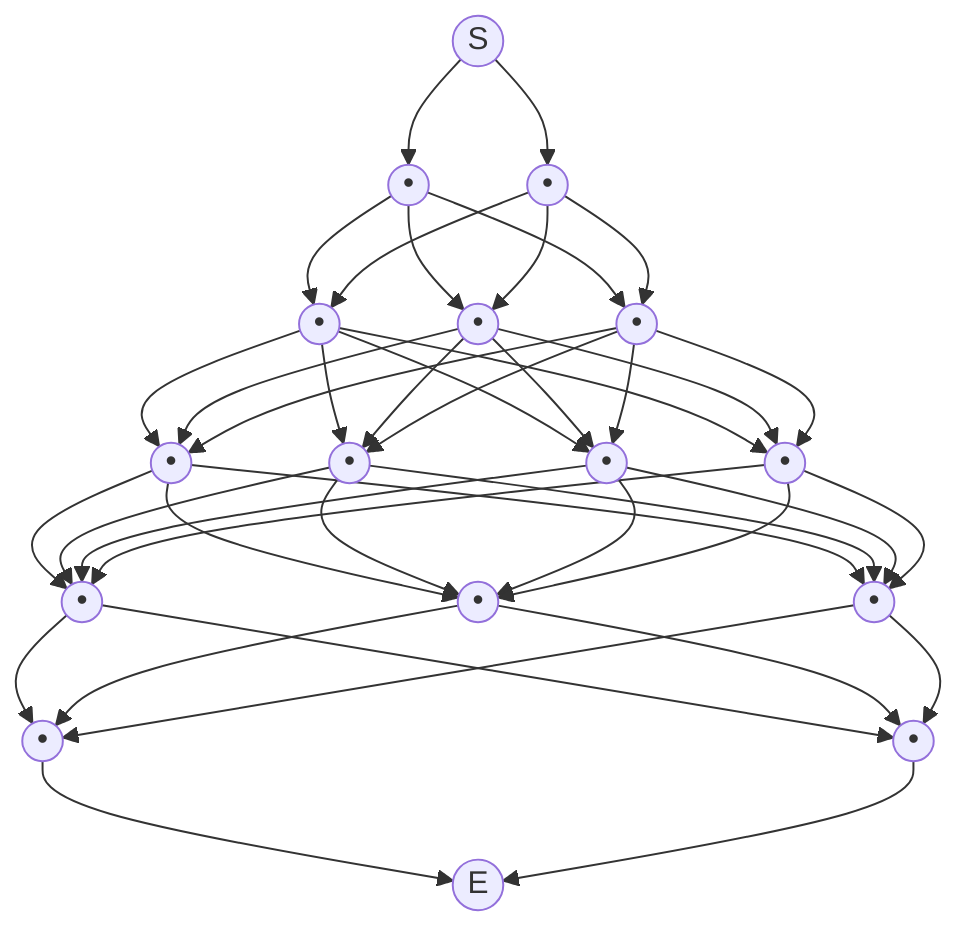

The number of choices at each step: 2, 3, 4, 3, 2, 1 (S and E are fixed). Multiplying: 2 × 3 × 4 × 3 × 2 × 1 = 144.

### Q2 (1.5 pts) – Brute-force password cracking
*A password is 3 or 4 characters long. Each character is a digit (10), a lowercase letter (26), an uppercase letter (26) or one of `, . ? !` (4). In the worst case, how many attempts must a brute-force algorithm try?*

**Answer: 19262232**

**Why:** there are 10 + 26 + 26 + 4 = 66 choices per character. The worst case tries every 3-character and every 4-character password:

66³ + 66⁴ = 287,496 + 18,974,736 = **19,262,232**

### Q3 (1.5 pts) – Romance reality show
*4 men and 4 women are matched into 4 man–woman pairs, each person having exactly one partner. How many possible outcomes are there?*

- ⁴C₁ × ⁴C₁
- ⁴P₁ × ⁴P₁
- ⁴C₄ × ⁴C₄
- ⁴C₄
- ⁴P₄ × ⁴P₄
- **⁴P₄** ✅

**Why:** fix the men in order M1–M4. Then assign them distinct women: 4 choices for M1, 3 for M2, 2 for M3, 1 for M4, which is ⁴P₄ = 4! = 24. The other options count the men's arrangements a second time or ignore order.

---

## Time Complexity (Basics)

### Q4 (1 pt) – Time complexity of `z`

```python
def z(n):
    for i in range(n):
        z(n-1)
    return
```

- O(n² log n)
- O(log n)
- O(n log n)
- **O(n!)** ✅
- O(3ⁿ)
- O(2ⁿ)
- O(log (log n))
- O(n)
- O(nⁿ)
- O(1)
- O(n³)
- O(n²)

**Why:** each call makes n recursive calls on n−1, so T(n) = n · T(n−1), which gives n · (n−1) · … · 1 = **O(n!)**.

---

## Insertion Sort

### Q5 (1 pt) – Comparisons and swaps
*Sort x = [34, 23, 12, 4, 6, 99, 3] in ascending order with the insertion sort from the slides. How many comparisons (`a[i] < a[i-1]`) and how many swaps?*

**Answer: comparisons = 17, swaps = 15**

| i | Element | Swaps | Comparisons | Array after |
|---|---|---|---|---|
| 1 | 23 | 1 | 1 | 23,34,12,4,6,99,3 |
| 2 | 12 | 2 | 2 | 12,23,34,4,6,99,3 |
| 3 | 4 | 3 | 3 | 4,12,23,34,6,99,3 |
| 4 | 6 | 3 | 4 | 4,6,12,23,34,99,3 |
| 5 | 99 | 0 | 1 | 4,6,12,23,34,99,3 |
| 6 | 3 | 6 | 6 | 3,4,6,12,23,34,99 |
| **Total** | | **15** | **17** | |

**Why:** swaps = number of inversions = 15. Each element is compared once per swap, plus one extra failing comparison when it stops before reaching index 0. That extra happens for 6 (compared with 4) and for 99 (compared with 34). 15 + 2 = 17.

### Q6 (4 pts) – Recursive `isSorted`

```python
def isSorted(a, i=0):          # a is a list of unique integers
    if i >= len(a) - 1:        # base case: 0 or 1 element left to check
        return True
    if a[i] > a[i+1]:          # found a pair out of order
        return False
    return isSorted(a, i+1)    # check the rest
```

(Alternative: `if len(a) <= 1: return True; return a[0] < a[1] and isSorted(a[1:])`)

The iterative version returns `False` as soon as it finds `a[i] > a[i+1]` and returns `True` after the loop ends. The recursive version does the same, and the base case replaces the end of the loop.

---

## Stacks & Queues

### Q7 (1 pt) – Printed output

```python
s = Stack(); q = Queue()
s.push(1); s.push(2)
q.enqueue(3); q.enqueue(4); q.enqueue(5)
print(s.peek())          # 2
s.push(q.dequeue())      # push 3
print(s.pop())           # 3
s.push(q.dequeue())      # push 4
s.push(6)
print(s.pop())           # 6
print(q.dequeue())       # 5
```

**Answer: 2365**

| Step | Stack (top on right) | Queue (front on left) | Output |
|---|---|---|---|
| after line 08 | 1, 2 | 3, 4, 5 | |
| `peek()` | 1, 2 | 3, 4, 5 | **2** |
| `s.push(q.dequeue())` | 1, 2, 3 | 4, 5 | |
| `pop()` | 1, 2 | 4, 5 | **3** |
| `s.push(q.dequeue())` | 1, 2, 4 | 5 | |
| `s.push(6)` | 1, 2, 4, 6 | 5 | |
| `pop()` | 1, 2, 4 | 5 | **6** |
| `q.dequeue()` | 1, 2, 4 | empty | **5** |

---

## Sorting with Two Stacks

### Q8 (3 pts) – Fill in the blanks

```python
def sort(list):              # list = unsorted list of ints
    stack = []
    tempstack = []
    stack.append(list[0])    # list[0] is 1st int in list

    for i in range(1, len(list)):
        currentInt = list[i]
        topStack = stack[-1]

        if (currentInt >= topStack):
            stack.append(currentInt)
        else:
            # push all greater int to tempstack
            while (currentInt < topStack):
                topStack = stack.pop()
                tempstack.append(topStack)
                if len(stack) > 0:
                    topStack = ______(answer1)______
                else:
                    break

            # push currentInt to stack
            stack.append(currentInt)

            # push tempstack back to stack
            while (len(tempstack) > 0):
                ______(answer2)______

    return stack             # return sorted list
```

**Answer1: `stack[-1]`** (also accepted: `stack[len(stack)-1]`, `stack.peek()`, `stack.peek`)

**Answer2: `stack.append(tempstack.pop())`** (also accepted: `stack.append(tempstack.pop)`, `stack.push(tempstack.pop())`, `stack.push(tempstack.pop)`)

**Why:**
- Answer1 re-reads the new top of `stack` (without removing it) so the `while` condition compares `currentInt` with it.
- Answer2 moves the elements in `tempstack` back to `stack` one at a time. Each one is popped from `tempstack` and appended to `stack`, which restores the larger elements on top of `currentInt`.
- Omit all spaces in the answer field.

---

## Algorithm Facts

### Q9 (1 pt) – Which statement is FALSE?

- To use binary search, the array must be sorted beforehand.
- The best time complexity of binary search is O(1).
- **Given the same inputs, an O(n²) algorithm is always faster than an O(2ⁿ) algorithm.** ✅
- Using a priority queue, the dequeue and peek operations will return the element in the queue with the highest priority.
- Recursion is not necessarily more efficient than iteration.

**Why:** Big-O describes growth for large n. For small inputs, or because of constant factors, an O(2ⁿ) algorithm can still be faster, so "always faster" is false. The other four statements are true.

---

## Time Complexity of Recursive and Iterative Functions

### Q10 (1 pt) – Time complexity of `f`

```python
from math import sqrt, floor

def f(a, upper=None):          # a is a list of ints
    if upper == None:          # true only 1st time f is called
        upper = len(a)
    if upper <= 1:
        return 1
    else:
        return f(a, floor(sqrt(upper)))
```

- O(n²)
- **O(log (log n))** ✅
- O(n)
- O(log n)
- O(nⁿ)
- O(1)
- O(n³)
- O(2ⁿ)
- O(3ⁿ)
- O(n log n)
- O(n!)
- O(n² log n)

**Why:** `upper` starts at n and is replaced by its square root each call: n → n^(1/2) → n^(1/4) → … The calls stop when it is ≤ 1. After k calls the value is n^(1/2ᵏ), so k = log₂(log₂ n), which is **O(log log n)**.

### Q11 (1 pt) – Time complexity of `h`

```python
def h(n):                      # n > 2
    if n % 2 == 0:
        return 0
    else:
        return h(n-1) + h(n-1)
```

- O(2ⁿ)
- O(n² log n)
- **O(1)** ✅
- O(n²)
- O(nⁿ)
- O(n³)
- O(3ⁿ)
- O(n log n)
- O(log n)
- O(n)
- O(n!)
- O(log (log n))

**Why:** if n is even, it returns immediately. If n is odd, it makes 2 calls on n−1, which is even, and each of those returns 0 at once. So there are at most 3 calls in total, whatever n is, which is **O(1)**.

### Q12 (1 pt) – Time complexity of `x`

```python
def x(n):
    sum = 0
    for i in range(n):
        j = 1
        while (j < 2**i):      # 2 asterisks is the power operator
            j = j * 2
        sum = sum * j
    return sum
```

- O(log n)
- O(n!)
- O(n³)
- O(3ⁿ)
- O(1)
- **O(n²)** ✅
- O(log (log n))
- O(n log n)
- O(n)
- O(2ⁿ)
- O(nⁿ)
- O(n² log n)

**Why:** `j` doubles from 1 until it reaches 2ⁱ, so the `while` loop runs about i times. The total is 0 + 1 + 2 + … + (n−1) = n(n−1)/2, which is **O(n²)**.

---

## Printing (Nested Calls)

```python
def f(n):
    for i in range(n):
        g(n)
        for j in range(n):
            g(j)
    return

def g(n):
    for i in range(n):
        print(i)               # O(1) operation
    return
```

### Q13 (1 pt) – How many times does line 9 (`print(i)`) execute for `f(3)`?

**Answer: 18**

**Why:** `g(k)` prints k times. For each of the 3 values of i in `f(3)`:
- `g(3)` prints 3 times.
- The inner loop calls `g(0)`, `g(1)`, `g(2)`, which print 0 + 1 + 2 = 3 times.

That is 3 + 3 = 6 per outer iteration, and 3 × 6 = **18**.

### Q14 (1 pt) – Time complexity of `f`

- O(n log n)
- O(n!)
- O(2ⁿ)
- **O(n³)** ✅
- O(nⁿ)
- O(n²)
- O(log (log n))
- O(3ⁿ)
- O(n² log n)
- O(log n)
- O(n)
- O(1)

**Why:** for each i, `g(n)` costs n and the inner loop costs 0 + 1 + … + (n−1) ≈ n²/2. So each outer iteration costs O(n²), and the n outer iterations give n × n² = **O(n³)**.

---

## Selection Sort

*The algorithm: find the smallest card and swap it into the 1st position (if it is not already there); find the 2nd-smallest and swap it into the 2nd position; and so on. Step k scans all cards from position k to the end.*

### Q15 (1 pt) – Best-case time complexity

- O(log (log n))
- O(3ⁿ)
- O(n)
- O(n² log n)
- O(n log n)
- O(log n)
- O(1)
- O(n³)
- O(2ⁿ)
- O(nⁿ)
- O(n!)
- **O(n²)** ✅

**Why:** finding the minimum always scans the whole unsorted part, even when the list is already sorted. That is (n−1) + (n−2) + … + 1 comparisons, so the best case is still **O(n²)**.

### Q16 (1 pt) – Worst-case time complexity

- **O(n²)** ✅
- O(n log n)
- O(log (log n))
- O(n)
- O(log n)
- O(nⁿ)
- O(1)
- O(n!)
- O(n² log n)
- O(n³)
- O(2ⁿ)
- O(3ⁿ)

**Why:** the number of comparisons is the same, n(n−1)/2, whatever the input order. The worst case is **O(n²)**.

### Q17 (1 pt) – Swaps in the best case

**Answer: 0**

**Why:** the best case is an already-sorted list. Each smallest card is already in position, so the "swap only if it is not already there" rule means no swaps happen.

---

## Merge Sort

```python
def rmSort(a):                 # a is an array
    if len(a) == 1:
        return a
    mid = len(a)//2
    a1 = rmSort(a[0:mid])
    a2 = rmSort(a[mid:len(a)])
    return merge2(a1, a2)

def merge2(a1, a2):
    i = 0
    j = 0
    r = []
    while i < len(a1) or j < len(a2):
        if (j == len(a2)) or (i < len(a1) and a1[i] < a2[j]):
            r.append(a1[i])    # pick item from a1
            i += 1
        else:
            r.append(a2[j])    # pick item from a2
            j += 1
    return r
```

### Q18 (2 pts) – Array returned by the 6th call of `merge2()`
*X = [50, 16, 23, 44, 16, 9, 5, 20, 72, 56, 16]*

**Answer: `[5,9,20]`** (also accepted: `5,9,20`, `[5, 9, 20]`, `5 9 20`, and similar formats)

**Trace** (the left half is sorted first, then the right half):

| Call # | Merging | Returns |
|---|---|---|
| 1 | [50] and [16] | [16,50] |
| 2 | [44] and [16] | [16,44] |
| 3 | [23] and [16,44] | [16,23,44] |
| 4 | [16,50] and [16,23,44] | [16,16,23,44,50] |
| 5 | [5] and [20] | [5,20] |
| **6** | **[9] and [5,20]** | **[5,9,20]** |

The first split is [50,16,23,44,16] and [9,5,20,72,56,16]. The left half uses calls 1 to 4. The right half then starts with [9,5,20], which splits into [9] and [5,20], giving calls 5 and 6.

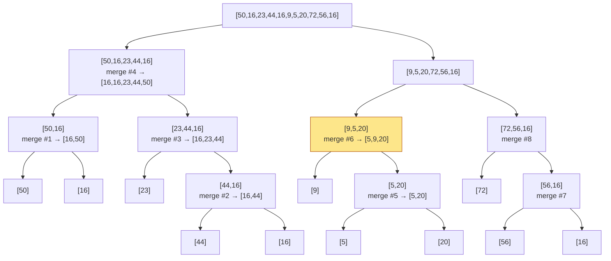

The merges happen bottom-up, left subtree first. The 6th call (highlighted) merges [9] with [5,20]. (The merges for the right half's [56,16] and [72,56,16] are #7 and #8, and the final two merges are #9 and #10.)

### Q19 (3 pts) – Recursive merge `merge3()`

```python
def merge3(a1, a2, i=0, j=0):
    if i < len(a1) or j < len(a2):
        if (j == len(a2)) or (i < len(a1) and a1[i] < a2[j]):
            return [ a1[i] ] + merge3(__(answer1)__)
        else:
            return [ a2[j] ] + merge3(__(answer2)__)

    return __(answer3)__       # base case
```

**Answer1: `a1,a2,i+1,j`**

**Answer2: `a1,a2,i,j+1`**

**Answer3: `[]`**

**Why:** taking from `a1` moves `i` forward, and taking from `a2` moves `j` forward. When both lists are used up (`i == len(a1)` and `j == len(a2)`), there is nothing left to merge, so the base case is the empty list. Omit all spaces in the answer fields.

### Q20 (3 pts) – Stack-based merge `stk_merge3()`

```python
def stk_merge3(a1, a2):
    stk = Stack()
    stk.push(0)
    stk.push(0)
    r = []

    while stk.count() > 0:
        i = stk.pop()
        j = stk.pop()
        if i < len(a1) or j < len(a2):
            if (j == len(a2)) or (i < len(a1) and a1[i] < a2[j]):
                r.append(a1[i])
                stk.push(j)
                stk.push(i+1)
            else:
                r.append(__(answer1)__)
                stk.push(__(answer2)__)
                stk.push(__(answer3)__)

    return r
```

**Answer1: `a2[j]`**

**Answer2: `j+1`** (also accepted: `1+j`)

**Answer3: `i`**

**Why:** the stack replaces the recursion's arguments. `i` is popped first and `j` second, so `j` must be pushed first and `i` last. The `if` branch takes from `a1`, so it pushes `j` then `i+1`. The `else` branch takes from `a2` and does the opposite: it appends `a2[j]`, pushes `j+1`, then pushes `i`.

---

## Closest Pair Problem

*Given a set of integers, find the closest pair. The "distance" between two ints is their absolute difference. If there are several closest pairs, the algorithm can return any one of them.*

```
01 closestPairSoFar = first 2 ints in the list
02 closestDistSoFar = absolute(a-b)
03
04 for each pair of integers in the list (currentPair):
05     currentDist = absolute(1st int in currentPair - 2nd int in currentPair)
06     if currentDist < closestDistSoFar:
07         closestPairSoFar = currentPair
08         closestDistSoFar = currentDist
09
10 return closestPairSoFar
```

### Q21 (1 pt) – Time complexity of the brute-force algorithm

- O(2ⁿ)
- O(1)
- O(n² log n)
- **O(n²)** ✅
- O(n)
- O(3ⁿ)
- O(n!)
- O(n log n)
- O(log (log n))
- O(n³)
- O(nⁿ)
- O(log n)

**Why:** there are n(n−1)/2 pairs and each is checked in O(1), so the total is **O(n²)**.

### Q22 (4 pts) – A better algorithm

**Idea:** after sorting, the closest pair must be two *neighbours* in the sorted order. If some pair (a, c) had an element b between them, then (a, b) and (b, c) would both be closer than (a, c). So only n−1 neighbouring pairs need to be checked.

```python
def closest_pair(nums):                  # nums: list of ints, len >= 2
    s = sorted(nums)                     # O(n log n), e.g. merge sort
    best_pair = (s[0], s[1])
    best_dist = s[1] - s[0]
    for i in range(1, len(s) - 1):       # O(n)
        d = s[i+1] - s[i]
        if d < best_dist:
            best_pair = (s[i], s[i+1])
            best_dist = d
    return best_pair
```

**Worst-case time complexity: O(n log n)**

- Sorting (merge sort) is O(n log n).
- The single scan over adjacent pairs is O(n).
- Total: O(n log n) + O(n) = **O(n log n)**, which is better than the brute-force O(n²).

(Q22 was a written-response question, so the screenshot gives no model answer. This is a solution of my own.)

---

# Mock Midterm 2 (Q&A Compilation)

> Answers marked ✅ are the options the screenshots show as correct (the arrow ➜ points at the right option). For typed-answer questions, the value in blue brackets is the correct answer shown in the screenshot. The working is mine, checked against those answers.

---

## Counting

### Q1 (1 pt) – Seating 16 participants on stools in a square
*16 participants sit on stools arranged in a square, with 4 stools on each row. Two arrangements are identical if the same participants sit in the same row and the order of everyone's relative positions is the same (i.e. one is a rotation of the other). How many different seating arrangements are there?*

Each ○ is a stool. The numbers are the participants. The four diagrams below are all the **same** arrangement, turned a quarter turn each time (this is Figure 1B):

**Arrangement A**

```
     1   2   3   4
     ○   ○   ○   ○
16 ○                  ○ 5
15 ○                  ○ 6
14 ○                  ○ 7
13 ○                  ○ 8
     ○   ○   ○   ○
     12  11  10  9
```

**Arrangement B (A rotated 90° clockwise)**

```
     13  14  15  16
     ○   ○   ○   ○
12 ○                  ○ 1
11 ○                  ○ 2
10 ○                  ○ 3
 9 ○                  ○ 4
     ○   ○   ○   ○
     8   7   6   5
```

**Arrangement C (A rotated 180°)**

```
     9   10  11  12
     ○   ○   ○   ○
 8 ○                  ○ 13
 7 ○                  ○ 14
 6 ○                  ○ 15
 5 ○                  ○ 16
     ○   ○   ○   ○
     4   3   2   1
```

**Arrangement D (A rotated 270° clockwise)**

```
     5   6   7   8
     ○   ○   ○   ○
 4 ○                  ○ 9
 3 ○                  ○ 10
 2 ○                  ○ 11
 1 ○                  ○ 12
     ○   ○   ○   ○
     16  15  14  13
```

The layout shows the same people in the same relative order going round the square, so these four count as **one** arrangement.

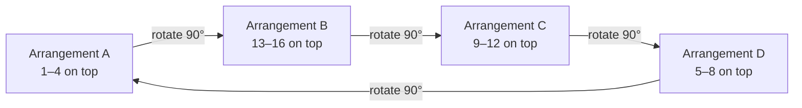

Rotating a full circle takes 4 quarter-turns, so every seating appears 4 times in the count. Dividing by 4 removes the repeats.

- **¹⁶C₄ × ¹²C₄ × ⁸C₄ × ⁴C₄ × (4!)⁴ / 4** ✅
- ¹⁶C₄ × ¹²C₄ × ⁸C₄ × ⁴C₄ × (4!)³
- ¹⁶P₄ × ¹²P₄ × ⁸P₄ × ⁴P₄
- ¹⁶P₄ × ¹²P₄ × ⁸P₄ × ⁴P₄ × 3!

**Why:**
1. Choose who sits on each of the 4 rows (top, right, bottom, left): ¹⁶C₄ × ¹²C₄ × ⁸C₄ × ⁴C₄.
2. Order the 4 people within each row: (4!)⁴.
3. Every arrangement has 4 rotations that look identical (see the four diagrams), and no arrangement is its own rotation, so divide by 4.

(¹⁶C₄ × ¹²C₄ × ⁸C₄ × ⁴C₄ = 16!/(4!)⁴, so the answer is the same as 16!/4. Also, ¹⁶P₄ × ¹²P₄ × ⁸P₄ × ⁴P₄ already includes the ordering, so it counts the 4 rotations separately.)

### Q2 (1 pt) – Sets of 4 representatives
*All 16 participants are seated and each of the 4 rows sends one representative. How many different sets of 4 participants could there be?*

**Answer: 256**

**Why:** each row has 4 people and sends exactly 1, so there are 4 choices per row. For the 4 rows: 4 × 4 × 4 × 4 = 4⁴ = **256**.

### Q3 (1 pt) – Palindromic lists
*From the collection {'a','a','b','b','c','c','@'}, how many different palindromic lists can be formed? (ⁿPₙ means "full permutation".)*

- 6!
- **³P₃** ✅
- ⁶C₃
- ⁶P₆
- 3²

**Why:** a palindrome of 7 elements has a middle element, and every other element needs a matching partner. The only unpaired element is '@', so it must be in the middle. The first 3 positions then hold a permutation of a, b, c, and the last 3 positions are forced to mirror them. That gives ³P₃ = 3! = **6** lists, for example `[a, b, c, @, c, b, a]`.

---

## Palindromes with a Stack

### Q4 (4 pts) – `is_palindromic`

```python
def is_palindromic(input):
    s = Stack()                          # empty stack
    count = 0

    while count < __(1)__:
        s.push(input[count])
        count += 1

    if __(2)__:
        count += 1

    while count < len(input):
        element = s.pop()
        if element != input[count]:
            __(3)__
        count += 1
    __(4)__
```

**Answer (1): `len(input)//2`**

**Answer (2): `len(input)%2==1`** (also accepted: `len(input)%2!=0`)

**Answer (3): `return False`**

**Answer (4): `return True`**

**Why:**
- The first loop pushes the **first half** of the list onto the stack.
- If the length is odd, the middle element has no partner, so `count += 1` skips it.
- The second loop pops the stack, which gives the first half in reverse order, and compares each popped element with the **second half** in order. Any mismatch means it is not a palindrome, so `return False`.
- `return True` goes after the loop (at function level), since every pair matched.
- Each element is pushed once and popped once, so the time complexity is O(n).

---

## Palindromic Rearrangement

### Q5 (5 pts) – A faster `hasPalindromicArr`
*The original counts each element's occurrences, which is O(n²). It returns True if all counts are even or exactly one count is odd. Write an algorithm with a better time complexity.*

**Idea:** a list can be rearranged into a palindrome if and only if **at most one** distinct element appears an odd number of times. Track the odd-count elements in one pass using a set.

```python
def hasPalindromicArr(a):
    odd = set()
    for x in a:                  # one pass: O(n)
        if x in odd:
            odd.remove(x)        # seen an even number of times so far
        else:
            odd.add(x)           # seen an odd number of times so far
    return len(odd) <= 1
```

**Worst-case time complexity: O(n)** (set add, remove and lookup are O(1) on average).

**Alternative without a set (sorting):**

```python
def hasPalindromicArr(a):
    s = sorted(a)                # O(n log n)
    odd_count = 0
    i = 0
    while i < len(s):            # O(n): count each run of equal values
        j = i
        while j < len(s) and s[j] == s[i]:
            j += 1
        if (j - i) % 2 == 1:
            odd_count += 1
        i = j
    return odd_count <= 1
```

This version is **O(n log n)**, which is still better than O(n²).

(Q5 was a written-response question, so the screenshot gives no model answer. These are solutions of my own.)

---

## Stack Orderings

### Q6 (2 pts) – Which sequence **cannot** be `list_x`?
*['a','b','c','d','e','f'] are pushed in this order. Between pushes, we may pop whenever the stack is not empty, and each popped element is appended to `list_x`.*

- **['d','b','c','a','e','f']** ✅ (cannot be)
- **['d','c','e','f','a','b']** ✅ (cannot be)
- ['a','c','e','d','b','f'] (possible)
- **['f','a','b','c','d','e']** ✅ (cannot be)
- ['f','e','d','c','b','a'] (possible)

**Why:** a stack gives last-in, first-out, so after popping an element, the next pop must be the current top.

| Sequence | Check | Possible? |
|---|---|---|
| d, b, c, a, e, f | push a,b,c,d and pop d. The top is now c, but b comes next. | No |
| d, c, e, f, a, b | pop d, c. Push e, pop e. Push f, pop f. Stack is now a, b (top b), but a comes next. | No |
| a, c, e, d, b, f | push a, pop a. Push b, c, pop c. Push d, e, pop e, pop d. Pop b. Push f, pop f. | Yes |
| f, a, b, c, d, e | push everything, pop f. Top is e, but a comes next. | No |
| f, e, d, c, b, a | push everything, then pop all. | Yes |

---

## Insertion Sort and Recursion

### Q7 (2 pts) – Possible time complexities of insertion sort (select 3)

- O(√n)
- **O(n log n)** ✅
- **O(n²)** ✅
- **O(n)** ✅

**Why:** the running time is about n + (number of inversions). A sorted list has 0 inversions, giving O(n) (best case). A reversed list has n(n−1)/2 inversions, giving O(n²) (worst case). Other inputs fall in between, for example O(n log n). O(√n) is impossible, because every element must be looked at at least once, so the time is at least O(n).

### Q8 (1 pt) – Output of `mystery(20)`

```python
def mystery(n):
    if n == 0:
        return 1
    else:
        if n%2 == 0:
            return mystery(n//2) + mystery(n//2)
        else:
            return mystery(n//2) * mystery(n//2)
```

- 64
- **16** ✅
- 32
- 256

**Trace:**
- mystery(1) = mystery(0) × mystery(0) = 1 × 1 = 1
- mystery(2) = mystery(1) + mystery(1) = 2
- mystery(5) = mystery(2) × mystery(2) = 4
- mystery(10) = mystery(5) + mystery(5) = 8
- mystery(20) = mystery(10) + mystery(10) = **16**

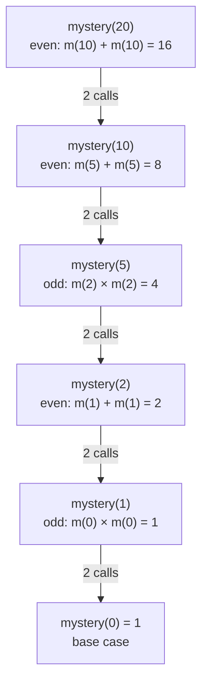

Each level has 2 calls to the same value, so the answers double or square as they come back up (1 → 2 → 4 → 8 → 16).

### Q9 (1 pt) – Complexity of the function in Q8

- O(n log n)
- **O(n)** ✅
- O(n²)
- O(2ⁿ)

**Why:** each call makes 2 recursive calls on n//2, plus O(1) work. So T(n) = 2T(n/2) + O(1), which solves to **O(n)**: there are about 1 + 2 + 4 + … ≈ 2n calls in total.

---

## Recursion on Strings

### Q10 (4 pts) – `repeat_char`

```python
def repeat_char(s, k, i=0):
    if len(s) == 0:
        return __(1)__
    elif i < k:
        return __(2)__ + repeat_char(__(3)__, __(4)__, __(5)__)
    else:
        return repeat_char(__(6)__, __(7)__, __(8)__)
```

| Blank | Answer |
|---|---|
| (1) | `""` (also accepted: `''`) |
| (2) | `s[0]` |
| (3) | `s` |
| (4) | `k` |
| (5) | `i+1` (also accepted: `1+i`) |
| (6) | `s[1:]` |
| (7) | `k` |
| (8) | `0` |

**Why:** `i` counts how many copies of the first character have been output so far.
- While `i < k`, output `s[0]` and recurse on the same string with `i+1`.
- Once `i == k`, drop the first character (`s[1:]`) and reset `i` to `0`.
- An empty string returns `""`.

**Trace of `repeat_char('ab', 2)`:** `'a' + repeat_char('ab',2,1)` → `'a' + 'a' + repeat_char('ab',2,2)` → `repeat_char('b',2,0)` → `'b' + 'b' + repeat_char('b',2,2)` → `repeat_char('',2,0)` → `""`. Result: `'aabb'`.

---

## Big-O of Code Fragments

### Q11 (1 pt)

```python
test = 0
for i in range(n):
    for j in range(n):
        test = test + i * j
```

- O(log n)
- O(n)
- **O(n²)** ✅
- O(n³)

**Why:** two nested loops of n iterations each, with O(1) work inside: n × n = O(n²).

### Q12 (1 pt)

```python
def f(n):
    k = 0
    for i in range(n//2):
        j = 1
        while (j < n):
            k = k + n / 2
            j = j * 2
```

- O(log n)
- O(n)
- O(n²)
- **O(n log n)** ✅

**Why:** the `while` loop doubles `j` until it reaches n, so it runs about log n times. The outer loop runs n/2 times. Total: (n/2) × log n = **O(n log n)**.

### Q13 (1 pt)

```python
i = n
while i > 0:
    k = i + 2
    i = i // 2
```

- O(n)
- O(n log n)
- O(n²)
- **O(log n)** ✅
- O(n³)

**Why:** `i` is halved every iteration, so the loop runs about log₂ n times.

---

## Insertion Sort (Partial Passes)

### Q14 (1 pt)
*Sort [15, 5, 4, 18, 12, 19, 14, 10, 8, 20]. Which list is the result after three complete passes of insertion sort?*

- [4, 5, 12, 15, 14, 10, 8, 18, 19, 20]
- [15, 5, 4, 18, 12, 19, 14, 8, 10, 20]
- **[4, 5, 15, 18, 12, 19, 14, 10, 8, 20]** ✅
- [15, 5, 4, 10, 12, 8, 14, 18, 19, 20]

**Trace:**

| Pass | Element inserted | List after |
|---|---|---|
| 1 | 5 | 5, 15, 4, 18, 12, 19, 14, 10, 8, 20 |
| 2 | 4 | 4, 5, 15, 18, 12, 19, 14, 10, 8, 20 |
| 3 | 18 | 4, 5, 15, 18, 12, 19, 14, 10, 8, 20 (18 is already in place) |

After 3 passes, the first 4 elements are sorted and the rest are untouched.

---

## Merge and Maximum Product

### Q15 (5 pts) – Recursive `merge(s1, s2)` for sorted strings

```python
def merge(s1, s2):
    # base case(s)
    if s1 == "":
        return s2
    if s2 == "":
        return s1

    # reduction step
    if s1[0] <= s2[0]:
        return s1[0] + merge(s1[1:], s2)
    else:
        return s2[0] + merge(s1, s2[1:])
```

**Trace of `merge("acu", "bst")`:** a, then b, then c, then s, then t, then the remaining "u" → **"abcstu"**.

(Q15 was a written-response question, so the screenshot gives no model answer. This is a solution of my own.)

### Q16 (5 pts) – Brute-force `findMaxPair`

```python
def findMaxPair(sequence):
    product = 0
    for i in range(len(sequence)):
        for j in range(i + 1, len(sequence)):     # every pair of different positions
            if sequence[i] * sequence[j] > product:
                product = sequence[i] * sequence[j]
    return product
```

It checks all n(n−1)/2 pairs, so it is O(n²). For [5, 6, 2, 7, 4] it returns 6 × 7 = **42**.

### Q17 (3 pts) – A faster algorithm

**Idea:** all numbers are non-negative, so the maximum product comes from the **two largest** elements. Find them in one pass instead of trying all pairs.

```python
def findMaxPair(sequence):
    largest = 0
    second = 0
    for x in sequence:                 # one pass
        if x >= largest:
            second = largest
            largest = x
        elif x > second:
            second = x
    return largest * second
```

**Worst-case time complexity: O(n)** (a single pass with O(1) work per element).

(Alternative: sort the sequence, then multiply the last two elements. That is O(n log n), which is still better than O(n²).)

(Q16 and Q17 were written-response questions, so the screenshots give no model answers. These are solutions of my own.)

---

## Binary Search on a Rotated Array

### Q18 (4 pts) – Fill in the blanks

```python
def search(nums, target):
    lower = 0
    upper = len(nums) - 1

    while lower <= upper:
        mid = (lower + upper) // 2

        if __(1)__:
            return mid

        if __(2)__:                                  # left half is sorted
            if __(3)__ and target < nums[mid]:
                upper = mid - 1
            else:
                lower = mid + 1
        else:                                        # right half is sorted
            if __(4)__ and target <= nums[upper]:
                lower = mid + 1
            else:
                upper = mid - 1
    return -1
```

**Answer (1): `nums[mid]==target`** (also accepted: `target==nums[mid]`)

**Answer (2): `nums[mid]>=nums[lower]`** (also accepted: `nums[lower]<=nums[mid]`)

**Answer (3): `nums[lower]<=target`** (also accepted: `target>=nums[lower]`)

**Answer (4): `nums[mid]<target`** (also accepted: `target>nums[mid]`)

**Why:** in a rotated sorted array, at least one half around `mid` is always sorted.
- If `nums[mid] >= nums[lower]`, the **left half** `[lower..mid]` is sorted. If the target lies in `[nums[lower], nums[mid])`, search left (`upper = mid - 1`). Otherwise search right.
- Otherwise the **right half** `[mid..upper]` is sorted. If the target lies in `(nums[mid], nums[upper]]`, search right (`lower = mid + 1`). Otherwise search left.
- Each step halves the search range, so the time complexity is O(log n).
- Omit all spaces in the answer fields.

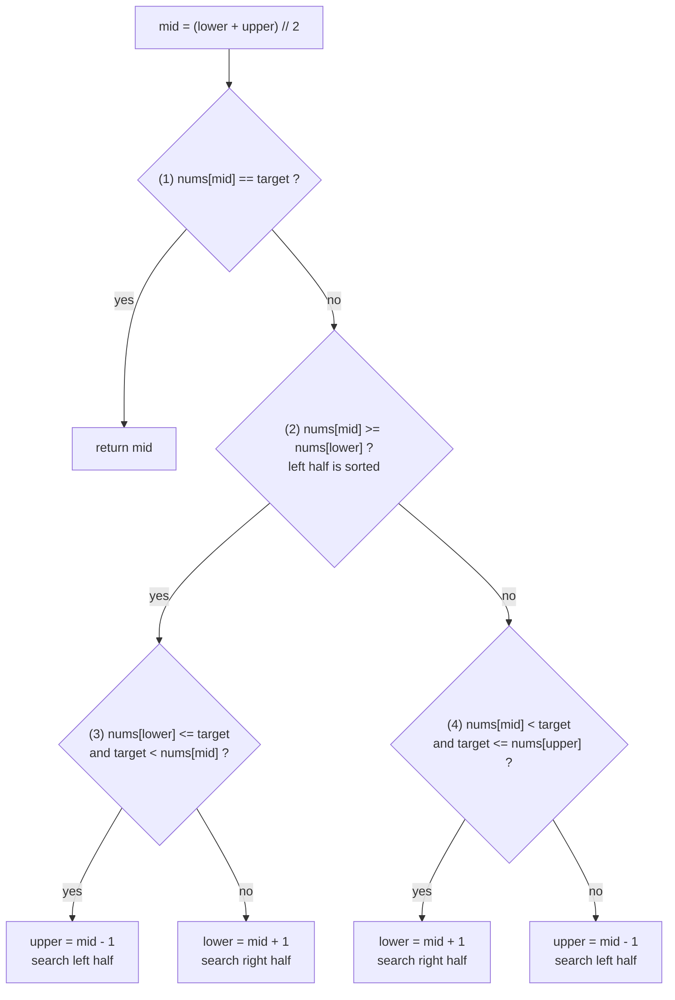

---

# Mock Midterm 3 (Q&A Compilation)

> Answers marked ✅ are the options the screenshots show as correct (the arrow ➜ points at the right option). For typed-answer questions, the value in blue brackets is the correct answer shown in the screenshot. The working is mine, checked against those answers. Diagrams are drawn with Mermaid.

---

## Counting

### Q1 (1 pt) – Seating 15 men and 15 women at 3 identical circular tables
*Each table has 5 men and 5 women seated alternately. Two seatings of a table are the same if every person has the same two neighbours, ignoring left and right (so a reflection counts as the same).*

- **[(¹⁵C₅)² (¹⁰C₅)² (4! · 5!)³] / (2³ · 3!)** ✅
- [(¹⁵C₅)² (¹⁰C₅)² (4! · 5!)²] / 3
- [(¹⁵C₅)² (¹⁰C₅)² (4! · 5!)³] / 2³
- [(¹⁵C₅)² (¹⁰C₅)² (4! · 5!)²] / (2³ · 3)

**Why:**
1. **Split the men into groups** for tables 1, 2, 3: ¹⁵C₅ × ¹⁰C₅ × ⁵C₅. Do the same for the women. Together: (¹⁵C₅ × ¹⁰C₅)² (the last factor ⁵C₅ = 1).
2. **Seat each table.** Fix one man's seat to remove rotations, then arrange the other 4 men in 4! ways. The 5 women fill the 5 gaps between the men in 5! ways. That is 4! · 5! per table, so (4! · 5!)³ for 3 tables.
3. **Reflections:** each table's mirror image has the same neighbours, so divide by 2 for each table: 2³.
4. **Identical tables:** the 3 tables can be swapped without changing the seating, so divide by 3!.

One table, with men (M) and women (W) alternating around the circle:

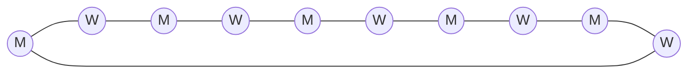

---

## Merge Sort and Searching

### Q2 (1 pt) – Worst-case comparisons when merging two sorted lists of 50 elements

- 199
- 100
- 200
- **99** ✅
- 50

**Why:** each comparison puts one element into the result. The worst case is when the lists alternate, so that one list runs out only when the other has 1 element left. The last element is then placed with no comparison. Total: 50 + 50 − 1 = **99**.

---

## Time Complexity

### Q3 (1 pt) – Time complexity of `mystery(n, m)`

```python
def mystery(n, m):
    if n <= 1:           # base case
        return 0
    else:
        mystery(n-1, m+1)
        mystery(n-1, m-1)
```

- O(n log n)
- O(1)
- O(log n)
- **O(2ⁿ)** ✅
- O(n²)
- O(n)

**Why:** each call makes 2 calls with n reduced by 1, so T(n) = 2T(n−1) + O(1), which is **O(2ⁿ)**. The calls form a binary tree whose depth is about n, and the number of calls doubles at every level:

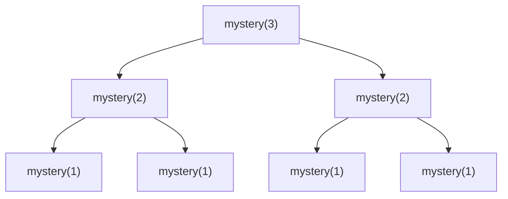

### Q4 (1 pt)

```python
test = 0
for i in range(n):
    for j in range(i):
        test = test + i + j*j
```

- O(n log n)
- **O(n²)** ✅
- O(log n)
- O(n³)
- O(n)

**Why:** the inner loop runs i times, so the total is 0 + 1 + … + (n−1) = n(n−1)/2, which is **O(n²)**.

### Q5 (1 pt)

```python
def f(n):
    k = 0
    for i in range(n//3, n):
        j = 1
        while (j < n//3):
            k = k + n
            j = j + 3
```

- O(2ⁿ)
- O(log n)
- O(n log n)
- O(n)
- **O(n²)** ✅

**Why:** the outer loop runs n − n/3 = 2n/3 times. The `while` loop adds 3 each time up to n/3, so it runs about n/9 times (linear, not logarithmic). Total: (2n/3) × (n/9) = **O(n²)**.

### Q6 (1 pt) – Order the functions by increasing growth

- f₁(n) = 2ⁿ
- f₂(n) = n^(3/2)
- f₃(n) = n log n
- f₄(n) = n^(log n)

Options:
- f₂, f₃, f₄, f₁
- f₂, f₃, f₁, f₄
- f₁, f₂, f₃, f₄
- **f₃, f₂, f₄, f₁** ✅
- f₃, f₂, f₁, f₄

**Why:**
- n log n grows slower than n^1.5, because log n grows slower than √n.
- n^(log n) = 2^((log n)²). Its exponent (log n)² eventually beats the fixed 1.5·log n of n^1.5, so it is larger than n^1.5.
- 2ⁿ = 2^n has an exponent n, which beats (log n)², so it is the largest.

Order: **n log n < n^1.5 < n^(log n) < 2ⁿ**.

### Q7 (1 pt) – Which `while` loop is most efficient?

| Loop | Behaviour | Iterations |
|---|---|---|
| [A] `i=0; while i<n: i+=1` | step 1 | n |
| [B] `i=0; while i<n: i+=2` | step 2 | n/2 |
| [C] `i=1; while i<n: i*=2` | doubles | log₂ n |
| [D] `i=n; while i>-1: i//=2` | halves, but never goes below 0 | never ends |

- A
- B
- **C** ✅
- D

**Why:** [C] doubles `i`, so it takes only about log₂ n iterations, which is **O(log n)**. In [D], once `i` reaches 0, `0 // 2` stays 0 and `0 > -1` is always true, so it is an infinite loop. [A] and [B] are both O(n).

---

## Stack Orderings

### Q8 (2 pts) – Which sequence **cannot** be `list_x`?
*['1','2','3','4','5','6'] are pushed in this order, and pops may happen at any time when the stack is not empty.*

- **['4','3','5','6','1','2']** ✅ (cannot be)
- **['6','1','2','3','4','5']** ✅ (cannot be)
- **['4','2','3','1','5','6']** ✅ (cannot be)
- ['6','5','4','3','2','1'] (possible)
- ['1','3','5','4','2','6'] (possible)

**Why:** a stack is last-in, first-out, so each pop must return the current top.

| Sequence | Check | Possible? |
|---|---|---|
| 4,3,5,6,1,2 | push 1–4, pop 4, 3. Push 5, pop 5. Push 6, pop 6. Stack is 1, 2 (top 2), but 1 comes next. | No |
| 6,1,2,3,4,5 | push all, pop 6. Top is 5, but 1 comes next. | No |
| 4,2,3,1,5,6 | push 1–4, pop 4. Top is 3, but 2 comes next. | No |
| 6,5,4,3,2,1 | push all, then pop all. | Yes |
| 1,3,5,4,2,6 | push 1, pop 1. Push 2, 3, pop 3. Push 4, 5, pop 5, 4. Pop 2. Push 6, pop 6. | Yes |

---

## Merge Sort Twice

### Q9 (2 pts) – Merge sort run twice on a list sorted in descending order
*The output of the first merge sort becomes the input of the second. What is the possible overall time complexity? (Select all correct answers.)*

- **O(n log n)** ✅
- O(n²)
- O((n log n)²)
- O(n² log n)

**Why:** merge sort always costs about n log n, whatever the input order, because it always splits the list into halves and merges at every level. The second sort receives an ascending list, and it still does the same amount of work. The total is n log n + n log n = **O(n log n)**.

The other options are only loose upper bounds, since the real running time never gets that large.

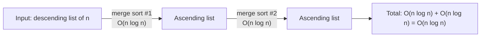

---

## Counting Arrangements

### Q10 (1 pt) – Arranging YANKEE-DOODLE

*How many ways can the 13 characters of YANKEE-DOODLE be arranged so that the first and last characters are not "-", and all the vowels (A, E, E, E, O, O) are together in any order?*

**Answer: 907200**

**Working:**
1. **Vowels as one block.** The vowels are A, E, E, E, O, O. Treat them as one unit. The other units are the consonants Y, N, K, D, D, L and the "-". That is 8 units in total: block, Y, N, K, D, D, L, "-".
2. **Place the "-".** It cannot be first or last, so it goes in one of the 6 middle positions: 6 ways.
3. **Arrange the other 7 units** (block, Y, N, K, D, D, L) in the remaining 7 positions. The two D's are identical: 7!/2! = 2520.
4. **Order inside the vowel block:** 6!/(3! · 2!) = 60 (three identical E's and two identical O's).

Total = 6 × 2520 × 60 = **907,200**.

---

## Recursion

### Q11 (1 pt) – Output of `mystery(1, 2, 3)`

```python
def mystery(x, y, n):
    if n == 0:                     # base case
        return 0
    if n%2 != 0:                   # if n is odd
        return mystery(x, y, n-1) + (n * y)
    else:                          # if n is even
        return mystery(x, y, n-1) + (n * x)
```

**Answer: 10**

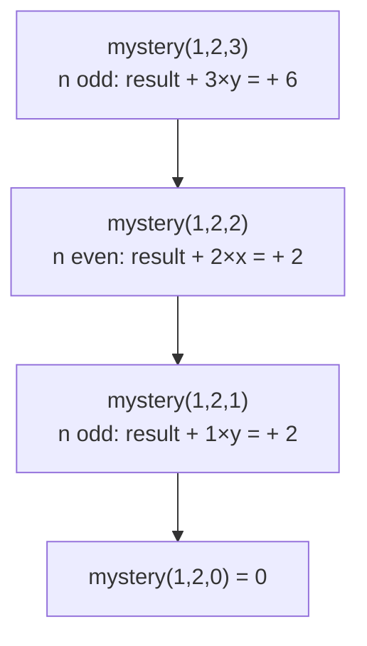

Working back up: 0 + 2 = 2, then 2 + 2 = 4, then 4 + 6 = **10**.

### Q12 (4 pts) – Stack-based `power4(x, n)`

```python
def power4(x, n):
    s = Stack()
    s.push(n)
    __(1)__                          # initialize result
    while s.count() > 0:
        s.display()
        __(2)__
        if current > 0:              # current is read from stack
            __(3)__                  # calculation
            __(4)__                  # update stack
    return result
```

**Answer (1): `result=1`** (also accepted: `result = 1`, `result= 1`)

**Answer (2): `current=s.pop()`**

**Answer (3): `result=x*result`** (also accepted: `result=result*x`, `result*=x`)

**Answer (4): `s.push(current-1)`**

**Why:** the stack holds the exponent that is still left to process. Each time, pop the current exponent. If it is above 0, multiply the result by `x` once and push `current-1` back. When the exponent reaches 0, the stack is empty and the loop ends. It runs n times, so the result is xⁿ. Omit all spaces in the answer fields.

**Trace of `power4(2, 3)`:**

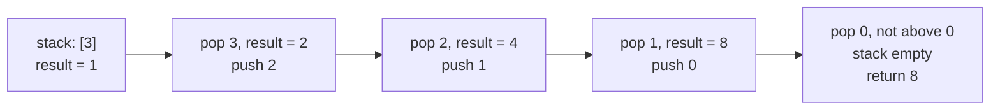

### Q13 (5 pts) – `mirror(s)`

```python
def mirror(s):
    if __(1)__:
        return __(2)__
    else:
        return __(3)__ + mirror(__(4)__) + __(5)__
```

**Answer (1): `len(s)==0`** (also accepted: `s==''`, `s==""`)

**Answer (2): `""`** (also accepted: `''`, `s`)

**Answer (3): `s[0]`** (also accepted: `s[0:1]`)

**Answer (4): `s[1:]`** (also accepted: `s[1:len(s)]`)

**Answer (5): `s[0]`** (also accepted: `s[0:1]`)

**Why:** the mirror of a string is `first char + mirror(rest) + first char`. An empty string has nothing to mirror, so it returns `""`.

**Trace of `mirror('abbc')`:**
- `mirror('c')` = `c` + `""` + `c` = `cc`
- `mirror('bc')` = `b` + `cc` + `b` = `bccb`
- `mirror('bbc')` = `b` + `bccb` + `b` = `bbccbb`
- `mirror('abbc')` = `a` + `bbccbb` + `a` = **`abbccbba`**

---

## Pascal's Triangle

### Q14 (4 pts) – Stack-based `pt(n, k)`

`pt(n, k)` returns the kth term (k from 1 to n+1) on level n. Each term is the sum of the two terms above it. The edge terms (k = 1 and k = n+1) are 1.

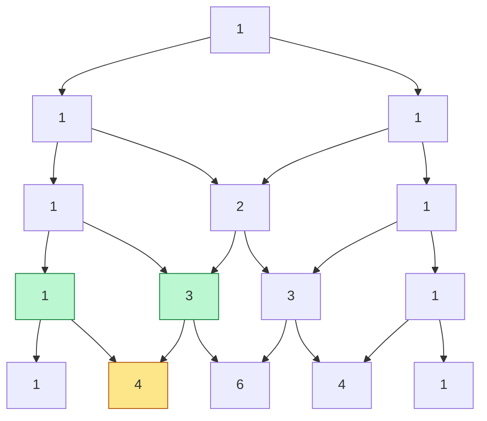

The highlighted example: level 4's second term, 4 = pt(4,2) = pt(3,1) + pt(3,2) = 1 + 3.

```python
def stk_pt(n, k):
    s = Stack()
    s.push(k)                         # push the pending sub-problem (n, k)
    s.push(n)
    total = 0
    while s.count() > 0:
        n = s.pop()                   # n was pushed last, so pop it first
        k = s.pop()
        if k == 1 or k == n+1:        # base case: edge of the triangle
            total += 1
        else:                         # split into the two terms above
            s.push(k-1)
            s.push(n-1)               # pt(n-1, k-1)
            s.push(k)
            s.push(n-1)               # pt(n-1, k)
    return total
```

**Idea:** the stack holds the sub-problems still to be solved. A term on an edge contributes 1 to `total`. Any other term is replaced by the two terms above it. The final `total` is the sum of all the 1's reached, which equals the recursive result.

**Trace of `stk_pt(2, 2)`:**
- Pop (2,2): not an edge, so push (1,1) and (1,2).
- Pop (1,2): k = n+1, so it is an edge → total = 1.
- Pop (1,1): k = 1, so it is an edge → total = 2.
- The stack is empty → returns **2**. ✓

(Q14 was a written-response question, so the screenshot gives no model answer. This is a solution of my own.)

---

## Strings

### Q15 (4 pts) – First non-repeating character

```python
def firstNonRepeatChar(s):
    counts = {}
    for ch in s:                          # pass 1: count each character, O(n)
        counts[ch] = counts.get(ch, 0) + 1
    for ch in s:                          # pass 2: first one with count 1, O(n)
        if counts[ch] == 1:
            return ch
    return None                           # no non-repeating character
```

**Time complexity: O(n)** (two passes, with O(1) dictionary operations on average).

**Examples:**
- `"abcxabcabc"` → a, b and c each appear 3 times, x appears once → **"x"**.
- `"abacx"` → a appears twice, b once → **"b"**.
- `"xxaabb"` → all repeat → **None**.
- `"abybaxa"` → y and x are unique, y comes first → **"y"**.

**Alternative without a dictionary (brute force, O(n²)):** for each character, scan the whole string and count its occurrences. Return the first character whose count is 1.

(Q15 was a written-response question, so the screenshot gives no model answer. This is a solution of my own.)

---

## Priority Queue (Unsorted List)

*The queue is an unsorted list `ulist`. `enqueue(x)` appends to the back, and `dequeue()` scans the whole list for the smallest number (highest priority) and removes it. The proposed improvement keeps a global variable `index` for the position of the highest-priority element, and the new `peek()` is just `return ulist[index]`.*

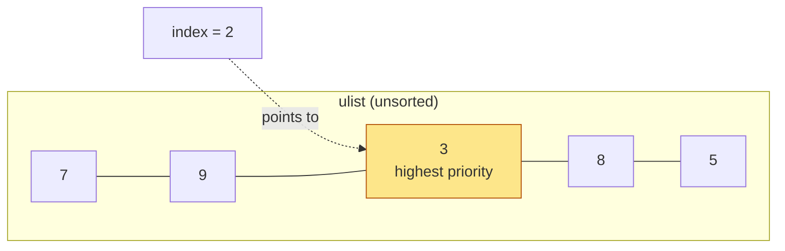

### Q16 (1 pt) – Worst-case time of the new `peek()`

- O(log n)
- **O(1)** ✅
- O(n)
- O(2ⁿ)
- O(n²)
- O(n log n)

**Why:** `peek()` only reads `ulist[index]`, which takes constant time.

### Q17 (1 pt) – Time of the new `enqueue()`

- O(log n)
- O(n log n)
- O(2ⁿ)
- **O(1)** ✅
- O(n)
- O(n²)
- O(n!)

**Why:** after appending, compare the new element with `ulist[index]`. If it is smaller, set `index` to the new last position. That is one comparison and one append, so it takes constant time.

### Q18 (1 pt) – Time of the new `dequeue()`

- O(n log n)
- **O(n)** ✅
- O(1)
- O(log n)
- O(2ⁿ)
- O(n!)
- O(n²)

**Why:** `dequeue()` can remove `ulist[index]` directly (the `pop` is O(n) anyway because the later elements shift). But `index` must then point to the **new** highest-priority element, and the list is unsorted, so this needs a full scan. That is **O(n)**.

---

## Ternary Search

*Ternary search uses two mid-points, `mid1` and `mid2`, to split the range into 3 parts. If the key is not found at either mid-point, 2 of the 3 parts are discarded.*

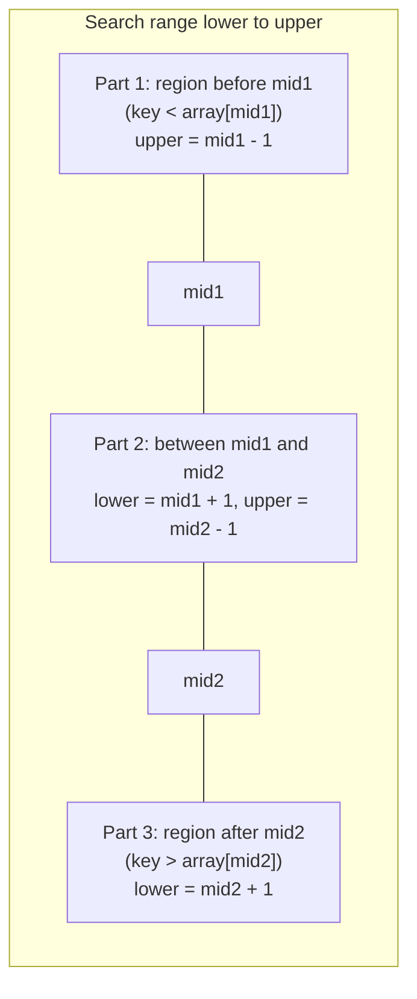

### Q19 (1 pt) – Number of `while` iterations for `tSearch([5, 8, 10, 12, 18, 20, 24], 3)`

- 1
- **2** ✅
- 3
- 4
- 5

**Trace:**

| Iteration | lower | upper | mid1 | mid2 | Comparison | Result |
|---|---|---|---|---|---|---|
| 1 | 0 | 6 | 0 + 6//3 = **2** (10) | 6 − 2 = **4** (18) | 3 < 10 | `upper = 1` |
| 2 | 0 | 1 | 0 + 1//3 = **0** (5) | 1 − 0 = **1** (8) | 3 < 5 | `upper = -1` |

Now `upper (-1) < lower (0)`, so the loop stops after **2 iterations** and returns -1.

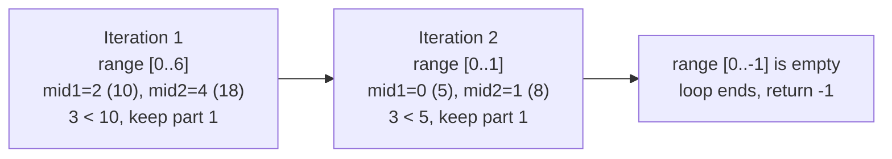

### Q20 (1 pt) – Worst-case iterations of ternary search

- n × log₂ n
- **log₃ n** ✅
- n
- 2ⁿ
- log₂ n
- 3ⁿ

**Why:** each iteration keeps at most one-third of the range, so the size goes n → n/3 → n/9 → … After k iterations it is n/3ᵏ. It reaches 1 when k = **log₃ n**.

### Q21 (1 pt) – Worst-case key comparisons: binary vs ternary

*Binary search makes 1 key comparison per iteration. Ternary search makes up to 2.*

- binary search requires more comparisons
- Cannot be determined
- Same number of comparisons
- **ternary search requires more comparisons** ✅

**Why:**
- Binary search: 1 × log₂ n = log₂ n comparisons.
- Ternary search: 2 × log₃ n = 2 × (log₂ n / log₂ 3) ≈ **1.26 × log₂ n** comparisons (using log₃ n = log₂ n / log₂ 3, and log₂ 3 ≈ 1.585).

Ternary search has fewer iterations, but it needs more comparisons overall, so it is not faster than binary search.

### Q22 (2 pts) – Recursive ternary search `tSearch_rec`

```python
def tSearch_rec(array, key, lower=-1, upper=-1):
    if lower == -1:                              # first time function is called
        lower = 0
        upper = len(array)-1

    if upper < lower:                            # region empty
        return -1                                # not found

    mid1 = lower + ((upper - lower) // 3)        # 1/3 midpoint
    mid2 = mid1 + ((upper - lower) // 3)         # 2/3 midpoint

    if key == array[mid1]:
        return mid1
    elif key == array[mid2]:
        return mid2

    if key < array[mid1]:                        # keep 1st region
        return tSearch_rec(array, key, __(1)__, mid1-1)
    elif key > array[mid2]:                      # keep 3rd region
        return tSearch_rec(array, key, __(2)__, __(3)__)
    else:                                        # keep 2nd region
        return tSearch_rec(array, key, __(4)__, mid2-1)
```

**Answer (1): `lower`**

**Answer (2): `mid2+1`** (also accepted: `1+mid2`)

**Answer (3): `upper`**

**Answer (4): `mid1+1`** (also accepted: `1+mid1`)

**Why:** the new search range depends on which part is kept:
- Part 1 (key < array[mid1]): range `lower` to `mid1-1`.
- Part 3 (key > array[mid2]): range `mid2+1` to `upper`.
- Part 2 (between): range `mid1+1` to `mid2-1`.

Omit all spaces in the answer fields.

---

# Actual Midterm (Q&A Compilation)

> Reading the screenshots: the blue arrow ➜ marks the correct option, a ✓ marks the option you selected and was right, and a red ✗ marks a wrong selection. Answers marked ✅ below are the correct ones. Where you picked a wrong option, I note it as "Your pick ❌". Working is mine, checked against the correct answers. Diagrams are drawn with Mermaid.

---

## Counting

### Q1 (3 pts) – Gold stars on lockers
*Seven numbered lockers are in one row. Choose exactly two lockers for a gold star, and the stars cannot be on neighbouring lockers. Each of the other five lockers gets a silver or a blue badge. How many complete arrangements are possible?*

- **480** ✅
- 672
- 465
- 15
- None of the above

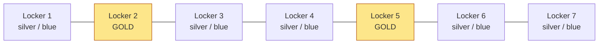

One valid arrangement (gold on 2 and 5). The other five lockers each have 2 choices.

**Why:**
1. **Place the stars:** all pairs are ⁷C₂ = 21. Neighbouring pairs are (1,2), (2,3), (3,4), (4,5), (5,6), (6,7), which is 6. Non-neighbouring pairs: 21 − 6 = **15**.
2. **Badges:** each of the other 5 lockers is silver or blue, so 2⁵ = **32**.
3. Total: 15 × 32 = **480**.

### Q2 (3 pts) – Exactly one condition
*Six tests each pass (P) or fail (F), recorded in order. Condition A: tests 1 and 2 both pass. Condition B: exactly four of the six pass. Count the sequences that satisfy exactly one condition.*

- 25 (Your pick ❌)
- 31
- 6
- **19** ✅
- None of the above

| Set | Count | Working |
|---|---|---|
| A (tests 1, 2 pass) | 16 | the other 4 tests are free: 2⁴ |
| B (exactly four pass) | 15 | ⁶C₄ |
| A and B | 6 | tests 1, 2 pass, and exactly 2 of the other 4 pass: ⁴C₂ |
| **A only** | 16 − 6 = **10** | |
| **B only** | 15 − 6 = **9** | |

Exactly one condition: 10 + 9 = **19**. (25 is what you get from 16 + 15 − 6, which counts A or B, with the overlap counted once, so it includes the "both" sequences.)

### Q3 (3 pts) – Team with leader and recorder
*Eight volunteers: 3 trained, 5 untrained. Choose a team of four with at least two trained members. Then choose one trained team member as leader and one of the other three as recorder. How many outcomes?*

- 180
- **225** ✅
- 270
- 75
- None of the above

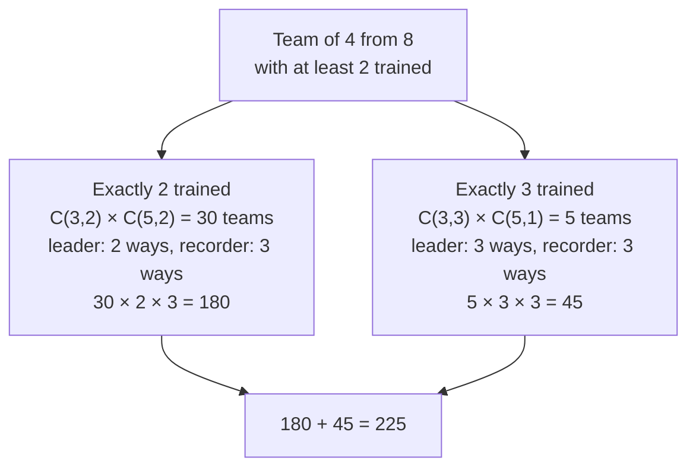

### Q4 (3 pts) – Six stations in a circle, D and E adjacent
*Six distinct stations A–F are placed in a circle. D and E must be next to each other. Rotating the circle is not a new arrangement, but reversing the order is.*

- 24
- 120
- 240
- **48** ✅
- None of the above

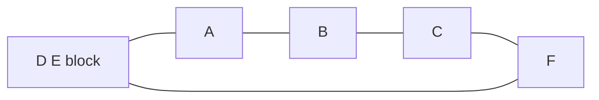

**Why:** treat D and E as one block. Then 5 units sit in a circle: (5 − 1)! = 24 arrangements (rotations removed). Inside the block D and E can be in 2 orders (DE or ED): 24 × 2 = **48**.

---

## Growth Rates

### Q5 (3 pts) – Order from slowest to fastest growth
*f₁ = n³, f₂ = log₂ n, f₃ = n², f₄ = n log₂ n, f₅ = 3ⁿ, f₆ = n!*

- f2, f4, f3, f5, f1, f6
- **f2, f4, f3, f1, f5, f6** ✅
- f2, f3, f4, f1, f5, f6
- f2, f4, f1, f5, f3, f6
- None of the above

**Why:** log n < n log n < n² < n³ < 3ⁿ < n!. The polynomials (n², n³) are slower than the exponential 3ⁿ, and n! beats any exponential.

---

## Nested Loops and Complexity

```python
def has_equal_pair(a):
    n = len(a)
    for i in range(n):
        for j in range(i + 1, n):
            if a[i] == a[j]:
                return True
    return False
```

### Q6 (1 pt) – (a) How many times is `a[i] == a[j]` evaluated for `a = [3, 5, 3, 5]`?

- 1
- **2** ✅
- 4
- 6 (Your pick ❌)

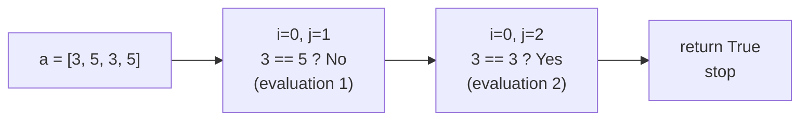

**Why:** the function returns as soon as it finds a match. The first match is at (i=0, j=2), after 2 evaluations. 6 would be all the pairs, which only happens if no match is found.

### Q7 (1 pt) – (b) Best-case time complexity for n ≥ 2

- **O(1)** ✅
- O(log n)
- O(n) (Your pick ❌)
- O(n²)

**Why:** the best case is when `a[0] == a[1]`. The very first comparison finds it and returns, so the time is constant.

### Q8 (2 pts) – (c) Worst-case time complexity for n ≥ 2

- O(1)
- O(n)
- **O(n²)** ✅
- O(2ⁿ)

**Why:** with no equal pair, every pair (i, j) with i < j is compared: n(n−1)/2 comparisons, which is O(n²).

---

## Nested Loops with `work(j)`

*A call to `work(k)` performs exactly k basic operations.*

```python
for i in range(1, n + 1):
    for j in range(1, i + 1):
        work(j)
```

### Q9 (3 pts) – (a) How many basic operations for n = 4?

- 10 (Your pick ❌)
- 16
- **20** ✅
- 40

| i | Calls | Operations |
|---|---|---|
| 1 | work(1) | 1 |
| 2 | work(1), work(2) | 1 + 2 = 3 |
| 3 | work(1), work(2), work(3) | 1 + 2 + 3 = 6 |
| 4 | work(1), … , work(4) | 1 + 2 + 3 + 4 = 10 |
| **Total** | | **20** |

(10 is only the number of `work` calls, 1 + 2 + 3 + 4, not the number of operations inside them.)

### Q10 (2 pts) – (b) Time complexity for general n

- O(n)
- O(n²)
- **O(n³)** ✅
- O(2ⁿ)

**Why:** for each i the inner loops cost 1 + 2 + … + i = i(i+1)/2. Summing over i = 1 to n gives about n³/6, which is **O(n³)**.

---

## Recursion on Odd and Even Numbers

```python
def count(n):
    if n <= 1 or n % 2 == 0:
        return 1
    return count(n - 1) + count(n - 2)
```

### Q11 (3 pts) – (a) How many calls does `count(9)` make (including the initial call and base-case calls)?

- 5
- 8
- **9** ✅
- 109
- None of the above (Your pick ❌)

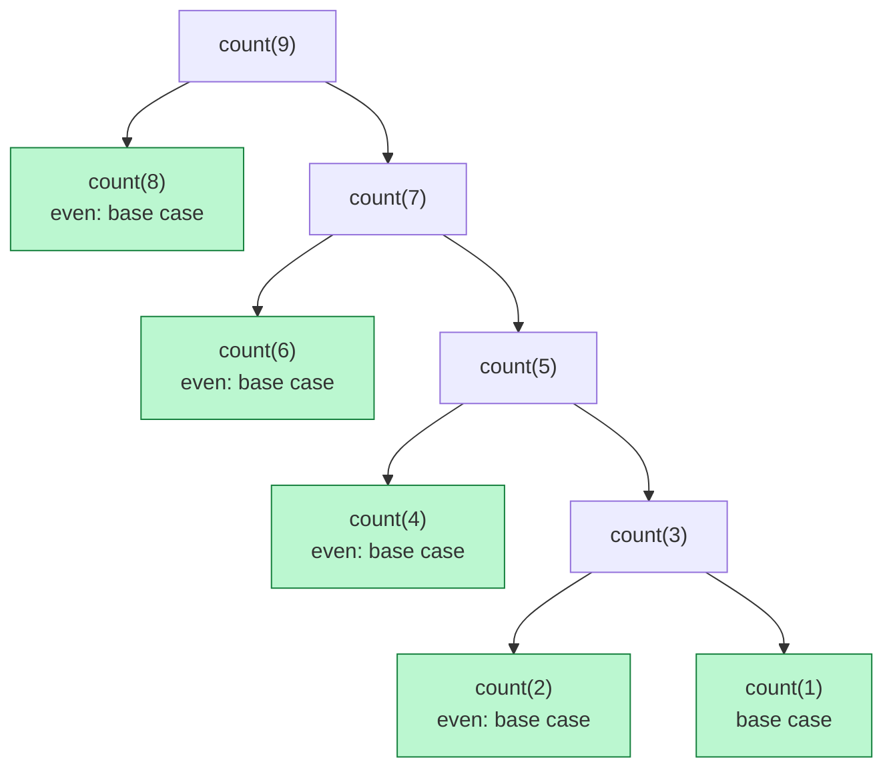

**Why:** for an odd n, `count(n-1)` is even and returns immediately, and `count(n-2)` is odd and continues. So the calls form a single chain with one extra base-case call per level. Counting the 9 nodes in the tree: 4 odd calls (9, 7, 5, 3), 5 base-case calls (8, 6, 4, 2, 1). Total **9**.

### Q12 (3 pts) – (b) Time complexity as n grows through odd integers

- O(log n)
- **O(n)** ✅
- O(n²)
- O(2ⁿ) (Your pick ❌)
- None of the above

**Why:** this does not branch exponentially, because half of every pair of calls is a base case. The number of calls is about n (for odd n it is n), so the time is **O(n)**.

---

## Searching

### Q13 (2 pts) – Unsorted array with duplicates: which method always works?
*Find the original index of the first occurrence of a target, or return −1 if it is absent.*

- **Scan from left to right and return the first matching index; return −1 if no match is found.** ✅
- Apply binary search directly to the unsorted array.
- Sort the array, find the target's index in the sorted array.
- Return the original index of the smallest value in the array, regardless of the target.

**Why:** binary search needs a sorted array. Sorting loses the original indices (and with duplicates, the first occurrence). The smallest value has nothing to do with the target. A linear scan always works (O(n)).

*Q14–Q15 use this binary search on `A = [7, 16, 28, 35, 49, 63, 78, 90]` with target 48:*

```python
def search(A, target):
    lower = 0
    upper = len(A) - 1
    while lower <= upper:
        mid = (lower + upper) // 2
        if A[mid] == target:
            return mid
        elif A[mid] < target:
            lower = mid + 1
        else:
            upper = mid - 1
    return -1
```

### Q14 (3 pts) – (a) Which values of `A[mid]` are checked, in order?

- 49, 16, 28, 35
- **35, 63, 49** ✅
- 35, 49, 63
- 35, 63
- None of the above

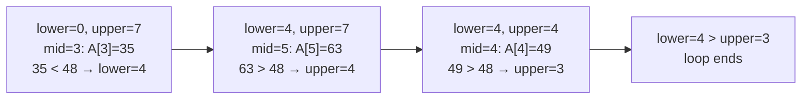

### Q15 (1 pt) – (b) What does `search(A, 48)` return?

- **-1** ✅
- 3
- 4
- 48
- None of the above

**Why:** 48 is not in the array, so the loop ends when `lower > upper`, and the function returns −1.

---

## Insertion Sort (One Pass)

*The first four values are already sorted: [5, 12, 20, 31, 14, 9]. Insert 14 into the sorted part by repeatedly swapping it with its left neighbour while that neighbour is larger. Stop after inserting 14 (do not process 9).*

```mermaid
flowchart LR
    a0["[5, 12, 20, 31, 14, 9]<br/>insert 14"] -->|"14 &lt; 31: swap (swap 1)"| a1["[5, 12, 20, 14, 31, 9]"] -->|"14 &lt; 20: swap (swap 2)"| a2["[5, 12, 14, 20, 31, 9]"] -->|"12 &lt; 14 is false: stop"| a3["Done"]
```

### Q16 (2 pts) – (a) The array after this one pass

- **[5, 12, 14, 20, 31, 9]** ✅
- [5, 9, 12, 14, 20, 31]
- [5, 12, 20, 14, 31, 9]
- [5, 12, 20, 31, 14, 9]

### Q17 (1 pt) – (b) Value comparisons made (including the final one that stops the swaps)

- 1
- 2
- **3** ✅
- 4
- None of the above

**Why:** 14 vs 31 (swap), 14 vs 20 (swap), 14 vs 12 (stop) = **3 comparisons**.

### Q18 (1 pt) – (c) Number of swaps

- 0
- 1
- **2** ✅
- 3
- 4

---

## Merge Step

*Two sorted groups are ready to merge: L = [2, 11, 18, 29] and R = [3, 7, 16, 24]. At each step, compare the first remaining value in each group and output the smaller one. Once one group is empty, copy the rest without further comparisons.*

| Step | Compare | Output | Total so far |
|---|---|---|---|
| 1 | 2 vs 3 | **2** | 2 |
| 2 | 11 vs 3 | **3** | 2, 3 |
| 3 | 11 vs 7 | **7** | 2, 3, 7 |
| 4 | 11 vs 16 | **11** | 2, 3, 7, 11 |
| 5 | 18 vs 16 | 16 | 2, 3, 7, 11, 16 |
| 6 | 18 vs 24 | 18 | … 18 |
| 7 | 29 vs 24 | 24 | … 24 |
| – | L has 29 left, R is empty: copy | 29 | 2, 3, 7, 11, 16, 18, 24, 29 |

### Q19 (2 pts) – (a) The first four values added to the merged output

- 2, 11, 18, 29
- **2, 3, 7, 11** ✅
- 3, 7, 16, 24
- 2, 3, 11, 7 (Your pick ❌)

### Q20 (2 pts) – (b) Maximum comparisons to merge any two sorted groups of four values each

- 4
- 6
- **7** ✅
- 8 (Your pick ❌)

**Why:** every comparison outputs one value, and the last value is output without a comparison. The worst case compares until one group is empty, which is 4 + 4 − 1 = **7**. (The example above needs exactly 7 comparisons.)

---

## Recursion

```python
def reward(n):
    if n <= 1:
        return n
    return n + reward(n - 2)
```

### Q21 (2 pts) – (a) Values of n in call order for `reward(7)`

- 7, 5, 3
- 7, 6, 5, 4, 3, 2, 1
- **7, 5, 3, 1** ✅
- 1, 3, 5, 7

### Q22 (1 pt) – (b) What does `reward(7)` return?

- 7
- 15
- **16** ✅
- 28

```mermaid
flowchart TD
    r7["reward(7) = 7 + reward(5) = 7 + 9 = 16"] --> r5["reward(5) = 5 + reward(3) = 5 + 4 = 9"] --> r3["reward(3) = 3 + reward(1) = 3 + 1 = 4"] --> r1["reward(1) = 1<br/>base case"]
```

### Q23 (3 pts) – Output of `activity(2)`

```python
def activity(n):
    if n == 0:
        return
    print("enter", n)
    activity(n - 1)
    print("leave", n)
```

- enter 2; leave 2; enter 1; leave 1
- **enter 2; enter 1; leave 1; leave 2** ✅
- enter 1; enter 2; leave 2; leave 1
- enter 2; enter 1; leave 2; leave 1

```mermaid
flowchart TD
    e2["activity(2)<br/>prints: enter 2"] --> e1["activity(1)<br/>prints: enter 1"] --> e0["activity(0)<br/>returns immediately"]
    e0 -.-> l1["back in activity(1)<br/>prints: leave 1"] -.-> l2["back in activity(2)<br/>prints: leave 2"]
```

**Why:** the print before the recursive call happens on the way down (enter 2, enter 1). The print after the call happens on the way back up, in the reverse order (leave 1, leave 2).

### Q24 (6 pts) – `count_dim`: count the values in `a` that are less than 20

```python
def count_dim(a, i=0):
    if __blank 1__:
        return __blank 2__
    if a[i] < 20:
        return 1 + count_dim(a, i+1)
    return count_dim(a, __blank 3__)
```

**Blank 1: `i==len(a)`** (also accepted: `len(a)==i`). Your answer `len(a)==0` ❌

**Blank 2: `0`** ✅

**Blank 3: `i+1`** (also accepted: `1+i`). Your answer `i=1` ❌

**(d) Time complexity for n = len(a): O(n)** ✅

**Why:**
- Blank 1 is the base case: when `i` has gone past the last index, there are no values left. `len(a)==0` is wrong, because `a` never changes. `i` is what moves, so the check would never become true and the recursion would run off the end of the array.
- Blank 2: nothing left to count, so return 0.
- Blank 3: the value was not less than 20, so move on to the next index without adding 1.
- Each index is visited once, so it is O(n). Omit all spaces in the answers.

### Q25 (8 pts) – `split` and `reuse` (assume n is a power of 2)

```python
def split(n):
    if n == 1:
        return 1
    return split(n // 2) + split(n // 2)       # two recursive calls

def reuse(n):
    if n == 1:
        return 1
    x = reuse(n // 2)                          # one recursive call
    return x + x
```

(The operator between the two `split` calls does not change the number of calls.)

**(a) How many calls does `split(8)` make in total? 15** ✅ (Your answer 14 ❌)

```mermaid
graph TD
    s8["split(8)"] --> s4a["split(4)"]
    s8 --> s4b["split(4)"]
    s4a --> s2a["split(2)"]
    s4a --> s2b["split(2)"]
    s4b --> s2c["split(2)"]
    s4b --> s2d["split(2)"]
    s2a --> l1["split(1)"]
    s2a --> l2["split(1)"]
    s2b --> l3["split(1)"]
    s2b --> l4["split(1)"]
    s2c --> l5["split(1)"]
    s2c --> l6["split(1)"]
    s2d --> l7["split(1)"]
    s2d --> l8["split(1)"]
```

1 + 2 + 4 + 8 = **15** calls (all the nodes, including the first).

**(b) How many calls does `reuse(8)` make in total? 4** ✅

```mermaid
graph LR
    u8["reuse(8)"] --> u4["reuse(4)"] --> u2["reuse(2)"] --> u1["reuse(1)<br/>base case"]
```

**(c) Time complexity of `split(n)`: O(n)** ✅ (Your answer O(log n) ❌). The calls double at every level, for log₂ n levels: 1 + 2 + 4 + … + n = 2n − 1 calls, which is O(n).

**(d) Time complexity of `reuse(n)`: O(log n)** ✅. Only one call is made per level, over log₂ n levels. Saving the result in `x` is what avoids the second call.

---

## Stacks and Queues

### Q26 (3 pts) – Which sequence **cannot** be the order of popped numbers?
*1, 2, 3, 4, 5 are pushed in order onto an empty stack, and popped between pushes. Every number is pushed once and popped once.*

- 2, 1, 4, 3, 5 (possible)
- 3, 2, 1, 5, 4 (possible)
- **3, 1, 2, 5, 4** ✅ (cannot be)
- 1, 4, 3, 2, 5 (possible)

**Why:** after pushing 1, 2, 3 and popping 3, the top is 2, so the next pop must be 2, not 1. For the others: 2,1,4,3,5 (push 1, 2, pop 2, 1, push 3, 4, pop 4, 3, push 5, pop 5); 3,2,1,5,4 (push 1–3, pop 3, 2, 1, push 4, 5, pop 5, 4); 1,4,3,2,5 (push 1, pop 1, push 2, 3, 4, pop 4, 3, 2, push 5, pop 5).

### Q27 (4 pts) – `change(q)`
*Initially the queue is front [1, 2, 3, 4, 5, 6] rear. The stack starts empty and `m` = 6.*

```python
def change(q):
    s = Stack()
    m = q.count()
    for i in range(m):
        x = q.dequeue()
        if x % 2 == 0:
            q.enqueue(x)
        else:
            s.push(x)
    while s.count() > 0:
        q.enqueue(s.pop())
```

- **[2, 4, 6, 5, 3, 1]** ✅
- [1, 2, 3, 4, 5, 6]
- [2, 4, 6, 1, 3, 5]
- [6, 4, 2, 1, 3, 5]

```mermaid
flowchart LR
    q0["Start<br/>queue: 1,2,3,4,5,6<br/>stack: empty"] --> q1["After the for loop<br/>even numbers go back into the queue<br/>odd numbers go on the stack<br/>queue: 2,4,6<br/>stack: 1,3,5 (top is 5)"] --> q2["After the while loop<br/>pop 5, 3, 1 and enqueue each<br/>queue: 2,4,6,5,3,1"]
```

**Why:** the stack reverses the order of the odd numbers (1, 3, 5 go in, 5, 3, 1 come out), and they are added behind the even numbers.

### Q28 (5 pts) – Priority queue: unsorted list (U) vs sorted list (S)

| Implementation | `enqueue(task)` | `peek()` |
|---|---|---|
| U: unsorted list | O(1) | scans all k tasks: O(k) |
| S: sorted list | O(k) worst case | O(1) |

*The code first inserts n tasks with distinct priorities, then calls `peek()` n² times.*

**(a) Worst-case total time for U: O(n³)** ✅
- n enqueues × O(1) = O(n).
- n² peeks × O(n) each (the queue holds n tasks) = O(n³).
- Total: O(n) + O(n³) = **O(n³)**.

**(b) Worst-case total time for S: O(n²)** ✅
- n enqueues, the kth costing up to O(k): 1 + 2 + … + n = O(n²).
- n² peeks × O(1) = O(n²).
- Total: O(n²) + O(n²) = **O(n²)**.

### Q29–Q31 (3 + 1 + 1 pts) – A queue built from two stacks
*The queue uses two initially empty stacks, `inbox` and `outbox`. Enqueue pushes the item onto `inbox`. Dequeue: if `outbox` is empty, move all items from `inbox` to `outbox` one at a time (pop then push), then pop `outbox` and return that item. Perform: enqueue A, B, C; dequeue twice; enqueue D, E; dequeue twice. Transfer items only when a dequeue starts with an empty outbox.*

```mermaid
flowchart LR
    enq["enqueue(x)"] --> inbox["inbox<br/>(stack)"]
    inbox -->|"move all, only when outbox is empty<br/>(this reverses the order)"| outbox["outbox<br/>(stack)"]
    outbox --> deq["dequeue()<br/>pop outbox"]
```

Stacks are listed bottom → top:

| Operation | inbox | outbox | Returned |
|---|---|---|---|
| enqueue A | [A] | [] | |
| enqueue B | [A, B] | [] | |
| enqueue C | [A, B, C] | [] | |
| dequeue (outbox empty: move all, then pop) | [] | [C, B, A] → pop → [C, B] | **A** |
| dequeue | [] | [C, B] → pop → [C] | **B** |
| enqueue D | [D] | [C] | |
| enqueue E | [D, E] | [C] | |
| dequeue (outbox not empty) | [D, E] | [C] → pop → [] | **C** |
| dequeue (outbox empty: move all, then pop) | [] | [E, D] → pop → [E] | **D** |

**Q29 (a) The four returned items, in order: A, B, C, D** ✅ (Your pick C, B, E, D ❌)

Other options: A, B, E, D; C, B, E, D; A, B, D, E.

**Q30 (b) Final contents of `inbox`, from bottom to top: [] (empty)** ✅ (Your pick [A] ❌). Other options: [E], [D, E], [A].

**Q31 (c) Final contents of `outbox`, from bottom to top: [E]** ✅ (Your pick [] ❌). Other options: [], [E, D], [C].

**Why:** the last dequeue moved D and E to the outbox (reversing them to [E, D]), then popped D. So the inbox is empty and the outbox holds [E].

---

## Binary Search Trees

### Q32 (3 pts) – How many insertion orders give this tree?
*Start with an empty BST and insert the keys 10, 20, 30, 40, each exactly once. Standard insertion adds each new key as a leaf.*

```mermaid
flowchart TD
    n30((30)) -->|"L"| n20((20))
    n30 -->|"R"| n40((40))
    n20 -->|"L"| n10((10))
```

- 2
- 6
- 24
- **3** ✅
- None of the above

**Why:**
- 30 is the root, so it must be inserted first.
- 10 is below 20, so 20 must come before 10.
- 40 can come at any time after 30.

So the orders of {20, 10, 40} after 30 with 20 before 10 are:
1. 30, 20, 10, 40
2. 30, 20, 40, 10
3. 30, 40, 20, 10

That is **3** orders.

### Q33 (4 pts) – Reconstruct a BST from its preorder
*Preorder: 35, 20, 12, 28, 48, 42, 55. Reconstruct the BST, then give its postorder traversal.*

```mermaid
flowchart TD
    n35((35)) -->|"L"| n20((20))
    n35 -->|"R"| n48((48))
    n20 -->|"L"| n12((12))
    n20 -->|"R"| n28((28))
    n48 -->|"L"| n42((42))
    n48 -->|"R"| n55((55))
```

- 12, 20, 28, 35, 42, 48, 55
- 12, 28, 20, 42, 48, 55, 35
- **12, 28, 20, 42, 55, 48, 35** ✅
- 55, 42, 48, 28, 12, 20, 35
- None of the above

**Why:** the first key in the preorder (35) is the root. The keys smaller than 35 (20, 12, 28) form the left subtree, and the keys larger (48, 42, 55) form the right. Repeat in each part: 20 is the root of the left part, with 12 on its left and 28 on its right. 48 is the root of the right part, with 42 on its left and 55 on its right. Postorder (left, right, root): 12, 28, 20, 42, 55, 48, 35.

### Q34 (2 pts) – (a) Search for 58: keys visited, in order

```mermaid
flowchart TD
    n40((40)) -->|"L"| n20((20))
    n40 -->|"R"| n70((70))
    n20 -->|"L"| n10((10))
    n20 -->|"R"| n30((30))
    n70 -->|"L"| n55((55))
    n70 -->|"R"| n80((80))
    n55 -->|"R"| n60((60))
    n60 -.->|"L (new)"| n58(("58"))
    style n40 fill:#fde68a,stroke:#b45309
    style n70 fill:#fde68a,stroke:#b45309
    style n55 fill:#fde68a,stroke:#b45309
    style n60 fill:#fde68a,stroke:#b45309
    style n58 stroke-dasharray: 5 5
```

The shaded nodes are the search path. The dashed node is where 58 is inserted.

- **40, 70, 55, 60** ✅
- 40, 70, 55
- 40, 20, 30
- 40, 70, 80

**Why:** 58 > 40, go right to 70. 58 < 70, go left to 55. 58 > 55, go right to 60. 58 < 60, go left, and 60 has no left child, so 58 is absent.

### Q35 (2 pts) – (b) Where should the new key 58 be inserted?

- Right child of 55
- Right child of 60
- **Left child of 60** ✅
- Left child of 70

**Why:** the search ended at 60 with 58 < 60 and no left child, so 58 becomes the **left child of 60** (see the dashed node in the diagram above).

### Q36 (2 pts) – (a) Inorder successor of 50
*Delete 50 using its inorder successor (the smallest key in its right subtree). If the successor has a right child, reconnect it to the successor's former parent.*

Before deleting:

```mermaid
flowchart TD
    n50((50)) -->|"L"| n30((30))
    n50 -->|"R"| n80((80))
    n80 -->|"L"| n60((60))
    n80 -->|"R"| n90((90))
    n60 -->|"R"| n70((70))
    style n60 fill:#fde68a,stroke:#b45309
```

- 30
- **60** ✅
- 70
- 80

**Why:** the right subtree of 50 is rooted at 80. Keep going left: 80 → 60, and 60 has no left child. So the smallest key in the right subtree is **60**.

### Q37 (3 pts) – (b) After deleting 50, which key becomes the left child of 80?

After deleting 50: 60 replaces 50 at the root, and 60's right child (70) is reconnected to 60's former parent (80), as its left child.

```mermaid
flowchart TD
    m60((60)) -->|"L"| m30((30))
    m60 -->|"R"| m80((80))
    m80 -->|"L"| m70((70))
    m80 -->|"R"| m90((90))
    style m70 fill:#bbf7d0,stroke:#15803d
```

- No key: the left child is removed
- 30
- 60
- **70** ✅

### Q38 (3 pts) – Post-order from pre-order and in-order
*Pre-order: [A, B, D, H, I, E, C, F, J, K, G]. In-order: [H, D, I, B, E, A, J, F, K, C, G]. What is the post-order traversal?*

**Answer: HIDEBJKFGCA** ✅

**Working:**
1. The first pre-order item, A, is the root. In the in-order list, H D I B E are to its left and J F K C G are to its right.
2. Left part: pre-order B, D, H, I, E gives root B. In-order H D I | B | E gives left D (with H on its left and I on its right) and right E.
3. Right part: pre-order C, F, J, K, G gives root C. In-order J F K | C | G gives left F (with J on its left and K on its right) and right G.

```mermaid
flowchart TD
    A((A)) -->|"L"| B((B))
    A -->|"R"| C((C))
    B -->|"L"| D((D))
    B -->|"R"| E((E))
    D -->|"L"| H((H))
    D -->|"R"| I((I))
    C -->|"L"| F((F))
    C -->|"R"| G((G))
    F -->|"L"| J((J))
    F -->|"R"| K((K))
```

Post-order (left, right, root): left subtree H, I, D, E, B, then right subtree J, K, F, G, C, then the root A: **HIDEBJKFGCA**.
