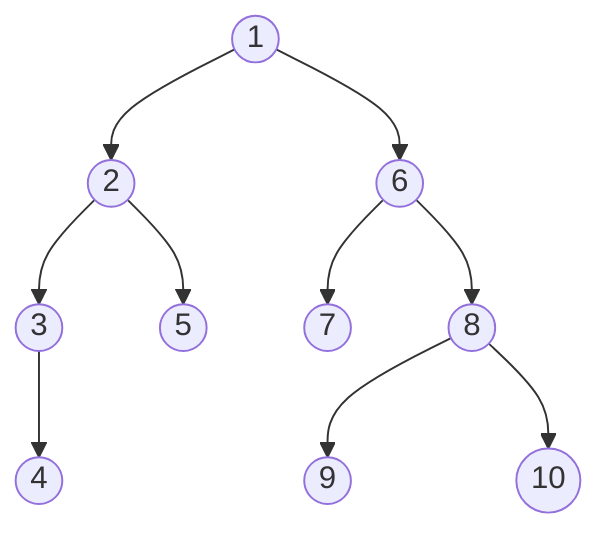
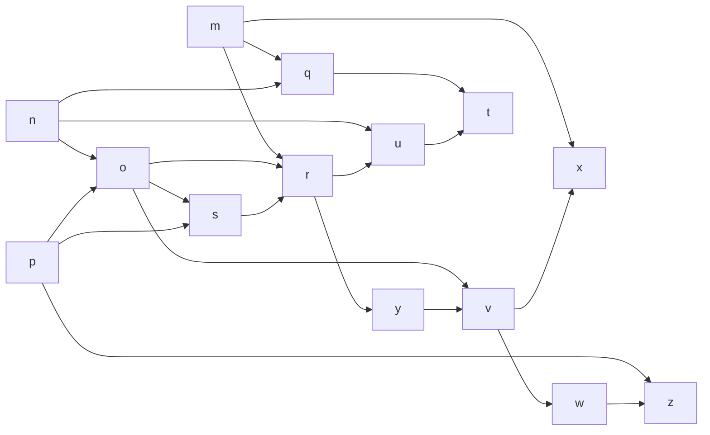
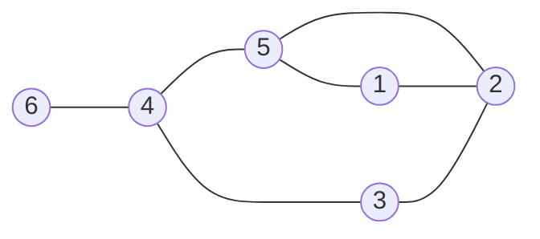
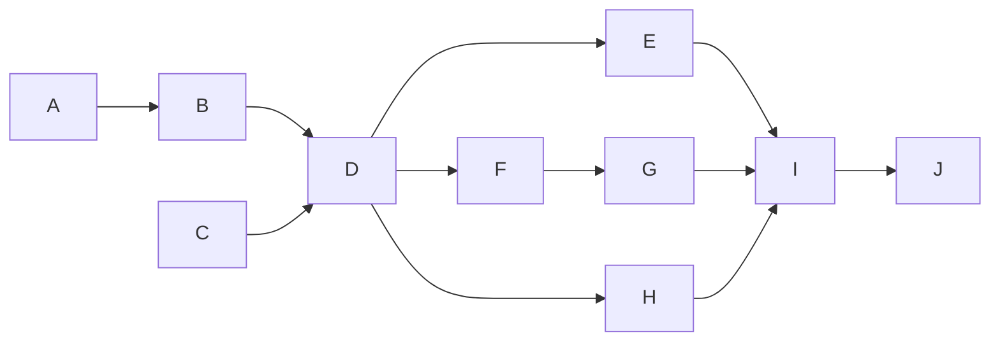
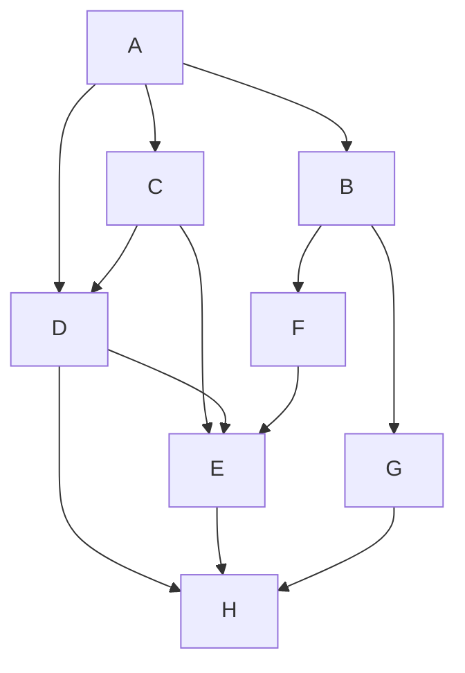
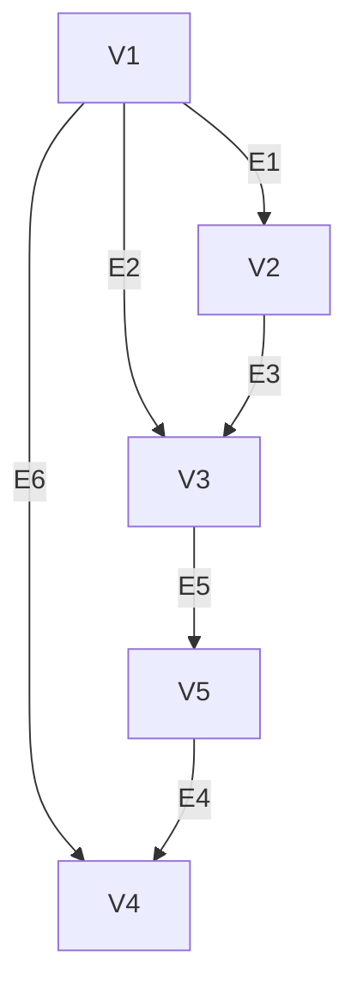
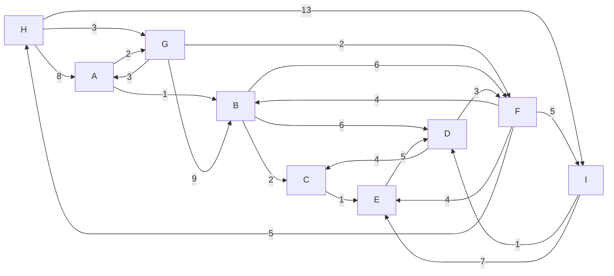
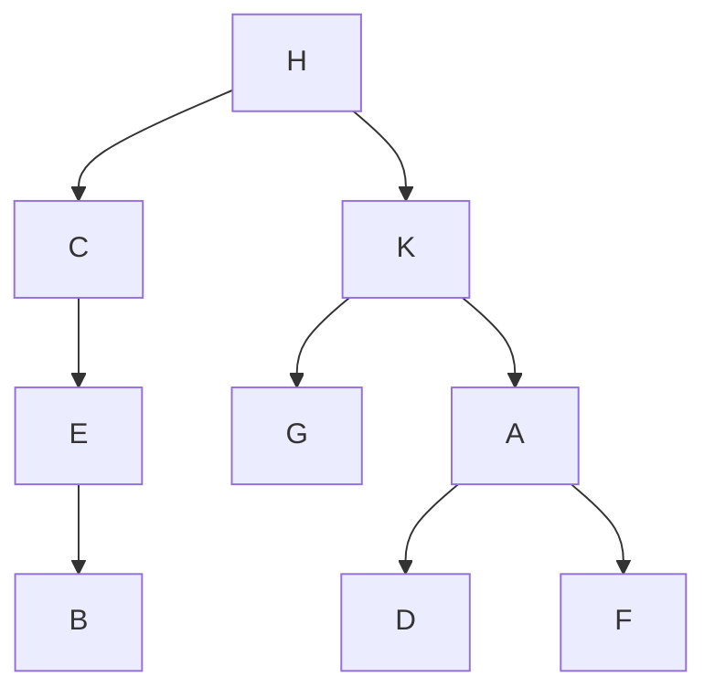
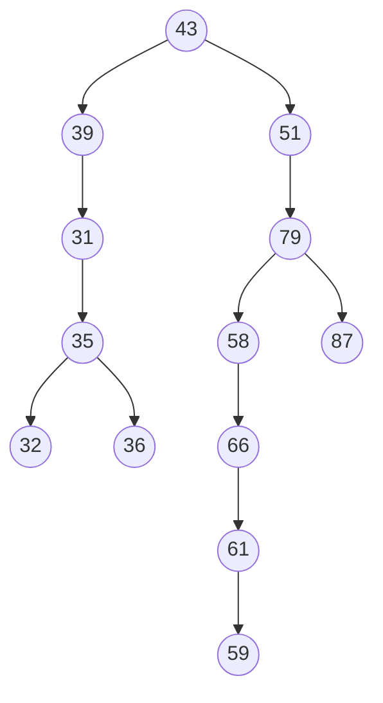
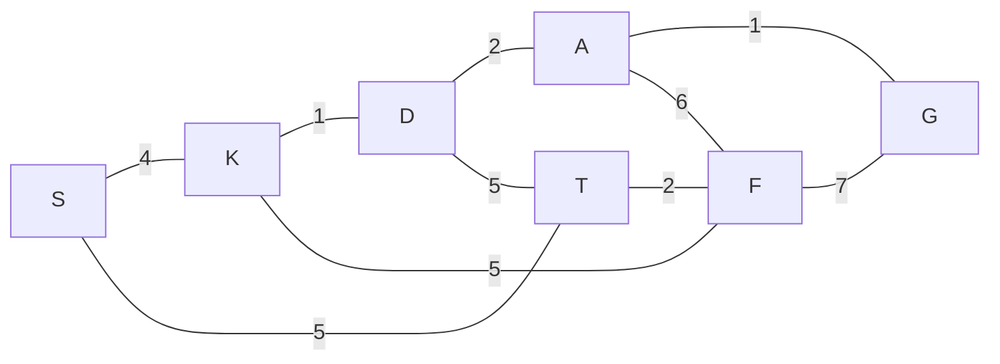

# Computational Thinking – Mocks 1, 2 & 3 (Q&A Compilation)

> Q1–Q8 answers are the options marked in the screenshots. Q9–Q23 are worked solutions, checked against the correct answers shown in blue in the screenshots (the red ✗ means the question was left blank).

---

## Part A – MCQs (8 marks)

### Q1 (1 pt)
*An exam has 5 questions and you only need to answer any 4. In how many different ways can you attempt the paper?*

- 5!
- ⁵P₄
- **⁵C₄** ✅
- 4!
- 5 × 4

**Answer: ⁵C₄** (order does not matter, so choose 4 of 5 = 5 ways).

### Q2 (1 pt)
*Algorithm analysis should be independent of all of the following EXCEPT ____.*

- the programming language used
- the computer used to run the program
- **the number of operations in an algorithm** ✅
- the test data used
- the experience of the person implementing it

**Why:** algorithm analysis counts operations as a function of input size, so it must not depend on the language, the hardware, the test data or the programmer. The number of operations is the thing being analysed, so it is the exception.

### Q3 (1 pt)
*Which is used to compare the computational efficiency of two algorithms?*

- **their growth rate functions** ✅
- their number of lines of code
- the programming languages they are written in
- the programmers who wrote them
- the data structures they used

**Why:** a growth rate function (e.g. n, n log n, n²) shows how the work grows with input size. It is machine-independent, unlike line count, language or programmer.

### Q4 (1 pt)
*If a problem of size n requires a computational time of at most k²·n units, where k is a constant, the problem runs in ____ time.*

- O(1)
- **O(n)** ✅
- O(k²n)
- O(kn)
- O(k²)

**Why:** k is a constant, so k²·n = O(n).

### Q5 (1 pt)
*Graph of number of operations vs input size (a smoothly curving, rapidly growing curve). What can you infer?*

The figure: the x-axis is input size (2 to 20) and the y-axis is the number of operations (0 to 1400). The green curve starts near 0, rises slowly at first (about 200 operations at input size 10), then climbs steeply to roughly 1,200 operations at input size 20.


- It is an inefficient algorithm
- **Its Big-O complexity is O(n²).** ✅
- This algorithm performs an exhaustive search
- It uses recursion
- The algorithm is an insertion sort

**Why:** the curve bends upward, with the operation count growing faster than linearly. That fits a quadratic function, i.e. O(n²). Operation counts alone cannot tell us whether the algorithm uses recursion, does an exhaustive search or is insertion sort, and 1,000+ operations for 20 inputs does not show it is "inefficient".

### Q6 (1 pt)
*Graph with n vertices and m edges (adjacency list). One loop goes through all vertices and another through all edges. Worst-case time complexity?*

- O(n)
- O(m)
- O(nm)
- **O(n+m)** ✅
- O(n log m)

**Why:** the two loops run one after the other, so the costs add.

### Q7 (1 pt)
*X is in class P, and Y is NP-complete. Which statements are true?*
1. X is in NP. 2. Y is in NP. 3. X is NP-complete. 4. X can be reduced to Y. 5. Y can be reduced to X.

- 1 & 2 only
- 2 & 3 only
- 1, 2 & 3 only
- **1, 2 & 4 only** ✅

**Why:** P ⊆ NP, and NP-complete problems are in NP. Every problem in NP (including X) reduces to Y. X is not necessarily NP-complete, and Y reducing to X would imply P = NP.

### Q8 (1 pt)
*Which advice for an NP-hard optimization problem reflects computational thinking? Choose the BEST answer.*
1. Solve it exactly using backtracking search
2. Solve it heuristically using a greedy algorithm
3. Implement the solution in Python instead of Java
4. Reduce/map it to another NP-hard optimization problem
5. Reduce another NP-hard optimization problem to it

- 1 & 2 only
- 2 & 3 only
- 1, 2 & 3 only
- **1, 2 & 4 only** ✅
- 1, 2 & 5 only

**Why:**
- **1. Exact search (backtracking):** reasonable when the instance is small.
- **2. Greedy heuristic:** gives a good answer quickly when exact solutions are too slow.
- **4. Reduce/map the problem to another NP-hard problem:** lets you reuse existing solvers and heuristics for that problem.
- **3. Python vs Java:** the language does not change the problem's computational difficulty.
- **5. Reducing another NP-hard problem to it:** this goes in the wrong direction and only shows the problem is hard. It gives no way to solve it.

---

## Part B – Stacks & Queues (9 marks)

### Q9 (3 pts) – Stack-based binary search

```python
def rbsearch_stack(a, k):
    lower = -1
    upper = len(a)
    s = Stack()
    s.push(lower)
    s.push(upper)
    while s.count() > 0:
        s.display()
        upper = s.pop()
        lower = s.pop()
        mid = (lower + upper) // 2
        if mid == lower:
            return -1
        if k == a[mid]:
            return mid
        if k < a[mid]:
            s.push(lower)
            s.push(mid)
        if k > a[mid]:
            s.push(mid)
            s.push(upper)
```

Input: `a = [2, 19, 27, 31, 45, 62, 67, 74, 92]`, `k = 74`. Stack contents (top … bottom) at each call to line 8:

| Iteration | Working | Content of Stack (top … bottom) |
|---|---|---|
| 1 | lower=-1, upper=9 pushed | **9,-1** |
| 2 | mid=4, a[4]=45 < 74 → push 4, push 9 | **9,4** |
| 3 | mid=6, a[6]=67 < 74 → push 6, push 9 | **9,6** |

(Iteration 4 would give mid=7, a[7]=74, so it returns 7.)

### Q10 (3 pts) – FIFO queue, single teller

| Customer | Arrival | Duration | Service period |
|---|---|---|---|
| C1 | 5 | 5 | 5–10 |
| C2 | 7 | 9 | 10–19 |
| C3 | 8 | 4 | 19–23 |
| C4 | 23 | 6 | 23–29 |
| C5 | 30 | 5 | 30–35 |
| C6 | 33 | 4 | 35–39 |

| Time | Content of Queue (front to back) |
|---|---|
| 0 | Empty |
| 5 | C1 |
| 7 | C1,C2 |
| 8 | **C1,C2,C3** (#1) |
| 10 | **C2,C3** (#2) |
| 19 | **C3** (#3) |
| 23 | **C4** (#4) |
| 29 | **Empty** (#5) |
| 30 | **C5** (#6) |
| 33 | **C5,C6** (#7) |
| 35 | **C6** (#8) |
| 39 | **Empty** (#9) |

### Q11 (3 pts) – Priority queue (1 = highest priority, no pre-emption, FIFO within same priority)

| Customer (Priority) | Arrival | Duration |
|---|---|---|
| C1 (3) | 5 | 5 |
| C2 (2) | 7 | 9 |
| C3 (1) | 8 | 4 |
| C4 (3) | 22 | 6 |
| C5 (1) | 23 | 5 |
| C6 (2) | 33 | 4 |

Service order: C1 (5–10) → C3 (10–14) → C2 (14–23) → C5 (23–28) → C4 (28–34) → C6 (34–38).

| Time | Content of Queue (front to back) |
|---|---|
| 0 | Empty |
| 5 | **C1** |
| 7 | **C1,C2** |
| 8 | **C1,C3,C2** |
| 10 | **C3,C2** |
| 19 | **C2** |
| 23 | **C5,C4** |
| 29 | **C4** |
| 30 | **C4** |
| 33 | **C4,C6** |
| 35 | **C6** |
| 39 | Empty |

C1 finishes at 10, so C3 (priority 1) is served ahead of C2. At 23, C2 finishes just as C5 (priority 1) arrives, so C5 is served before C4.

---

## Part C – Tree & Recursion (9 marks)

### Q12 (3 pts) – `count_two_children(t)`

Figure 2 (the family tree; node 3 has only a left child, 4):



```python
def count_two_children(t):
    if t is None:                       # base case: empty tree
        return 0
    count = 0
    if t.leftChild is not None and t.rightChild is not None:
        count = 1                       # this node has exactly two children
    return count + count_two_children(t.leftChild) \
                 + count_two_children(t.rightChild)
```

For Figure 2 it returns 4 (nodes 1, 2, 6, 8).

**Why this works (divide and conquer):** the answer for a tree is (1 if the root has two children, else 0) + the answer for the left subtree + the answer for the right subtree. The base case is the empty tree, which has 0 such nodes.

### Q13 (4 pts) – `count_descendents(t)`

```python
def count_descendents(t):
    """Sets t.descendents for every node.
       Returns the size of the subtree rooted at t (t itself included)."""
    if t is None:
        return 0
    left  = count_descendents(t.leftChild)
    right = count_descendents(t.rightChild)
    t.descendents = left + right        # descendants = all nodes below t
    return left + right + 1             # subtree size = descendants + t itself
```

Check: leaf → 0; node 8 → 2; root 1 → 9.

### Q14 (2 pts) – Worst-case time complexity

**O(n)** for both algorithms, where n is the number of nodes. Each node is visited exactly once and does O(1) work (a few comparisons and an assignment). Recurrence: T(n) = T(n_left) + T(n_right) + O(1) = O(n). This holds for any tree shape.

---

## Part D – Graphs (10 marks)

### Q15 (2 pts) – Topological sort vs ordinary sort (≤ 30 words)

> Topological sort orders DAG vertices so each edge's start precedes its end (partial order, not unique). Ordinary sort orders elements by key comparison into one total order.

### Q16 (3 pts) – A valid topological ordering of Figure 3

Edges read from the figure: m→q, m→r, m→x; n→o, n→q, n→u; o→r, o→s, o→v; p→o, p→s, p→z; q→t; r→u, r→y; s→r; u→t; v→w, v→x; w→z; y→v.



**One valid ordering:**

`m, n, p, o, s, r, y, v, w, x, z, q, u, t`

Many other orderings are valid, for example `p, n, m, o, s, r, y, v, w, z, x, q, u, t`.

### Q17 (3 pts) – Least number of months to finish the project

**Approach:** Process the vertices in topological order. For each task, earliest finish month = 1 + max(earliest finish of all its predecessors), or 1 if it has no predecessors. The project length is the largest value, which is the length of the longest (critical) path.

| Task | m | n | p | o | q | s | r | u | y | v | t | w | x | z |
|---|---|---|---|---|---|---|---|---|---|---|---|---|---|---|
| Finish month | 1 | 1 | 1 | 2 | 2 | 3 | 4 | 5 | 5 | 6 | 6 | 7 | 7 | 8 |

**The project takes 8 months.** The critical path is n → o → s → r → y → v → w → z (p→o→… also works).

### Q18 (2 pts) – Why limited resources can make it intractable (< 50 words)

> With limited workers, we must choose which ready tasks to run now and which to delay. The number of possible task-to-worker assignments and orderings grows exponentially. Resource-constrained scheduling is NP-hard, so no known polynomial-time algorithm guarantees the optimal schedule.

---

## Part E – Heuristics (12 marks)

### Q19 (1 pt) – Number of possible tours

Distances between cities, in tens of km:

| | I | K | M | P | S |
|---|---|---|---|---|---|
| **I** (Ipoh) | – | 20 | 36 | 12 | 55 |
| **K** (Kuala Lumpur) | 20 | – | 15 | 31 | 35 |
| **M** (Melaka) | 36 | 15 | – | 46 | 22 |
| **P** (Penang) | 12 | 31 | 46 | – | 70 |
| **S** (Singapore) | 55 | 35 | 22 | 70 | – |

Fix S as the start and end, and arrange the 4 Malaysian cities (K, M, I, P) in between. That gives 4! = 24 orderings. Distances are symmetric, so a tour and its reverse are the same tour, which halves the count:

**Answer: 4!/2 = 12** (accepted forms: 4!/2, 12, 24/2)

### Q20 (4 pts) – Greedy TSP tour

Pseudocode for the greedy algorithm for the Traveling Salesman problem:

```
1:  Let S be the set of cities to be included in the tour
2:  Let T be the current tour (initially empty)
3:  Put into T two cities, a and b, with closest symmetric
    distance from one another
4:  Remove a and b from S
5:  While S is not an empty set
6:      Find the city x in S with the smallest symmetric
        distance to any city y in T
7:      Choose the expanded tour with lower overall distance:
8:          Insert x between y and its next destination z in T
9:          Insert x between y and its previous destination u in T
10:     Remove x from S
11: End While
12: Return T
```

*What is the tour resulting from the greedy algorithm for your trip?* Omit commas and spaces in your answer (e.g. ABCDE). Give a circular tour that starts and ends at the same city, without repeating the starting city at the end.

Distances (tens of km): I-K 20, I-M 36, I-P 12, I-S 55, K-M 15, K-P 31, K-S 35, M-P 46, M-S 22, P-S 70.

1. Closest pair: **I–P (12)** → T = {I, P}
2. Closest remaining city to T: **K** (20 from I). The tour I-K-P-I costs 63 either way → T = I, K, P
3. Next: **M** (15 from K). Insert between K and P: 20+15+46+12 = **93**. Insert between I and K: 36+15+31+12 = 94. Choose 93 → I, K, M, P
4. Last: **S** (22 from M). Insert between M and P: 20+15+22+70+12 = 139. Insert between K and M: 20+35+22+46+12 = **135**. Choose 135 → I, K, S, M, P

**Answer: `IKSMP`** (circular tour I→K→S→M→P→I, total 135 × 10 = 1350 km).

Equivalent rotations or reversals, such as `SMPIK` or `KSMPI`, describe the same circular tour.

### Q21 (1 pt) – Number of possible request combinations

Each request is either included or excluded, so there are **2ⁿ** combinations (2^n; subsets of n requests).

### Q22 (2 pts) – Similarity to the Knapsack problem (< 50 words)

> Both are combinatorial optimisation problems: choose a subset from n candidates to maximise value under a constraint. Requests are items (value 1 each); "no conflicts" plays the role of the weight limit. Both have 2ⁿ candidate subsets, so brute force is infeasible and greedy heuristics are used.

### Q23 (4 pts) – Best greedy criterion

The greedy algorithm for choosing a route with the highest number of accepted requests:

```
1: let R be the set of submitted requests.
2: let A be the set of accepted requests, initially empty.
3: while R is not empty
4:     choose a request r in R based on criterion c
5:     add r into A
6:     remove r from R
7:     remove all other requests that conflict with r from R
8: return A
```

Options for the greedy criterion c on line 4:
- **Option 1:** the request that starts the earliest
- **Option 2:** the request that finishes the earliest
- **Option 3:** the request with the shortest interval (end time − start time)
- **Option 4:** the request with the fewest number of conflicting requests in R

*Which option is the most likely to lead to the optimal solution (highest number of accepted requests)? Explain your reasoning.* Hint: for each option, illustrate a case where it fails to produce the optimal solution. If you find such cases for three options, the remaining option is likely the optimal one.

**Best: Option 2 – the request that finishes the earliest.**

Why it is best: picking the earliest finish leaves the most time free for the remaining requests. This rule (earliest-finish-time-first) is provably optimal for interval scheduling.

Counter-examples for the other options:

- **Option 1 (starts earliest):** A = [9am–6pm] starts first, but B = [10–11], C = [12–1], D = [2–3] fit around it. It picks A → 1 request, but the optimum is 3.
- **Option 3 (shortest interval):** B = [11–1] is the shortest and overlaps A = [9–12] and C = [12:30–3]. It picks B → 1 request, but A + C is 2, which is optimal.
- **Option 4 (fewest conflicts):** Carefully built instances exist where a request with the fewest conflicts overlaps two or more requests from the optimal set. Picking it excludes them and gives a smaller schedule than the optimum. This is the standard counter-example from the interval scheduling literature.

Since Options 1, 3 and 4 can all fail, **Option 2** is the remaining one, and the earliest-finish-first argument shows it is optimal.

---
---

# Mock 2 (Q&A Compilation)

> Q1–Q3, Q8–Q10, Q15–Q17 use the option marked in the screenshot. Q4–Q5 and Q12 use the blue correct answers. The other questions are worked solutions.

---

## Question A – Recursion

### Q1 (1 pt)
*Which statement on recursion is TRUE? Choose ONE option.*

- Recursion is useful because it has better performance than iteration.
- **Recursion is useful because the resulting algorithm is often more readable than one based on iteration.** ✅
- Recursion is useful because it can solve more problems than iteration.
- Recursion is useful because it gets rid of the for loops and while loops.
- Recursion is useless.

**Why:** recursion often matches the structure of the problem (trees, divide and conquer), so the code is short and clear. It is not faster than iteration, it can be rewritten as loops (both are equally powerful), and the repetition is still there, just hidden in the function calls.

### Q2 (1 pt)
```python
01 def rmSort(a):
02     if len(a) == 1:
03         return a
04     mid = len(a)//2
05     a1 = rmSort(a[0:mid])
06     a2 = rmSort(a[mid:len(a)])
07     return merge2(a1, a2)
```
Array: `[37, 61, 1, 76, 98, 20, 72, 41, 56, 54, 44]`. *What are a1 and a2 just after line 6?*

- **[1, 37, 61, 76, 98] [20, 41, 44, 54, 56, 72]** ✅
- [1, 20, 37, 61, 76] [98, 41, 44, 54, 56, 72]
- [1, 20, 37, 41, 61] [72, 76, 98, 44, 54, 56]
- [1, 20, 37, 41, 44] [54, 56, 61, 72, 76, 98]
- [1, 37, 61, 76, 20] [41, 72, 98, 44, 54, 56]

**Why:** len = 11, so mid = 5. a1 is the sorted left half `[37,61,1,76,98]` and a2 is the sorted right half `[20,72,41,56,54,44]`.

### Q3 (1 pt)
```python
def method(n, m):
    if n == m:
        return n
    else:
        return n + method(n-1, m)
```
*What does the function return (n > m)?*

- n + m
- sum of all the numbers between n and m, excluding n and m
- **sum of all the numbers between n and m, including n and m** ✅
- n × m
- nᵐ

**Why:** the result is n + (n−1) + … + m.

### Q4 (1 pt) – Big-O of `mystery(n)` (iterative)

```python
def mystery(n):
    if n == 0:
        return 1
    if n == 1:
        return 3
    if n == 2:
        return 5
    x = 1
    y = 3
    z = 5
    for i in range(1, (n-1)):
        w = z + (y ** 2) + (x ** 3)
        x = y
        y = z
        z = w
    return z
```

**Answer: O(n)**. The loop runs n−2 times and does constant work each time.

### Q5 (2 pts) – Fill in the table

| n | mystery(n) |
|---|---|
| 0 | 1 |
| 1 | **3** |
| 2 | **5** |
| 3 | **15** |
| 4 | **67** |
| 5 | **417** |

Working:
- n=3: 5 + 3² + 1³ = 15
- n=4: 15 + 5² + 3³ = 67
- n=5: 67 + 15² + 5³ = 417

### Q6 (2 pts) – Recursive form of `mystery(n)`

```
mystery(n):
    if n == 0: return 1
    if n == 1: return 3
    if n == 2: return 5
    return mystery(n-1) + mystery(n-2)**2 + mystery(n-3)**3
```

Equivalent Python:

```python
def mystery(n):
    if n == 0:
        return 1
    if n == 1:
        return 3
    if n == 2:
        return 5
    return mystery(n-1) + mystery(n-2) ** 2 + mystery(n-3) ** 3
```

Check: mystery(3) = 5 + 3² + 1³ = 15 ✓.

### Q7 (2 pts) – Which version has higher complexity?

**The recursive version.**

- **Iterative:** the loop runs n−2 times with O(1) work each, so T(n) = O(n).
- **Recursive:** each call makes three further calls, so T(n) = T(n−1) + T(n−2) + T(n−3) + O(1). The call tree roughly multiplies by 3 at each level, giving an upper bound of O(3ⁿ) (the tight bound is about O(1.84ⁿ)). This is **exponential**, because the same subproblems are recomputed many times.

Exponential time is far worse than linear time, so the recursive version has higher complexity.

---

## Question B – Graphs

### Q8 (1 pt)
*Which vertex in the graph (vertices 1–6) has the lowest degree?*

- **Vertex 6** ✅
- Vertex 1
- Vertex 2 and vertex 5
- Vertex 3
- Vertex 4

The graph (also used in Q9):



**Why:** the degrees are 6 → 1, 1 → 2, 3 → 2, and 2, 4, 5 → 3 each. Vertex 6 is connected only to vertex 4, so it has the lowest degree.

### Q9 (1 pt)
*Which is NOT a valid BFS traversal starting from vertex 1? (same graph as Q8)*

- 1, 2, 5, 3, 4, 6
- 1, 5, 2, 3, 4, 6
- 1, 2, 5, 4, 3, 6
- 1, 5, 2, 4, 3, 6
- **1, 5, 4, 6, 2, 3** ✅

**Why:** BFS visits vertices in order of distance from the start. Vertex 1's neighbours 2 and 5 are at distance 1, vertices 3 and 4 are at distance 2, and vertex 6 is at distance 3. The marked option visits 4 and 6 before 2, so it is not a valid BFS. The other four options list the distance-1 vertices first, then distance 2, then 6.

### Q10 (1 pt)
*Which is NOT a valid topological ordering of this DAG?*

Edges: A→B, B→D, C→D, D→E, D→F, D→H, E→I, F→G, G→I, H→I, I→J.



- A, B, C, D, E, F, H, G, I, J
- A, C, B, D, F, E, H, G, I, J
- A, B, C, D, E, F, G, H, I, J
- **A, B, D, F, G, I, J** ✅
- C, A, B, D, E, F, H, G, I, J

**Why:** the marked option leaves out vertices C, E and H, so it is not an ordering of all the vertices.

### Q11 (2 pts) – Adjacency matrix

Edges read from the figure: A→B, A→C, A→D, B→F, B→G, C→D, C→E, D→E, D→H, E→H, F→E, G→H.



Rows are "From" and columns are "To".

```
To: ABCDEFGH
From :A01110000
       B00000110
       C00011000
       D00001001
       E00000001
       F00001000
       G00000001
       H00000000
```

| From \ To | A | B | C | D | E | F | G | H |
|---|---|---|---|---|---|---|---|---|
| **A** | 0 | 1 | 1 | 1 | 0 | 0 | 0 | 0 |
| **B** | 0 | 0 | 0 | 0 | 0 | 1 | 1 | 0 |
| **C** | 0 | 0 | 0 | 1 | 1 | 0 | 0 | 0 |
| **D** | 0 | 0 | 0 | 0 | 1 | 0 | 0 | 1 |
| **E** | 0 | 0 | 0 | 0 | 0 | 0 | 0 | 1 |
| **F** | 0 | 0 | 0 | 0 | 1 | 0 | 0 | 0 |
| **G** | 0 | 0 | 0 | 0 | 0 | 0 | 0 | 1 |
| **H** | 0 | 0 | 0 | 0 | 0 | 0 | 0 | 0 |

> Follow the "To: ABCDEFGH / From :A…" template from the question for the exact row format in your answer field.

### Q12 (1 pt) – DFS from A

**Answer: `ABFEHGCD`** (this matches the blue correct answer).

Trace: A → B → F → E → H, back to B → G (H already visited), back to A → C → D.

### Q13 (2 pts) – Two different topological orderings

1. `A, B, C, D, F, G, E, H`
2. `A, C, D, B, G, F, E, H`

Constraints used: A before B, C, D; C before D; B before F, G; C and D before E; D before H; F before E; E before H; G before H.

### Q14 (2 pts) – Recursive topological sort (no DFS)

```
topoSort(G):
    if G has no vertices:
        return empty list
    find a vertex v in G with in-degree 0      # no incoming edges
    if no such vertex exists:
        report "cycle found – no topological order"
    remove v and all edges leaving v from G
    return [v] + topoSort(G)                   # recurse on the remaining graph
```

Idea: a vertex with in-degree 0 has no prerequisites, so it can safely come first. Remove it and repeat on the smaller graph.

---

## Question C – Heuristics

### Q15 (1 pt)
*Which statement about approximation algorithms is FALSE?*

- Approximation algorithms do not guarantee an optimal result.
- Approximation algorithms are usually more efficient than the optimal brute-force algorithms.
- Approximation algorithms are useful for computationally demanding problems.
- Approximation algorithms are useful for large problem sizes.
- **Greedy search is the only form of approximation strategy.** ✅

**Why it is false:** greedy search is just one heuristic. Others include local search (hill climbing, 2-opt), randomised methods and approximation with guaranteed bounds. The other four statements are true: approximations may be suboptimal, are faster than brute force, and are useful for hard and large problems.

### Q16 (1 pt)
Coins: $1, 60¢, 35¢, 5¢, 1¢. *For which change amount does greedy FAIL to find the optimal solution?*

- $1.95
- **$2.80** ✅
- $1.50
- $3.66
- Never. The greedy solution is also the optimal solution.

**Why:** greedy gives $1 + $1 + 60¢ + 5¢×4 = 7 coins. Optimal gives $1 + $1 + 35¢ + 35¢ + 5¢ + 5¢ = 6 coins.

### Q17 (1 pt)
*12 cities (A to L), split into 3 tours of 4 cities each for 3 salesmen with different speeds. How many possibilities must we examine?*

- **(¹²C₄ × ⁸C₄ × ⁴C₄) × (3!/2)³** ✅
- (¹²C₄ × ⁸C₄ × ⁴C₄ / 3!) × (3!/2)³
- (¹²C₄ × (3!/2))³
- (3!/2)³
- 11!/2

**Why:** the salesmen are distinguishable (different speeds), so choose 4 cities for the first, 4 of the remaining 8 for the second, and the last 4 for the third. Each group of 4 cities then has (4−1)!/2 = 3!/2 distinct circular tours.

### Q18 (2 pts) – Greedy 2 TSP on 6 Malaysian cities

Pseudocode for the 2nd greedy algorithm for the Travelling Salesman Problem (from the lecture slides):

```
1.  let S be set of cities to be included in the tour
2.  let T be the initial tour of 2 cities with closest distance
3.  remove these 2 cities from S
4.  while there are still cities in S:
4a.     find the city x in S with the smallest distance to
        any city y in the current tour T
4b.     choose the one with lower overall distance:
            insert x between y and its next destination z in T
            insert x between y and its previous destination u in T
4c.     remove x from S
```

*Suppose you are going on a round-trip tour of 6 cities in Malaysia. Use the Greedy 2 algorithm to derive the tour that minimizes the total distance.*

Distance table (from the screenshot):

| | GT | IP | JB | KB | KL | KT |
|---|---|---|---|---|---|---|
| **GT** (Georgetown) | – | 16 | 69 | 34 | 35 | 44 |
| **IP** (Ipoh) | 16 | – | 53 | 35 | 20 | 37 |
| **JB** (Johor Bahru) | 69 | 53 | – | 71 | 34 | 57 |
| **KB** (Kota Bahru) | 34 | 35 | 71 | – | 58 | 16 |
| **KL** (Kuala Lumpur) | 35 | 20 | 34 | 58 | – | 46 |
| **KT** (Kuala Terengganu) | 44 | 37 | 57 | 16 | 46 | – |

**Step 1 has a tie.** The closest pair is **GT–IP = 16** and also **KB–KT = 16**. Either can be the initial tour, so here are both.

#### Path A: start with GT–IP

1. T = {GT, IP}. Closest remaining city: **KL** (20 from IP). T = GT, IP, KL (cost 16 + 20 + 35 = 71).
2. Another tie: **KB** is 34 from GT, and **JB** is 34 from KL. Taking KB first (y = GT; next of GT is IP, previous is KL):
   - Between GT and IP: GT,KB,IP,KL = 34 + 35 + 20 + 35 = **124**
   - Between KL and GT: GT,IP,KL,KB = 16 + 20 + 58 + 34 = 128
   - Choose 124 → GT, KB, IP, KL
3. Closest to T: **KT** (16 from KB). JB is still 34 from KL.
   - Between KB and IP: GT,KB,KT,IP,KL = 34 + 16 + 37 + 20 + 35 = **142**
   - Between GT and KB: GT,KT,KB,IP,KL = 44 + 16 + 35 + 20 + 35 = 150
   - Choose 142 → GT, KB, KT, IP, KL
4. Last city **JB** (34 from KL; next of KL is GT, previous is IP).
   - Between KL and GT: GT,KB,KT,IP,KL,JB = 34 + 16 + 37 + 20 + 34 + 69 = 210
   - Between IP and KL: GT,KB,KT,IP,JB,KL = 34 + 16 + 37 + 53 + 34 + 35 = **209**
   - Choose 209

**Tour: GT → KB → KT → IP → JB → KL → GT, total = 209.** (Taking JB before KB in step 2 also ends at the same tour.)

#### Path B: start with KB–KT

1. T = {KB, KT}. Closest remaining city: **GT** (34 from KB). T = KB, GT, KT (34 + 44 + 16 = 94).
2. Closest: **IP** (16 from GT). GT's next is KT, previous is KB.
   - Between GT and KT: KB,GT,IP,KT = 34 + 16 + 37 + 16 = **103**
   - Between KB and GT: KB,IP,GT,KT = 35 + 16 + 44 + 16 = 111
   - Choose 103 → KB, GT, IP, KT
3. Closest: **KL** (20 from IP). IP's next is KT, previous is GT.
   - Between IP and KT: KB,GT,IP,KL,KT = 34 + 16 + 20 + 46 + 16 = **132**
   - Between GT and IP: KB,GT,KL,IP,KT = 34 + 35 + 20 + 37 + 16 = 142
   - Choose 132 → KB, GT, IP, KL, KT
4. Last city **JB** (34 from KL). KL's next is KT, previous is IP.
   - Between KL and KT: KB,GT,IP,KL,JB,KT = 34 + 16 + 20 + 34 + 57 + 16 = **177**
   - Between IP and KL: KB,GT,IP,JB,KL,KT = 34 + 16 + 53 + 34 + 46 + 16 = 199
   - Choose 177

**Tour: KB → GT → IP → KL → JB → KT → KB, total = 177.**

**Answer:** mention the tie in your answer. Breaking it in favour of GT–IP gives `GT KB KT IP JB KL` (209). Starting from KB–KT gives `KB GT IP KL JB KT` (177), the shorter tour. Greedy is only a heuristic, so the result depends on this choice.

---

## Question D – Heuristics

### Q19 (2 pts) – BIG-O Combo (budget ≤ $10)

| Dish | Code | Price | Calories |
|---|---|---|---|
| Fried Rice | F | 4.20 | 850 |
| Wan Ton Noodle | W | 3.40 | 675 |
| Nasi Lemak | N | 5.00 | 740 |
| Roti Prata | R | 1.15 | 250 |
| Curry Puff | C | 0.80 | 200 |
| Apple | A | 1.50 | 50 |
| Pie | P | 2.00 | 215 |
| Bread | B | 1.00 | 100 |
| Mee Siam | M | 2.10 | 550 |
| Vegetarian Soup | V | 3.20 | 350 |

The greedy algorithm from the question:

```
1:  Let D be the set of all dishes.
2:  Let O be the set of dishes in the combo, initially empty.
3:  Let P be the total price of combo O, initially zero.
4:  While P <= 10 and D is not empty
5:      Choose a dish d in D based on criterion c
6:      If (P + the price of d) <= 10
7:          Add d into O
8:          P = P + the price of d
9:      End If
10:     Remove d from D
11: End While
12: Return O
```

The two options for the criterion c on line 5:
- **Option 1:** include the cheapest dish first
- **Option 2:** include the dish with the highest number of calories first

*What is the final solution you will arrive at with each option?*

**Option 1 – cheapest first.** Order: C (0.80), B (1.00), R (1.15), A (1.50), P (2.00), M (2.10), V (3.20), W (3.40), F (4.20), N (5.00)

Running total: C 0.80 → B 1.80 → R 2.95 → A 4.45 → P 6.45 → M 8.55. Then V, W, F and N would each exceed $10 and are skipped.

**Option 2 – highest calories first.** Order: F, N, W, M, V, R, P, C, B, A

Running total: F 4.20 → N 9.20. W (12.60), M (11.30), V, R (10.35) and P (11.20) are skipped. C 9.20 + 0.80 = **10.00** is added. B (11.00) and A (10.70) are skipped.

```
----------------------------------
Option 1: cheapest
Combination of dish codes: C,B,R,A,P,M
Total price: 8.55
Total calories: 1365
----------------------------------
Option 2: highest calories
Combination of dish codes: F,N,C
Total price: 10.00
Total calories: 1790
----------------------------------
```

### Q20 (1 pt) – Big-O of the greedy algorithm

Let N be the number of dishes.

- **Naive version (the pseudocode as written): O(N²).** The while loop runs up to N times, and each iteration scans D to find the cheapest or highest-calorie dish, which is O(N). The price check and removal are O(1) or O(N) at worst.
- **Faster version: O(N log N).** Sort the dishes once by the criterion, which costs O(N log N), then do a single O(N) pass.

*Assumptions:* adding, comparing prices and removing a dish take O(1). Searching for the next dish is a linear scan (naive) or the dishes are pre-sorted (fast).

### Q21 (2 pts) – New criterion (Option 3): highest calories per dollar

**Idea:** choose the dish with the best calories-per-dollar ratio, like a knapsack value-to-weight ratio.

| Dish | M | C | R | F | W | N | V | P | B | A |
|---|---|---|---|---|---|---|---|---|---|---|
| Cal/$ | 261.9 | 250.0 | 217.4 | 202.4 | 198.5 | 148.0 | 109.4 | 107.5 | 100.0 | 33.3 |

Greedy run:
- M 2.10 → total 2.10
- C 0.80 → 2.90
- R 1.15 → 4.05
- F 4.20 → 8.25
- W 3.40 → 11.65 ✗ skipped
- N, V and P are skipped (each would exceed $10)
- B 1.00 → 9.25
- A 1.50 → 10.75 ✗ skipped

```
Option 3: highest calories per dollar
Combination of dish codes: M,C,R,F,B
Total price: 9.25
Total calories: 1950
```

| Option | Dishes | Price | Calories |
|---|---|---|---|
| 1 – cheapest | C,B,R,A,P,M | 8.55 | 1365 |
| 2 – highest calories | F,N,C | 10.00 | 1790 |
| **3 – calories per dollar** | **M,C,R,F,B** | **9.25** | **1950** |

Option 3 gives **1950 calories**, which is more than Option 1 (1365) and Option 2 (1790), and it stays within $10. It does better because it favours dishes that give many calories for little money, so the budget is spent efficiently. Option 1 wastes budget on low-calorie items, and Option 2 spends most of the budget on just two expensive dishes.

---
---

# Mock 3 (Q&A Compilation)

> Where the screenshot shows a blue correct answer or an arrow-marked correct option, I used it. The rest are worked solutions. In the multi-select questions (Q2, Q13, Q23), the arrow with ✗ marks the option(s) that should be selected, and the ✓ marks the options that should stay unselected.

---

## Q1 – Adjacency list

```
V : W, Z
W : Y
X : V, Y, Z
Y : -
Z : V, W, X, Y
```

- **(a) Number of nodes: 5**
- **(b) Number of edges: 10** (2 + 1 + 3 + 0 + 4, since it is a directed graph)
- **(c) Edge density: 0.5** (accepted forms: 0.5, 0.50, 1/2, 5/10)

Working: max possible edges in a directed graph = n(n−1) = 5×4 = 20, so density = 10/20 = 0.5.

## Q2 – Which statements are FALSE? (choose 1 or more)

- There will always be at least 1 valid topological order for any DAG. *(true)*
- If you can find one or more cycles in a directed graph, there cannot be any valid topological order. *(true)*
- A valid topological order needs at least 1 vertex with zero outgoing edges. *(true)*
- A valid topological order needs at least 1 vertex with zero incoming edges. *(true)*
- **In order to come up with a valid topological order for a graph, all the vertices must be connected to at least one other vertex.** ✅ *(FALSE: isolated vertices are fine and can go anywhere in the order)*

## Q3 – Number of valid topological orders

Edges (from the figure): V1→V2 (E1), V1→V3 (E2), V2→V3 (E3), V1→V4 (E6), V3→V5 (E5), V5→V4 (E4).



The constraints force the chain V1 → V2 → V3 → V5 → V4, so there is only one ordering:

**Answer: 1** (V1, V2, V3, V5, V4)

## Q4 – Weighted graph (DFS, BFS, shortest path from H)

Directed weighted graph, as I read it from the figure:



The DFS and BFS algorithms given in the slides:

```python
# DFS (recursive version)
1  def dfs_traversal(vertex):
2      visit(vertex)
3      for i in range(len(vertex.adjList)):
4          neighbour = vertex.adjList[i]
5          if not neighbour.isVisited():
6              dfs_traversal(neighbour)
```

```python
# BFS
1   def bfs_traversal(vertex):
2       q = LinearDSLab.Queue()
3       visit(vertex)
4       q.enqueue(vertex)
5       while !q.isEmpty():
6           v = q.dequeue()
7           for i in range(len(v.adjList)):          # for each unvisited neighbour
8               neighbour = v.adjList[i]             # of the current vertex:
9               if not neighbour.isVisited():        #   visit and enqueue it
10                  visit(neighbour)
11                  q.enqueue(neighbour)
```

If a vertex has several neighbours, they are taken in alphabetical order (e.g. if B has 3 neighbours, C is the 1st, D the 2nd and F the 3rd).

- (a) [1.5 marks] DFS from H: the order in which the vertices are visited.
- (b) [1.5 marks] BFS from H: the order in which the vertices are visited.
- (c) [1 mark] The shortest path from H to C.

Give each answer as a list of letters with no commas or spaces (e.g. HGFEDC).

- **(a) DFS: `HABCEDFIG`**
- **(b) BFS: `HAGIBFDEC`**
- **(c) Shortest path from H to C: `HGABC`**

> The DFS and BFS orders match the blue answers when traced on the edges above. A few weights are my best reading of the figure. The shortest path `HGABC` costs 3 + 3 + 1 + 2 = 9, against 11 for H→A→B→C.

**How each is obtained:**
- **DFS:** visit a vertex, then go to its first unvisited neighbour (alphabetical order). Keep going deeper, and backtrack only when there is no unvisited neighbour left.
- **BFS:** use a queue. Visit and enqueue all unvisited neighbours of the current vertex, then move on to the next vertex in the queue, so vertices are visited level by level.
- **Shortest path:** compare the *total edge weights* of the possible routes. `HGABC` is the cheapest route from H to C. DFS and BFS ignore weights, so their visiting order is not the shortest path.

## Q5 – kth smallest number using merge sort

Sort the whole array with merge sort, O(n log n), then read position k, O(1).

**Answer: O(n log(n))**

## Q6 – Input order giving a worst-case BST

- 50, 30, 100, 20, 40, 35, 45, 37
- 35, 37, 40, 45, 20, 30, 50, 100
- 37, 30, 20, 35, 45, 40, 50, 100
- **20, 30, 35, 37, 40, 45, 50, 100** ✅

**Why:** sorted input makes every new node a right child, so the BST becomes a linked list and searching takes O(n).

## Q7 – Hermione's problem X reduced to TSP, with a polynomial-time algorithm for X

- The TSP problem can be solved in polynomial time, and she has solved P vs NP.
- Her discovery must be wrong.
- Problem X is harder than the TSP problem.
- **The TSP problem is still NP-hard.** ✅

**Why:** reducing X to TSP only shows that TSP is at least as hard as X. A polynomial-time algorithm for X says nothing about TSP, so TSP is still NP-hard.

## Q8 – 3 sisters and 8 other girls around a circle

*3 sisters and 8 other girls are seated around a circle to play a game.*
- (a) [0.5 marks] How many ways are there to arrange all 11 of them in a circle?
- (b) [1 mark] We do not want the 3 sisters to sit together side-by-side. How many ways are there to seat all the girls around a circle so that the 3 sisters are not seated together?

The figure shows 11 circles (seats) around a ring, where the three sisters are shaded and marked "S".
- **Not OK:** the three S seats are next to one another, in a block of three.
- **OK:** the sisters are not all in one block of three, for example two sisters side by side with the third seated apart, or all three spread out around the circle.

- **(a) Number of ways to arrange all 11 in a circle: 10! = 3628800**
- **(b) Sisters not seated together side by side: 3386880**

Working for (b):
- Sisters together as one block: block + 8 girls = 9 units in a circle, so 8! = 40320. The sisters can be ordered 3! = 6 ways inside the block, so 40320 × 6 = 241920.
- Not together = 3628800 − 241920 = **3386880**.

## Q9 – Post-order from pre-order 15, 10, 12, 11, 20, 18, 16, 19

- 10, 11, 12, 15, 16, 18, 19, 20
- **11, 12, 10, 16, 19, 18, 20, 15** ✅
- 20, 19, 18, 16, 15, 12, 11, 10
- 19, 16, 18, 20, 11, 12, 10, 15

**Why:** root 15 has left subtree {10, 12, 11} (10 → right 12 → left 11) and right subtree {20, 18, 16, 19} (20 → left 18 → children 16 and 19). Post-order is left, right, root: 11, 12, 10 / 16, 19, 18, 20 / 15.

## Q10 – Worst-case time complexity

```python
for i in range(0, N, 2):        # step = 2
    for j in range(1, N, 3):    # step = 3
        print("go")
```

The outer loop runs N/2 times and the inner loop runs N/3 times, so N²/6 prints in total.

**Answer: O(N²)**

## Q11 – Odd integers with distinct digits from 3000 to 9999

**Answer: 1736**

Working:
- The last digit is odd (1, 3, 5, 7 or 9), and the first digit is 3–9, with no repeated digits.
- Last digit = 1: the first digit has 7 choices.
- Last digit = 3, 5, 7 or 9: the first digit has 6 choices (it cannot equal the last digit).
- The two middle digits come from the 8 unused digits: 8 × 7 = 56 ways.
- Total = (7 + 4 × 6) × 56 = 31 × 56 = **1736**.

## Q12 – Time complexity of `what(n)`

```python
def what(n):
    if n == 1: return 1
    if n == 2: return 2
    return what(n//3) * what(n//3) + what(n//3)
```

- constant
- logarithmic
- **linear** ✅ (marked answer)
- polynomial
- exponential

**Why:** T(n) = 3·T(n/3) + O(1) as the code is written (it makes three recursive calls, each on n//3). By the master theorem a = 3, b = 3, so T(n) = Θ(n^(log₃ 3)) = Θ(n), which is linear.

## Q13 – Comparisons made by `merge(arr1, arr2)` (choose 1 or more)

The merge function from the slides (the bold part of the question is line 06):

```python
01 def merge(a1, a2):
02     i = 0
03     j = 0
04     r = []
05     while i < len(a1) or j < len(a2):
06         if (j == len(a2)) or (i < len(a1) and a1[i] < a2[j]):
07             r.append(a1[i])    # pick item from a1
08             i += 1
09         else:
10             r.append(a2[j])    # pick item from a2
11             j += 1
12     return r
```

Rule: the **minimum** number of comparisons is min(len1, len2), when one array is used up first. The **maximum** is len1 + len2 − 1.

| Option | len(arr1) | len(arr2) | Min | Max | Correct? |
|---|---|---|---|---|---|
| **(a)** | 32768 | 1 | 1 | 32768 | ✅ |
| (b) | 512 | 512 | 512 | 1024 | ❌ (max should be 1023) |
| (c) | 1000 | 1001 | 1001 | 2000 | ❌ (min should be 1000) |
| **(d)** | 172 | 173 | 172 | 344 | ✅ |

**Answer: (a) and (d)**

## Q14 – `rec_remove` fill-in-the-blanks

```python
def rec_remove(arr, target, i=0):
    if len(arr)==i:                       # (a)
        return 0
    elif arr[i]==target:                  # (b)
        del arr[i]
        return 1 + rec_remove(arr,target,i)      # (c)
    else:
        return rec_remove(arr,target,i+1)        # (d)
```

| Blank | Answer |
|---|---|
| (a) | `len(arr)==i` (or `i==len(arr)`) |
| (b) | `arr[i]==target` (or `target==arr[i]`) |
| (c) | `arr,target,i` |
| (d) | `arr,target,i+1` (or `arr,target,1+i`) |

After a deletion the next element slides into position i, so i stays the same. Otherwise i moves to the next position.

## Q15 – Level-by-level traversal

The tree:



```python
def level_by_level_traverse(root):
    q = Queue()
    visit(root)
    q.enqueue(root)

    while q.count() > 0:
        node = q.dequeue()
        if node.left != None:
            visit(node.left)          # (a)
            q.enqueue(node.left)      # (b)
        if node.right != None:
            visit(node.right)         # (c)
            q.enqueue(node.right)     # (d)
```

| Blank | Answer |
|---|---|
| (a) | `visit(node.left)` |
| (b) | `q.enqueue(node.left)` |
| (c) | `visit(node.right)` |
| (d) | `q.enqueue(node.right)` |

**Why:** this is BFS on a tree. A child is visited when it is discovered, and then queued so that its own children are processed later. Since the queue is first-in-first-out, the nodes are visited level by level (H, C, K, E, G, A, B, D, F).

## Q16 – Which statement is FALSE?

- There are exactly 15 nodes in a Perfect Binary Tree of height 4.
- **A Binary Search Tree must have at least one node on the tree.** ✅ *(FALSE: a BST can be empty)*
- For a directed graph, the number of vertices visited by DFS and BFS from the same vertex must be the same.
- For a TSP with n cities, a tour must have at least n edges.

**Why:** a BST can be empty (zero nodes), so "must have at least one node" is false. The other three statements are true. A perfect binary tree with 4 levels has 2⁴ − 1 = 15 nodes. DFS and BFS from the same start both visit exactly the vertices reachable from it. A round trip through n cities uses n edges.

## Q17 – BST (root 43)



- **(a) Comparisons to find 32: 5** (43 → 39 → 31 → 35 → 32)
- **(b) Comparisons to find 78: 5** (43 → 51 → 79 → 58 → 66, then 78 is not found)
- **(c) Two nodes that can replace 43: 39,51** (51,39 is also accepted)
  - 39 is the in-order predecessor (the largest node in the left subtree).
  - 51 is the in-order successor (the smallest node in the right subtree).

## Q18 – Uniform Cost Search from S to G

Given the Uniform Cost Search (UCS) algorithm from the lecture:

```python
# v1 = origin, v2 = target
# vertex.cost: shortest cost from v1 so far
# vertex.prev: previous vertex
# PriorityQueue stores vertices; priority depends on vertex.cost
#   (smaller cost -> higher priority)
01: def ucs(graph, v1, v2):
02:     pq = PriorityQueue()
03:     v1.cost = 0
04:     v1.prev = None
05:     pq.enqueue(v1)
06:     while pq.count() > 0:             # every iteration = one row in the table
07:         v = pq.dequeue()
08:         if v == v2:                   # found my target
09:             return v
10:         visit(v)
11:         for i in range(len(v.adjList)):     # enqueue every neighbour into PQ
12:             neighbor = v.adjList[i]
13:             if not neighbor.isVisited():
14:                 neighbor.cost = v.cost + graph.cost(v, neighbor)
15:                 neighbor.prev = v
16:                 pq.enqueue(neighbor)
17: return None                           # can't find target
```

- **(a)** [1.5 marks] What is the sequence of vertices visited when UCS is applied to the undirected weighted graph, starting from vertex S to the goal vertex G? Give a sequence of letters without spaces or commas (e.g. SADFKTG).
- **(b)** [1.5 marks] What information is still left in the priority queue when the goal vertex G is reached? Do not remove any legitimately-queued vertex: if "T" is already in the priority queue and a shorter path to "T" is discovered, the new "T" is enqueued, resulting in both "T"s in the priority queue. Give a sequence of letters representing the vertices left in the priority queue (e.g. ADFD), including the vertices appended when G is visited. The order of the letters does not matter (i.e. ADFD is the same as AFDD). Omit spaces and commas.

Undirected weighted graph, as I read it from the figure (the long curved edge around the outside joins D and T):



- **(a) Sequence of vertices visited: `SKDTAFG`**
- **(b) Vertices left in the priority queue when G is reached: `FFGT`** (accepted: any order of F, F, G, T, e.g. FFGT, FGFT, TGFF)

**Trace** (cost to reach each vertex in brackets):

| Step | Dequeued | Enqueued | Priority queue after |
|---|---|---|---|
| 1 | S (0) | K (4), T (5) | K4, T5 |
| 2 | K (4) | D (5), F (9) | T5, D5, F9 |
| 3 | D (5) | A (7), T (10) | T5, A7, F9, T10 |
| 4 | T (5) | F (7) | A7, F7, F9, T10 |
| 5 | A (7) | G (8), F (13) | F7, G8, F9, T10, F13 |
| 6 | F (7) | G (14) | G8, F9, T10, F13, G14 |
| 7 | G (8) | goal reached | **F9, T10, F13, G14** |

Ties at the same cost are broken alphabetically (D before T, A before F), which gives the visit order S, K, D, T, A, F, G from the blue answer.

Vertices left in the queue: F, T, F, G, which is **FFGT** when written in any order. A vertex is enqueued again each time a new path reaches it before it is visited. So F is queued twice (via K and via A), T is still queued from the longer path via D, and G is still queued from the path via F.

## Q19 – Topological orderings of the bipartite DAG

S = {1,…,n}, Q = {n+1,…,n+m}. Every S node points to every Q node, and there are no edges inside S or Q.

All S nodes must come before all Q nodes. Within each group the order is free: n! orderings of S times m! orderings of Q.

- 1
- 0
- n+m
- n×m
- **n! × m!** ✅
- (m+1)!
- (n+m)²

## Q20 – Complexity of the 2-opt local search for TSP

- n²
- n³
- n!
- 2ⁿ
- **None of the other options** ✅

**Why:** each improvement step takes O(n²) (checking all pairs of edges), but the number of improvement steps is not bounded by a simple polynomial or factorial. So no single listed option is the total complexity.

## Q21 – Tour from city 1 visiting exactly 2 other cities (3 cities in total)

*Assuming P ≠ NP, which statement is correct?*

- This problem can be reduced to the TSP.
- This problem is in NP-hard.
- **This problem is in P.** ✅
- The number of possible solutions is smaller than that of the TSP.

**Why:** only (n−1)(n−2) tours (pick the ordered pair of the 2 other cities) need to be checked, which is O(n²), so the problem is solvable in polynomial time.

## Q22 – Venn diagram for X and Y (assuming P ≠ NP)

| | Problem X | Problem Y |
|---|---|---|
| Best known solving time | O(n!) | O(3ⁿ) |
| Best known verifying time | O(n⁵) | O(3ⁿ) |

- X can be verified in polynomial time, so X is in NP. It is solved in factorial time, so (assuming P ≠ NP) it is not in P, and it sits in NP-complete.
- Y cannot be verified in polynomial time, so Y is outside NP. It is still at least as hard as NP-complete problems, so it is NP-hard but not in NP.

**Answer: (a)**

What each diagram shows:
- **(a)** X is in NP-Complete; Y is in NP-Hard but outside NP.
- **(b)** X and Y are both in NP-Complete.
- **(c)** X is in P; Y is in NP-Hard but outside NP.
- **(d)** X is in NP but not in P or NP-Complete; Y is in NP-Complete.
- **(e)** X and Y are both NP-Hard but outside NP.
- **(f)** X is NP-Hard but outside NP; Y is in NP but not in P or NP-Complete.

## Q23 – Hill climbing on a grid (choose 2)

The grid has 9 columns (A–I) and 6 rows (A–F), which is 54 cells. Each number is a cell's elevation:

| | A | B | C | D | E | F | G | H | I |
|---|---|---|---|---|---|---|---|---|---|
| **A** | 3 | 2 | 2 | 4 | 4 | 5 | 4 | 5 | 6 |
| **B** | 3 | 4 | 3 | 5 | 6 | 8 | 5 | 7 | 7 |
| **C** | 4 | 5 | 4 | 6 | 7 | 10 | 7 | 9 | 8 |
| **D** | 4 | 5 | 5 | 7 | 10 | **12** | 10 | 9 | 10 |
| **E** | 5 | 6 | 6 | 9 | 11 | 11 | 10 | 8 | 7 |
| **F** | 5 | 6 | 7 | 8 | 8 | 9 | 9 | 8 | 6 |

The highest cell is (D,F) = 12. The cell labels read (row, column).

The algorithm: start at a random cell, repeatedly move to the highest neighbouring cell, and stop when the current cell is higher than all its neighbours.

- will always return the global optimal
- is very likely to return the global optimal, especially if the grid is very large
- **will return a local optimal, which may or may not be the global optimal** ✅
- **is a heuristic algorithm** ✅
- is deterministic (the same grid will always produce the same solution) *(false, because the start cell is random)*
- is a brute-force algorithm
- may continue in an endless loop with certain grids

**Why:**
- **Local optimal:** the search stops as soon as no neighbour is higher, which is a local peak. It may not be the global highest cell.
- **Heuristic:** it checks only a few cells instead of the whole grid. It is fast, but gives no optimality guarantee.
- **Not deterministic:** the start cell is chosen randomly, so different runs can end at different peaks.
- **Not brute force:** it does not examine every cell.
- **No guarantee of the global optimal:** the global optimal is reached only if the walk happens to start on its slope.

## Q24 – Assigning T tasks to D developers

### (a) Brute-force number of assignments

Each of the T tasks can go to any of the D developers, and valid and invalid assignments are all counted.

**Answer: Dᵀ** (for the example with T = 4 and D = 2: 2⁴ = 16)

### (b) Heuristic (greedy) algorithm

```
Input: time[d][t] = hours developer d needs for task t
       hours[d]   = total working hours of developer d
Output: assignment of every task to a developer, or "no valid solution"

1: let used[d] = 0 for every developer d
2: let assignment be empty
3: for each task t = 1 to T:
4:     best = none
5:     for each developer d = 1 to D:
6:         if used[d] + time[d][t] <= hours[d]:       # fits within working hours
7:             if best is none or time[d][t] < time[best][t]:
8:                 best = d                           # fastest developer so far
9:     if best is none:
10:        return "no valid solution found"
11:    assignment[t] = best
12:    used[best] = used[best] + time[best][t]
13: return assignment
```

Greedy criterion: give each task to the developer who can complete it in the least time and still has enough working hours left. This keeps the total time low and respects the working-hour limit.

**Worst-case time complexity: O(T × D)**, because there are T tasks and each looks at D developers with O(1) work.

(If the tasks are first sorted, for example hardest first, the cost is O(T log T + T × D).)

It is a heuristic, so it is not guaranteed to be optimal and can sometimes miss a valid solution that exists.
