<style>
:root{
  --bg:#0d0f14; --fg:#d7dae0; --muted:#8b93a1;
  --h1:#ff7b72; --h2:#79c0ff; --h3:#d2a8ff; --h4:#7ee787;
  --th:#1f2733; --zebra:#141922; --border:#2b3340; --code:#11151c; --accent:#e3b341;
  --tip:#3fb950; --warn:#e3b341; --mistake:#f85149; --gap:#a371f7; --fix:#58a6ff;
}
body{background:var(--bg);color:var(--fg);font-family:-apple-system,Segoe UI,Helvetica,Arial,sans-serif;line-height:1.55;}
h1{color:var(--h1);border-bottom:2px solid var(--h1);padding-bottom:.2em;}
h2{color:var(--h2);border-bottom:1px solid var(--border);padding-bottom:.15em;}
h3{color:var(--h3);} h4{color:var(--h4);}
a{color:var(--h2);}
table{border-collapse:collapse;width:100%;margin:.8em 0;}
th{background:var(--th);color:var(--accent);} th,td{border:1px solid var(--border);padding:6px 10px;text-align:left;vertical-align:top;}
tr:nth-child(even) td{background:var(--zebra);}
code,pre{background:var(--code);color:#c9d1d9;border-radius:4px;} pre{padding:10px;overflow:auto;border:1px solid var(--border);} code{padding:1px 4px;}
blockquote{border-left:3px solid var(--h4);margin-left:0;padding:.2em 1em;color:var(--fg);background:var(--zebra);}
hr{border:0;border-top:1px solid var(--border);}
.callout{border-left:5px solid var(--accent);background:var(--zebra);padding:.6em 1em;margin:1em 0;border-radius:0 6px 6px 0;}
.callout.tip{border-left-color:var(--tip);} .callout.warning{border-left-color:var(--warn);}
.callout.mistake{border-left-color:var(--mistake);} .callout.gap{border-left-color:var(--gap);} .callout.fix{border-left-color:var(--fix);}
</style>

# IS114 Computing Fundamentals — Complete Study Notes

**Detected module type:** Introductory computing / information-systems fundamentals — a **mixed** module. Lens used: *Programming/CS* (Linux CLI pipelines, HTML, HTTP — worked examples are annotated commands with traced input→output), *Natural-science-style process tracing* (packet switching, NAT, DNS resolution — mechanisms walked stage by stage), and *Business/IS* (cloud models, case-study architecture, information security — frameworks applied to scenarios).

> **Rendering notes.** Mermaid diagrams render natively in GitHub, Obsidian and Typora, and in VS Code with a Mermaid preview extension; elsewhere the raw block is still readable as text. GitHub.com strips `<style>` tags, but all content stays readable there regardless. Maths uses LaTeX with a plain-words fallback.

**Source tags used throughout**

| Tag | Source |
|---|---|
| `[W1 s5]` … `[W11 s16]` | Week *n* lecture slides (PDF), slide number *s* |
| `[LT]` | *Linux Terminal* study document (.docx): cheat sheets, Lab 1 (`yum.csv`), Lab 2 (directory tree), lab exercises, 160 practice questions, glossary |
| `[Comp §x]` | *IS114 Syllabus & Quiz Compendium* (.md), section *x* |
| `(added context)` | Explanation I added to make something understandable; not stated in the sources |
| `(inferred)` | A diagram element or statement inferred rather than stated |

<div class="callout gap">

**Gaps in the source material**

1. **Weeks 4, 8 and 9 slides are not in the uploaded zip.** The zip contained Weeks 1, 2, 3, 5, 6, 7, 10, 11 plus the Linux Terminal doc. Content for those weeks is covered only where the `[LT]` doc or `[Comp]` compendium treats it (for example the compendium's Part 9 case study and the Week 9-style security/AWS material). Nothing has been invented for the missing decks.
2. **Cloud/AWS lab detail and Information-Security lab detail** exist in the slides only as one-line "Lab Session" divider slides `[W10 s10]`, `[W11 s19]`. The practical steps (launching EC2, SSH, security groups, `chmod` on the `.pem` key) come from `[Comp §7]` and `[Comp §9]`.
3. **Slide figures are images.** Figures (example network `[W7 s6]`, home LAN `[W7 s2]`, firewall `[W11 s18]`, TLD tables `[W5 s20–21]`, packet-switching figure `[W5 s12]`, Windows/UNIX directory trees `[W3 s11, s13]`, von Neumann figure `[W1 s12]`) were viewed where legible and re-expressed as text/diagrams; anything not legible is marked `(inferred)`.
4. The micro:bit lab slides `[W1 s14–16]` contain only images/title text; no lab steps are given in the sources.

</div>

<div class="callout fix">

**Source inconsistencies found (kept as given, with the correct reading alongside)** — each is repeated at the relevant section.

- **Course name:** slides say "Computing *Fundamentals*"; the compendium says "Computing *Foundations*". Same course (IS114).
- **`wc -c`:** the Week 2 slide lists `-c → characters` `[W2 s16]`, but `[LT]` says `wc -c` is **out of scope (as of Aug 28)**. Safest rule for quizzes: use only `wc -l` and `wc -w`.
- **`chmod u=rw, go=r file`** in `[LT]` has a stray space after the comma. The correct command has **no spaces**: `chmod u=rw,go=r file`.
- **Lab 2, step 27 output** in `[LT]` shows `../mango/` as "(empty)". Because step 13 used `cp` (copy, not move), `fomo.txt` and `savage.txt` are still in `mango`. See §D.9.
- **Lab 2 tree footer** says "7 directories, 14 files"; the listing itself shows 10 directories and 15 leaf entries (extensionless names like `bless`, `yeet`, `snacc`, `vibe`, `trust` are files, as step 20 `mv vibe` treats `vibe` as a file). See §D.9.
- **`<b>Hello<b>`** in the index-file exercise `[LT]` is missing the closing slash; correct HTML is `<b>Hello</b>`.
- **`<a href=http://google.com/>`** on `[W6 s17]` omits quotes around the attribute value; best practice is `href="http://google.com/"`.

</div>

## Provenance / Changelog

- **Round 1 (NEW FILE):** Merged Week 1, 2, 3, 5, 6, 7, 10, 11 lecture PDFs; the *Linux Terminal* study document (cheat sheets, Lab 1 `yum.csv` with all 28 answers, Lab 2 tree walk-through with all 27 steps, web/LAN lab exercises, 160 practice questions, glossary); and the *Syllabus & Quiz Compendium* (syllabus synthesis, three weekly quiz modules, eight topic review banks, trial-exam case study). Added: concept maps and flow/sequence diagrams, worked traces, cross-references, consolidated common-mistakes list, cheat sheet, and new application-type self-check questions (marked `(added context)`).


## Table of Contents

- [Big-Picture Overview](#big-picture-overview)
- [Part A — Computer Hardware (Week 1)](#part-a--computer-hardware-week-1)
  - [A.1 Hardware vs software](#a1-hardware-vs-software)
  - [A.2 Reading a laptop specification line by line](#a2-reading-a-laptop-specification-line-by-line)
  - [A.3 Metric prefixes — powers of ten](#a3-metric-prefixes--powers-of-ten)
  - [A.4 The processor (CPU)](#a4-the-processor-cpu)
  - [A.5 Memory (RAM) vs storage — the central comparison](#a5-memory-ram-vs-storage--the-central-comparison)
  - [A.6 How it all works together (when you open a browser)](#a6-how-it-all-works-together-when-you-open-a-browser)
  - [A.7 GPU, display, ports, wireless](#a7-gpu-display-ports-wireless)
  - [A.8 Embedded systems and the micro:bit](#a8-embedded-systems-and-the-microbit)
  - [A.9 Hardware gotchas](#a9-hardware-gotchas)
- [Part B — Operating Systems, Processes & the Command Line (Week 2)](#part-b--operating-systems-processes--the-command-line-week-2)
  - [B.1 Software categories](#b1-software-categories)
  - [B.2 Roles of an OS — "sharing nicely"](#b2-roles-of-an-os--sharing-nicely)
  - [B.3 Why Linux?](#b3-why-linux)
  - [B.4 GUI vs CLI](#b4-gui-vs-cli)
  - [B.5 Program vs process](#b5-program-vs-process)
  - [B.6 Process control commands](#b6-process-control-commands)
- [Part C — Linux Command-Line Data Analysis (Week 2 labs, Lab 1 `yum.csv`)](#part-c--linux-command-line-data-analysis-week-2-labs-lab-1-yumcsv)
  - [C.1 File-system listing and file commands (from Week 2)](#c1-file-system-listing-and-file-commands-from-week-2)
  - [C.2 Extract, search, sort, count](#c2-extract-search-sort-count)
  - [C.3 Lab 1 dataset — `yum.csv`](#c3-lab-1-dataset--yumcsv)
  - [C.4 Lab 1 — all 28 tasks with answers](#c4-lab-1--all-28-tasks-with-answers)
  - [C.5 Pipeline explanations from the compendium](#c5-pipeline-explanations-from-the-compendium)
  - [C.6 Redirection traces (compendium quiz items)](#c6-redirection-traces-compendium-quiz-items)
- [Part D — File Systems, Paths & Permissions (Week 3)](#part-d--file-systems-paths--permissions-week-3)
  - [D.1 Core definitions `[W3 s2–4]`](#d1-core-definitions-w3-s24)
  - [D.2 Text files vs binary files](#d2-text-files-vs-binary-files)
  - [D.3 File types and extensions](#d3-file-types-and-extensions)
  - [D.4 File operations](#d4-file-operations)
  - [D.5 Directory trees and paths](#d5-directory-trees-and-paths)
  - [D.6 The PATH environment variable](#d6-the-path-environment-variable)
  - [D.7 Navigation and manipulation commands](#d7-navigation-and-manipulation-commands)
  - [D.8 File protection and permissions](#d8-file-protection-and-permissions)
  - [D.9 Lab 2 — walking the `is114-nav` tree (all 27 steps)](#d9-lab-2--walking-the-is114-nav-tree-all-27-steps)
  - [D.10 Filesystem gotchas](#d10-filesystem-gotchas)
- [Part E — Computer Networks, Addressing & Diagnostics (Week 5)](#part-e--computer-networks-addressing--diagnostics-week-5)
  - [E.1 What is a network?](#e1-what-is-a-network)
  - [E.2 Client/server](#e2-clientserver)
  - [E.3 Types of networks](#e3-types-of-networks)
  - [E.4 Packet switching](#e4-packet-switching)
  - [E.5 Network addresses](#e5-network-addresses)
  - [E.6 Port numbers](#e6-port-numbers)
  - [E.7 DNS](#e7-dns)
  - [E.8 Diagnostic tools: ping, dig, nmap](#e8-diagnostic-tools-ping-dig-nmap)
  - [E.9 Network gotchas](#e9-network-gotchas)
- [Part F — The World Wide Web, HTML & HTTP (Week 6)](#part-f--the-world-wide-web-html--http-week-6)
  - [F.1 Internet vs Web](#f1-internet-vs-web)
  - [F.2 HTML and CSS](#f2-html-and-css)
  - [F.3 HTTP — request/response](#f3-http--requestresponse)
  - [F.4 URLs](#f4-urls)
  - [F.5 Web server, web root, URL ↔ file mapping](#f5-web-server-web-root-url--file-mapping)
  - [F.6 Lab exercises (full list) and answers](#f6-lab-exercises-full-list-and-answers)
- [Part G — Local Area Networks, Private/Public IPs, DHCP & NAT (Week 7)](#part-g--local-area-networks-privatepublic-ips-dhcp--nat-week-7)
  - [G.1 Home LAN components](#g1-home-lan-components)
  - [G.2 Public vs private IP](#g2-public-vs-private-ip)
  - [G.3 DHCP](#g3-dhcp)
  - [G.4 NAT](#g4-nat)
  - [G.5 LAN lab walkthrough `[LT]`](#g5-lan-lab-walkthrough-lt)
  - [G.6 LAN gotchas](#g6-lan-gotchas)
- [Part H — Cloud Computing & AWS EC2 (Week 10)](#part-h--cloud-computing--aws-ec2-week-10)
  - [H.1 What is cloud computing?](#h1-what-is-cloud-computing)
  - [H.2 Cloud deployment models](#h2-cloud-deployment-models)
  - [H.3 Typical cloud services `[W10 s6]`](#h3-typical-cloud-services-w10-s6)
  - [H.4 Providers and AWS](#h4-providers-and-aws)
  - [H.5 EC2 concepts](#h5-ec2-concepts)
  - [H.6 SSH — secure remote access](#h6-ssh--secure-remote-access)
  - [H.7 AWS Security Groups (cloud firewall)](#h7-aws-security-groups-cloud-firewall)
  - [H.8 Cloud gotchas](#h8-cloud-gotchas)
- [Part I — Information Security & Cryptography (Week 11)](#part-i--information-security--cryptography-week-11)
  - [I.1 Definitions](#i1-definitions)
  - [I.2 CIA triad](#i2-cia-triad)
  - [I.3 Authentication](#i3-authentication)
  - [I.4 Cryptography vocabulary](#i4-cryptography-vocabulary)
  - [I.5 Firewalls](#i5-firewalls)
  - [I.6 Putting security vocabulary to work](#i6-putting-security-vocabulary-to-work)
- [Part J — Applied Systems Architecture: IoT Assisted-Living Case Study (Trial Exam)](#part-j--applied-systems-architecture-iot-assisted-living-case-study-trial-exam)
- [Part K — Official Weekly Quiz Master Repository `[Comp §10]`](#part-k--official-weekly-quiz-master-repository-comp-10)
  - [Quiz Module 1: Linux Command Line, Filesystems & Process Management](#quiz-module-1-linux-command-line-filesystems--process-management)
  - [Quiz Module 2: Networking Fundamentals, Addressing & Protocols](#quiz-module-2-networking-fundamentals-addressing--protocols)
  - [Quiz Module 3: World Wide Web, HTML & Web Servers](#quiz-module-3-world-wide-web-html--web-servers)
- [Part L — Practice Question Bank](#part-l--practice-question-bank)
  - [L.1 Linux Terminal doc — 160 practice questions `[LT]` (original numbering kept)](#l1-linux-terminal-doc--160-practice-questions-lt-original-numbering-kept)
  - [L.2 Compendium topic review banks `[Comp §11]`](#l2-compendium-topic-review-banks-comp-11)
- [Part M — Consolidated Common Mistakes & Troubleshooting](#part-m--consolidated-common-mistakes--troubleshooting)
- [Part N — Consolidated Cheat Sheet](#part-n--consolidated-cheat-sheet)
  - [N.1 Units & hardware](#n1-units--hardware)
  - [N.2 Linux commands](#n2-linux-commands)
  - [N.3 Permissions grid](#n3-permissions-grid)
  - [N.4 Networking](#n4-networking)
  - [N.5 Web](#n5-web)
  - [N.6 Cloud & security](#n6-cloud--security)
  - [N.7 Command-recipe decision flow](#n7-command-recipe-decision-flow)
- [Part O — Self-Check Questions (new, mixed types)](#part-o--self-check-questions-new-mixed-types)


# Big-Picture Overview

IS114 walks bottom-up from the machine to the Internet and security: **hardware → operating system → files & permissions → networks → the Web → LANs/NAT → cloud → security**. Each layer relies on the one before it: a process (Part B) needs RAM (Part A); a web server (Part F) is a process (Part B) that listens on a port (Part E) and serves files from a directory (Part D); a cloud VM (Part H) is just a remote Linux machine you reach by SSH using a protected key file (Parts D, I).

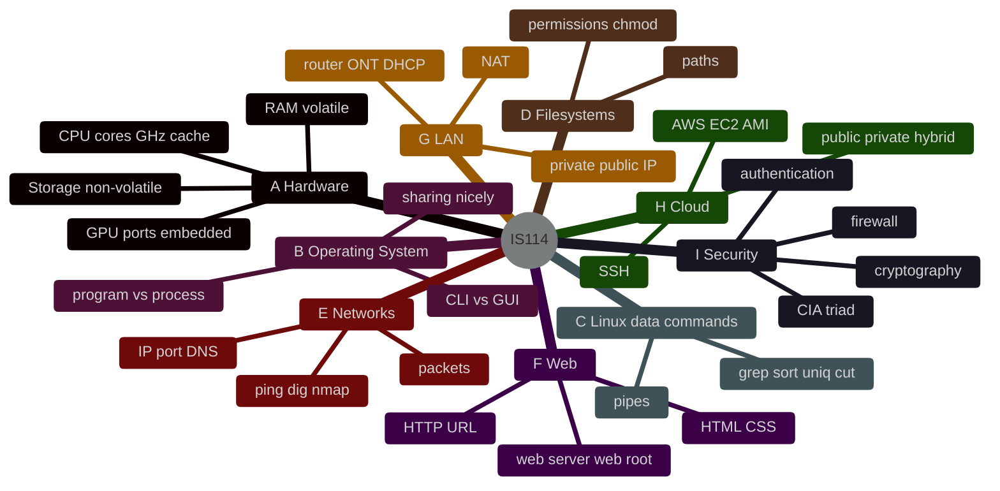

*Caption: concept map of the whole course. Read it clockwise from Part A; each branch is a Part of these notes.*

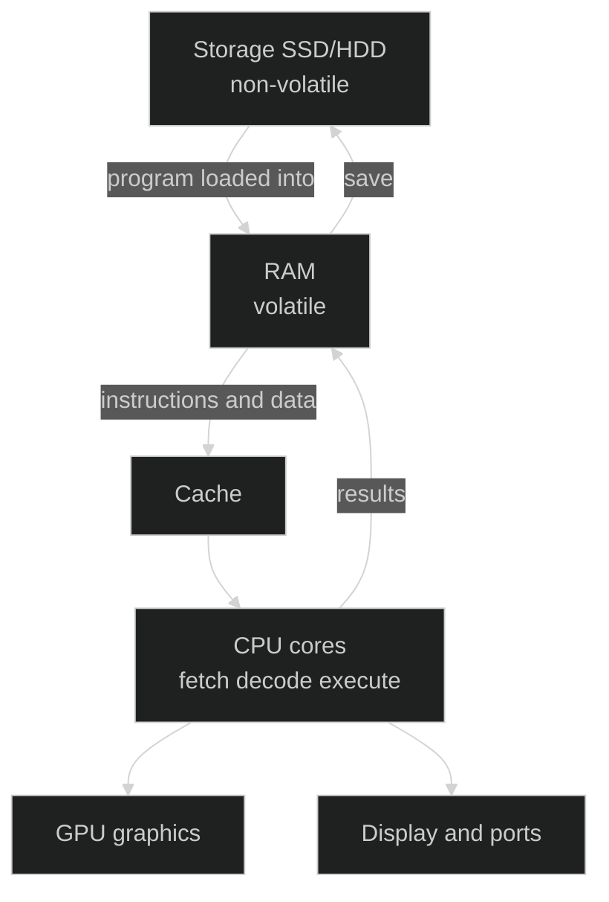

*Caption: how storage, RAM, cache and CPU cooperate when you open a program `[LT]` (cache position inferred from `[Comp §1.1]`). Note the CPU never executes straight from storage — programs are copied into RAM first.*

---

# Part A — Computer Hardware (Week 1)

## A.1 Hardware vs software

| Term | Meaning |
|---|---|
| **Hardware** | Physical parts you can touch; "visible even when powered off", consuming no electricity `[LT]` `[Comp §1]`. Examples: processor, memory, storage, battery, keyboard, screen, ports. |
| **Software** | Programs and data that run on hardware (OS, web browser, word processor). `[W1 s11]` |

A computing system = hardware + software `[W1 s11]`. In the Week 1 specification, the single software item is **Windows 11 Home** `[W1 s10]`.

## A.2 Reading a laptop specification line by line

The course reference specification `[W1 s2]`:

| Spec line | Meaning |
|---|---|
| **Intel Core i7** | CPU model — a high-performance processor. |
| **2.8 GHz** | Clock speed = 2.8 billion cycles per second `[W1 s5]`. |
| **Quad-Core** | 4 cores for parallel processing / better multitasking. |
| **12 MB Intel Smart Cache** | Very fast volatile memory inside the CPU; 12 MB = 12 million bytes. |
| **15-inch HD LED display (1920 × 1080)** | 15 inches = *diagonal* screen size; HD = High Definition; LED = Light-Emitting Diode backlight (energy-efficient, long-lasting, mercury-free `[W1 s8]`); 1920 × 1080 = resolution in pixels, width × height. |
| **Intel Iris Xe GPU** | Graphics Processing Unit: handles graphics (games, video, animation); relieves the CPU. |
| **20 GB RAM** | Random Access Memory (main memory); 20 GB = 20 billion bytes; volatile. |
| **1 TB SSD** | Solid-State Drive (secondary storage); 1 TB = 1 trillion bytes; non-volatile; faster and more durable than HDD (no moving parts). |
| **WiFi 7, Bluetooth 5** | WiFi: wireless internet (long range). Bluetooth: short-range wireless for keyboards, earphones, phone syncing. |
| **2 USB Type-C ports** | Universal Serial Bus: connects external devices (flash drives, monitors, phones). |
| **1 HDMI port** | High-Definition Multimedia Interface: sends video and audio to TVs/projectors. |
| **3 kg** | Weight. |
| **Windows 11 Home** | Pre-installed operating system (software). |

## A.3 Metric prefixes — powers of ten

| Prefix | Symbol | Value | In bytes |
|---|---|---|---|
| Kilo- | K | $10^3$ | 1,000 B |
| Mega- | M | $10^6$ | 1,000,000 B |
| Giga- | G | $10^9$ | 1,000,000,000 B |
| Tera- | T | $10^{12}$ | 1,000,000,000,000 B |
| Peta- | P | $10^{15}$ | 1 quadrillion B |

*(in words: kilo = thousand, mega = million, giga = billion, tera = trillion, peta = quadrillion)*

<div class="callout tip">

**Course rule:** use powers of 10 (1 KB = 1,000 B). **Ignore** binary prefixes (KiB, MiB, GiB) `[LT]`. `[W1 s3]` shows the prefixes up to Tera; Peta appears in `[LT]` and `[Comp §1.3]`.

</div>

**Worked example.** The spec lists 20 GB RAM. $20\ \text{GB} = 20 \times 10^9 = 20{,}000{,}000{,}000$ bytes. If one ASCII character is 1 byte, RAM could in principle hold 20 billion characters (added context: ignoring OS overhead). Emoji are usually 4 bytes each `[LT]` `[Comp §1.3]`, so the same RAM holds roughly $5\times10^9$ emoji.

## A.4 The processor (CPU)

Synonyms: CPU, Central Processing Unit, microprocessor, microcontroller `[W1 s4]`. Think of it as "the brain" `[LT]`.

| Part | What it is | Why it matters |
|---|---|---|
| **Function** | Fetch instructions and data from memory, decode, execute; process data (text, images, numbers) `[W1 s4]` | The only component that actually computes. |
| **Clock** | A centrally generated series of electrical pulses that coordinates all actions in the computer `[LT]`. Measured in **Hz** (cycles per second); 2.8 GHz = 2.8 billion cycles/second. | The "conductor's baton" `[Comp §1.1]` (added analogy in source). Higher GHz → more cycles per second. |
| **Cores** | A multi-core CPU has several independent processors in one chip (Dual/Quad/Hexa). | More cores = better performance **and higher power usage** `[W1 s4]` (and more heat and cost `[Comp §1.1]`). |
| **Cache** | Very fast volatile memory on/near the CPU storing frequently used data/instructions (typically 8–12 MB `[LT]`). | Avoids waiting on slower RAM. |

**Lookup order when the CPU needs data** `[LT Q23]` `[Comp §1.1]`: **cache (fastest) → RAM → storage (slowest, last resort)**. The CPU tries the fastest place first to avoid delays. Note `[LT]` states this "is not stated explicitly in the notes, and requires inference".

## A.5 Memory (RAM) vs storage — the central comparison

| Attribute | Memory (RAM) | Storage (SSD/HDD) |
|---|---|---|
| Synonyms | RAM, primary storage/memory, main memory, volatile memory `[W1 s6]` | Secondary storage, disk, non-volatile memory `[W1 s7]` |
| Volatility | **Volatile** — all contents lost when power is off | **Non-volatile** — retained without power |
| Role | Holds the OS, programs and data *currently in use* | Long-term storage of OS, apps, files |
| CPU access | CPU reads from and writes to it directly; programs execute from here | CPU cannot execute from storage; program must be loaded into RAM first |
| Typical capacity | 4–32 GB in laptops/phones `[W1 s6]`; `[LT]`: 4 GB basic, 16 GB standard, 32 GB high-end | 200 GB–1 TB `[W1 s7]`; `[LT]`: 256 GB–1 TB laptops, several TB desktops/servers; summary table 256 GB–2 TB |
| Speed | Fast (but slower than cache) | Slower ("storage is slower than RAM but permanent") |
| Effect of too little | OS closes programs to free space; too many apps feel sluggish | Less room for files and apps |

Storage types `[LT]`: **SSD** — no moving parts, fast, durable, expensive; **HDD** — spinning disk, slower, cheaper, more fragile; **SD card** — removable (cameras, phones).

Hardware summary table `[LT]`:

| Component | Category | Volatile? | Speed | Typical size | Role |
|---|---|---|---|---|---|
| CPU | Processor | n/a | Fastest | n/a | Executes instructions |
| Cache | Memory | Yes | Very fast | 8–12 MB | Speeds up CPU access |
| RAM | Memory | Yes | Fast | 4–32 GB | Run programs & store active data |
| SSD/HDD | Storage | No | Slower | 256 GB–2 TB | Store OS, apps, files long-term |
| GPU | Processor | n/a | Fast | Integrated or dedicated | Handle graphics |

<div class="callout warning">

**Unsaved work.** Because RAM is volatile, anything you are editing that hasn't been saved to storage is lost immediately on sudden power loss `[LT Q19]` `[Comp §1.2]`. A running *process* dies on power-off, while its *program* file survives on storage (see §B.5).

</div>

## A.6 How it all works together (when you open a browser)

1. **Storage** loads the program into **RAM**.
2. **RAM** supplies data/instructions to the **CPU**.
3. **CPU** executes instructions and processes data.
4. **GPU** handles graphics (video, animations).
5. Results are shown on screen and saved back to storage if needed. `[LT]`

"This cycle runs millions of times per second." The **von Neumann architecture** `[W1 s12]`: instructions (software) and data are *both* stored in the memory unit.

## A.7 GPU, display, ports, wireless

- **GPU:** a separate processor for graphics; frees the CPU `[W1 s8]`; also used for machine-learning tasks `[LT Q7]` and parallel matrix computations `[Comp §1.1]`.
- **Display:** *size* = diagonal of the screen; *resolution* = pixels wide × high (1920 × 1080 → 1,920 pixels across, 1,080 down).
- **USB:** standardised bidirectional interface for data and power `[Comp §1.4]`. **HDMI:** uncompressed digital audio + video to monitors/TVs.
- **Bluetooth:** short range, low power → ideal for keyboards, mice, earphones `[Comp §1.4]`.

## A.8 Embedded systems and the micro:bit

An **embedded system** is a computer dedicated to a narrow range of functions as part of a larger system `[W1 s13]` — found in microwaves, cars, watches, medical equipment, smart appliances.

The **BBC micro:bit v2** is a tiny embedded computer with a processor, memory, storage and sensors `[W1 s14]`; in the lab it is "a platform to practice coding and sensor integration" `[W1 s17]`. It demonstrates that the same three resources (processor, memory, storage) exist even in a tiny device.

## A.9 Hardware gotchas

<div class="callout mistake">

- **Memory ≠ storage.** A big disk does not let you run more programs at once; RAM does. (A machine with lots of storage but little RAM still feels slow when many apps run `[LT Q22]`.)
- **Storage is not "executed" directly.** The CPU runs programs from RAM.
- **Prefix confusion:** 1 TB = $10^{12}$ bytes in this course, not $2^{40}$.
- **Quad-Core ≠ 4× faster** in every case; it helps parallel work, and costs power.
- **15-inch** is the *diagonal*, not width.

</div>

---

# Part B — Operating Systems, Processes & the Command Line (Week 2)

## B.1 Software categories

| Category | Definition | Examples |
|---|---|---|
| **Application software** | Written to address specific needs / solve real-world problems `[W2 s2]` | Terminal, Microsoft Office, Firefox, Chrome, games, social media, AI tools `[LT Q28]` |
| **System software** | Manages a computer system at a fundamental level `[W2 s2]`; provides tools for creating and running application software, often interacts directly with hardware | Windows, Linux, macOS `[LT Q26]` |

The **operating system (OS)** is the core component of system software `[LT Q29]`.

## B.2 Roles of an OS — "sharing nicely"

An OS `[W2 s3–5]`:

1. Manages computer resources such as memory and storage (and processors).
2. Provides an interface through which a human can interact with the computer.
3. Allows application programs to interact with those resources.

All roles revolve around **"sharing nicely"**: resources are shared among programs that want them `[W2 s5]`. The compendium breaks this into four duties `[Comp §2.1]`:

| Duty | What it means |
|---|---|
| Processor scheduling | Programs take turns on the CPU so all make progress (`[LT Q34]`) |
| Memory allocation | Isolated RAM space per process; reclaimed on termination |
| Storage & I/O coordination | Turns file requests into low-level block reads/writes |
| User interfaces | GUI and CLI |

**Booting:** when the machine powers up, firmware loads the OS (kernel) from non-volatile storage into memory and hands control of the computer to it `[LT Q32]` `[Comp §2.1]`.

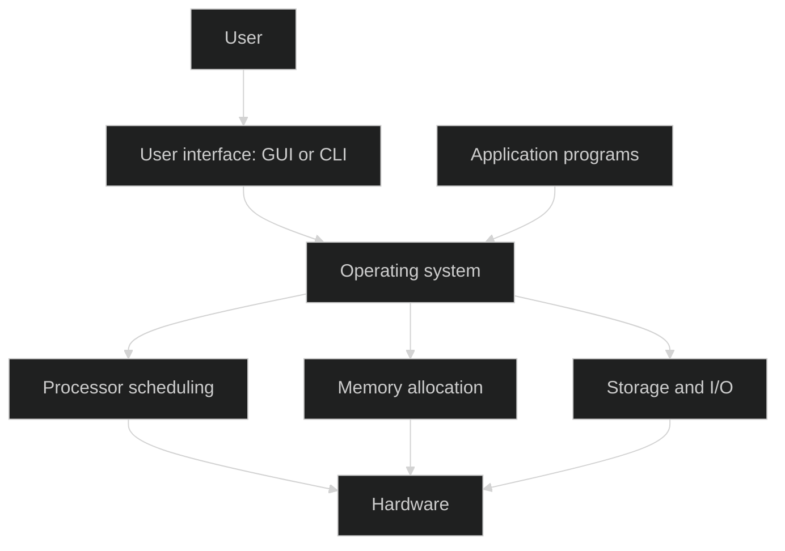

*Caption: the OS sits between users/applications and hardware `[W2 s4]` (figure re-expressed; box labels inferred).* Notice every request, whether from a person or a program, passes through the OS.

## B.3 Why Linux?

- Used in this course to prepare for advanced IS courses `[W2 s6]`.
- Powers **over 60% of servers worldwide** and **all of the Top 500 supercomputers** `[W2 s6]`.
- Android is built on the open-source Linux kernel `[Comp §2.2]`.

## B.4 GUI vs CLI

| | GUI | CLI |
|---|---|---|
| Interaction | Click or tap graphical elements | Type commands |
| Strength | Intuitive for single items | Batch processing, automation (scripting), remote administration with little bandwidth `[Comp §2.3]` |
| Other names | — | terminal, shell, command line `[W2 s7]` |

Why beginners struggle with the Linux CLI: it is **case-sensitive** and needs **precise syntax** `[LT Q37]`; also forgetting to check the prompt host, not using tab-completion, and confusing signals `[Comp §2.3]`.

**CLI conventions** `[W2 s12]`: commands are almost always lowercase; options typically come **before** arguments; the **order of options does not matter**. Tricks: **Tab completion**; history with **↑ / ↓**; **Ctrl+c** stops a running command.

**Which computer am I on?** Look at the **prompt**: it shows the username and the **hostname** of the machine you're commanding `[LT Q24, Q46]`.

## B.5 Program vs process

| | Program | Process |
|---|---|---|
| Definition | An executable file with a set of instructions (and data) `[W2 s8]` | A program in execution `[W2 s8]` |
| Lives in | Storage (non-volatile) — e.g. `/bin/cat`, `C:\Windows\notepad.exe` | Main memory (RAM) |
| When power is cut | Remains intact | Terminates instantly (RAM is volatile) `[LT Q40]` |

Synonyms for program: app, application, executable file `[LT glossary]`.

**See them:** Programs — Windows *Start ➜ Settings ➜ Apps*; macOS *Finder ➜ Applications*. Processes — Windows *Task Manager*; macOS *Activity Monitor* `[W2 s9]`. Try opening and closing Notepad/Calculator and watch the process appear and vanish.

**Foreground vs background** `[W2 s10]`: the **foreground** process is the one you're interacting with right now; **background** processes run without direct user interaction. GUI analogies `[LT Q45]`: foreground ≈ maximised app you are using; background ≈ minimised/behind other windows; Ctrl-C ≈ closing the app.

## B.6 Process control commands

| Command | Purpose |
|---|---|
| `ps u` | List processes you own (note: **no dash** — `ps -u` is ❌ in this course) |
| `top` | Interactive demo process (used to practise control) |
| `Ctrl-c` | **Terminate** (kill) the foreground process |
| `Ctrl-z` | **Suspend** (pause) the foreground process |
| `bg` | Resume the most recently suspended process **in the background** |
| `fg` | Resume the most recently suspended process **in the foreground** |

Focus on the **COMMAND** column of `ps u` — it shows the program, options and arguments `[LT]`.

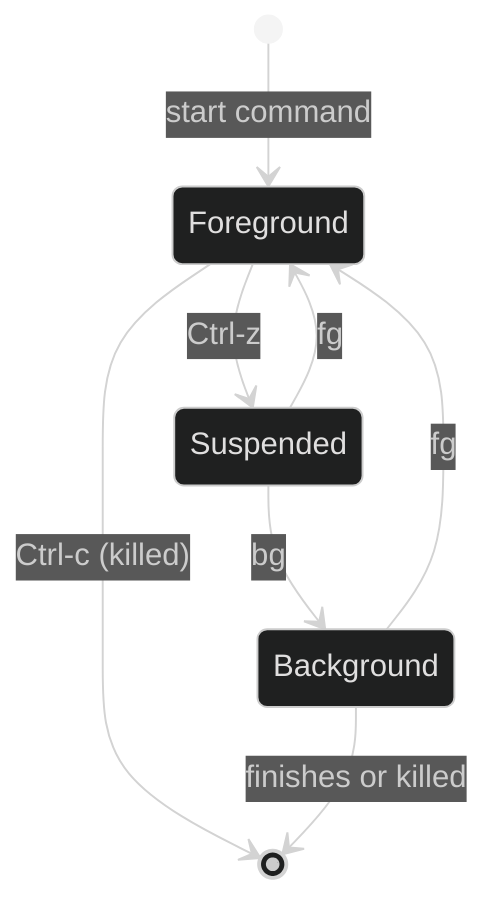

*Caption: process state control in Linux `[W2 s13]` (the Background → Foreground and finish edges are inferred).* A **killed** process frees both CPU and RAM; a **suspended** process uses **zero CPU** but **still holds its RAM** until resumed or killed `[Comp §2.4]`.

**Worked trace — "I pressed Ctrl-Z by mistake"** `[LT Q44]`:
1. You meant to kill `top`, but pressed Ctrl-Z. `top` is paused and moved out of the foreground.
2. Type `fg` → it returns to the foreground.
3. Press `Ctrl-c` → it is terminated.

<div class="callout mistake">

**Common beginner mistake:** pressing Ctrl-Z by accident and wondering where the process went — *it's paused, not gone* `[W2 s13]`. "Suspending vs sleeping" are different concepts, out of scope `[W2 s13]`.

</div>

---

# Part C — Linux Command-Line Data Analysis (Week 2 labs, Lab 1 `yum.csv`)

## C.1 File-system listing and file commands (from Week 2)

| Command | Purpose |
|---|---|
| `ls` | List directory contents |
| `ls -l` | Long format: permissions, owner, size, date |
| `ls -a` | Include hidden files (names starting with `.`) |
| `touch file` | Create an empty file |
| `touch "name with spaces"` | Use **quotes** for spaces — do **not** use backslash `\` in quizzes |
| `cat file` | Display the entire file |
| `nano file` | Edit a file — save **Ctrl-O**, exit **Ctrl-X** |
| `echo "text"` | Print text |
| `head file` / `head -n N file` | First 10 lines / first *N* lines |
| `tail file` / `tail -n N file` | Last 10 lines / last *N* lines |

## C.2 Extract, search, sort, count

| Command | Purpose | Options |
|---|---|---|
| `cut` | Extract fields (columns) | `-d` delimiter, `-f` fields |
| `grep "text" file` | Print lines matching | `-i` ignore case, `-v` invert (lines **not** matching) |
| `sort` | Sort lines (default ASCII/alphabetical) | `-r` reverse, `-n` numeric |
| `uniq` | Remove **adjacent** duplicate lines | `-d` only duplicated lines, `-u` only unique lines, `-c` count occurrences |
| `wc` | Count | `-l` lines, `-w` words (`-c` characters appears on `[W2 s16]` but `[LT]` says out of scope) |
| `\|` | Pipe: output of one command → input of the next | |
| `*` `?` | Wildcards: `*` = any characters (zero or more); `?` = exactly one character | |

Wildcard examples `[LT]`: `ls *.csv`, `ls so*`, `ls s?m?`.

**Which commands accept multiple files?** `[LT]`

| Accepts several files | Does **not** |
|---|---|
| `cat *.csv`, `ls f1 f2`, `wc *.log`, `head f1 f2`, `tail f1 f2`, `sort f1 f2`, `grep "error" *.log` | `cut` → use `cat files \| cut …`; `uniq` → use `cat files \| sort \| uniq` |

Pipes: `cat file | grep "dog" | sort | uniq -c`; `cat data.csv | cut -d',' -f2 | sort | uniq -c`.

Redirection: `>` creates/overwrites; `>>` appends `[W3 s20]`. Overwrite also **truncates**: `> file.txt` empties a file but keeps it `[LT]`.


*Caption: the "top 2 most common foods" pipeline (Lab 1 task 27). Read left to right: each box is the data after the command on the arrow.* **`sort` must come before `uniq`** because `uniq` only collapses *adjacent* duplicates.

## C.3 Lab 1 dataset — `yum.csv`

```csv
#date,food,price,rating
2020-01-01,Nasi Lemak,5,B
2020-01-01,Chicken Rice,4,A
2020-01-03,Laksa,6,B
2020-01-04,Char Kway Teow,7,C
2020-01-05,Dim Sum,8,A
2020-01-05,Roti Prata,3,B
2020-01-07,Satay,10,A
2020-01-08,Duck Rice,6,B
2020-01-09,Nasi Lemak,12,A
2020-01-10,Nasi Goreng,5,B
2020-01-11,Tom Yum Soup,9,C
2020-01-11,Sushi,8,B
2020-01-13,Pad Thai,7,A
2020-01-14,Green Milk Tea,5,B
2020-01-15,Spring Rolls,5,B
2020-01-15,Biryani,9,C
2020-01-17,Green Milk Tea,7,A
2020-01-18,Happy Meal,15,A
2020-01-19,Sushi,20,A
2020-01-19,Sushi,6,B
```

Structure: 4 columns (`date,food,price,rating`), comma-delimited, a header row starting with `#`, 20 data rows. Foods that repeat: Nasi Lemak ×2, Green Milk Tea ×2, Sushi ×3.

## C.4 Lab 1 — all 28 tasks with answers

| # | Task | Command |
|---|---|---|
| 1 | Display entire contents | `cat yum.csv` |
| 2 | Rows containing "Sushi" | `grep "Sushi" yum.csv` |
| 3 | Count how many times "Sushi" appears | `grep "Sushi" yum.csv \| wc -l` |
| 4 | First 3 foods (no dates/prices/ratings) | `tail -n +2 yum.csv \| head -n 3 \| cut -d',' -f2` |
| 5 | Last 4 foods | `tail -n 4 yum.csv \| cut -d',' -f2` |
| 6 | Foods in alphabetical order | `tail -n +2 yum.csv \| cut -d',' -f2 \| sort` |
| 7 | Foods A→Z, no duplicates | `tail -n +2 yum.csv \| cut -d',' -f2 \| sort \| uniq` |
| 8 | Count of unique foods (one number) | `tail -n +2 yum.csv \| cut -d',' -f2 \| sort \| uniq \| wc -l` |
| 9 | Count of unique ratings | `tail -n +2 yum.csv \| cut -d',' -f4 \| sort \| uniq \| wc -l` |
| 10 | Lowest price | `tail -n +2 yum.csv \| cut -d',' -f3 \| sort -n \| head -n 1` |
| 11 | Highest price | `tail -n +2 yum.csv \| cut -d',' -f3 \| sort -n \| tail -n 1` |
| 12 | Times each food appears | `tail -n +2 yum.csv \| cut -d',' -f2 \| sort \| uniq -c` |
| 13 | Times each rating appears | `tail -n +2 yum.csv \| cut -d',' -f4 \| sort \| uniq -c` |
| 14 | First 5 lines | `head -n 5 yum.csv` |
| 15 | Last 3 lines | `tail -n 3 yum.csv` |
| 16 | First line | `head -n 1 yum.csv` |
| 17 | Last line | `tail -n 1 yum.csv` |
| 18 | "food" column (2nd) | `tail -n +2 yum.csv \| cut -d',' -f2` |
| 19 | "price" column (3rd) | `tail -n +2 yum.csv \| cut -d',' -f3` |
| 20 | Lines with "Sushi" (case-sensitive) | `grep "Sushi" yum.csv` |
| 21 | Count "Nasi Lemak" | `grep "Nasi Lemak" yum.csv \| wc -l` |
| 22 | "green" regardless of case | `grep -i "green" yum.csv` |
| 23 | Lines **not** containing "Chicken" | `grep -v "Chicken" yum.csv` |
| 24 | Contents without header | `tail -n +2 yum.csv` |
| 25 | Dates appearing more than once | `tail -n +2 yum.csv \| cut -d',' -f1 \| sort \| uniq -d` |
| 26 | Foods appearing exactly once | `tail -n +2 yum.csv \| cut -d',' -f2 \| sort \| uniq -u` |
| 27 | Top 2 most-common foods | `tail -n +2 yum.csv \| cut -d',' -f2 \| sort \| uniq -c \| sort -n -r \| head -n 2` |
| 28 | Foods costing exactly 5, sorted A→Z | `tail -n +2 yum.csv \| grep ",5," \| cut -d',' -f2 \| sort` |

(Within a Markdown table the pipe is escaped as `\|`; type a plain `|` in the terminal.)

**Worked trace — task 27** (input → output at each stage, added context computed from the dataset):

1. `tail -n +2 yum.csv` → 20 data rows (header dropped; `+2` means "start from line 2").
2. `cut -d',' -f2` → 20 food names.
3. `sort` → alphabetical, so identical names are adjacent (Green Milk Tea, Green Milk Tea, … Sushi, Sushi, Sushi).
4. `uniq -c` → counts, e.g. `3 Sushi`, `2 Nasi Lemak`, `2 Green Milk Tea`, others `1`.
5. `sort -n -r` → numeric descending: `3 Sushi` first, then the `2`s.
6. `head -n 2` → top 2 lines. *(Ties at count 2 are ordered by the secondary text of the line, so which `2` appears second is decided by the sort's tie-break — added context.)*

**Worked trace — task 3 vs 21:** `grep "Sushi" yum.csv | wc -l` counts **lines containing** "Sushi" = 3 (2020-01-11, two on 2020-01-19). It counts lines, not occurrences within a line.

**Why `grep ",5,"` in task 28?** It matches the price column exactly (`,5,`) and avoids prices like 15 or 50 `[LT]`.

<div class="callout tip">

**Best practices** `[LT]`: always skip the header with `tail -n +2 yum.csv` (more reliable than `grep -v "#"`); use `','` as the `cut` delimiter for CSV; `sort -n -r` for descending top-N; `uniq -c` only after `sort`; chain with pipes.

</div>

<div class="callout mistake">

**Key rules recap** `[LT]`: `ps u`, not `ps -u` · quotes for spaces, not `\` · `grep` is case-sensitive by default · **always sort before uniq** · `uniq` only works on adjacent lines · `cut -d','` for CSV · `*` = any chars, `?` = one char · don't use `wc -c`.

</div>

## C.5 Pipeline explanations from the compendium

- `cat yum.csv | grep "Sushi" | wc -l` — stream file, keep lines containing "Sushi", count them `[Comp §11.2]`.
- `cat yum.csv | grep -v "#date" | cut -d, -f2 | sort | uniq -c` — drop the header row, extract column 2 (food), sort, count each unique food `[Comp §11.2]`.

## C.6 Redirection traces (compendium quiz items)

```bash
echo "monday" > file1     # file1 = monday
echo "tuesday" >> file1   # appended: monday / tuesday
cat file1 | wc -l         # 2
```

```bash
echo "monday" > file1
echo "tuesday" > file1    # overwrites -> only tuesday
cat file1 | wc -l         # 1
```

`[Comp §10 Q27–28]`


---

# Part D — File Systems, Paths & Permissions (Week 3)

## D.1 Core definitions `[W3 s2–4]`

| Term | Definition |
|---|---|
| **File** | A named collection of related data, used for organizing secondary memory; from the user's view, the smallest amount of data that can be written to storage |
| **File system** | The operating system's logical view of the files it manages |
| **Directory** | A named group of files (also "folder") |

Why directories? They group and organise files logically `[LT Q47]`, and a directory tree lets filenames be reused in different subdirectories `[LT Q74]`.

**Linux filenames are case-sensitive:** `data.txt` and `Data.txt` are different files and can coexist `[LT Q48]` `[Comp §11.3]`. Mistyping a name can therefore act on the wrong file `[LT Q66]`.

## D.2 Text files vs binary files

| | Text file | Binary file |
|---|---|---|
| Content | Characters from a character set (ASCII, Unicode) | Data in a specific format needing special interpretation of its bits (formatting, pixels, audio…) |
| Human-readable? | Yes — open in a text editor | No — gibberish without proper software |
| Examples | `.txt .csv .java .html .sh` | `.docx .jpg .mp3 .pdf .exe` |
| Editable with `nano`? | Yes | No (or you corrupt it) |

<div class="callout warning">

**Misconception alert** `[LT]`: "Text files aren't binary" is **false**. *Everything* on a computer is stored as binary digits `[W3 s4]`; "text" vs "binary" is about **how the bits are interpreted** — text files are chunks of 8 or 16 bits interpreted as characters. The terms "are somewhat misleading" `[W3 s4]`.

</div>

A `.docx` is **binary** because it embeds formatting, fonts, margins, colours and media beside the text `[LT Q51, Q68]` `[Comp §3.1]`.

## D.3 File types and extensions

- **File type** = the kind of information in a file. **Extension** = the part after the dot (`.jpg`, `.csv`) that indicates the type; names are `Filename.Extension` `[W3 s5]`.
- Purpose: helps the OS choose which program opens the file (`MyProg.java` → code editor; `family.jpg` → image viewer).
- **Extension ≠ truth.** Renaming `virus.exe` to `funny-cat.jpg` does not change what it is `[LT]`. Changing an extension (or any part of the name) does not change the contents `[LT Q53]`; you can't "convert" a file by renaming `[LT Q69]`.
- What happens on double-click: OS checks extension → opens associated program → program reads the real format → mismatch gives an error `[LT Q54]`.

## D.4 File operations

| Operation | Command / meaning |
|---|---|
| Create | `touch` (file), `mkdir` (folder) |
| Delete | `rm` (file); `rmdir` (empty dir); `rm -r` (dir + contents) |
| Open / Close | Load into a program (e.g. `nano file.txt`) / exit program |
| Rename / Move | `mv old new` |
| Copy | `cp source dest` |
| Read | `cat`, `head`, `grep` |
| Write | `>`, `nano` |
| Append | `>>` |
| Truncate | `> file.txt` (delete content, keep file) |

## D.5 Directory trees and paths

| Term | Definition |
|---|---|
| Parent directory | The containing directory |
| Subdirectory | The directory being contained |
| Directory tree | Logical view of nested directories `[W3 s10]` |
| Root directory | Highest level: `/` (Linux), `C:\` (Windows) |
| Current working directory (CWD) | Where you are now (`pwd`) |

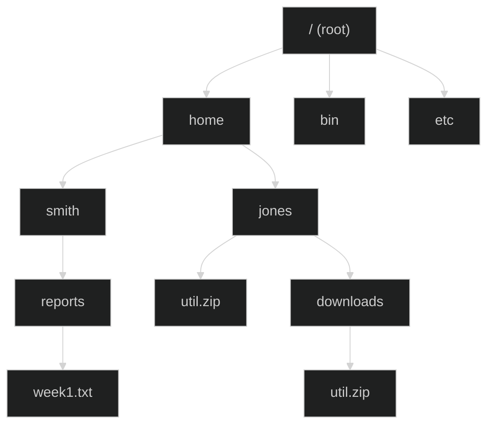

*Caption: a UNIX-style tree using `[LT]` examples `/home/smith/reports/week1.txt` and the two `util.zip` files (tree shape inferred from the paths).* The two `util.zip` files coexist because their **full paths differ** `[LT Q75]`.

**Absolute path** — begins at the root, **always starts with `/`**, unique and unambiguous. Examples: `/`, `/bin/tar`, `/etc/sysconfig/clock`, `/home/smith/reports/week1.txt`. Windows: `C:\Program Files\MS Office\WinWord.exe`.

**Relative path** — starts from the CWD, **never starts with `/`**. If CWD is `/home/jones`:

| Relative path | Resolves to |
|---|---|
| `donations` | `/home/jones/donations` |
| `utilities/printall` | `/home/jones/utilities/printall` |
| `../smith/reports` | `/home/smith/reports` |
| `../../dev/ttyE71` | `/dev/ttyE71` |

Windows example `[W3 s15]`: with CWD `C:\My Documents\letters`, relative paths `cancelMag.doc`, `applications\calState.doc`.

Special names: `.` = current directory; `..` = parent directory. Find your absolute path with `pwd` `[LT Q83]`.

## D.6 The PATH environment variable

`PATH` is a colon-separated list of directories searched for executables: `PATH=/usr/bin:/bin:/usr/local/bin:/home/jones/utilities`. The OS searches them **in order** and runs the first match `[Comp §3.3]`. If `printall` is in a listed directory you can type `printall` from anywhere; otherwise type `/home/jones/utilities/printall`. Temporary addition: `export PATH=$PATH:/home/jones/utilities` (how to add is out of scope `[LT Q90]`).

## D.7 Navigation and manipulation commands

| Command | Description |
|---|---|
| `tree` / `tree FOLDER` | Visual tree from the current / specified folder |
| `pwd` | Print current working directory |
| `cd` / `cd ~` | Go to home directory (same) |
| `cd ..` | Up to parent |
| `cd .` | Stay (no change) |
| `cd -` | Previous working directory (toggle) |
| `ls`, `ls -l`, `ls -a` | List; detailed; include hidden |
| `mkdir DIR` / `rmdir DIR` | Create / remove **empty** directory |
| `rm FILE` / `rm -r DIR` | Delete file / directory recursively |
| `mv OLD NEW` | Move or rename |
| `cp F1 F2` / `cp -r D1 D2` | Copy file / directory recursively |
| `cat FILE` | Display |
| `> FILE` / `>> FILE` | Overwrite / append |

<div class="callout warning">

`rm`, `mv`, `cp`, `>` and `>>` "can permanently change or delete data. Use them carefully!" `[W3 s20]` Deleting a directory deletes everything inside `[LT Q76]`.

</div>

**Hidden files:** names starting with `.`. After `mkdir one .two three`, plain `ls` shows only `one` and `three`; use `ls -a` to see `.two` `[LT Q91]`.

## D.8 File protection and permissions

File protection limits file access; in multi-user systems it is of primary importance `[W3 s7]`. Three user categories and three permission bits:

| Category | Symbol | Meaning |
|---|---|---|
| Owner | `u` | The user who owns the file (usually creator) |
| Group | `g` | A set of users, e.g. project team |
| World/Other | `o` | Everyone else with an account |
| (All) | `a` | all three |

| Permission | On a **file** | On a **directory** |
|---|---|---|
| `r` read | View contents (`cat`, `nano`) | List contents (`ls`) |
| `w` write | Modify/overwrite/append/truncate | Create, delete, rename items inside |
| `x` execute | Run as a program/script | Enter / traverse (`cd`) |

### chmod

Syntax: `chmod [who][operator][permissions] FILE`, with who ∈ {`u`,`g`,`o`,`a`}, operator ∈ {`+` add, `-` remove, `=` set exactly}, permissions ∈ {`r`,`w`,`x`}.

| Command | Effect |
|---|---|
| `chmod u+x script.sh` | Owner can execute |
| `chmod +x file` | All can execute (`a+x`) |
| `chmod -x file` | Remove execute from everyone |
| `chmod go-w notes.txt` | Remove write from group and world |
| `chmod u=rw,go=r file` | Owner read/write; group/world read only |
| `chmod u=rw,go= file` | **Only owner** read/write; nothing for group/world — private file (e.g. SSH key) |
| `chmod u=rwx,go=rx dir/` | Owner full; others can enter and list but not create/delete |
| `chmod u=r,go= FILE` | Owner read only, no write/execute; nothing for group/world `[Comp Q30]` |

Note: `chmod u=rw, go=r file` in `[LT]` contains a stray space — the real syntax has **no spaces** around the comma.

<div class="callout tip">

**Why must executable permission be granted explicitly?** So you don't accidentally run a malicious downloaded file `[LT Q60]`. A downloaded script run as `./this-is-running.sh` gives `Permission denied` until `chmod u+x this-is-running.sh` `[LT Q84]` `[Comp §3.4]`.

</div>

**Diagnosing permission symptoms** (applications):

| Symptom | Missing permission |
|---|---|
| Can `ls` a folder ABC but `cd ABC` → `Permission denied` | **x** on the directory `[LT Q87]` |
| Teammate can `ls` `report.docx` but cannot open it | **r** on the file for their category — Group if in the file's group, otherwise World `[LT Q85]` |
| Make a folder non-writable by everyone but the owner | `chmod go-w FOLDER_NAME` `[LT Q88]` |
| World-readable, not writable file | Any user can view; cannot modify/delete `[LT Q71]` |
| `chmod u=rw,go=` result | Only owner can read/write `[LT Q93]` |

## D.9 Lab 2 — walking the `is114-nav` tree (all 27 steps)

Starting tree `[LT]` (extensionless names are files):

```text
.
├── alpha
│   ├── mango
│   │   ├── fomo.txt
│   │   └── savage.txt
│   ├── peach
│   │   ├── bless
│   │   └── slay.txt
│   └── yumyum.csv
├── bravo
│   ├── apple
│   │   ├── flex.txt
│   │   └── yeet
│   ├── banana
│   │   ├── gucci.txt
│   │   └── lit.txt
│   └── gennermen
│       └── thanos.txt
└── charlie
    ├── grape
    │   ├── snacc
    │   └── vibe
    └── kiwi
        ├── trust
        ├── boujee.txt
        └── ghosted.txt
```

<div class="callout fix">

The source footer reads "7 directories, 14 files". Counting the listing above gives **10 directories** (alpha, mango, peach, bravo, apple, banana, gennermen, charlie, grape, kiwi) and **15 files**. The doc's footer therefore doesn't match its own listing; the steps below are consistent with the listing.

</div>

| # | Task | Command | Result |
|---|---|---|---|
| 1 | Go to lab root | `cd is114-nav` | Now in `~/is114-nav` |
| 2 | Show tree | `tree` | Whole structure |
| 3 | Go to peach | `cd alpha/peach` | In `alpha/peach` |
| 4 | List | `ls` | `bless`, `slay.txt` |
| 5 | Parent | `cd ..` | In `alpha` |
| 6 | List | `ls` | `mango`, `peach`, `yumyum.csv` |
| 7 | To apple | `cd ../bravo/apple` | In `bravo/apple` |
| 8 | New folder | `mkdir snow` | `snow` created in apple |
| 9 | List | `ls` | `flex.txt`, `snow`, `yeet` |
| 10 | Remove snow | `rmdir snow` | removed (works: empty) |
| 11 | List | `ls` | `flex.txt`, `yeet` |
| 12 | To mango | `cd ../../alpha/mango` | In `alpha/mango` |
| 13 | Copy all files to banana (wildcard) | `cp * ../../bravo/banana/` | Copies `fomo.txt`, `savage.txt` |
| 14 | Check banana (stay in mango) | `ls ../../bravo/banana/` | `gucci.txt`, `lit.txt`, `fomo.txt`, `savage.txt` |
| 15 | Remove one copy | `rm ../../bravo/banana/fomo.txt` | removed |
| 16 | Remove other copy | `rm ../../bravo/banana/savage.txt` | removed |
| 17 | To grape | `cd ../../charlie/grape` | In `charlie/grape` |
| 18 | List | `ls` | `snacc`, `vibe` |
| 19 | List kiwi | `ls ../kiwi/` | `trust`, `boujee.txt`, `ghosted.txt` |
| 20 | Move vibe | `mv vibe ../kiwi/` | `vibe` now in kiwi |
| 21 | List grape | `ls` | `snacc` only |
| 22 | List kiwi | `ls ../kiwi/` | `trust`, `boujee.txt`, `ghosted.txt`, `vibe` |
| 23 | To banana | `cd ../../bravo/banana` | In `bravo/banana` |
| 24 | List | `ls` | `gucci.txt`, `lit.txt` |
| 25 | Remove files containing `cc` | `rm *cc*` | `gucci.txt` deleted |
| 26 | To peach | `cd ../../alpha/peach` | In `alpha/peach` |
| 27 | List three folders at once | `ls ../mango/ ../../bravo/banana/ ../../charlie/` | see below |

(In the source docx some of these commands are line-wrapped by the converter, e.g. `cd . ./../alpha/mango`; the intended commands are as shown, derived by hand-tracing the relative paths — *inferred* from the tree.)

<div class="callout fix">

**Step 27 correction.** The source shows `../mango/:` as "(empty)". Because step 13 was `cp` (copy) not `mv`, `mango` **still contains `fomo.txt` and `savage.txt`**. Correct output: `../mango/: fomo.txt savage.txt`; `../../bravo/banana/: lit.txt`; `../../charlie/: grape kiwi`.

</div>

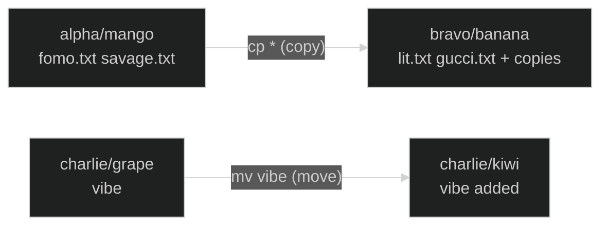

*Caption: `cp` leaves the source intact; `mv` removes it from the source.* This is the reason step 27 must list `mango` as non-empty.

Concepts practised `[LT]`: `cd` navigation (steps 1,3,5,7,12,17,23,26); relative paths (all); `ls` (4,6,9,11,14,18,19,21,22,24,27); `mkdir`/`rmdir` (8,10); `cp` with `*` (13); `rm *cc*` (25); `mv` (20); multi-folder `ls` (27).

**Pro tips** `[LT]`: use `tree` to verify; `ls` before and after each operation; `rmdir` only works on empty folders; `rm *cc*` removes any name containing `cc`; `cd ..` moves up; one `ls` can list several folders.

## D.10 Filesystem gotchas

<div class="callout mistake">

- **Case sensitivity** (`Data.txt` ≠ `data.txt`).
- **Directory `x`** is what lets you `cd`; `r` alone lists names only.
- **`rmdir` fails on non-empty directories**; use `rm -r` (dangerous).
- **`cp` copies, `mv` moves.** Don't assume the source disappears after `cp`.
- **A file that vanishes after reboot** may be stored in RAM — a challenge inference `[LT Q89]`: files in storage persist; RAM contents don't; the course never says files *can* be in RAM, but only that explains the behaviour.
- **`.` vs `..`**: `cd .` stays, `cd ..` goes up.
- `diff path1/data.csv path2/data.csv` compares two files — **out of scope** `[LT Q86]`.

</div>

---

# Part E — Computer Networks, Addressing & Diagnostics (Week 5)

## E.1 What is a network?

A **computer network** is a collection of computing devices connected so they can communicate and share resources `[W5 s2]`. Shared resources include files (intangible) and printers (tangible). Links can be physical (wires/cables) or wireless (radio waves, infrared). Email, instant messaging and web pages all rely on networks `[LT]`.

| Term | Definition |
|---|---|
| **Node / host** | Any device on a network `[W5 s3]` |
| **Data transfer rate (bandwidth)** | Speed with which data moves from one place to another on a network `[W5 s3]` |
| **Protocol** | A set of rules defining how data are formatted and processed on a network `[W5 s4]` |
| **Internetworking** | Communication between different networks `[LT glossary]` |

Learning objectives `[LT]`: explain LAN, WAN, intranet, internet structure; IP addressing & DNS; need for protocols; packet switching; client–server.

## E.2 Client/server

The **client** initiates a request; the **server** (always listening) processes it and responds `[W5 s5]` `[Comp §4.2]`. A **web server** is a computer dedicated to responding to requests for web pages; a **file server** stores and manages files for network users `[W5 s6]`. Example: a web browser (client) asks a web server for a page and the server delivers it `[LT Q96]`.

## E.3 Types of networks

| Type | Definition | Examples |
|---|---|---|
| **LAN** | Connects a relatively small number of machines in a relatively close area; single room/building, maybe a few close buildings | Home, office |
| **WAN** | Connects LANs over a potentially large geographic distance; routers act as gateways | Offices across cities/countries |
| **Gateway** | The particular node set up to handle all communication between a LAN and other networks (usually a router) | |
| **Internet** | A WAN that spans the planet ("network of networks") | |
| **Wireless network** | Devices communicate through a wireless access point; flexible, cheaper to install, but prone to interference and security issues `[LT Q100]` | Wi-Fi |
| **Bluetooth** | Wireless over short distances | phone→earbuds, mouse |

Wireless vulnerability: electromagnetic interference and unauthorised access due to broadcast nature `[LT Q100]`.

## E.4 Packet switching

| Term | Definition |
|---|---|
| **Packet** | A unit of data sent across a network |
| **Router** | Device that directs a packet between networks toward its final destination |
| **Packet switching** | Messages are divided into fixed-size, numbered packets; each routed individually, then reassembled `[W5 s11]` |

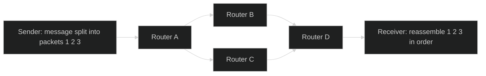

*Caption: packets take independent routes and are reassembled at the destination (topology inferred; `[W5 s12]` shows a similar figure).* Packets can arrive **out of order** because they take different routes `[Comp Quiz Q9]`; the receiver caches incoming packets and reorders them using the sequence numbers in their headers `[Comp §4.3]`.

**Routers know only the next hop**, not the full path `[LT Q94–95]` `[Comp §11.4]`: they forward to the best *next step*, using routing tables and congestion. If a path is down/congested, they may **reroute** `[LT Q98]`. (Added context: real packets are not always fixed size; the course simplifies.)

**Analogy** `[LT Q102]`: sending a long letter in separate envelopes by different routes, reassembled at the destination.

**Every packet carries** `[W5 s13]`:

1. Destination network address (IP) — identifies the correct **computer**
2. Destination port number — identifies the correct **process**
3. Source network address
4. Source port number

## E.5 Network addresses

| Type | Definition / example |
|---|---|
| **Hostname** | Words separated by dots uniquely identifying a computer, human-readable: `matisse.csc.villanova.edu` |
| **IP address** | Four one-byte numbers (0–255) separated by dots: `205.39.155.18` `[W5 s14–15]` |
| **IPv4** | 32 bits; ~4.3 billion addresses; last block assigned in **2011** `[W5 s16]` |
| **IPv6** | 128 bits, eight groups of 16 bits (hex): `FE80:0000:0000:0000:0202:B3FF:FE1E:8329`; works **in parallel** with IPv4 |
| **Loopback** | `127.0.0.1` / `localhost` — routes back to the same device |

IPv4 hierarchy as simplified in `[LT]`: first 2 numbers = network, 3rd = subnetwork, 4th = specific machine.

$$2^{32} = 4{,}294{,}967{,}296 \approx 4.3\ \text{billion}$$ (in words: 2 multiplied by itself 32 times). IPv6: $2^{128}$ addresses.

**Hostname vs IP:** a hostname is human-readable; an IP is the numeric identifier computers use `[LT Q99]`.

**Loopback** `[W5 s17]`: sending data to it is like sending a message to yourself; works with no Internet connection or in **airplane mode**; reason: traffic is routed internally within the device and never touches external hardware `[LT Q106]`. Use: test applications privately before launch `[LT Q105]`.

## E.6 Port numbers

An IP address gets data to the right **computer**; a **port** gets it to the right **process** — like a mailbox `[LT Q107–108]`. Two processes on the same port clash `[LT Q109]`.

| Service | Port |
|---|---|
| SSH | 22 |
| HTTP | 80 |
| HTTPS | 443 |

Identify two web servers: same computer → different **port numbers**; different computers → different **IP address + port** `[LT lab Q]`.

## E.7 DNS

**DNS** = a distributed system for managing hostname resolution `[W5 s22]`; a **domain name server** translates hostnames to IPs. Without DNS we'd memorise IPs `[LT Q101, Q113]`.

Hostname anatomy: `matisse.csc.villanova.edu` → computer name `matisse`; domain `csc.villanova.edu`; TLD `edu` `[W5 s19]`. In `node7.cluster.spider.net`, `node7` is the machine and `.net` the TLD `[Comp §4.5]`. **TLD** = last section of a domain name specifying organisation type or country. **Generic:** `.com` commercial, `.org` non-profit, `.edu` education. **Country codes:** `.au`, `.sg`, `.uk` `[LT]`. ICANN oversees TLDs `[Comp Quiz Q36]`. `.sg` in `www.smu.edu.sg` represents Singapore `[LT Q114]`.

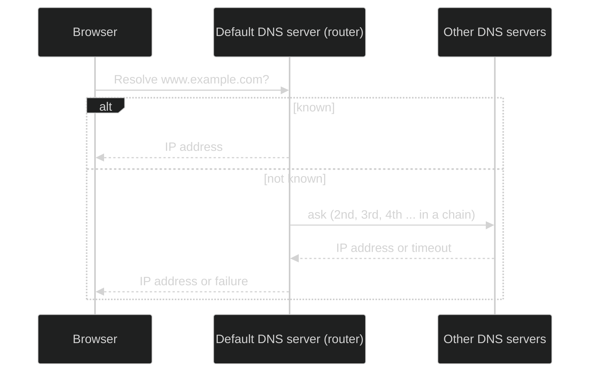

*Caption: DNS resolution `[W5 s23]`.* In the compendium's fuller description `[Comp §4.5]`: the client contacts the local default DNS nameserver (typically on the local router); if it can't resolve locally, recursive queries propagate up through **root nameservers** and **authoritative nameservers** until the address is found or the query times out. A failed resolution means all servers involved failed or the request timed out `[LT Q103]`. In a typical home network the default DNS server runs on the **router** (can be changed) `[Comp Quiz Q32]`.

## E.8 Diagnostic tools: ping, dig, nmap

| Tool | Use | Interpreting results |
|---|---|---|
| `ping HOST` | Reachability + round-trip time (`time=173 ms`); shows IP e.g. `PING gov.sg (76.223.1.167)` | Reply = alive. **Name-resolution failure** = DNS can't resolve the name. **Timeout / no reply** = inconclusive: host down, network issue, or firewall blocking ICMP `[LT]` |
| `dig +short DOMAIN` | DNS lookup | `dig +short shopee.sg @1.1.1.1` or `dig +short @1.1.1.1 shopee.sg` uses a specific server. Several returned IPs ⇒ load balancing `[Comp §11.4]` |
| `nmap HOST -p PORT` | Port state | **open**: application listening; **closed**: host reachable but nothing listening; **filtered**: firewall blocks probe, state unknown |

Troubleshooting a website that won't load `[LT]`:

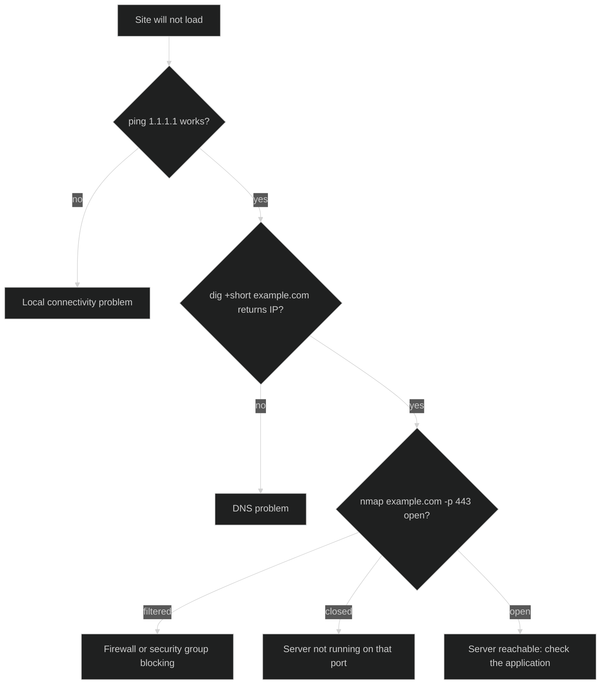

*Caption: layered diagnosis — connectivity, then DNS, then port (decision branches interpreted from `[LT]` and `[Comp §4.6]`).* Steps in source: `ping 1.1.1.1`; `dig +short example.com`; `nmap -p 80,443 example.com`; `nmap example.com -p 443`.

Public DNS servers `[LT]`: `1.1.1.1` (Cloudflare), `8.8.8.8` (Google), `9.9.9.9` (Quad9, security-focused), `149.112.112.112` (CleanBrowsing — as stated in the source; *(added context)*: that address is conventionally associated with Quad9's secondary, so treat this attribution with caution).

Other items `[LT]`: `traceroute` shows network path/hop times; performance monitoring ideas — latency, hop tracking, bandwidth utilisation, packet loss; architecture principles — scalability, redundancy, security, QoS.

**Two different IPs for one computer** `[LT]`: external IP from a browser (`https://icanhazip.com`, your ISP-assigned public IP) vs internal IP from the terminal (Windows `ipconfig | findstr /i "IPv4"`, macOS `ipconfig getifaddr en0`). Reasons: NAT, multiple interfaces (Wi-Fi/Ethernet/VPN), virtual machines, network segmentation, dynamic assignment.

## E.9 Network gotchas

<div class="callout mistake">

- Ping failure ≠ host down (ICMP may be blocked).
- **filtered ≠ closed**: filtered = firewall hides state; closed = host answers, nothing listening.
- Port 22/80/443 are *defaults*; any can be changed.
- `127.0.0.1` never leaves your device.

</div>


---

# Part F — The World Wide Web, HTML & HTTP (Week 6)

## F.1 Internet vs Web

| | Internet | World Wide Web |
|---|---|---|
| What | Physical network infrastructure connecting computers (since the 1950s per `[LT]`; text email and file exchange) | An infrastructure of information combined with the network software used to access it (1990s) `[W6 s3]` |
| Relationship | The foundation | An application system **on top of** the Internet |

Agenda `[W6 s2]`: WWW → HTML (create a page) → HTTP (access a page) → URL (address a resource) → lab (edit HTML; run a local web server; use HTTPie).

| Term | Definition |
|---|---|
| Web page | Document containing or referencing data (text, images, programs) |
| Links | Connections from one page to another |
| Website | Collection of related web pages (same person/organisation) |
| Web browser | Software that retrieves and displays pages (Firefox, Chrome, Safari) |
| Web server | Computer (or program) set up to respond to requests for web pages |
| Search engine | A website that helps you find other websites `[W6 s7]` |
| URL | Standard way of specifying the location of a web page |

## F.2 HTML and CSS

**HTML** (HyperText Markup Language) builds a page and defines **structure and content**. *Hypertext* = information not organised linearly, linkable to other information. *Markup language* = uses **tags** to annotate information. **HTML5** is the current standard `[LT]`.

- **Source HTML:** raw markup received over the wire. **Rendered HTML:** what you see on screen after the browser applies CSS `[W6 s8]`. View source: right-click → *View Source*.
- **CSS** (Cascading Style Sheets) controls **how** content looks (alignment, borders, backgrounds, fonts, colours). HTML says *what* the information is (paragraph, image, list); CSS says how to display it `[W6 s10]`.
- **Tags** are in angle brackets; the word inside (`head`, `title`, `body`) is the **element** name. Most elements have a start tag `<body>` and an end tag `</body>` `[W6 s13]`.

Document structure `[W6 s14]`:

```html
<!DOCTYPE html>
<html>            <!-- whole document -->
  <head>          <!-- metadata: title, stylesheet links -->
    <title>Page Title</title>
  </head>
  <body>          <!-- visible content -->
    <h1>Some Heading</h1>
    <div>Some text.</div>
  </body>
</html>
```

The browser uses tags + CSS, **ignores** your carriage returns, extra spaces and blank lines, considers the window width/height, and reflows content `[W6 s15]`. Improperly nested tags give unpredictable rendering `[LT Q123]`. An HTML doc is tree-like: root `<html>` contains tags that contain tags — like a directory tree `[LT Q133]`.

| Element | Meaning |
|---|---|
| `<p>…</p>` | paragraph |
| `<br />` | forced line break |
| `<hr />` | horizontal rule |
| `<ul>…</ul>` / `<ol>…</ol>` | unordered (bullets) / ordered (numbered) list |
| `<li>…</li>` | list item |
| `<h1>`…`<h6>` | headings level 1–6 |
| `<em>` / `<strong>` | italic / bold emphasis (`<b>` also bold) |
| `<a href="…">` | anchor: hyperlink |
| `` | image |
| `<video controls><source src type></video>` | video (lab) |

**Attributes** (`name=value`, in the start tag) give extra information: `style="text-align:center"`, ``, `<a href="http://google.com/">Google It!</a>`. `href` = destination URL `[LT Q121]`. (The slide shows `href` without quotes; quote attribute values.)

## F.3 HTTP — request/response

HTTP is the protocol for data exchange between browser and server `[W6 s18]`:

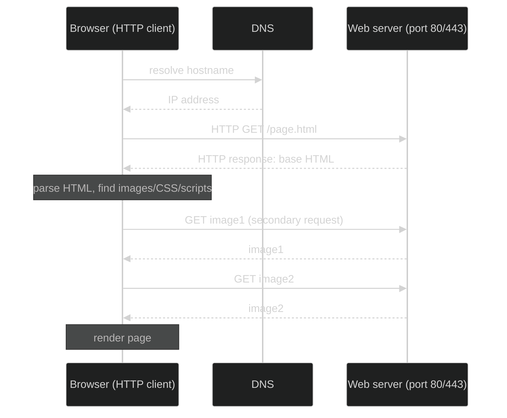

*Caption: what happens when you type `http://example.com` `[W6 s20 discussion]` (DNS step and secondary-request order are standard flow; DNS from `[Comp §6.2]`).*

- **HTTP client** `[W6 s19]`: sends requests, receives responses, processes (renders/prints) them — a browser or `httpie`. **HTTP server**: waits for requests, processes, sends back resources. Local server: `python -m http.server`.
- **Multiple objects:** the base HTML comes first; for each referenced image/script/stylesheet the browser sends **another request**. A page with 3 images ⇒ **4** downloads; 5 graphics ⇒ **6** requests `[LT Q130]` `[Comp §11.6]`. Objects can come from different servers (File4 example: 1 HTML + 2 images from different servers `[LT]`).
- **HTTPS** encrypts traffic between client and server (confidentiality and integrity); HTTP does not `[LT Q127]`.
- A missing file returns an HTTP error such as **404 Not Found** `[Comp §11.6]`.

## F.4 URLs

$$\text{scheme://host:port/path?key1=value1\&key2=value2\#anchor}$$

`https://www.example.com:443/path/to/resource.html?key1=value1&key2=value2#anchor` `[W6 s21]`

| Part | Meaning |
|---|---|
| scheme | How the resource is accessed: `http`, `https`, `ftp`/`sftp` |
| host | Server hostname or IP — tells the client which server to contact `[LT Q134]` |
| port | Defaults if omitted: http→80, https→443 (sftp 22 `[Comp §6.3]`) |
| path | Location relative to the web root |
| query/search | Key–value pairs: `?` for the first, `&` for the others; optional |
| anchor/fragment | `#name` — location within the resource; if omitted, start of resource |

## F.5 Web server, web root, URL ↔ file mapping

A **web server** (Apache, Nginx, Python `http.server`) binds a port and serves files from the **web root** (`public_html/` in the course). `python -m http.server` serves the **current directory** as web root, on **port 8000** by default; use `python -m http.server 8080` to choose another; if `python` fails try `python3` `[W6 s27]`. Output: `Serving HTTP on 0.0.0.0 port 8000`. Stop with **Ctrl+C**.

When a path is given → the file at that path; when none → `index.html` if it exists, else a **directory listing** of the web root `[W6 s28]`.

Mapping with this tree `[LT]`:

```text
public_html
├── animals
│   ├── cat/page1.html
│   └── dog/page2.html
└── fruits
    ├── apple/page3.html
    └── banana/page4.html
```
(each file contains one line of plain text: "contents of page1", …)

| URL | File/folder |
|---|---|
| `http://localhost:8000/fruits/apple/page3.html` | `public_html/fruits/apple/page3.html` |
| `http://localhost:8000/` | `public_html/index.html` |
| `http://localhost:8000/animals/cat/../..` | `public_html/` |
| `http://localhost:8000/fruits/../animals` | `public_html/animals/` |
| `http://localhost:8000/fruits/../animals/cat/../../` | `public_html/` |

<div class="callout warning">

**Security: choose the web root carefully.** Setting `/` or your home folder as web root exposes private files (keys, configs) to everyone who can reach the port `[Comp §6.4]` `[LT]`. On a LAN "everyone on the LAN can access it" `[LT]`. Only open necessary ports; avoid standard ports 80/443 for testing `[LT]`.

</div>

Server running ⇒ `nmap localhost -p 8000` shows **open**; stopped ⇒ **closed**; the browser then fails to connect.

## F.6 Lab exercises (full list) and answers

**Lab setup** `[LT]`: teaching team prepares a lab server with `httpie`; Python must be installed; know how to open a terminal from a folder; Windows users may need to turn the firewall off temporarily (re-enable after).

**Demo:**
1. Open `public_html/fruits/apple/page3.html` directly in the browser (no server).
2. `cd public_html`, run `python -m http.server`, visit `http://localhost:8000/fruits/apple/page3.html`.
3. Port test: start `python -m http.server 8888`; `localhost:8000/…` → **error**; `localhost:8888/…` → works.
4. `https://www.example.com` → right-click *View Source* to see raw HTML.

**HTML exercise:** create `is114-basic.html` in the web root with the heading/text/image/video template; open in a browser; edit in VS Code: heading "Hello", change image to `https://www.w3schools.com/html/pic_trulli.jpg`, add a line break between "This is a video:" and the video; refresh.

**Local HTTP server exercise (two terminals):** 1) nmap port 8000 → closed; 2) start server; 3) nmap → open; 4) browser works; 5) Ctrl+C; 6) nmap → closed; 7) browser fails to connect.

**Index-file exercise:** create `index.html` with `<b>Hello</b>` (the source has `<b>Hello<b>`, a typo); refresh `/` → shows "Hello" in bold. Rename to `notindex.html`; refresh → **directory listing**. *Answer:* `index.html` is the default page served when a directory URL is requested.

**URL path fill-ins** (answers): `public_html/fruits/apple/` ↔ `http://localhost:8000/fruits/apple`; `public_html/fruits/banana/page4.html` ↔ `http://localhost:8000/fruits/banana/page4.html`; `public_html/animals/` ↔ `http://localhost:8000/animals/`; `public_html/animals/cat/page1.html` ↔ `http://localhost:8000/animals/cat/page1.html`. Relative: `/animals/cat/../..` → `public_html/`; `/fruits/../animals` → `public_html/animals/`; `/fruits/../animals/cat/../../` → `public_html/`.

**Multiple servers:** make `public_html_2`, save a page in it, run `python -m http.server 9000` from it (Server #2 Terminal), nmap 9000 before/after, browse `localhost:9000`. *Answers:* 8000 and 9000 show different content because they serve **different web roots**; **2** web server processes are running; same computer → distinguish by **port number**; different computers → **IP address + port**.

**httpie exercise:** `http --print b https://toscrape.com` — httpie shows **source HTML** while the browser shows **rendered HTML** `[LT Q137]`. Options: `--print b` body only; `--print H` headers; no option → full response `[LT]`.

**Web scraping exercise:** list authors from `https://quotes.toscrape.com/tag/life/` alphabetically using httpie plus other commands. *(No answer in the sources; a plausible approach is an added-context sketch:)* `http --print b https://quotes.toscrape.com/tag/life/ | grep "author" | …| sort` — you would need to inspect the page source to find the exact line pattern that holds each author name, then `cut`/`grep -v` to isolate names and `sort`. *(added context — not from source.)*

**Remote HTTP server (optional):** on the lab server make `public_html` with `page1.html`; with seat number `XX`, nmap port `80XX`, run `python -m http.server 80XX`, nmap again, visit `http://Y.Y.Y.Y:80XX` where `Y.Y.Y.Y` is the lab server's public IP, stop and nmap again.

**Local vs remote host** `[LT]`: local host = the computer you interact with; remote host = one you reach over a network. For HTTP, a **remote** computer runs a web **server**; our **local** computer runs a web **client** which connects to that server `[LT Q136]`.

**Best practices** `[LT]`: test locally first (localhost) because it exposes no unfinished work `[LT Q126]`; descriptive paths; avoid sharing private data; understand URL ↔ filesystem mapping; avoid standard ports for testing. **Web scraping** = automated downloading of website information.

---

# Part G — Local Area Networks, Private/Public IPs, DHCP & NAT (Week 7)

## G.1 Home LAN components

A LAN connects nearby devices (home, office, building) `[W7 s2]`.

| Component | Role |
|---|---|
| **Optical Network Terminal (ONT)** | Converts optical (fibre) signals from the ISP into electrical signals; ISP-provided (Singtel, StarHub). Some ISPs give an *Optical Network Router (ONR)* = ONT + router — convenience vs less control `[LT]` |
| **Router** | Directs packets between networks; the **default gateway** — exit/entry point to the Internet |
| **Switch** | Wired connections between LAN devices |
| **Wi-Fi access point** | Wireless connections |

Modern consumer routers are **3-in-1: router + switch + Wi-Fi AP**. The switch and AP handle only **local** traffic, not Internet access `[LT]`.

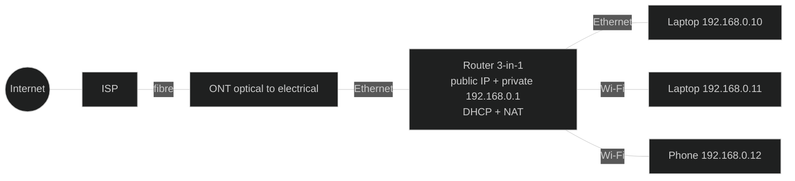

*Caption: typical home LAN `[W7 s2, s11]` (IP examples from `[LT]`).* Note the router has **two** IPs: a public one facing the ISP and a private one facing the LAN.

The router acts like a **traffic controller**, directing data to the correct device `[LT Q142]`. ONT is connected to the ISP's network and converts incoming signals; these electrical signals go to the router, which directs them to the right devices `[LT Q143]`.

Devices in a LAN talk with **private IPs**. The course simplifies "direct" communication; technically traffic goes through the router's internal switch or AP `[LT]`.

## G.2 Public vs private IP

| | Public IP | Private IP |
|---|---|---|
| Uniqueness | Globally unique; no two Internet endpoints share one | Reusable in different LANs |
| Routable on Internet? | Yes | **No** |
| Allocation | **ICANN** → regional registries (e.g. **APNIC** for Asia-Pacific) → ISPs (Singtel, StarHub) → customers. Home router's public IP may change unless you buy a static IP | **DHCP** server in the router |
| Why | Pool is limited (≈4.3 B IPv4); one per device is impractical/costly | Conserves public IPs |

**Private ranges** `[W7 s7]` `[Comp §5.2]`:

| Range | Notation | Class (compendium) |
|---|---|---|
| 10.0.0.0 – 10.255.255.255 | `10.x.x.x` | Class A block |
| 172.16.0.0 – 172.31.255.255 | `172.16.x.x`–`172.31.x.x` | Class B block |
| 192.168.0.0 – 192.168.255.255 | `192.168.x.x` | Class C block |

Any IP **outside** these ranges is public. **Analogy** `[LT]`: public IP = country name (globally unique); private IP = street name (can repeat in different cities/countries).

Check yourself: `172.15.0.1` is **public** (below 172.16); `172.32.0.1` is **public** (above 172.31); `10.1.2.3` and `192.168.8.8` are private (added context applying the ranges).

## G.3 DHCP

When a device joins, it asks a **DHCP server** (the router) for an address; the router leases a private IP automatically (e.g. 192.168.0.15): *device requests → router assigns* `[W7 s9]`. The router also leases other configuration to joining devices `[Comp §5.1]`.

## G.4 NAT

NAT runs on routers and maps private IPs to public IPs so multiple LAN devices share **one** public IP `[W7 s10]`. *(Optional)*: it replaces the IP-address–port pair of a packet with another pair.

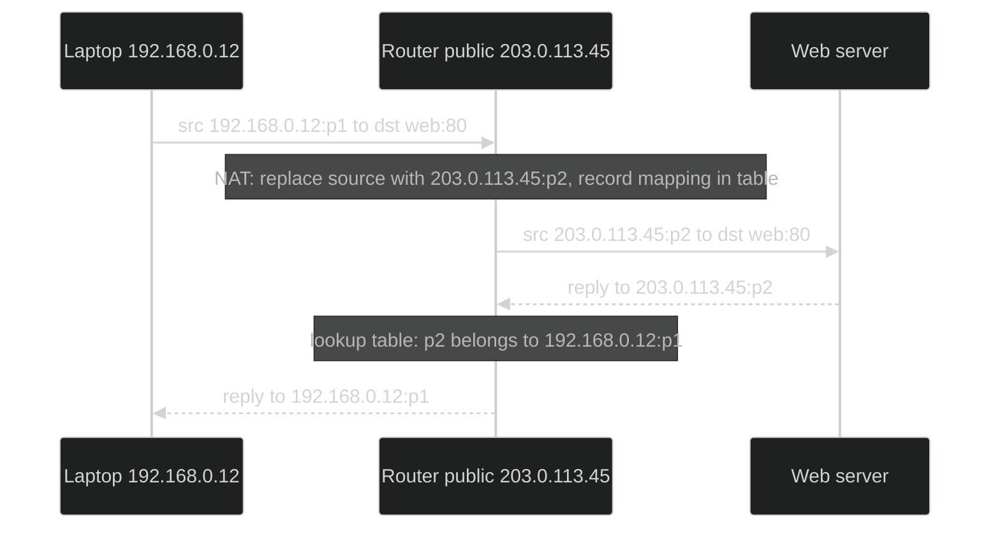

*Caption: NAT round trip `[LT]` `[Comp §5.3]`.* Steps from `[LT]`: (1) router gets a public IP (e.g. `203.0.113.45`); (2) laptop gets a private IP via DHCP; (3) laptop requests `google.com` via the router; (4) router replaces the source IP with its public IP; (5) Google replies to the public IP; (6) the router remembers which device asked and forwards the reply. **Exam-level requirement:** devices use private IPs inside, the router's public IP outside, and the router does NAT automatically `[LT]`.

Why NAT exists: IPv4 exhaustion and cost efficiency. **Less critical for IPv6** because the 128-bit space gives vastly more addresses `[LT Q158]`.

<div class="callout tip">

The lab handout mentions NAT "provides basic security by hiding internal network structure". *(added context)*: this is a side effect of address translation, not a substitute for a firewall (see Part I).

</div>

**Communication flow** `[W7 s11]`: **within LAN** — private IPs via the router's switch/AP. **Outside LAN** — data to the router → NAT translates private to public → router forwards externally.

Two routers in separate networks may give the same private IP to different devices with no conflict `[LT Q152]`. If the router's public IP changes, internal communication continues but external access may be disrupted until reconnection `[LT Q145]`.

## G.5 LAN lab walkthrough `[LT]`

⚠ You may lose Internet during this lab; save instructions offline first.

**Part 1 — LAN setup.** (1) Reset router (hold reset 10 s), power on. (2) Connect a laptop by Ethernet/Wi-Fi; browse to the router's default IP (often `192.168.0.1` or `192.168.1.1`); log in with the default credentials. (3) Set **SSID** (network name) and **PSK** (Wi-Fi password); set router LAN IP `192.168.0.1`; save. (4) Connect all team laptops. (5) Find IPs — Windows: `ipconfig | findstr /i "IPv4"` (ignore `192.168.x.1` from VirtualBox). (6) Test: `ping 192.168.0.1`, `ping 192.168.0.10`; if ping fails, temporarily disable Windows Firewall and re-enable afterwards.

**Part 2 — web servers on the LAN.** Choose a web root with **no confidential files**. On each laptop: `python -m http.server 8000`. `nmap localhost -p 8000` → closed before, **open** after. From laptop A: `nmap 192.168.0.11 -p 8000`, `nmap 192.168.0.12 -p 8000`; browser `http://192.168.0.11:8000` shows laptop B's site. Everyone can view everyone's site.

**Part 3 — topology.** Draw router (public + private IP) and each laptop with IP and connection type:

```text
[Internet]
   |
[Router: Public=203.0.113.45, Private=192.168.0.1]
   |
   ├── [Laptop A: 192.168.0.10] (Wi-Fi)
   ├── [Laptop B: 192.168.0.11] (Ethernet)
   └── [Laptop C: 192.168.0.12] (Wi-Fi)
```

**Part 4 — cleanup.** Reset router to factory settings; re-enable firewall; close terminals/browsers; delete temporary web content.

**Security** `[LT]`: never expose sensitive data via local web servers; use strong PSKs; all LAN devices share one public IP; firewalls may block ICMP (ping) — normal.

**Phone exercises** `[LT Q153–154]`: on mobile data the phone's IP is usually **public** (unless VPN or the carrier uses private addressing); on Wi-Fi it's **private**. Applications: home networks (share Internet/printers/files), office LANs (file servers, intranets), development (test sites before going live), IoT.

**Host a site on W:8888 and reach it from X** (`W`=1.2.3.4) `[LT Q160]`:

1. On W: `nmap` port 8888 → **closed** (no other process is using it).
2. On W: start the web server on 8888 (lets clients connect).
3. On W: `nmap` 8888 → **open** (confirms the server uses the port).
4. On X: `nmap 1.2.3.4 -p 8888` → **open** (reachable from another computer; no firewall in the way).
5. On X: browser → `http://1.2.3.4:8888` (the real goal: users reach it via a browser).

## G.6 LAN gotchas

<div class="callout mistake">

- Router has **both** a public and a private IP; other LAN devices have only a private one.
- Private IPs are **not** routable on the Internet.
- A device's *own* phone/laptop IP may differ from what websites see (NAT).
- Don't set a LAN web server's root to a folder with private files — everyone on the LAN can read it.

</div>


---

# Part H — Cloud Computing & AWS EC2 (Week 10)

## H.1 What is cloud computing?

A paradigm in which resources (computers, storage, etc.) are provided by a third party and managed through Internet communication `[W10 s2]` — e.g. Google's Gmail. A **cloud service provider** supplies processors, memory and storage; users need not know their physical location or routing `[LT glossary]`. A **data center** is a building housing the numerous computers and physical resources of a provider.

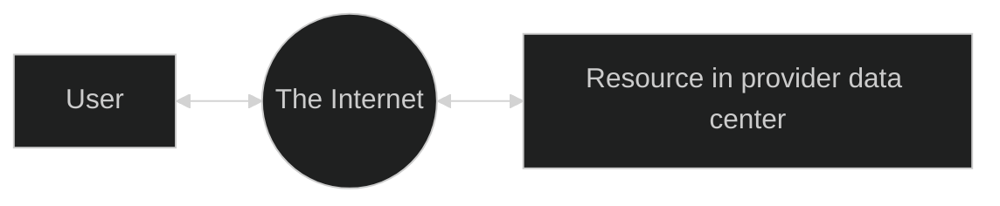

*Caption: the cloud as drawn on `[W10 s2]` — the Internet is depicted as a cloud between user and resource.*

**On-premise** `[W10 s3]`: the organisation owns and manages its own physical servers and infrastructure, on-site or in a private data centre (heavy capital expenditure, power, cooling, maintenance `[Comp §7.1]`).

**Analogy** `[Comp §7.1]` (added by source): on-premise = buying and maintaining a whole residential building; an EC2 VM = renting a furnished hotel room, paying only for the stay.

## H.2 Cloud deployment models

| Model | Definition | Example (compendium) |
|---|---|---|
| **Public** | Accessible by **any subscriber**; multi-tenant (AWS, Azure, GCP) | Public web app on AWS |
| **Private** | Established for a specific group/organisation; heightened governance/isolation | Single-enterprise cloud |
| **Community** | Shared among two or more organisations with the same needs (shared regulatory/security mandates) | Partner institutions |
| **Hybrid** | Some combination of the others | Sensitive financial data on private clusters + public-facing web app on AWS |

## H.3 Typical cloud services `[W10 s6]`

| Service | What | Examples |
|---|---|---|
| **Compute** | Renting a computer online to run programs/websites | Website or game server |
| **Storage** | Photos, videos, documents saved in the cloud, accessible anytime anywhere | Google Drive, iCloud, Dropbox |
| **Database** | Managed databases for structured and unstructured data | Instagram storing posts and likes |

## H.4 Providers and AWS

Market share, Worldwide cloud infrastructure services, **Q2 2025** `[W10 s7]` (chart: "The Big Three Stay Ahead in Ever-Growing Cloud Market"):

| Provider | Share |
|---|---|
| AWS | 30% |
| Azure | 20% |
| Google Cloud | 13% |
| Alibaba Cloud | 4% |
| Oracle | 3% |
| Salesforce | 2% |
| IBM Cloud | 2% |
| Tencent Cloud | 2% |

Total cloud infrastructure service revenue in Q2 2025: **$99B (+25% y-o-y)**. The "big three" = AWS, Azure, Google Cloud.

AWS is the market leader `[W10 s8]`:

| Category | AWS service |
|---|---|
| Compute | **Elastic Compute Cloud (EC2)** |
| Storage | **Simple Storage Service (S3)** |
| Database | **Relational Database Service (RDS)** |

## H.5 EC2 concepts

**EC2** = AWS service for "renting" virtual computers: you choose **CPU, memory, storage and OS**; **pay-as-you-go** — only while the VM runs `[W10 s11]`. *Elastic* = flexible: launch/terminate on demand; *Compute* = CPU/memory/storage; *Cloud* = cloud service `[LT glossary]`.

| Term | Meaning |
|---|---|
| **Instance** | AWS word for a computer — specifically a virtual machine (VM) |
| **Launch** an instance | "turn on a computer" |
| **Terminate** an instance | "turn off" — wipes the machine and halts billing `[Comp §7.2]` |
| **AMI** (Amazon Machine Image) | Pre-configured template (OS, app server, apps) used as a blueprint; many instances from one AMI start identical, e.g. Amazon Linux, Ubuntu |
| **OS image** | Template with an OS (and often other software) so you needn't install from scratch |
| **Elasticity** | Provision/decommission compute and memory to match demand |

**Lab plan** `[W10 s11]`: (1) create an EC2 instance, (2) access it via SSH, (3) host a website on it.

Why terminate unused instances: stop metered charges and remove idle attack surface `[Comp §11.7]`.

## H.6 SSH — secure remote access

Cloud computers are remote; you use your **local** computer to reach them. **Secure Shell (SSH)** is the application and protocol for secure remote access `[W10 s9]`; it gives an **encrypted** connection and lets you connect to a remote system, run commands remotely, and transfer files securely. Uses **port 22**.

```bash
ssh -i is114-keypair.pem ec2-user@YOUR_EC2_PUBLIC_IP
#   -i <file>       identity (private key) file to authenticate with
#   ec2-user        login user on the remote Amazon Linux instance
#   @<public IP>    which remote machine (its public IP)
```

`[Comp §7.3, §11.7]` — establishes an encrypted SSH session to the instance as `ec2-user`, authenticating with the private key.

**Keypairs:** asymmetric; a **private key** (`.pem`) kept secret on your machine, a **public key** placed on the instance in `~/.ssh/authorized_keys`. **The SSH client refuses a private key with loose permissions**, so restrict it:

```bash
chmod u=rw,go= is114-keypair.pem   # owner read/write only (also written chmod 400)
```

If the private key is deleted/lost, you're **permanently locked out** of the instance `[Comp §7.3]`.

*(added context)* In SSH, the keypair is used to *authenticate* you (you prove possession of the private key) rather than to encrypt your typed messages one by one; the compendium describes it as "asymmetric cryptography" login, which is the same idea at the course level (see §I.6).

## H.7 AWS Security Groups (cloud firewall)

A **Security Group** is a stateful virtual firewall at the instance level `[Comp §7.4]`:

| Element | Meaning |
|---|---|
| Inbound rules | Allow incoming traffic by protocol, port range, source IP |
| Outbound rules | Regulate connections the server starts |
| `0.0.0.0/0` | **All** IPv4 addresses (the whole Internet) |

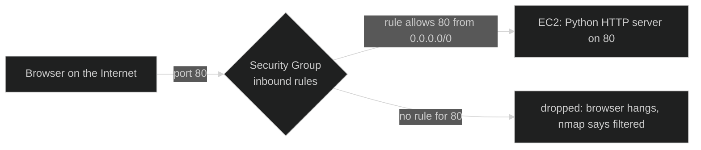

*Caption: why a running server can still be unreachable.* If an HTTP server runs on port 80 but the Security Group has no inbound rule for 80, packets are **dropped**: browsers hang/time out ("Site cannot be reached") and `nmap` reports the port **filtered** `[Comp §7.4, §11.7]`. By contrast, **closed** would mean the packet reached the host but nothing is listening.

Typical hardening `[Comp §9.4]`: open **80/443 to `0.0.0.0/0`** so public clients and sensors can connect; lock **22 (SSH)** to administrator IP addresses.

## H.8 Cloud gotchas

<div class="callout mistake">

- Forgetting to terminate an instance ⇒ continuing charges.
- Deleting the `.pem` ⇒ permanent lock-out.
- `.pem` with permissions too open ⇒ `ssh` refuses to use it.
- Server running but Security Group missing the port ⇒ looks like an outage (`filtered`).
- Public/private/community/hybrid is about **who can use it**, not about where the hardware is.

</div>

---

# Part I — Information Security & Cryptography (Week 11)

## I.1 Definitions

| Term | Definition |
|---|---|
| **Information security** | Techniques and policies to ensure proper access to data (safeguarding from unauthorised reading/modification) `[W11 s3]` |
| **Cyber security** | Ability to protect resources accessible on the Internet (cyberspace) from attack |
| **Risk analysis** | Determine the nature and likelihood of the risks to key data; goal is to minimise vulnerability to the threats that put a system at most risk `[W11 s5]`; pairs realistic threats with vulnerabilities |
| **Separation of management privileges** | Administrative powers split so no one person can compromise the system `[Comp §8.1]` |

## I.2 CIA triad

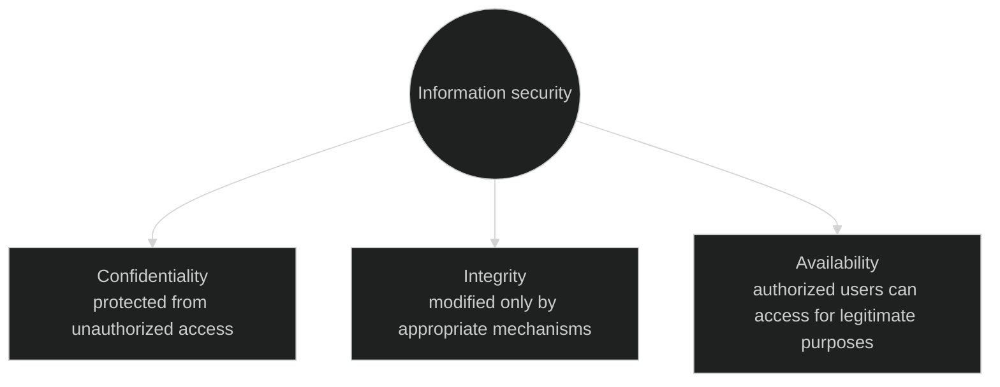

*Caption: the CIA triad figure from `[W11 s4]`, redrawn.*

| Pillar | Meaning | Violated by (examples) |
|---|---|---|
| **Confidentiality** | Key data protected from unauthorised access | Exposed bank balances/medical files; a web root pointing at private files |
| **Integrity** | Data modified only through authorised mechanisms | Tampered balances, corrupted data, transmission errors |
| **Availability** | Degree to which authorised users can access information when needed | **Denial-of-service** flood crashing a server ⇒ Availability `[Comp §11.8]` |

## I.3 Authentication

**Authentication credentials** — what users provide to identify themselves `[W11 s6]`:

| Factor | Examples | Notes |
|---|---|---|
| **Something you know** | name, password, PIN | Weak to dictionary attacks, phishing, shoulder surfing, credential stuffing |
| **Something you have** | Smart card (card with embedded memory chip), hardware token, authenticator app | Stronger than passwords |
| **Something you are** (biometrics) | fingerprint, retina/iris, voice, face | Tuned between **false rejection** (denying a legitimate user) and **false acceptance** (admitting an impostor) |

**Passwords** `[W11 s7]`: username + password proves identity; only you should know it; don't make passwords accessible; make them *easy to remember, hard to guess*.

**Password managers** (1Password, RoboForm) `[W11 s8]`: store and autofill login info; encrypt data and protect it with a **master password**; often browser plug-ins; use reputable tools and enable extra protection (e.g. 2FA).

**2FA** `[W11 s9]`: two forms of identification (e.g. password + device). Flow: (1) login → system pushes a notification to your 2FA app; (2) you approve or deny; (3) one-time codes via SMS are possible but **not recommended**. **MFA**: more than two steps, used by high-security sectors. In `[Comp §8.2]`, 2FA = credentials from **two distinct categories**.

*CISA warning* `[Comp §8.2]`: avoid SMS as a factor — messages travel unencrypted over carrier networks, are vulnerable to SIM-swapping, and are not phishing-resistant.

## I.4 Cryptography vocabulary

| Term | Definition |
|---|---|
| **Cryptography** | Field of study of encoded information (Greek for "secret writing") |
| **Plaintext / Ciphertext** | Readable / unreadable form |
| **Encryption / Decryption** | plaintext→ciphertext / ciphertext→plaintext |
| **Cipher** | Algorithm used to encrypt and decrypt |
| **Key** | Set of parameters guiding a cipher — "neither is any good without the other" |
| **Cryptanalysis** | Decrypting a message **without** knowing the cipher or key |

Principle `[W11 s11]`: *Encrypted(Information)* cannot be read; *Decrypted(Encrypted(Information))* can be.

### Substitution (Caesar) cipher

A **substitution cipher** replaces one character with another; the **Caesar cipher** shifts characters a fixed number of positions. `[W11 s14]` table (shift of **3**):

```text
A B C D E F G H I J K L M N O P Q R S T U V W X Y Z
D E F G H I J K L M N O P Q R S T U V W X Y Z A B C
```

**Worked answers to the slide questions:**

- **Encrypt(FUNDAMENTAL):** map each letter to the one below it: F→I, U→X, N→Q, D→G, A→D, M→P, E→H, N→Q, T→W, A→D, L→O ⇒ **IXQGDPHQWDO**.
- **Decrypt(FRPSXWHU):** shift each letter back by 3: F→C, R→O, P→M, S→P, X→U, W→T, H→E, U→R ⇒ **COMPUTER**.

*(Both worked by hand from the table; the slide leaves them as "?".)*

**Why substitution ciphers are weak** `[W11 s15]`: easy for modern computers to break (added context: only 25 useful shifts exist, and letter-frequency analysis also reveals the text). **Symmetric** schemes (same key to encrypt and decrypt) have a **key-distribution problem**: the shared secret must be exchanged securely; if intercepted, **all current and future messages** are compromised.

### Public-key (asymmetric) cryptography `[W11 s16]`

Each user has two related keys: a **public key** (distributed freely; used to encrypt) and a **private key** (kept secret; used to decrypt). A person encrypts an outgoing message with the **receiver's public key**; **only the receiver's private key** can decrypt it.

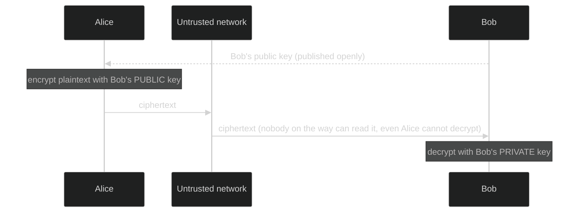

*Caption: the asymmetric exchange `[Comp §8.3]`.* Because the private key is never shared or transmitted, there is nothing to intercept, solving the symmetric key-distribution problem `[Comp §11.8 Q7]`.

## I.5 Firewalls

A **firewall** is a gateway machine and its software that protects a network by **filtering the traffic it allows** `[W11 s17]`; it enforces an **access control policy** — rules specifying what types of network communication are permitted and denied. In the figure `[W11 s18]` a firewall sits between the protected LAN and the Internet users.

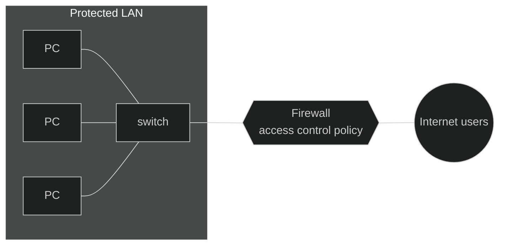

*Caption: a firewall protecting a LAN `[W11 s18]` (host count inferred).*

| Technique | Notes |
|---|---|
| **Port filtering** | Baseline: deny traffic on specific ports (e.g. drop inbound port 22 from the Internet, allow it from the LAN) |
| **Stateful / deep packet inspection** | Tracks connection state and inspects payloads for malicious patterns; stronger protection but introduces **latency** |

## I.6 Putting security vocabulary to work

| Scenario | CIA pillar / concept |
|---|---|
| HTTPS instead of HTTP | Confidentiality + integrity (encryption) `[Comp Quiz Q8]` |
| `chmod u=rw,go= key.pem` | Confidentiality of the private key |
| Security group closes port 22 to the world | Access control policy / firewall |
| DoS flood on a web server | Availability |
| Biometric scanner rejecting a real user | False rejection |

<div class="callout mistake">

- Mixing up which key does what: **public encrypts, private decrypts** (course framing).
- Treating SMS 2FA as strongest — it's "not recommended".
- "Encrypted" ≠ "integrity-proof"; separate CIA ideas.
- Deep packet inspection is stronger but slower.

</div>

---

# Part J — Applied Systems Architecture: IoT Assisted-Living Case Study (Trial Exam)

An IoT startup deploys an assisted-living platform for elderly people living alone `[Comp §9]`. The system spans five tiers from edge sensors to cloud to clinical endpoints.

| Tier | Infrastructure | Concepts and protocols |
|---|---|---|
| **1. Edge sensing** | Motion detectors, door sensors, wearables | Embedded systems, microcontrollers, Bluetooth pairing, biometric health telemetry |
| **2. Residential gateway** | Home ONT + consumer router | Fibre→Ethernet, DHCP, Class C private addressing (`192.168.x.x`), NAT |
| **3. Cloud infrastructure** | AWS EC2 instance from an Amazon Linux AMI | Public cloud virtualisation, elasticity, non-volatile storage |
| **4. Cloud perimeter security** | AWS Security Group + Linux key management | Port filtering (443, 22), keypair auth (`is114-keypair.pem`), `~/.ssh/authorized_keys`, `chmod u=rw,go=` |
| **5. Application & client** | Python web server, ML anomaly engine, dashboards, mobile clients | HTTP/HTTPS, HTML5/CSS, loopback testing (`127.0.0.1:8000`), automated caregiver alerts |

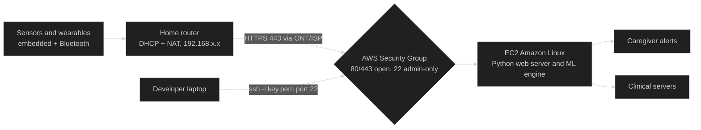

*Caption: end-to-end data path of the case study (arrows follow the text of `[Comp §9.4]`).*

**J.1 Hardware & OS selection** `[Comp §9.1]`: developer laptops — multi-core CPU (e.g. Quad-Core 2.8 GHz), **16–32 GB RAM** (many concurrent processes without thrashing), fast **SSD** (shorter loading/build times). **Linux** as the development OS: native sensor SDK support, CLI file-filtering pipelines (`grep`, `cut`, `sort`), shell scripting; where proprietary Windows apps are required, run **virtual machines inside Linux**.

**J.2 Office networking** `[Comp §9.2]`: commercial fibre plan → ISP terminates into an **ONT** → enterprise router (**default gateway**). The ISP gives **one public IPv4** to the router's WAN interface; the router's DHCP leases **Class C private** IPs to laptops; **NAT** lets all staff share the public IP; an internal DNS daemon maps internal hostnames to private IPs.

**J.3 Application lifecycle** `[Comp §9.3]`: authors write dashboards in **HTML5 + CSS**; early on, host the server on the laptop via **loopback** (`127.0.0.1:8000`/`localhost:8000`) to test rendering without exposing unfinished code. When stable, provision **EC2** from an **Amazon Linux AMI** instead of buying server hardware (up in minutes).

**J.4 Perimeter security & telemetry** `[Comp §9.4]`: Security Group opens **80/443 to `0.0.0.0/0`**, **22** only to admin IPs; developers log in with **RSA keypairs** (`.pem`), public keys in `~/.ssh/authorized_keys`, private keys protected by `chmod u=rw,go=`. Sensors send **encrypted telemetry over HTTPS (443)** through home routers (**NAT**) to the cloud instance. Prolonged inactivity triggers automated alerts to caregivers; AI health wearables send vitals to clinical servers.

**Skill demonstrated:** tracing one concept across tiers. E.g. *a port number*: 443 at tier 5 (HTTPS) → 22 at tier 4 (SSH) → both appear in the tier-4 Security Group; *an IP address*: private at tiers 1–2, public at tier 3.


This part reproduces the official quiz items (Linux/Filesystems, Networking, Web) with their answers. Question numbering follows the source; **Networking Q25 does not exist in the source** (numbering jumps from Q24 to Q26).

---

# Part K — Official Weekly Quiz Master Repository `[Comp §10]`


## Quiz Module 1: Linux Command Line, Filesystems & Process Management

#### Q1.

Type a single letter that is allowed in Linux filenames.

> **A:** `a` (or any alphanumeric character). Note: Linux filenames support standard ASCII characters but are **case-sensitive**.

---

#### Q2.

Command to create files.

> **A:** `touch FILENAME`

---

#### Q3.

Command to display entire file contents.

> **A:** `cat FILENAME`

---

#### Q4.

Command to edit a file in the terminal.

> **A:** `nano FILENAME`

---

#### Q5.

Command to display some text to the screen.

> **A:** `echo SOME_TEXT`

---

#### Q6.

Command to display the beginning of a file.

> **A:** `head FILENAME`

---

#### Q7.

Command to display the end of a file.

> **A:** `tail FILENAME`

---

#### Q8.

Command to search for lines matching a pattern.

> **A:** `grep PATTERN FILENAME`

---

#### Q9.

Command to sort lines of text in a file.

> **A:** `sort FILENAME`

---

#### Q10.

Command to remove duplicate consecutive lines.

> **A:** `uniq FILENAME`

---

#### Q11.

Command to count lines in a file.

> **A:** `wc -l FILENAME`

---

#### Q12.

Command to list directory contents including details.

> **A:** `ls -l`

---

#### Q13.

Command to list directory contents including hidden files.

> **A:** `ls -a`

---

#### Q14.

Command to sort lines of text in reverse order.

> **A:** `sort -r FILENAME`

---

#### Q15.

Command to sort lines of text numerically.

> **A:** `sort -n FILENAME`

---

#### Q16.

Command to show only duplicate consecutive lines.

> **A:** `uniq -d FILENAME`

---

#### Q17.

Command to show only unique consecutive lines.

> **A:** `uniq -u FILENAME`

---

#### Q18.

Command to count occurrences of unique consecutive lines.

> **A:** `uniq -c FILENAME`

---

#### Q19.

Command to count lines in a file.

> **A:** `wc -l FILENAME`

---

#### Q20.

Command to count words in a file.

> **A:** `wc -w FILENAME`

---

#### Q21.

Command to search for lines matching "bbt", ignoring case.

> **A:** `grep -i "bbt" FILENAME`

---

#### Q22.

Command to search for lines matching "huat ah", ignoring case.

> **A:** `grep -i "huat ah" FILENAME`

---

#### Q23.

Command to search for lines that do not match "bbt".

> **A:** `grep -v "bbt" FILENAME`

---

#### Q24.

Command to show the first 8 lines of a file.

> **A:** `head -n 8 FILENAME`

---

#### Q25.

Command to show the last 8 lines of a file.

> **A:** `tail -n 8 FILENAME`

---

#### Q26.

Command to extract fields 10 and 20 using comma delimiter.

> **A:** `cut -d',' -f10,20 FILENAME`

---

#### Q27.

What does this print?

```bash
echo "monday" > file1
echo "tuesday" >> file1
cat file1 | wc -l
```

> **A:** `2`. `>` writes "monday" to an empty file; `>>` appends "tuesday" as line 2.

---

#### Q28.

What does this print?

```bash
echo "monday" > file1
echo "tuesday" > file1
cat file1 | wc -l
```

> **A:** `1`. The second `>` truncates and overwrites the file, leaving only "tuesday".

---

#### Q29.

Command to enable execute permissions for Owner, Group and World.

> **A:** `chmod +x FILENAME`

---

#### Q30.

Command to enable read permission for the owner only, with no write/execute for the owner and zero permissions for group and world.

> **A:** `chmod u=r,go= FILENAME`

---

#### Q31.

Command to list all files with filenames starting with "vibe".

> **A:** `ls vibe*`

---

#### Q32.

Command to list all files with filenames ending with "vibe".

> **A:** `ls *vibe`

---

#### Q33.

Command to list files having "vibe" in the middle with 1 or more characters before and after.

> **A:** `ls ?*vibe*?` (`?` = exactly one character; `*` = zero or more; so each side has at least one character).

---

#### Q34.

What does the command `rm cd ../apple/file.txt` do?

> **A:** Removes the file named `cd` in the current folder, **and** removes the file named `file.txt` in the `../apple` folder. `rm` treats each whitespace-separated token as a separate file to delete (it is not "cd then rm").

---


## Quiz Module 2: Networking Fundamentals, Addressing & Protocols

#### Q1.

`file.txt` is a valid Linux filename. (True/False)

> **A:** True.

---

#### Q2.

What does the term "bandwidth" commonly refer to?

> **A:** The data transfer rate of a network.

---

#### Q3.

A protocol in networking defines:

> **A:** The rules for formatting and processing data.

---

#### Q4.

Which of the following are hardware components?

> **A:** Storage, Memory, Network cable.

---

#### Q5.

Which of these best describes the client/server model?

> **A:** A client requests a service and a server responds.

---

#### Q6.

What defines a Local Area Network (LAN)?

> **A:** A network spanning a small geographic area like a building.

---

#### Q7.

What is the purpose of a router in a LAN?

> **A:** Serves as a gateway between a LAN and external networks (WAN).

---

#### Q8.

What is packet switching?

> **A:** Breaking a message into discrete packets sent separately across networks.

---

#### Q9.

Why might packets arrive out of order in a network?

> **A:** They take different routes across intermediate networks.

---

#### Q10.

Which pieces of information must a data packet include?

> **A:** Destination IP address and destination port number (alongside source IP and source port).

---

#### Q11.

Which of the following is a loopback address?

> **A:** `127.0.0.1`

---

#### Q12.

What is the hostname equivalent of `127.0.0.1`?

> **A:** `localhost`

---

#### Q13.

Which IP address ranges are private?

> **A:** `10.1.x.x` and `192.168.x.x` (from the standard Class A and Class C private reservations).

---

#### Q14.

What is a port number used for?

> **A:** To identify a specific process on a computer.

---

#### Q15.

What is a top-level domain (TLD)?

> **A:** The final section of a domain name, like `.com`.

---

#### Q16.

The default port numbers for SSH, HTTP and HTTPS are:

> **A:** `22, 80, 443`.

---

#### Q17.

What does a hostname typically consist of?

> **A:** Computer name and domain name.

---

#### Q18.

In `node7.cluster.spider.net`, the computer name is:

> **A:** `node7`.

---

#### Q19.

In `cute.labubu.flushie.biz`, the Top-Level Domain (TLD) is:

> **A:** `.biz`.

---

#### Q20.

When a router directs packets, what is it expected to know about the packet's entire course?

> **A:** Only the best next step to get the packet closer to its destination (not the whole path).

---

#### Q21.

What is the primary function of the Domain Name System (DNS)?

> **A:** To translate human-readable hostnames into numeric IP addresses.

---

#### Q22.

What command measures round-trip time?

> **A:** `ping`

---

#### Q23.

What can `ping ex.com` accomplish?

> **A:** Finds out the round-trip latency and resolves the IP address of `ex.com`.

---

#### Q24.

If `ping ex.com` reports a failure in "name resolution", what is the cause?

> **A:** The domain `ex.com` cannot be resolved by DNS (does not exist or DNS is unreachable).

---

#### Q26.

Command to test whether `smoo.com` has a server listening on port 443.

> **A:** `nmap smoo.com -p 443`

---

#### Q27.

When nmap reports a port is **open**, it means:

> **A:** An application process is actively listening for connections on that port.

---

#### Q28.

When nmap reports a port is **filtered**, it means:

> **A:** A firewall or network obstacle prevents nmap from determining if it is open or closed.

---

#### Q29.

When nmap reports a port is **closed**, it means:

> **A:** The host is alive, but no application process is listening on that port.

---

#### Q30.

Command to resolve `x.com` using the default nameserver with a short answer.

> **A:** `dig +short x.com`

---

#### Q31.

Command to resolve `x.com` using nameserver `1.1.1.1`.

> **A:** `dig +short x.com @1.1.1.1`

---

#### Q32.

In a typical home network, the default nameserver runs on the:

> **A:** Router.

---

#### Q33.

Which network type connects multiple LANs over large geographic distances?

> **A:** Wide Area Network (WAN).

---

#### Q34.

In a packet-switched network, what happens if a path is congested or down?

> **A:** Routers reroute packets along alternative paths.

---

#### Q35.

Example of a valid hostname.

> **A:** `matisse.csc.villanova.edu`.

---

#### Q36.

Organization managing TLD names.

> **A:** ICANN.

---

#### Q37.

Primary use of a loopback address.

> **A:** Routing network traffic back to one's own local machine for testing.

---

#### Q38.

Port used by HTTPS.

> **A:** `443`.

---

#### Q39.

In `lab1.network.school.edu`, what is the TLD?

> **A:** `.edu`.

---


## Quiz Module 3: World Wide Web, HTML & Web Servers

#### Q1.

What is the main function of HTML?

> **A:** Defining the semantic structure and elements of a web page.

---

#### Q2.

What is the main role of Cascading Style Sheets (CSS) in web design?

> **A:** To specify how information should be visually displayed (styles, fonts, colors, positioning).

---

#### Q3.

When an HTTP client requests a web page that references additional objects (images, scripts), how are these handled?

> **A:** The client sends separate, secondary HTTP requests for each referenced object after receiving and parsing the base HTML file.

---

#### Q4.

From which specific folder does an HTTP server retrieve files served to clients?

> **A:** The web root directory (e.g. `public_html/`).

---

#### Q5.

What is source HTML?

> **A:** The raw HTML markup text received across the wire by the browser client.

---

#### Q6.

What does the `<a>` tag define in HTML?

> **A:** An anchor tag defining a hyperlink to another resource.

---

#### Q7.

What is the primary operational risk if a web server designates the wrong folder as its web root?

> **A:** Accidental exposure of private or sensitive system files to the public Internet.

---

#### Q8.

Why is HTTPS preferred over unencrypted HTTP?

> **A:** It provides end-to-end cryptographic encryption, ensuring confidentiality and integrity.

---

#### Q9.

What URLs can a local browser use to access an HTTP server running on the same machine?

> **A:** `http://localhost` and `http://127.0.0.1`.

---

#### Q10.

Command to view the raw HTTP response body for a website using httpie.

> **A:** `http --print b https://x.com`.

---

#### Q11.

What is the relationship between the Internet and the World Wide Web?

> **A:** The Web is an application system built on top of the physical communication infrastructure of the Internet.

---

#### Q12.

What is a website?

> **A:** A collection of related web pages, typically hosted from the same domain source.

---

#### Q13.

What is the purpose of the `<head>` section in an HTML document?

> **A:** Contains metadata about the document (such as page title and stylesheet links) rather than body content.

---

#### Q14.

Which HTML element inserts a forced line break?

> **A:** `<br>`.

---

#### Q15.

Which HTML element represents bold text emphasis by default?

> **A:** `<b>` (or `<strong>`).

---


Two banks: the 160 questions from the Linux Terminal study document (answers verbatim, with minor clarifications in italics) and the compendium's eight topic review banks. Where the same idea appears in several questions it is **not** re-explained — follow the section pointers in Parts A–J.

---

# Part L — Practice Question Bank


## L.1 Linux Terminal doc — 160 practice questions `[LT]` (original numbering kept)


### Hardware (1–23)

#### Q1.

What is the purpose of the processor in a computer?

> **A:** The processor executes instructions, and performs computations on data.

---

#### Q2.

What does GHz mean in a processor specification?

> **A:** It's the unit of measure for the processor's clock speed, in billions of cycles per second.

---

#### Q3.

What does Quad-Core mean in a processor description?

> **A:** It means the processor has four cores inside it.

---

#### Q4.

What is cache memory used for?

> **A:** Cache is fast, volatile memory used to store frequently accessed data for the processor.

---

#### Q5.

What does a 15-inch laptop screen measurement refer to?

> **A:** It refers to the diagonal length of the display area.

---

#### Q6.

What does a screen resolution of 1920 × 1080 mean?

> **A:** It means the screen is 1920 pixels wide and 1080 pixels high.

---

#### Q7.

What role does a GPU play in a computer system?

> **A:** A GPU handles graphics processing, freeing up the main processor for other tasks. GPUs can also be used for Machine Learning tasks.

---

#### Q8.

What does RAM stand for, and what is its function?

> **A:** Random Access Memory. It stores data and instructions temporarily while a program runs.

---

#### Q9.

How much data is stored in 1 terabyte (TB)?

> **A:** 1 TB equals 1,000,000,000,000 bytes.

---

#### Q10.

What is Bluetooth commonly used for?

> **A:** Bluetooth connects devices like keyboards, mice, and earphones over short distances.

---

#### Q11.

What does USB stand for, and what is it used for?

> **A:** USB stands for Universal Serial Bus and is used for connecting and transferring data between devices.

---

#### Q12.

What does HDMI allow you to do?

> **A:** HDMI allows digital audio and video to be transmitted to devices like TVs and monitors.

---

#### Q13.

What is the main difference between memory and storage?

> **A:** Memory is volatile and temporary; storage is non-volatile and permanent.

---

#### Q14.

What happens to memory contents when a computer is powered off?

> **A:** All memory contents are lost when the computer is turned off.

---

#### Q15.

What is an embedded system?

> **A:** An embedded system is a specialized computer designed to perform specific tasks within a larger device.

---

#### Q16.

Where can embedded systems be found?

> **A:** They are found in everyday devices like microwaves, cars, and watches.

---

#### Q17.

Why does a laptop need both memory and storage, instead of just storage?

> **A:** Memory is fast and temporary, mainly for running programs, while storage is for storing data even when the power is switched off.

---

#### Q18.

Why is a GPU critical for gaming?

> **A:** Gaming requires fast, complex image rendering that would overwhelm the main processor.

---

#### Q19.

How does the volatility of RAM affect what happens to unsaved work, when you lose power suddenly?

> **A:** All unsaved work in RAM is lost immediately if power is cut off.

---

#### Q20.

How does a processor use both memory and storage when running a program?

> **A:** It loads the program from storage into memory. It accesses and executes the program instructions from memory, not from storage.

---

#### Q21.

Create a concept map for the concepts you've learnt in this lesson.

> **A:** (do your own) — see the concept map in the Big-Picture Overview and the flow diagram in §A.6 as a model.

---

#### Q22.

Why might a computer with lots of storage but little memory still feel slow when there are too many running applications?

> **A:** Because memory affects how many programs can be run at once. Storage space does not.

---

#### Q23.

When the CPU needs data, where does it look first — storage, memory, or cache? Why?

> **A:** Order: cache (fastest), memory (slower than cache, but faster than storage), storage (slowest, used only if data is not in cache or RAM). The CPU tries to find data in the fastest place first to avoid delays. *(Source note: this is not stated explicitly in the notes, and requires inference, which is a necessary skill for higher education and the workplace.)*

---


### Operating System (24–45)

#### Q24.

From a Linux terminal, how do you tell which computer you are interacting with?

> **A:** By looking at the prompt. It shows the hostname of the computer that you are interacting with.

---

#### Q25.

What is the main role of system software?

> **A:** System software manages hardware, and helps application software to share that hardware.

---

#### Q26.

What are some examples of system software?

> **A:** Windows, Linux, macOS

---

#### Q27.

How does application software differ from system software?

> **A:** Application software solves specific real-world problems, while system software manages the computer's core operations.

---

#### Q28.

What are some examples of application software?

> **A:** Terminal, Microsoft Office, FireFox, Chrome

---

#### Q29.

What is the core component of system software?

> **A:** The operating system is the core component of system software.

---

#### Q30.

What resources does an operating system manage?

> **A:** It manages processors, memory, and storage.

---

#### Q31.

What is the purpose of a user interface provided by an operating system?

> **A:** It allows users to interact with the computer and its resources.

---

#### Q32.

What happens during the booting process?

> **A:** The operating system loads into memory, and takes control of the computer.

---

#### Q33.

Why is "sharing nicely" an important concept in operating systems?

> **A:** Because multiple programs must take turns sharing limited system resources.

---

#### Q34.

How does the operating system handle multiple programs that need to use the CPU?

> **A:** It schedules programs so they take turns using the CPU.

---

#### Q35.

What is a GUI, and how do we typically use it?

> **A:** A GUI is a Graphical User Interface where users click or tap icons to interact with applications or the Operating System.

---

#### Q36.

What is a CLI, and how is it different from a GUI?

> **A:** A Command Line Interface uses typed commands instead of graphical elements.

---

#### Q37.

Why might beginners struggle with using the Linux CLI?

> **A:** It is case-sensitive, and requires precise command syntax.

---

#### Q38.

What is a program?

> **A:** A program is a file containing instructions and data for execution.

---

#### Q39.

What is a process?

> **A:** A process is a running program that resides in main memory.

---

#### Q40.

What happens to a process and its associated program when the computer is turned off?

> **A:** The process terminates, because memory is volatile, but the program remains in storage, because storage is non-volatile and retains its contents even after being turned off.

---

#### Q41.

How can you view a list of running processes on Windows?

> **A:** Open Task Manager from the Start menu.

---

#### Q42.

What is the difference between a foreground and background process?

> **A:** At a given point in time, the foreground process is the one the user is directly interacting with. Background processes are the processes that the user isn't directly interacting with.

---

#### Q43.

What does pressing Ctrl-C do in the Linux command line?

> **A:** It kills the currently running foreground process.

---

#### Q44.

Using the CLI, what happens if you wanted to terminate the foreground process, but accidentally pressed Ctrl-Z? How can you recover from it?

> **A:** The foreground process is suspended (paused) instead of being terminated, and it becomes a background process. Type `fg` to bring it back to the foreground first, then Ctrl-C to terminate it.

---

#### Q45.

What are GUI concepts similar to: foreground processes, background processes, Ctrl-C?

> **A:** Foreground process: app that is maximized and that you're interacting with. Background process: app that is minimized or put behind other windows. Ctrl-C: close an app.

---


### File Systems (46–93)

#### Q46.

From a terminal, how do you tell which computer you are interacting with?

> **A:** By looking at the prompt. The prompt shows the hostname of the computer that the user is interacting with.

---

#### Q47.

Why do operating systems organize files into directories?

> **A:** Directories help group and organize files logically for easier management.

---

#### Q48.

What does it mean that filenames are case sensitive in Linux?

> **A:** Files like data.txt and Data.txt are considered different and separate in Linux.

---

#### Q49.

What is the main difference between text files and binary files?

> **A:** Text files are easily human-readable, while binary files are not and need special programs.

---

#### Q50.

Why is all data ultimately stored as binary?

> **A:** Computers use binary digits (bits) to represent and store all types of data.

---

#### Q51.

Why might a Word document be considered a binary file?

> **A:** It stores text plus additional formatting and style information not readable as plain text.

---

#### Q52.

What is a file extension used for?

> **A:** It indicates the file type and helps the operating system know how to open it.

---

#### Q53.

Does changing a file's extension change its contents?

> **A:** No, changing the extension, or any part of the filename, does not change the file's contents.

---

#### Q54.

What might happen if you open a file with the wrong extension?

> **A:** You might get an error because the program expects a specific file format.

---

#### Q55.

List two file operations you can perform on a file.

> **A:** Create, read, delete, etc.

---

#### Q56.

Why is file protection important on shared computers?

> **A:** It prevents unauthorized users from accessing or modifying other users' files.

---

#### Q57.

What are the three categories for file permissions in Linux?

> **A:** Owner, Group, and World.

---

#### Q58.

What does it mean if you have 'write' permission on a file?

> **A:** You can modify the file.

---

#### Q59.

What Linux command grants a file executable permissions to the file owner?

> **A:** `chmod u+x FILENAME`

---

#### Q60.

Why must files in Linux be explicitly given executable permissions?

> **A:** To ensure the user doesn't accidentally execute malicious files.

---

#### Q61.

What is a directory?

> **A:** A directory (or folder) is a collection of files organized together.

---

#### Q62.

What is a directory tree?

> **A:** It's a hierarchy showing directories within directories, starting from the root.

---

#### Q63.

What is the difference between the notation used to represent the root directory in Windows and Linux?

> **A:** Windows uses `C:\` and Linux uses `/` to represent the root directory.

---

#### Q64.

What is an absolute path?

> **A:** An absolute path starts from the root and specifies every directory down to the file.

---

#### Q65.

What is a relative path?

> **A:** A relative path starts from the current working directory and navigates from there.

---

#### Q66.

Why is it dangerous to mistype a filename when working in Linux?

> **A:** Because Linux filenames are case sensitive, mistyping can result in acting on the wrong file.

---

#### Q67.

How do file types and file extensions work together in an operating system?

> **A:** The extension suggests the file type, helping the OS choose the right program to open it.

---

#### Q68.

Why is a Word document stored as a binary file and not a text file?

> **A:** Because it includes hidden formatting data beyond just text characters.

---

#### Q69.

Why can't you just rename a file's extension to convert it to another type?

> **A:** Renaming doesn't change the internal data format, causing programs to fail when opening it.

---

#### Q70.

How does the operating system use a file's permissions to protect it?

> **A:** It controls who can read, write, or execute the file, based on owner, group, and world settings.

---

#### Q71.

If a file is set to world-readable but not writable, what can any user do with it?

> **A:** They can view (read) the file but cannot modify or delete it.

---

#### Q72.

What could happen if you accidentally give executable permissions to a harmful file?

> **A:** You could run malicious code that damages or takes over your system.

---

#### Q73.

How do directories support better file protection?

> **A:** Directories can group sensitive files and set permissions on the whole group.

---

#### Q74.

What is the benefit of using a directory tree instead of keeping all files in one folder?

> **A:** It organizes files logically and allows the reuse of filenames in different subdirectories.

---

#### Q75.

Why can two files have the same name in a file system without causing conflicts?

> **A:** Because they are stored in different directories, making their full paths unique.

---

#### Q76.

Why must you be careful when deleting a directory?

> **A:** Deleting a directory typically deletes all files and subdirectories inside it.

---

#### Q77.

How does a current working directory affect relative paths?

> **A:** Relative paths are interpreted starting from wherever the current working directory is.

---

#### Q78.

What is the key visible difference between an absolute and a relative path?

> **A:** Absolute paths always start with `/`, while relative paths do not.

---

#### Q79.

How does the PATH environment variable make using the command line easier?

> **A:** It lets the OS find executable files without typing their full paths every time.

---

#### Q80.

Why is understanding file permissions critical when managing group projects?

> **A:** Correct permissions ensure only authorized team members can modify shared project files.

---

#### Q81.

How can mismanaging directory permissions cause security risks?

> **A:** It can unintentionally allow others to access or modify private or sensitive data.

---

#### Q82.

What makes binary files less user-friendly compared to text files?

> **A:** They require specific software to read or edit, unlike text files that humans can easily view.

---

#### Q83.

How to find your absolute path?

> **A:** Use `pwd`.

---

#### Q84.

You try to run a program `./this-is-running.sh` that exists in the current working directory, but get Permission denied. What's the likely fix?

> **A:** `chmod u+x this-is-running.sh`

---

#### Q85.

Your teammate cannot open report.docx even though it's in the shared folder. They can `ls` the file but get Permission denied when opening it. What's missing?

> **A:** Missing read permission for Group (if teammate is in the file's group), or World (if teammate is not in the file's group).

---

#### Q86.

You have two data.csv files in different folders. How can you verify if they are identical? (ignore, out of scope)

> **A:** Use `diff path1/data.csv path2/data.csv`

---

#### Q87.

You can see a folder named ABC using `ls`, but `cd` into it returns Permission denied. Which permission is missing?

> **A:** Execute permission on the directory.

---

#### Q88.

You want to remove write permission for everyone except the owner of a folder. What's the command?

> **A:** `chmod go-w FOLDER_NAME`

---

#### Q89.

Every time you put files into a folder, they disappear after a reboot. Using mainly information from this course, what could be a possible cause? (challenging, requires inference)

> **A:** A possible cause is that the whole folder is stored in RAM. *Thought process (source):* files stored in storage survive reboots; information in RAM disappears after a reboot; the course never says whether files can be stored in RAM, but from what we know it is a possible cause.

---

#### Q90.

The file `/tmp/running/i-am-running.sh` has executable permissions for owner, group, and world. How do we ensure that typing `i-am-running.sh` will run this program, regardless of the current working directory?

> **A:** Add the folder `/tmp/running` to the PATH variable. (how to add is out of scope)

---

#### Q91.

After running "mkdir one .two three", running `ls` shows only "one" and "three". Why?

> **A:** Need to use `ls -a` to display `.two`, which is a hidden folder.

---

#### Q92.

You run `cd projects/old` but get a message No such file or directory. What's the first thing to check?

> **A:** Whether `projects/old` exists, and whether the spelling is correct (case-sensitive).

---

#### Q93.

You use `chmod u=rw,go=` on a file. What's the result?

> **A:** Only the owner can read/write; no permissions for group/world.

---


### Networks (94–116)

#### Q94.

When a router receives a packet from different sources, how does it decide where to send that packet?

> **A:** It forwards the packet based on its knowledge of the best next step toward the packet's destination.

---

#### Q95.

Does a router know in advance exactly which route a packet will take from its source to its destination?

> **A:** No, it only knows the best next step toward the packet's destination, not the entire path that the packet will take.

---

#### Q96.

Explain the client/server model using an example of a web browser connecting to a web server.

> **A:** The web browser (client) sends a request to a web server, and the server responds by delivering the requested web page.

---

#### Q97.

Compare LANs and WANs in terms of geographic coverage and typical use cases.

> **A:** LANs cover small areas like a room or building, while WANs connect multiple LANs over large geographic distances.

---

#### Q98.

What might a router do when there is a downed path in the network?

> **A:** It might reroute packets via an alternative path to reach the destination.

---

#### Q99.

What's the difference between a hostname and an IP address?

> **A:** A hostname is a human-readable name for a computer, while an IP address is a numerical identifier used by computers to locate each other.

---

#### Q100.

Explain the main security challenges wireless networks face compared to wired networks.

> **A:** Wireless networks are more vulnerable to electromagnetic interference and unauthorized access due to their broadcast nature.

---

#### Q101.

What if we did not have the domain name system (DNS)?

> **A:** Users would have to remember numerical IP addresses instead of easy-to-remember hostnames, making Internet use impractical.

---

#### Q102.

What's an analogy for packet switching?

> **A:** Packet switching is like sending a long letter in separate envelopes by different routes, then reassembling it at the destination.

---

#### Q103.

When a hostname cannot be resolved, what likely went wrong in the DNS process?

> **A:** All DNS servers involved failed to find a corresponding IP address for the hostname, or the request expired due to time limits.

---

#### Q104.

In your own words, explain the role of IP addresses and port numbers.

> **A:** (use your own words) — model answer: an IP address gets data to the right *computer*; a port number gets it to the right *process* on that computer (see §E.6).

---

#### Q105.

Why would a developer test a draft website on localhost or 127.0.0.1?

> **A:** Testing on a loopback address like 127.0.0.1 keeps the website private and secure during development before launching.

---

#### Q106.

Why does 127.0.0.1 still work when your device is in airplane mode?

> **A:** 127.0.0.1 is a loopback address that routes traffic internally within your device and does not rely on any external network connection.

---

#### Q107.

How is a port number similar to a mailbox?

> **A:** It ensures messages are delivered to the intended recipient process.

---

#### Q108.

How does a port number work together with an IP address?

> **A:** An IP address gets data to the right computer, while a port number directs that data to the correct process or application on that computer.

---

#### Q109.

What might happen if two processes tried to use the same port number?

> **A:** Both processes might clash, causing errors or failed connections.

---

#### Q110.

What is the default port number used by the HTTP protocol?

> **A:** 80

---

#### Q111.

Which port number is commonly used for secure web communication via HTTPS?

> **A:** 443

---

#### Q112.

Which protocol typically uses port number 22 for secure remote access?

> **A:** SSH

---

#### Q113.

What would be the biggest challenge for Internet users if DNS did not exist?

> **A:** We would have to memorize or constantly look up the numerical IP addresses for every website, which would make internet navigation difficult.

---

#### Q114.

What is the top-level domain (TLD) in www.smu.edu.sg and what does it represent?

> **A:** `.sg` is the TLD, representing Singapore as the country code.

---

#### Q115.

How do ping, dig, and nmap each provide different information about network connectivity?

> **A:** `ping` checks if a host is reachable. `dig` checks for a domain's IP address. `nmap` checks which services and ports are open on a host.

---

#### Q116.

If nmap shows port 80 as open, what does that indicate?

> **A:** The host is running a server process on port 80.

---


### The World Wide Web (117–137)

#### Q117.

What's the difference between the Internet and the World Wide Web?

> **A:** The Internet is the physical network infrastructure that connects computers together, while the Web is a combination of information and software that is distributed over many computers, and uses networks like the Internet to exchange information.

---

#### Q118.

When you type a web address like www.villanova.edu/academics.html into a browser, what role does the web server play?

> **A:** The web server receives the request, retrieves the requested web page, and sends it back to the browser for display.

---

#### Q119.

What's the purpose of a web browser when accessing a web page?

> **A:** A web browser sends a request for a web page to a server and displays the page when it receives the response.

---

#### Q120.

When visiting a website, why might multiple files be downloaded?

> **A:** Besides the base HTML file, a web page often references additional objects like images, videos, or scripts that must also be downloaded.

---

#### Q121.

Explain the function of the "href" attribute in an HTML anchor tag.

> **A:** The "href" attribute specifies the destination URL for a hyperlink in a web page.

---

#### Q122.

Compare how HTML and CSS work together to create a web page.

> **A:** HTML defines the structure and content, while CSS defines the appearance and layout of that content.

---

#### Q123.

Why might improperly nested HTML tags cause a web page to look strange?

> **A:** Browsers interpret incorrectly structured HTML unpredictably, leading to formatting errors and visual quirks.

---

#### Q124.

What's the role of HTTP when accessing a web page?

> **A:** HTTP is the protocol that governs the request and delivery of web documents between the browser (client) and the web server.

---

#### Q125.

What's the difference between the source HTML and the rendered HTML of a web page?

> **A:** Source HTML is the raw HTML code received from the server; rendered HTML is how the browser visually presents that code to the user.

---

#### Q126.

What are the benefits of using a localhost for testing a website before going live?

> **A:** Testing locally allows developers to identify and fix issues without exposing unfinished work to the public.

---

#### Q127.

What's the difference between using HTTP and HTTPS?

> **A:** HTTPS encrypts data between the client and server, providing security and privacy, while HTTP does not.

---

#### Q128.

What is one consequence of incorrectly setting the web root directory in a HTTP server?

> **A:** Accidentally expose private or sensitive files to public access.

---

#### Q129.

When a web browser downloads an HTML file, what additional steps might it perform before displaying the page?

> **A:** It parses the HTML, requests additional resources like images, then displays the final page.

---

#### Q130.

If a web page references three images, how many files will the browser download in total?

> **A:** Four: the base HTML file plus the three images.

---

#### Q131.

In the context of web development, what is a web root?

> **A:** The directory from which the web server serves files to clients.

---

#### Q132.

What is the purpose of a port number?

> **A:** To identify a specific process in a computer, ensuring that data is sent to the correct process.

---

#### Q133.

What's the similarity between the structure of an HTML document and a directory tree?

> **A:** An HTML document starts with a root element, `<html>` which contains tags, which can in turn contain other tags. This is similar to how a directory tree starts with a root folder which contains folders, which can in turn contain other folders.

---

#### Q134.

Why must a URL include the hostname of the web server?

> **A:** The hostname tells the client which specific server to contact to request the desired web page or resource.

---

#### Q135.

Distinguish between a local host and a remote host when browsing the Web.

> **A:** A local host is your own computer; a remote host is a distant server you are connecting to over a network.

---

#### Q136.

Fill in the blanks below. Use these words (each word can be used zero or more times): client, server, local, remote, local. For HTTP, a ___ computer runs a web ___. Our ___ computer runs a web ___, which connects to that web ___.

> **A:** For HTTP, a **remote** computer runs a web **server**. Our **local** computer runs a web **client**, which connects to that web **server**.

---

#### Q137.

Compare how httpie and a web browser differ in handling HTTP responses.

> **A:** httpie retrieves and displays raw HTML code, while a browser retrieves raw HTML, and displays rendered HTML.

---


### Local Area Networks (138–160)

#### Q138.

How do devices inside the same LAN communicate with each other?

> **A:** Devices use their private IP addresses to communicate directly with each other. (communicating through a router, switch or access point is also correct, in this course we ignore this detail for simplicity)

---

#### Q139.

In a home LAN, what device acts as the default gateway, and what is its role?

> **A:** The router acts as the default gateway, forwarding packets from the local network to devices outside the network.

---

#### Q140.

Describe what happens when a laptop inside a LAN wants to access a website on the Internet.

> **A:** The laptop sends an HTTP request to the router, which forwards it to the Internet service provider and beyond, until the request reaches the website.

---

#### Q141.

What role does the Optical Network Terminal (ONT) play in a home network?

> **A:** Converts optical signals from the Internet Service Provider into electrical signals usable by the home network.

---

#### Q142.

Explain how a router is like a traffic controller.

> **A:** It directs data to the correct device, just like a traffic controller guides vehicles to the right lanes.

---

#### Q143.

How do the ONT and router work hand in hand?

> **A:** The ONT is connected to the Internet Service Provider (ISP)'s network, and provides internet connectivity to your home. It converts incoming signals into electrical signals. These signals are sent to the router, which can direct them to the appropriate device(s).

---

#### Q144.

Why does a home router have both a public IP address and a private IP address?

> **A:** The public IP address allows the router to communicate with the Internet, while the private IP address is for communication within the LAN.

---

#### Q145.

What might happen if a home router's public IP address changed unexpectedly?

> **A:** Devices within the LAN would still communicate internally, but access to external Internet resources might be disrupted and need to re-establish connection.

---

#### Q146.

Why don't all devices have a public IP address?

> **A:** The total number of devices exceeds the maximum number of public IP addresses available.

---

#### Q147.

How does NAT help reduce the number of public IP addresses needed globally?

> **A:** NAT lets multiple devices in a Local Area Network share one public IP by translating between private and public addresses.

---

#### Q148.

If your laptop has a private IP address, how does it access a website hosted on the internet?

> **A:** It sends the request to the router, which uses NAT to forward the request using the router's public IP.

---

#### Q149.

Why do organizations like ISPs need to acquire IP addresses from regional registries like APNIC?

> **A:** To distribute public IPs to their customers and ensure global uniqueness.

---

#### Q150.

If two devices on the same Local Area Network have different IP addresses, how do they communicate?

> **A:** They send data directly using each other's private IP addresses.

---

#### Q151.

In a home network, explain how multiple devices can share one public IP address.

> **A:** The home router uses NAT to translate private IP addresses to its public IP address for external communication and vice versa.

---

#### Q152.

What happens if two routers in separate networks assign the same private IP to two different devices?

> **A:** It is ok, because the networks are separate, and there won't be any IP address conflicts.

---

#### Q153.

Set your phone to use mobile data, not Wi-Fi. Find out your phone's IP address. Is it public or private?

> **A:** Usually public, unless using a Virtual Private Network, or the Internet Service Provider's DHCP server provides a private address.

---

#### Q154.

Set your phone to use Wi-Fi, not mobile data. Find out your phone's IP address. Is it public or private?

> **A:** Private.

---

#### Q155.

Provide an example of a private IP address.

> **A:** 192.168.8.8

---

#### Q156.

Differentiate between public and private IP addresses using an analogy.

> **A:** Public IP addresses are like country names (unique globally), while private IP addresses are like street names (can repeat in different countries). *(The source text reads "IP addresses are like country names" for the first clause — the intended word is "Public".)*

---

#### Q157.

Find out the public and private IP addresses of your home router, your phone, your laptop, and other devices on your home network. Which parts of the IP addresses are similar, and which parts are different?

> **A:** (open-ended) — expected pattern: private IPs on one LAN share the same leading parts (e.g. `192.168.0.`) and differ in the last number; the public IP is unrelated to them.

---

#### Q158.

Why is NAT essential for IPv4 but less critical for IPv6?

> **A:** IPv6 has a vastly larger address space (there are a lot more addresses), reducing the need for address sharing via NAT.

---

#### Q159.

Login to your home router and observe its settings, including the settings for the SSID and PSK, the IP address assignment, and other settings you've learnt so far. Do not change any of the settings unless you know exactly what you're doing.

> **A:** (ownself do)

---

#### Q160.

Suppose you want to host a website on computer W's port 8888, and access it from computer X. W's IP address is 1.2.3.4. List the steps to do so. Explain the purpose of each step.

> **A:** (1) On W, use nmap to ensure the state of W's port 8888 is closed — no other process is using the port. (2) On W, start the web server on port 8888 — lets web clients connect. (3) On W, use nmap to ensure port 8888 is open — the web server is indeed using it. (4) On X, use nmap to ensure W's port 8888 is open — accessible from another computer. (5) On X, visit `http://1.2.3.4:8888` and confirm you can see the page — web browsers can access the site, which is the ultimate goal.

---


## L.2 Compendium topic review banks `[Comp §11]`


### Computer Hardware review bank

#### R1.

What is the primary purpose of a processor?

> **A:** Executes instructions and performs mathematical and logical computations on data.

---

#### R2.

What does GHz signify in processor specifications?

> **A:** Gigahertz; billions of electrical clock cycles per second.

---

#### R3.

What does Quad-Core indicate?

> **A:** The CPU package contains four distinct physical processing cores.

---

#### R4.

What is the function of cache memory?

> **A:** High-speed volatile memory storing frequently accessed instructions/data to minimize CPU wait states.

---

#### R5.

What does a 15-inch laptop display measurement denote?

> **A:** The diagonal physical length of the active screen panel.

---

#### R6.

What does a resolution of $1920 \times 1080$ mean?

> **A:** The screen renders an active grid 1920 pixels wide by 1080 pixels high.

---

#### R7.

What role does a GPU serve?

> **A:** Handles high-speed graphics and matrix computations, offloading visual rendering from the CPU.

---

#### R8.

What does RAM stand for and what is its role?

> **A:** Random Access Memory; volatile storage temporarily holding active processes, code, and operational variables.

---

#### R9.

How many bytes are in 1 Terabyte (TB)?

> **A:** Exactly $1{,}000{,}000{,}000{,}000$ bytes ($10^{12}$).

---

#### R10.

What are typical use cases for Bluetooth?

> **A:** Short-range, low-power connections for peripherals (mice, keyboards, audio headsets).

---

#### R11.

What does USB provide?

> **A:** Universal Serial Bus; standardized data transfer and power delivery to peripherals.

---

#### R12.

What does HDMI provide?

> **A:** High-Definition Multimedia Interface; delivers digital video and multi-channel audio to monitors.

---

#### R13.

What is the core difference between memory and storage?

> **A:** Memory is fast, volatile, and temporary; storage is non-volatile and retains data without power.

---

#### R14.

What happens to RAM contents upon system shutdown?

> **A:** All contents are immediately wiped and permanently lost.

---

#### R15.

What is an embedded system?

> **A:** A dedicated computer engineered to perform specialized control functions within a larger machine (e.g., cars, appliances).

---

#### R16.

Why does a computer require both RAM and storage?

> **A:** RAM provides the high-speed access required by the CPU to execute active tasks, while storage permanently preserves software and user files.

---

#### R17.

Why is a GPU essential for video games?

> **A:** 3D frame rendering requires massive parallel polygon and texture calculations that would saturate a general CPU.

---

#### R18.

When the CPU requests data, in what order does it query hardware tiers?

> **A:** Cache first (fastest), RAM second (intermediate), secondary storage last (slowest).

---

#### R19.

Why does a machine with high storage capacity but low RAM feel sluggish during multitasking?

> **A:** Storage capacity does not dictate concurrent execution capacity; low RAM forces the OS to bottleneck, page, or kill active processes.

---


### Operating Systems, Linux CLI & Data Processing review bank

#### R1.

How can a user identify which computer they are commanding in a Linux shell?

> **A:** By inspecting the terminal prompt, which displays the logged-in username and host machine name.

---

#### R2.

How does system software differ from application software?

> **A:** System software manages physical hardware and establishes an execution platform; application software addresses specific user problems.

---

#### R3.

What occurs during the system booting process?

> **A:** Firmware loads the operating system kernel from storage into main memory and transfers machine control to it.

---

#### R4.

What is the difference between a program and a process?

> **A:** A program is a passive binary file on secondary storage; a process is an active, executing program instance in RAM.

---

#### R5.

What happens to a running process when electrical power is cut?

> **A:** The process in volatile RAM terminates instantly; the dormant program binary remains intact on storage.

---

#### R6.

Distinguish between foreground and background processes.

> **A:** The foreground process is actively receiving terminal user input; background processes execute without direct user interaction.

---

#### R7.

What is the operational effect of `Ctrl-c` vs. `Ctrl-z`?

> **A:** `Ctrl-c` sends `SIGINT` to kill the foreground process; `Ctrl-z` sends `SIGTSTP` to suspend (pause) the process in RAM. *(SIGINT/SIGTSTP are names of the signals — beyond the slides.)*

---

#### R8.

How do you recover and terminate an inadvertently suspended process?

> **A:** Enter `fg` to resume the suspended task in the foreground, then press `Ctrl-c` to kill it.

---

#### R9.

What system resource is consumed by a suspended process?

> **A:** Memory (RAM). It consumes zero CPU cycles while suspended.

---

#### R10.

Explain the data pipeline `cat yum.csv | grep "Sushi" | wc -l`.

> **A:** Streams `yum.csv`, filters lines containing "Sushi", and counts how many matching lines exist.

---

#### R11.

Explain `cat yum.csv | grep -v "#date" | cut -d, -f2 | sort | uniq -c`.

> **A:** Excludes the CSV header row, extracts column 2 (food items), sorts them alphabetically, and tallies the occurrence count of each unique food.

---


### File Systems, Permissions & Directory Tree review bank

#### R1.

Why are Linux filenames considered case-sensitive?

> **A:** `data.txt` and `Data.txt` represent distinct filesystem nodes and can coexist in the same directory.

---

#### R2.

Why is a Microsoft Word document classified as a binary file rather than a text file?

> **A:** It contains complex embedded binary formatting metadata, styling rules, XML structures, and media assets beyond raw character sets.

---

#### R3.

Does modifying a file's extension alter its internal format?

> **A:** No. An extension merely provides a hint to applications; the raw byte sequence remains identical.

---

#### R4.

What are the three categories of Linux file permissions?

> **A:** Owner (`u`), Group (`g`), and World (`o`). *(Strictly these are the three user categories; the permission types are r, w, x.)*

---

#### R5.

What semantic does the execute bit (`x`) carry on a folder?

> **A:** It grants permission to enter, access, or traverse through the directory (`cd`).

---

#### R6.

What does `chmod u=rw,go=` accomplish?

> **A:** Grants read and write access to the file owner while stripping all read, write, and execute permissions from group and world users.

---

#### R7.

What is the visual distinction between an absolute and a relative path?

> **A:** Absolute paths always begin with a leading `/`; relative paths never begin with `/`.

---

#### R8.

Why can two files share the exact same filename without conflict?

> **A:** They reside in distinct directories, giving them unique absolute paths.

---

#### R9.

What role does the `PATH` environment variable play?

> **A:** It specifies the directory search list used by the OS to find executable program binaries without requiring full paths.

---

#### R10.

A user can list a directory via `ls`, but attempting to `cd` into it yields `Permission denied`. What is missing?

> **A:** The execute permission (`x`) on that directory.

---


### Computer Networks, Addressing & Diagnostics review bank

#### R1.

How does a router make forwarding decisions in a packet-switched network?

> **A:** It forwards the packet to the optimal "next hop" toward its destination; it does not map the entire end-to-end path in advance.

---

#### R2.

What four addressing fields must every packet envelope contain?

> **A:** Destination IP, Destination Port, Source IP, and Source Port.

---

#### R3.

Why does the loopback address `127.0.0.1` function in airplane mode?

> **A:** It routes traffic internally within the local device's networking stack without engaging external network hardware.

---

#### R4.

What is the primary purpose of a port number?

> **A:** To direct network traffic to a specific running process on a target computer.

---

#### R5.

What are the default port assignments for SSH, HTTP, and HTTPS?

> **A:** SSH: 22, HTTP: 80, HTTPS: 443.

---

#### R6.

What occurs during DNS resolution when a hostname is queried?

> **A:** The request queries local resolver caches, then traverses hierarchical DNS nameservers until the IP mapping is returned or the query expires.

---

#### R7.

When `nmap` flags a port as `filtered`, what does it signify?

> **A:** A firewall or network access filter is intercepting and dropping probes, preventing determination of open or closed status.

---

#### R8.

What does returning multiple IP addresses from `dig +short domain.com` indicate?

> **A:** The domain employs DNS load balancing across multiple server instances.

---


### LAN & NAT review bank

#### R1.

What device serves as the default gateway in a home network?

> **A:** The home router.

---

#### R2.

What role does the Optical Network Terminal (ONT) perform?

> **A:** Converts incoming fiber-optic light signals from the ISP into electrical Ethernet signals.

---

#### R3.

Provide an example of a private Class C IPv4 address.

> **A:** `192.168.1.1` (or `192.168.8.8`).

---

#### R4.

Why is Network Address Translation (NAT) essential in IPv4 networks?

> **A:** The global IPv4 address pool is exhausted; NAT allows thousands of private LAN nodes to share single public IP addresses.

---

#### R5.

Can two separate homes utilize identical private IP addresses (`192.168.1.10`) simultaneously?

> **A:** Yes. Private address spaces are isolated within their respective LAN boundaries and never conflict across the public Internet.

---

#### R6.

Why is NAT less critical in IPv6 architectures?

> **A:** IPv6's 128-bit address space provides trillions of globally unique public addresses, eliminating address scarcity. *(The 128-bit space is in fact far larger than "trillions": $2^{128}$ ≈ $3.4\times10^{38}$ — added context.)*

---


### World Wide Web & HTTP review bank

#### R1.

Differentiate between the Internet and the World Wide Web.

> **A:** The Internet is the physical networking infrastructure; the Web is the hypermedia information system operating on top of it.

---

#### R2.

When a browser downloads a page embedding five graphics, how many total HTTP requests are issued?

> **A:** Six requests: one for the base HTML file, plus five individual requests for the embedded graphic objects.

---

#### R3.

What is the function of the `href` attribute in an `<a>` tag?

> **A:** Specifies the target destination URL of the hyperlink.

---

#### R4.

What is a web root?

> **A:** The specific filesystem folder on a server from which web content is served to requesting clients.

---

#### R5.

What occurs if a browser requests a file that does not exist in the web root?

> **A:** The web server returns an HTTP error code (such as 404 Not Found) to the client.

---

#### R6.

Why do developers utilize `localhost` during early application testing?

> **A:** It isolates development testing within the local machine, preventing unfinished features or security flaws from being exposed publicly.

---


### Cloud Computing & AWS EC2 review bank

#### R1.

What is the fundamental operational paradigm of cloud computing?

> **A:** On-demand provisioning and rental of computing resources (CPUs, storage, networks) hosted in remote provider data centers.

---

#### R2.

What is an Amazon Machine Image (AMI)?

> **A:** A pre-configured template containing an operating system and software stack used to instantiate EC2 virtual servers.

---

#### R3.

What does the command `ssh -i is114-keypair.pem ec2-user@1.2.3.4` execute?

> **A:** Establishes an encrypted Secure Shell session to the remote EC2 instance at IP `1.2.3.4` as user `ec2-user`, authenticating via the private key `is114-keypair.pem`.

---

#### R4.

What happens if an administrator deletes their EC2 private key file?

> **A:** They are permanently locked out of administrative access to that instance.

---

#### R5.

Why must EC2 instances be terminated when no longer needed?

> **A:** To eliminate ongoing metered utility charges and eliminate dormant security attack surfaces.

---

#### R6.

What does setting an inbound Security Group source to `0.0.0.0/0` denote?

> **A:** Incoming traffic on the specified port is accepted from any IPv4 address on the public Internet.

---

#### R7.

If an HTTP server is running on EC2 port 80 but port 80 is not permitted in the Security Group, what occurs?

> **A:** Inbound packets are dropped; client browsers hang and display connection timeouts, and `nmap` reports port 80 as `filtered`.

---


### Information Security & Cryptography review bank

#### R1.

Define the three components of the CIA triad.

> **A:** Confidentiality (preventing unauthorized access), Integrity (preventing unauthorized modification), and Availability (ensuring reliable access for authorized users).

---

#### R2.

If an attacker floods a web server with dummy HTTP requests until it crashes, which CIA component is breached?

> **A:** Availability.

---

#### R3.

What are the three general categories of authentication credentials?

> **A:** Something you know (passwords), something you have (hardware tokens), and something you are (biometrics).

---

#### R4.

What is the difference between False Acceptance and False Rejection in biometric systems?

> **A:** False acceptance grants access to an unauthorized impostor; false rejection denies access to a legitimate user.

---

#### R5.

Why does CISA recommend migrating away from SMS-based MFA?

> **A:** SMS messages travel unencrypted across telecom networks, can be intercepted via SIM-swapping, and are vulnerable to phishing.

---

#### R6.

What is the critical vulnerability of symmetric key encryption?

> **A:** Both parties must share the secret key; intercepting the key during initial transmission compromises all communication.

---

#### R7.

How does public-key cryptography prevent key interception?

> **A:** It uses asymmetric keys; encryption is performed via a public key, while decryption requires a private key that is never shared or transmitted.

---

#### R8.

What is an access control policy, and how does a firewall enforce it?

> **A:** An access control policy defines permitted and denied network communications; a firewall filters network packets against these rules by inspecting ports, protocols, and addresses.

---

#### R9.

Why can deep packet inspection in firewalls degrade network performance?

> **A:** Inspecting the internal data payload of every transit packet introduces processing latency and delays network transmission throughput.

---


---

# Part M — Consolidated Common Mistakes & Troubleshooting

<div class="callout mistake">

**Hardware / OS**

1. Memory (RAM) ≠ storage; only RAM lets more programs run together.
2. CPU doesn't run programs from storage; they're loaded into RAM first.
3. `Ctrl-z` pauses; it does not kill. Recover with `fg` then `Ctrl-c`. (§B.6)
4. `ps u`, **not** `ps -u`.

**CLI / data analysis**

5. `uniq` without `sort` leaves non-adjacent duplicates. (§C.2)
6. Forgetting to skip the header (`tail -n +2`) contaminates counts/sorts.
7. `sort` without `-n` sorts numbers as text (10 before 9).
8. `grep` is case-sensitive; use `-i`. `grep -v` inverts.
9. `>` overwrites; `>>` appends. (§C.6)
10. Backslash `\` for spaces in filenames → use **quotes** in this course. `wc -c` out of scope.
11. `rm cd ../apple/file.txt` deletes **two** files named `cd` and `file.txt`.

**Filesystem / permissions**

12. Linux is case-sensitive.
13. `rmdir` only removes empty directories; `rm -r` deletes everything inside.
14. `cp` copies (source stays); `mv` moves.
15. Directory `r` lists, directory `x` enters; missing `x` ⇒ `cd` fails.
16. A downloaded script needs `chmod u+x`.
17. Extension ≠ format; renaming doesn't convert.
18. `chmod` takes **no spaces**: `u=rw,go=r`.
19. Hidden files need `ls -a`.

**Networking / Web**

20. Router knows the **next hop**, not the whole path.
21. `filtered` ≠ `closed`; ping failure ≠ host down.
22. A packet needs **four** address fields (src/dst IP + port).
23. Web page with *n* images ⇒ *n*+1 requests.
24. Source HTML ≠ rendered HTML; httpie shows source.
25. Wrong web root ⇒ private files exposed (and on a LAN, exposed to everyone on it).
26. 127.0.0.1 never leaves the device and works in airplane mode.
27. Router has public **and** private IPs; LAN devices only private.

**Cloud / Security**

28. Terminate instances to stop charges. Don't delete the `.pem`; keep it `chmod u=rw,go=`.
29. Security group missing a port ⇒ browser hangs and nmap says filtered even though the server runs.
30. Public key encrypts, private key decrypts; never share the private key.
31. SMS is a weak second factor; DoS attacks **availability**.

</div>

---

# Part N — Consolidated Cheat Sheet

## N.1 Units & hardware

| Item | Fact |
|---|---|
| K/M/G/T/P | $10^3/10^6/10^9/10^{12}/10^{15}$ bytes |
| 1 GHz | $10^9$ cycles/sec |
| RAM | volatile, fast, 4–32 GB |
| Storage | non-volatile, 200 GB–1 TB+ |
| CPU lookup | cache → RAM → storage |
| ASCII char / emoji | 1 byte / ~4 bytes |
| 1920×1080 | width × height pixels; 15-inch = diagonal |

## N.2 Linux commands

| Goal | Command |
|---|---|
| Processes | `ps u`, `Ctrl-c` kill, `Ctrl-z` pause, `bg`, `fg` |
| Create/view/edit | `touch`, `cat`, `nano` (Ctrl-O save, Ctrl-X exit), `echo` |
| Partial view | `head -n N`, `tail -n N`, `tail -n +2` (skip header) |
| Columns | `cut -d',' -f2` |
| Search | `grep [-i] [-v] "text" file` |
| Sort / unique | `sort [-r] [-n]`, `uniq [-d] [-u] [-c]` (sort first!) |
| Count | `wc -l`, `wc -w` |
| Redirect | `>` overwrite, `>>` append, `\|` pipe |
| Wildcards | `*` many, `?` one |
| Navigate | `pwd`, `cd` (`..`, `.`, `-`, `~`), `ls [-l] [-a]`, `tree` |
| Manage | `mkdir`, `rmdir`, `rm [-r]`, `mv`, `cp [-r]` |
| Permissions | `chmod u+x f`, `chmod go-w f`, `chmod u=rw,go=r f`, `chmod u=rw,go= key.pem` |

## N.3 Permissions grid

| | r | w | x |
|---|---|---|---|
| File | read content | modify | run |
| Directory | `ls` | create/delete inside | `cd` |
| Categories | **u**ser/owner, **g**roup, **o**ther/world, **a**ll | operators `+ - =` | |

## N.4 Networking

| Item | Fact |
|---|---|
| Packet needs | dst IP, dst port, src IP, src port |
| IPv4 | 32-bit, 4 octets 0–255, exhausted (last block 2011) |
| IPv6 | 128-bit, 8 groups of 16 bits hex |
| Loopback | `127.0.0.1` / `localhost` |
| Ports | SSH 22, HTTP 80, HTTPS 443; python server default 8000 |
| Private ranges | `10.x.x.x`, `172.16–31.x.x`, `192.168.x.x` |
| Tools | `ping host`, `dig +short domain [@server]`, `nmap host -p port` |
| nmap states | open = listening; closed = reachable, nothing listening; filtered = firewall hides |
| Roles | DNS name→IP; DHCP gives private IPs; NAT shares one public IP; router = default gateway; ONT optical→electrical |
| TLD managers | ICANN; APNIC = Asia-Pacific registry |

## N.5 Web

| Item | Fact |
|---|---|
| URL | `scheme://host:port/path?k=v&k2=v2#anchor` |
| HTTP | request → response; one request per object; n images ⇒ n+1 |
| HTML / CSS | structure & content / presentation |
| Skeleton | `<html><head><title/></head><body/></html>` |
| Server | `python -m http.server [port]`; web root = current dir; `index.html` default else directory listing |
| httpie | `http --print b URL` (body), `--print H` (headers) |

## N.6 Cloud & security

| Item | Fact |
|---|---|
| Cloud models | public, private, community, hybrid |
| AWS | EC2 compute, S3 storage, RDS database |
| EC2 words | instance = VM; launch = on; terminate = off; AMI = template |
| SSH | `ssh -i key.pem ec2-user@IP`, port 22, key `chmod u=rw,go=` |
| Security group | inbound/outbound; `0.0.0.0/0` = everyone |
| CIA | Confidentiality, Integrity, Availability |
| Authentication | know / have / are; 2FA two factors; MFA more; SMS discouraged |
| Crypto | plaintext↔ciphertext; cipher + key; Caesar shift; public encrypts, private decrypts |
| Caesar shift 3 | FUNDAMENTAL→IXQGDPHQWDO; FRPSXWHU→COMPUTER |
| Firewall | enforces access control policy; DPI = stronger but slower |

## N.7 Command-recipe decision flow

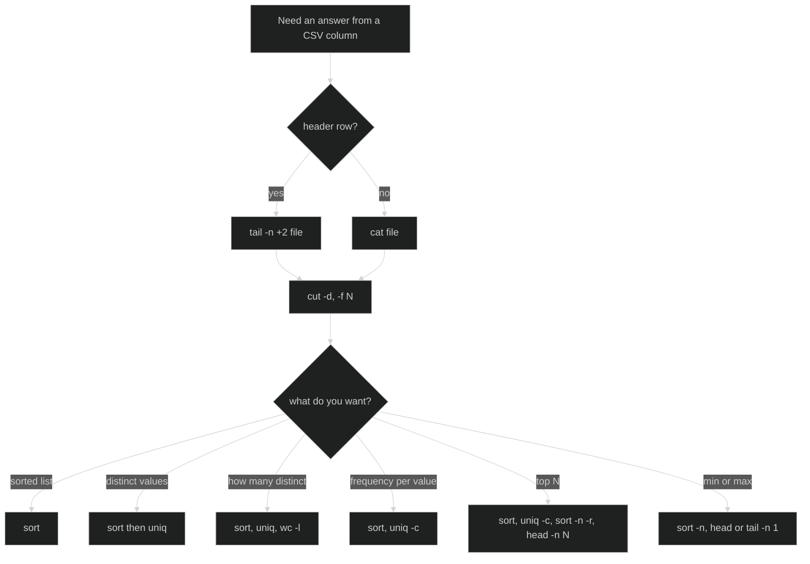

*Caption: choosing the Lab 1 pipeline shape (decision tree built from the 28 solved tasks).*

---

# Part O — Self-Check Questions (new, mixed types)

*Recall, why-explain, compare, and application questions written for these notes `(added context)`. Answers show working.*


#### Q1. (Recall)

List the four things every packet must carry and say which identifies the computer and which the process.

> **A:** Destination IP, destination port, source IP, source port. IPs identify the **computer**; ports identify the **process** (§E.4).

---

#### Q2. (Explain why)

Why must `sort` precede `uniq` in a pipeline?

> **A:** `uniq` only removes **adjacent** duplicates; `sort` makes equal lines adjacent first (§C.2).

---

#### Q3. (Calculation)

A laptop lists 20 GB RAM. How many bytes is that, and about how many 4-byte emoji could fit ignoring overhead?

> **A:** $20\times10^9 = 20{,}000{,}000{,}000$ bytes; $/4 = 5\times10^9$ emoji (five billion) (§A.3).

---

#### Q4. (Apply)

Write one pipeline that prints how many distinct ratings appear in `yum.csv`, then state the answer.

> **A:** `tail -n +2 yum.csv | cut -d',' -f4 | sort | uniq | wc -l` → ratings A, B, C ⇒ **3** (from the dataset in §C.3).

---

#### Q5. (Apply)

Using `yum.csv`, which command lists the three most expensive prices?

> **A:** `tail -n +2 yum.csv | cut -d',' -f3 | sort -n -r | head -n 3` → 20, 15, 12 (computed from the dataset).

---

#### Q6. (Compare)

Compare `chmod u=rw,go= f` with `chmod u=rw,go=r f`.

> **A:** Both give the owner read/write. The first removes **all** access for group and world (private, e.g. SSH key); the second lets them **read** only.

---

#### Q7. (Apply)

Your CWD is `/home/jones/projects`. What absolute path does `../../smith/reports` resolve to?

> **A:** `..` → `/home/jones`; `../..` → `/home`; then `smith/reports` ⇒ **`/home/smith/reports`**.

---

#### Q8. (Apply)

You run `./backup.sh` and get `Permission denied`. What do you do and why was it designed this way?

> **A:** `chmod u+x backup.sh`. Linux requires explicit execute permission so a downloaded file can't run accidentally (§D.8).

---

#### Q9. (Trace)

Starting in an empty directory, what does `ls` show after `mkdir a .b c`, and what shows `.b`?

> **A:** `ls` shows `a c`; `ls -a` shows `.b` too (and `.`/`..`).

---

#### Q10. (Explain why)

Why does `ls ../kiwi` work from `grape` but `cd kiwi` fails there?

> **A:** `../kiwi` goes up to `charlie` then `kiwi`; plain `kiwi` is a relative path under `grape`, which has no `kiwi`.

---

#### Q11. (Apply)

A process was suspended by accident. Give the exact keystrokes/commands to end it.

> **A:** `fg` then `Ctrl-c` (§B.6).

---

#### Q12. (Compare)

Compare program, process, foreground process, background process.

> **A:** Program = file in storage; process = running program in RAM; foreground = receiving your input; background = running without it.

---

#### Q13. (Apply)

A web page references 7 images and 1 stylesheet. How many HTTP requests does the browser make?

> **A:** 1 (HTML) + 7 + 1 = **9**.

---

#### Q14. (Apply)

You start `python -m http.server 8080` in `~/Documents`. A friend on your LAN opens `http://<your IP>:8080`. What risk exists?

> **A:** Everything in `~/Documents` is browsable by anyone on the LAN — wrong web root (§F.5).

---

#### Q15. (Apply)

`http://localhost:8000/fruits/../animals/cat/page1.html` maps to which file?

> **A:** `public_html/animals/cat/page1.html` (the `fruits/..` cancels out).

---

#### Q16. (Apply)

Which of these are private IPs: `10.9.9.9`, `172.20.1.1`, `172.40.1.1`, `192.169.0.1`, `192.168.255.1`?

> **A:** `10.9.9.9` ✔, `172.20.1.1` ✔ (within 172.16–31), `172.40.1.1` ✘ public, `192.169.0.1` ✘ public, `192.168.255.1` ✔.

---

#### Q17. (Explain why)

Why can your neighbour and you both use `192.168.0.10`?

> **A:** Private addresses aren't routable on the Internet and are only meaningful within one LAN; separate LANs never conflict (street-name analogy) (§G.2).

---

#### Q18. (Trace)

Trace a laptop (192.168.0.12) visiting a site through a router with public IP 203.0.113.45.

> **A:** Laptop → router; router NAT replaces source with 203.0.113.45 (+ new port) and records the mapping; site replies to the public IP; router looks up the mapping and forwards to 192.168.0.12 (§G.4).

---

#### Q19. (Diagnose)

`ping example.com` fails with "name resolution" but `ping 1.1.1.1` works. What's wrong?

> **A:** DNS resolution is failing, but basic connectivity is fine.

---

#### Q20. (Diagnose)

`nmap host -p 80` says `filtered` while the web server is running. Most likely cause?

> **A:** A firewall/security group is dropping port-80 probes (e.g. no inbound rule for 80).

---

#### Q21. (Compare)

Compare nmap `closed` and `filtered`.

> **A:** Closed: host replies, nothing listening. Filtered: no usable reply because a firewall blocks; the true state is unknown.

---

#### Q22. (Explain why)

Why does 127.0.0.1 still work in airplane mode?

> **A:** Traffic loops back inside the device's own network stack; no external network is used.

---

#### Q23. (Compare)

Compare symmetric and public-key encryption.

> **A:** Symmetric: one shared key; the key must be exchanged securely (if intercepted everything is compromised). Public-key: public key encrypts, private key decrypts; the private key never travels.

---

#### Q24. (Calculation)

Encrypt `NETWORK` with the Caesar shift-3 cipher.

> **A:** N→Q, E→H, T→W, W→Z, O→R, R→U, K→N ⇒ **QHWZRUN**.

---

#### Q25. (Calculation)

Decrypt `VHFXULWB` (shift 3).

> **A:** V→S, H→E, F→C, X→U, U→R, L→I, W→T, B→Y ⇒ **SECURITY**.

---

#### Q26. (Classify)

Map each incident to a CIA pillar: (a) leaked patient file; (b) altered account balance; (c) site down under request flood.

> **A:** (a) Confidentiality; (b) Integrity; (c) Availability.

---

#### Q27. (Apply)

Your EC2 web server runs on port 80 but the browser times out. List checks in order.

> **A:** (1) `ping`/connectivity; (2) `dig` if using a name; (3) `nmap IP -p 80`: `filtered` ⇒ add an inbound Security Group rule for 80 from `0.0.0.0/0`; `closed` ⇒ start the server; `open` ⇒ check content/web root.

---

#### Q28. (Apply)

`ssh` refuses your key file. What command fixes it and why?

> **A:** `chmod u=rw,go= is114-keypair.pem` — SSH rejects keys readable by others.

---

#### Q29. (Evaluate)

A team proposes SMS codes as their 2FA. Evaluate.

> **A:** It meets "two factors", but SMS is unencrypted in transit, vulnerable to SIM-swapping and phishing; CISA recommends against it — prefer an authenticator app/hardware token.

---

#### Q30. (Case)

In the IoT case study, name the tier and technology that stops the public Internet from reaching SSH.

> **A:** Tier 4: the AWS Security Group inbound rule restricting port 22 to administrator IPs (a firewall/access control policy) (§J).

---

#### Q31. (Case)

Why do developers test on `127.0.0.1:8000` before deploying to EC2?

> **A:** It keeps unfinished code and flaws off the public Internet and needs no external network (§J).

---

#### Q32. (Compare)

Compare on-premise vs public cloud vs hybrid.

> **A:** On-premise: you own/maintain hardware. Public: rent from a provider, pay-as-you-go, any subscriber. Hybrid: combine private/on-premise (e.g. sensitive data) with public (e.g. web front end).

---
